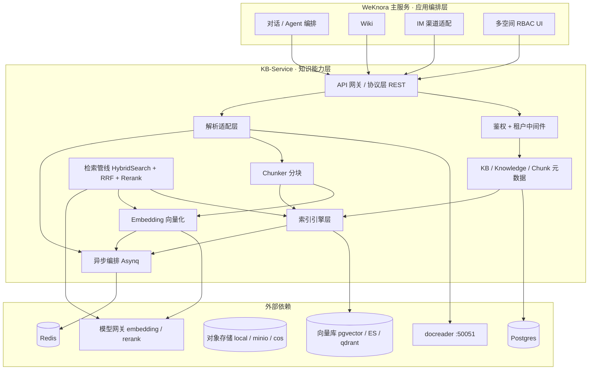
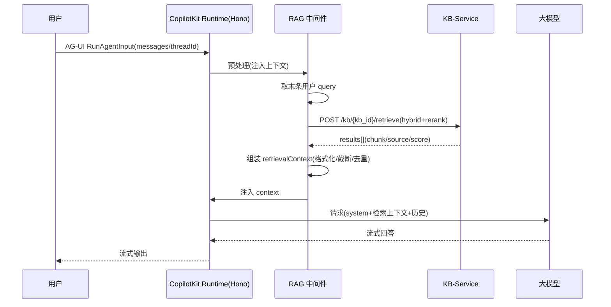

# WeKnora 知识库能力抽离与 OpenBot 接入方案

> 出品：阿客实验室 · 研发部（主理人 岑执衡）
> 参与：顾图南（架构）、霍承钧（接口与接入）、宋砚秋（数据模型）、韩渡川（部署运维）、关千锤（对比验收）
> 日期：2026-10-11

---

## 摘要

WeKnora 的知识库能力（文档解析 → 切分 → 向量化 → 索引 → 混合检索 → 重排）与对话/Agent 编排、Wiki、IM 渠道、多空间 RBAC 深度耦合于同一 Go 单体中。本方案提出将其**整建制抽离为独立的 KB-Service**（知识能力层），使 WeKnora 主服务退化为纯编排层（应用层）；随后在 OpenBot（Hono + CopilotKit Runtime，AG-UI 协议）中通过**「中间件注入为主 + 检索工具为辅」的非 MCP 方式**接入该服务，实现对话自动接地与可治理的按需检索。

---

## 一、WeKnora 知识库模块梳理（现状）

### 1.1 文档解析与切分

- **解析服务 docreader**（Python，独立进程，gRPC `:50051`）：
  - 解析引擎：`pdf / docx / doc / xlsx / md / html / epub / mhtml / xmind / 图片`（builtin），`markitdown`（pptx/ppt/csv），`opendataloader`（PDF 版面分析，需 JVM）。
  - gRPC 契约：`ReadRequest{file_content|url, file_type, parser_engine}` → `ReadResponse{markdown_content, image_refs, source_blocks, metadata}`；另有 `ReadStream` 流式（规避大 PDF 消息上限）与 `ListEngines`。
  - 鉴权：mTLS/TLS + `Bearer` token（服务端 `AuthInterceptor` HMAC 比对）。
- **Go 侧分块**（`internal/infrastructure/chunker`）：策略 `auto / heading / heuristic / recursive / legacy`，父子分块 `parent-child`（默认父 4096 / 子 384），默认 chunk=512 / overlap=80；多解析引擎可在 Go 进程内（`builtin / simple / anydoc`）或经 docreader。

### 1.2 向量化与索引

- **Embedding 抽象**（`internal/models/embedding`）：`Embedder` 接口；local（Ollama）与 remote（openai / dashscope / ark / google 协议）；批量 `batch size=5`，带重试策略。
- **索引与检索后端抽象**（`RetrieveEngineRepository / RetrieveEngineService`）：后端可选 `pgvector + ParadeDB`（Postgres，默认）、`Elasticsearch v7/v8`、`OpenSearch`、`Qdrant`、`Milvus`、`Weaviate`、`Doris`、`Tencent VectorDB`、`SQLite`。
- **异步编排**：Asynq + Redis，任务类型 `ProcessDocument / ProcessSummaryGeneration / ProcessQuestionGeneration` 等；Chunk 状态机 `stored → indexed`，文档 `ParseStatus: pending/processing/completed/failed`。

### 1.3 混合检索、召回与重排

- **混合检索**：`HybridSearch → fan-out（errgroup，并发 4）→ 向量 + BM25 双路召回`。
- **融合**：RRF（`k=60`，向量/关键词权重 `0.7 / 0.3`）归一化到 `[0,1]`。
- **重排**：纯 Go `MMR`（`lambda=0.7`，Jaccard 去重）+ 复合分 `0.6*model + 0.3*base + 0.1*source`；外部模型 `cohere / dashscope / nim / tei / lkeap / volcengine`。
- **结果结构**：`SearchResult{score, match_type, chunk, knowledge, source, page, metadata}`。

### 1.4 知识库与文档数据模型

| 表 | 关键字段 |
|---|---|
| `knowledge_bases` | id、tenant_id、type(document/faq/wiki)、chunking_config(JSONB)、embedding_model_id、vector_store_id、indexing_strategy、storage_provider |
| `knowledges` | id、tenant_id、knowledge_base_id、title、source、parse_status、file_*、embedding_model_id |
| `chunks` | id、tenant_id、knowledge_base_id、knowledge_id、content、chunk_index、start/end_at、pre/next_chunk_id、chunk_type、parent_chunk_id、image_info、status、index_status、context_header、source_locators |
| `vector_stores` | tenant_id、engine_type、connection_config(JSONB 加密)、index_config |

**多租户隔离**：三张主表统一以 `tenant_id(uint64)` 逻辑隔离，查询均带 tenant_id 条件；向量在 pgvector `embeddings` 表（halfvec + HNSW），BM25 用 ParadeDB `pg_search`。

### 1.5 对外 API 接口

- Gin REST：`/knowledge-bases`（CRUD + `hybrid-search`）、`/knowledge-bases/:id/knowledge`（file/url/manual 上传、list、folders）、`/knowledge`（get/delete/reparse/cancel/download/preview/search/move/tags）、`/chunks`、FAQ、Wiki。
- 鉴权：JWT + 四级角色（Viewer/Contributor/OwnedKBOrAdmin/Admin）+ API Key 能力点（`retrieve / ingest / manage_kbs / full-access`），per-KB 归属与跨租户共享。
- 提供 Go 客户端 SDK（`client/`）。

### 1.6 存储与配置依赖

- **组件**：Postgres（元数据 + pgvector + ParadeDB）、Redis（Asynq 队列 + stream）、docreader（gRPC）、embedding/rerank 模型、对象存储（local/minio/cos/s3/oss）。
- **可选**：Neo4j（知识图谱）、Langfuse（追踪）、Nacos（动态配置/注册）。
- **环境变量**：`DB_DRIVER=postgres`、`RETRIEVE_DRIVER=postgres`、`DOCREADER_ADDR`、`REDIS_ADDR`、`STORAGE_TYPE=local` 等（见 `config/config.yaml` 与 `.env`）。

---

## 二、知识库能力抽离方案（KB-Service）

### 2.1 服务边界与职责划分

| 层 | 归属 | 职责 |
|---|---|---|
| 应用编排层 | **WeKnora 主服务** | 对话与 Agent 编排、工具调用、会话/消息管理、Wiki 页面渲染、IM 渠道适配（企微/飞书/公众号）、多空间 RBAC UI 与成员管理 |
| 知识能力层 | **KB-Service** | 文档解析（docreader 代理与引擎选择）、分块、向量化、索引与存储、混合检索管线（召回+RRF+重排）、KB/文档/分块元数据 CRUD 与生命周期、异步任务编排 |

主服务不再落库，仅以「客户端身份」调用 KB-Service。

### 2.2 需要剥离 / 新建的模块

**剥离（Go 单体 → KB-Service）**：
- docreader client 封装；chunker 分块包（全策略）；embedding 包（Embedder 接口 + 各协议实现）；retriever 引擎包（9 种后端 + vector_stores 仓储）；reranking 包（纯 Go MMR + 外部模型）；knowledgebase/knowledge/chunk 三层（service + repository + handler + types）；对象存储适配。

**新建**：
- 独立 API 网关/协议层（对外 REST，可选内部 gRPC）；鉴权中间件（API Key + 能力点）；租户隔离中间件（tenant_id 注入与强制校验）；健康检查（liveness/readiness）；异步任务状态接口；独立配置模块（与主服务解耦）。

### 2.3 架构示意

**核心取舍**：以「能力完整内聚、协议统一收敛」为原则，将「解析 → 检索」全链路整建制迁入 KB-Service，主服务退化为纯编排层，二者仅经鉴权网关通信，租户与异步任务在服务内闭环。

### 2.4 数据模型与多租户隔离（宋砚秋）

**Schema 精简**：KB-Service 只保留检索必需字段，删除主服务才有的 RBAC/分享/渠道/审核字段。原 `knowledges` 更名 `documents`，`embeddings` 独立成表以解耦向量库切换，新增 `index_tasks` 驱动索引状态机。

**隔离方案（推荐分层混合）**：
- 元数据层：`tenant_id` 单库逻辑隔离（GORM Scope/拦截器统一注入，杜绝漏写）。
- 向量层：pgvector 用 `embeddings` 表加 `tenant_id/knowledge_base_id` 过滤；外部库用 `kb_{tenant_id}_{kb_id}` 命名。
- 对象存储：前缀 `{tenant_id}/{kb_id}/{document_id}/{file}`，路径级隔离与批量清理。

**存储选型**：Postgres 16 + pgvector（默认，<千万向量够用，生产可换 Qdrant）+ ParadeDB BM25 + MinIO/local（生产 COS/S3）+ Redis + Asynq。

**索引要点**：chunk 表建 `(knowledge_base_id, chunk_index)`、`(knowledge_base_id, status, index_status)` 复合索引；HNSW `m=16 / ef_construction=64~128 / ef_search=40~80`；检索只返回 `index_status=indexed` 的 chunk；删除软删先行、物理删除异步化（先删向量/BM25/对象存储，再删 DB 行）。

### 2.5 部署与资源开销（韩渡川）

**拓扑**：KB-Service（无状态 Go API）+ 独立 docreader 解析队列；与主服务共享 Postgres/Redis/对象存储控制面，仅 docreader 与模型服务按需独立。

**资源估算**：

| 档位 | CPU/内存 | 磁盘 | 配置要点 |
|---|---|---|---|
| 最小可运行 | 2C / 3~4GB | 50GB | embedding 走远端 API、rerank 用纯 Go MMR、docreader 1 worker |
| 生产建议 | 8~12C / 16~24GB | 200GB+ | kb-service 2 副本、docreader 2 副本、Postgres 4C/8GB、embedding 本地 GPU 或 4C/8GB |

**资源大头**：① docreader（PDF DPI200 + markitdown/opendataloader，opendataloader 需 JVM）；② embedding/rerank 模型（本地 Ollama 吃内存/GPU，远端 API 可省）。

**关键环境变量**：`DB_DSN`、`VECTOR_STORE`、`DOCREADER_ADDR`、`EMBEDDING_PROVIDER/BASE_URL/MODEL`、`RERANK_PROVIDER`、`STORAGE_TYPE/S3_*`、`JWT_SECRET/API_KEY`、`REDIS_ADDR/ASYNQ_CONCURRENCY`。

---

## 三、对外接口契约要点（霍承钧）

### 3.1 核心接口清单

| # | 方法 + 路径 | 关键请求字段 | 关键响应字段 |
|---|---|---|---|
| 1 | `POST /kb` | name、embedder、chunk_size、chunk_overlap、rerank_model | kb_id、created_at |
| 2 | `POST /kb/{kb_id}/documents` | type=file/url/text；file 或 url 或 content+title；metadata | task_id（异步） |
| 3 | `GET /kb/{kb_id}/tasks/{task_id}` | — | status、progress(0-100)、chunks_done/total、error |
| 4 | `POST /kb/{kb_id}/retrieve` | query、top_k=5、score_threshold、rerank、hybrid、filters | results[]：chunk_id/doc_id/content/score/source/page/metadata |
| 5 | `GET /kb/{kb_id}/documents` | page、page_size、status | items[]：doc_id/title/status/chunk_count |
| 6 | `DELETE /kb/{kb_id}/documents/{doc_id}` | — | deleted:true |
| 7 | `DELETE /kb/{kb_id}` | — | deleted:true |
| 8 | `GET /kb/{kb_id}` | — | kb 元信息 + doc_count |

补充：`GET /kb`（列库）、`GET /kb/{kb_id}/documents/{doc_id}`（详情）、`POST /kb/{kb_id}/documents/{doc_id}/reparse`（异步重解析）。

### 3.2 鉴权与多知识库隔离

- **API Key**：`Authorization: Bearer <api_key>`，每 key 绑定 `tenant_id` + `role ∈ {read, write, admin}` + 作用域 `kb_ids[]`（空=租户内全库）；密钥入库存哈希。
- **隔离**：`tenant_id → kb_id → documents/chunks` 三级；所有查询从 key 解析 tenant_id（不信任客户端传参），kb_id 归属校验，杜绝越权横库。
- **错误码**：`400` 参数、`401` 鉴权、`403` 越权、`404` 不存在、`409` 冲突、`422` 解析失败、`429` 限流、`500/503` 依赖不可用；统一 `{code, message, request_id}`。

### 3.3 异步契约

上传/解析/向量化走 Asynq+Redis：`POST` 返回 `202 {task_id}`，文档立即落库 `status=pending`；轮询 `GET /tasks/{task_id}` 返回 `{status, progress, chunks_done/total, error}`；可选 `callback_url` 推送结果。

---

## 四、OpenBot 接入方案（非 MCP）

### 4.1 调用链路与数据流

### 4.2 对话流程插入位置（两个 seam）

| 方式 | 位置 | 数据流差异 |
|---|---|---|
| **中间件注入式**（主） | 仿 `PersonalMemoryMiddleware`（`server/src/.../memory/tools.ts:29`），在 `copilot.ts:703` `built.use()` 挂载 | 每次 run 前自动检索 top-k 并注入 `system/context` |
| **工具式**（辅） | 封装 `GrantedTool{name:"search_kb", parameters:zod, execute}`，注册进 `loadToolsForActor()`（`server/src/index.ts:1187`） | 模型自主决定何时调用，走 `store.callTool` 授权/审计 |

### 4.3 会话上下文与检索结果结合

1. 每条 result 构造 `[来源 title | 第 page 页 | score]` 头 + `content` 体；
2. 按 score 降序、top_k 截断，单条 content 按 chunk_size 上限截断；
3. 去重：content 归一化后哈希去重 + 标题/分数近似去重；
4. 组装为固定模板，注入 system prompt 的 `[检索资料]` 段，附引用序号 `[1][2]` 供回答末尾生成 citations。

### 4.4 检索失败 / 无结果降级

| 场景 | 处理 |
|---|---|
| 检索超时 | 设 800ms~1.5s 超时，超时即降级为「无检索直接回答」并打日志 |
| 无结果 | 跳过注入，LLM 明示「知识库未找到相关内容」 |
| 服务不可用(503/连接失败) | 短路降级直接回答；可选熔断（连续 N 次失败暂停 M 秒） |
| 低分过滤 | score_threshold 以下丢弃；过滤后为空等同「无结果」 |

**核心原则**：检索是增强而非必需，失败必须静默降级、不阻断主流程，仅记录结构化日志供观测。

---

## 五、集成方式对比与推荐（关千锤）

| 维度 | ① 工具式 GrantedTool | ② 中间件注入式 | ③ 独立 agent 端点式 |
|---|---|---|---|
| 原理 | 检索封装为 GrantedTool，模型按需调用，走授权/审计网关 | AG-UI Middleware 每次 run 前自动检索注入上下文 | KB-Service 包装为 AG-UI agent 端点，远端 Bot 方式接入 |
| 优点 | 复用授权/审计/zod 治理；token 可控；实现简单 | 无感、不占工具轮次、默认接地 | 完全解耦，可独立扩缩容/多租户 |
| 缺点 | 依赖模型判断（可能漏检/多检）；多一跳工具延迟 | 每 run 固定检索开销；越权面需自行兜底 | 多一跳网络 + 独立运维 + 需实现完整 AG-UI 协议 |
| 改动量 | 小（1 工具 + 注册） | 中（中间件 + 挂载 + tenant 映射） | 大（新服务 + 协议适配） |

**推荐结论：方式②为主 + 方式①为辅**。先落地中间件注入打通无感检索（默认底座），再补工具式让模型在需精确/多跳查询时主动调用（复用审计网关）。方式③仅在出现独立编排/团队分工诉求时再演进，现阶段收益不抵成本。

---

## 六、分阶段实施步骤

| 阶段 | 目标 | 关键动作 | 验收标准 |
|---|---|---|---|
| **P0 跑通检索链路** | 验证 KB-Service 检索可用并接入注入 | KB 检索 client + 中间件原型 + tenant 映射 + 熔断降级 | 一个 Bot 每次 run 自动携带 top-k 片段；关停 KB-Service 对话不中断 |
| **P1 补治理与工具式** | 治理到位、模型可主动检索 | GrantedTool 注册进 loadToolsForActor；接授权/审计；日志脱敏、越权测试 | 模型可显式调用检索且全程留痕；越权用例通过 |
| **P2 管理能力** | 文档全生命周期 | 对接上传/解析(task)、删除同步失效索引、状态反馈、定期对账 | 上传→可检索，删除→无残留；异步任务状态可查询 |
| **P3 规模化与合规** | 多租户隔离、性能、合规加固 | 缓存/限流/连接池、灰度升级、数据留存与删除合规、监控告警 | 压测达标、跨租户隔离回归通过、合规清单落地 |

---

## 七、风险点清单

| 类别 | 风险 | 缓解措施 |
|---|---|---|
| 安全 | 越权 / tenant 混淆 | OpenBot 按 actorId/botId 映射 tenant，机器 token 最小权限，KB-Service 强制 tenant 校验 |
| 安全 | 检索片段提示注入 | 片段转义 + 隔离标注（"以下为知识库内容，仅作参考"），不赋指令权重 |
| 安全 | 跨租户召回 / 日志泄露 | 检索请求带 tenant 头、日志脱敏、最小化上下文注入量 |
| 性能 | 每次 run 串行检索抬升首 token 延迟 | 异步预热/缓存 top-k、超时熔断、降级为「无知识库」 |
| 性能 | 大文档解析耗时 | 异步 task 化、chunk 限制、分页 |
| 一致性 | 索引延迟（上传后非立即可见） | 明确最终一致语义，返回重索引状态 |
| 一致性 | 删除后向量/BM25 残留 | 删除接口同步失效索引 + 定期对账清理 |
| 运维 | KB-Service 宕机 | 熔断降级、健康检查、指数退避重试 |
| 运维 | 升级 / 向量模型变更 | 版本化 API、灰度、回滚预案 |
| 合规 | 数据留存 / 跨境 | 明确存储位置与保留策略，删除即删索引，全程审计留痕 |

---

## 附录：结论

本方案以「能力内聚、协议收敛、检索增强非必需」三条原则为主线：KB-Service 将 WeKnora 解析到检索全链路独立成服务，主服务与 OpenBot 均以轻量客户端接入；OpenBot 侧采用「中间件注入 + 检索工具」组合，在复用既有治理（授权/审计/AG-UI 中间件）的前提下，以最小改动实现对话自动接地，并以 P0→P3 四个阶段可控推进、全程配套降级与风险预案。
