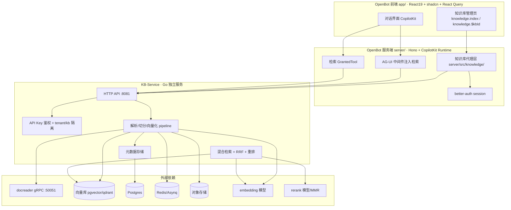
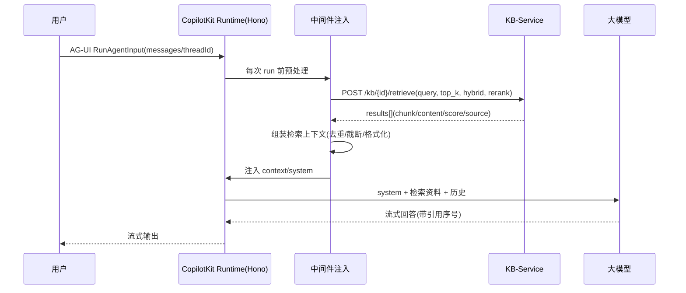

# WeKnora 集成 OpenBot 技术方案（实施版）

> 版本：v1.0 · 日期：2026-10-11 · 状态：可实施
> 适用读者：OpenBot 研发与部署团队
> 前置文档：《WeKnora知识库服务抽离与OpenBot接入方案.md》（架构设计稿）

---

## 0. 文档导览

本方案是「将 WeKnora 的知识库能力集成进 OpenBot」的**落地实施文档**，承接前序架构设计稿，明确到可执行的步骤、前置条件、验收标准与回滚路径。

核心结论一句话：**不采用 MCP 方式，而是把 WeKnora 的知识库能力抽离为独立 KB-Service（HTTP REST + API Key），OpenBot 以「服务端代理 + 中间件注入检索 + 检索工具」三条链路接入，前端采用原生重写（React + shadcn）。**

---

## 1. 集成目标与预期效果

### 1.1 目标

| 编号 | 目标 | 说明 |
|---|---|---|
| G1 | OpenBot 的 Bot 具备「企业知识库检索增强（RAG）」能力 | 用户提问时自动检索知识库，用检索结果接地 LLM 回答 |
| G2 | 知识库可管理 | 在 OpenBot 前端完成建库、上传文档（文件/URL/文本）、删除、查看解析状态、检索测试 |
| G3 | 鉴权统一、多知识库隔离 | 复用 OpenBot 的 better-auth 会话；知识库服务端按 tenant/kb 隔离，前端不接触服务端密钥 |
| G4 | 检索失败不阻断对话 | 检索超时/无结果/服务不可用时静默降级，对话主流程照常 |
| G5 | 能力可复用、可独立扩缩容 | KB-Service 与 OpenBot 主服务解耦，可独立部署与升级 |

### 1.2 预期效果（验收基线）

- 用户向 Bot 提问 → 首轮响应携带知识库命中片段的引用来源（citation）。
- 知识库未命中时，LLM 明确回答「知识库中未找到相关内容」，而不是幻觉编造。
- 关停 KB-Service 后，OpenBot 对话功能不受影响（降级为纯 LLM 回答）。
- 前端知识库页可完成「建库 → 上传 → 解析完成 → 检索命中 → 删除」全闭环。

### 1.3 范围与非目标

**范围内**：文档文本/URL/文件上传、切分、向量化、混合检索（向量+关键词）、重排、检索结果注入对话、知识库与文档的 CRUD。

**非目标（本期不做）**：FAQ 与 Wiki 模块、图谱（Neo4j）、IM 渠道适配（企微/飞书）、多空间 RBAC UI、WeKnora 主服务的对话/Agent 编排能力。这些能力留在 WeKnora 主服务或后续迭代。

---

## 2. 方案总览（关键决策）

| 决策点 | 结论 | 理由 |
|---|---|---|
| 接入方式 | **非 MCP**，HTTP 直连 | 避免引入 MCP 运行时与协议开销；复用 OpenBot 现有 Hono 中间件与授权体系 |
| 服务形态 | WeKnora 知识库能力**整建制抽离为 KB-Service** | 解析→切分→向量化→索引→检索→重排→元数据 内聚为一个服务 |
| 对话接入 | **中间件注入为主 + GrantedTool 检索工具为辅** | 注入式低延迟、每次必检索；工具式用于模型主动精确查询 |
| 前端 | **原生重写**（React + shadcn） | Vue→React 源码复用成本高于重写；鉴权天然统一 |
| 鉴权 | OpenBot 会话（前端）+ API Key（服务间）双层 | 前端不接触 KB-Service 密钥，服务端代理隔离 |

---

## 3. 整体架构设计与数据流向

### 3.1 架构分层



### 3.2 管理数据流（前端 → KB-Service）

```
用户操作(建库/上传/删除)
  → OpenBot app 页面 (lib/knowledge.ts 封装)
  → /api/knowledge/*  (OpenBot server, requireUser 鉴权)
  → server/src/knowledge/client.ts (注入 Bearer <apiKey>)
  → KB-Service /kb/* (API Key 鉴权 + tenant 隔离)
  → 异步 pipeline (切分→向量化→索引)
  → 状态经 task 轮询回显
```

**关键点**：OpenBot server 对请求体（JSON/multipart）**不做解释地透传**，只注入鉴权头，把 KB-Service 的 API Key 隔离在 Server 进程内；上游 404/403/409/422 原样回前端。

### 3.3 对话检索数据流（提问 → 回答）



### 3.4 鉴权链路

| 段 | 鉴权方式 | 说明 |
|---|---|---|
| 前端 → OpenBot server | better-auth cookie session | 复用 OpenBot 现有登录（含 SSO） |
| OpenBot server → KB-Service | `Authorization: Bearer <apiKey>` | 服务间密钥，仅存在于 server 进程 |
| KB-Service 内部 | API Key → `tenant_id` + `role` + `kb_ids` | 三级隔离，强制 tenant 过滤，不信任客户端传参 |

---

## 4. 关键模块改动点与接口对接

### 4.1 KB-Service（独立 Go 服务）✅ 已产出骨架

**位置**：`/Users/wuyongjun/trea/kb-service/`（与 WeKnora、OpenBot 平级）

**目录结构**：

```
kb-service/
├── go.mod · main.go          # 纯标准库，go run . 即启动(:8081)
└── internal/
    ├── config/   # 环境变量 + API Key 解析
    ├── model/    # KnowledgeBase / Document / Chunk / Task / SearchResult
    ├── store/    # 并发安全内存存储（生产替换 Postgres+pgvector）
    ├── auth/     # API Key 鉴权 + tenant/kb 隔离
    ├── ingest/   # chunker 切分 + Embedder 接口 + pipeline
    ├── retrieve/ # 关键词 TF + 向量余弦 → RRF(k=60, 0.7/0.3) 融合
    └── api/      # router / middleware / handlers
```

**接口契约（KB-Service 对外）**：

| 方法+路径 | 请求关键字段 | 响应关键字段 | 权限 |
|---|---|---|---|
| `POST /kb` | `name`、`description`、`embedder`、`chunk_size`(默认512)、`chunk_overlap`(默认80)、`rerank_model` | `id`、`tenant_id`、`created_at` | admin |
| `GET /kb` | — | `{items[], count}` | read |
| `GET /kb/{kb_id}` | — | KB 元信息 + `doc_count` | read |
| `DELETE /kb/{kb_id}` | — | `{deleted:true}` | admin |
| `POST /kb/{kb_id}/documents` | `type=file\|url\|text`；file(multipart) 或 `url` 或 `content`+`title`；`metadata` | `202 {task_id, doc_id}` | write |
| `GET /kb/{kb_id}/documents` | — | `{items[], count}` | read |
| `GET /kb/{kb_id}/documents/{doc_id}` | — | Document | read |
| `DELETE /kb/{kb_id}/documents/{doc_id}` | — | `{deleted:true}` | write |
| `GET /kb/{kb_id}/tasks/{task_id}` | — | `{status, progress, chunks_done, chunks_total, error}` | read |
| `POST /kb/{kb_id}/retrieve` | `query`、`top_k`(默认5)、`score_threshold`、`hybrid`(默认true)、`rerank` | `{results[]:{chunk_id,doc_id,content,score,source,metadata}, count}` | read |

**错误体统一**：`{code, message, request_id}`；状态码约定 `400/401/403/404/409/422/429/500/503`。

**鉴权配置**：`KB_API_KEYS` 格式 `<key>:<tenant_id>:<role>[:kb1,kb2;...]`（`;` 分隔多 key，`role ∈ read|write|admin`）。

**生产化扩展点（改接口实现，不动上层调用）**：

| 抽象 | 骨架实现 | 生产替换 |
|---|---|---|
| `ingest.Embedder` | 哈希向量占位 | Ollama/OpenAI 真实 embedding |
| `ingest.Split` | 固定窗口切分 | WeKnora 多策略 chunker（auto/heading/recursive/parent-child） |
| 文档解析 | 纯文本读取 | docreader gRPC 接 pdf/docx/xlsx/md 等 |
| `store.Store` | 内存 map | Postgres + pgvector + ParadeDB |
| 重排 | RRF 后直接截断 | 外部 rerank 或纯 Go MMR |

### 4.2 OpenBot Server 代理层 ✅ 已产出

**位置**：`server/src/knowledge/`

| 文件 | 职责 |
|---|---|
| `config.ts` | 读 `KB_SERVICE_URL` / `KB_SERVICE_API_KEY` / `KB_SERVICE_TIMEOUT_MS`；未配 URL 返回 `null`=功能关闭 |
| `types.ts` | snake_case 字段对齐 KB-Service wire format |
| `client.ts` | 统一注入 `Bearer <apiKey>`，非 2xx 抛 `KnowledgeServiceError`，含超时熔断 |
| `routes.ts` | 9 个 REST 端点，body/content-type 透传，`onError` 透传上游状态码 |

**挂载点**：`server/src/app.ts` 中 `app.route("/api/knowledge", createKnowledgeRoutes(knowledgeServiceConfig(), requireUser))`。

**代理端点 → 上游映射**：

| OpenBot 端点 | 上游 KB-Service |
|---|---|
| `GET/POST /api/knowledge/kb` | `GET/POST /kb` |
| `GET/DELETE /api/knowledge/kb/:id` | `GET/DELETE /kb/{id}` |
| `GET/POST /api/knowledge/kb/:id/documents` | `GET/POST /kb/{id}/documents` |
| `GET/DELETE /api/knowledge/kb/:id/documents/:docId` | `GET/DELETE /kb/{id}/documents/{docId}` |
| `GET /api/knowledge/kb/:id/tasks/:taskId` | `GET /kb/{id}/tasks/{taskId}` |
| `POST /api/knowledge/kb/:id/retrieve` | `POST /kb/{id}/retrieve` |

### 4.3 OpenBot App 前端 ✅ 已产出

| 文件 | 职责 |
|---|---|
| `app/src/lib/knowledge.ts` | 类型 + queryOptions + client 封装 + `uploadDocumentFile`（原生 fetch+FormData） |
| `app/src/routes/_authed/_app/knowledge.index.tsx` | 知识库列表 + 建库表单 |
| `app/src/routes/_authed/_app/knowledge.$kbId.tsx` | 详情页：上传(text/url/file) + 文档列表轮询 + 检索测试 |
| `app-sidebar.tsx` | 「知识库」导航项（IconBook2） |
| `locales/{en,zh-CN}/knowledge.json` + i18n 注册 + nav.json | 双语文案 |

**已通过验证**：server typecheck ✅、app typecheck ✅（routeTree 自动注册 `/knowledge`、`/knowledge/$kbId`）、biome check 零告警 ✅。

### 4.4 对话流程接入 ⏳ 待实施（本方案核心增量）

这是接入方案推荐的主路径，尚未落地，分两个插入点：

**（1）中间件注入式（主路径）**

仿 `PersonalMemoryMiddleware`（`server/src/.../memory/tools.ts:29`，`copilot.ts:703 built.use()` 挂载）新建 `KnowledgeRetrievalMiddleware`：

- 每次 run 前取末条用户 query；
- 调 `POST /kb/{kb_id}/retrieve`（超时 800ms~1.5s）；
- 命中则组装 `[来源 | 分数] content` 片段，去重、按 `score` 降序、`top_k` 截断、单条按 `chunk_size` 截断；
- 注入 system prompt 的 `[检索资料]` 段，附引用序号 `[1][2]`；
- 失败静默降级。

**（2）GrantedTool 检索工具（辅路径）**

把检索封装为 `GrantedTool{name:"search_knowledge", parameters:zod, execute}`，注册进 `loadToolsForActor()`（`server/src/index.ts:1187`），复用 `store.callTool` 授权/审计网关，供模型在需精确/多跳查询时主动调用。

**降级策略（两条链路通用）**：

| 场景 | 处理 |
|---|---|
| 检索超时 | 降级为无检索直接回答，记日志 |
| 无结果 | 跳过注入，LLM 明示「未找到相关内容」 |
| 服务不可用(503/连接失败) | 短路降级，可选熔断（连续 N 次失败暂停 M 秒） |
| 低分过滤 | `score_threshold` 以下丢弃，过滤后为空等同无结果 |

**核心原则**：检索是增强而非必需，失败静默降级、不抛错给用户，仅记录结构化日志。

### 4.5 会话上下文与检索结果结合

1. 每条 result 构造 `[来源 title | score]` 头 + `content` 体；
2. 按 `score` 降序、`top_k` 截断；
3. 去重：content 归一化（去空白/标点）后哈希去重；
4. 固定模板注入 `[检索资料]` 段，附引用序号供回答末尾生成 citations。

---

## 5. 配置与部署步骤（分阶段）

### P0 —— 跑通管理链路（✅ 已落地）

**前置条件**：Go 1.22+（已具备 Go 1.26.3）；OpenBot 现有 server/app 可编译。

**关键动作**（已完成）：
1. 产出 KB-Service 骨架并 `go build`/`go vet` 通过；
2. 产出 OpenBot server 代理层 + app 知识库页面 + 导航 + i18n；
3. server/app typecheck 与 biome 全绿。

**验收标准**：
- [x] `cd kb-service && go build ./...` exit 0；
- [x] `cd server && bun run typecheck` exit 0；
- [x] `cd app && bun run typecheck` exit 0；
- [x] 端到端：建库→上传→异步索引→检索→删除 全链路 curl 通过；
- [x] 多租户越权 403、read 角色建库 403、multipart 上传通过。

### P1 —— 对话检索接入（⏳ 待实施）

**前置条件**：P0 完成；KB-Service 部署并可达（`KB_SERVICE_URL` 已配）。

**关键动作**：
1. 新建 `server/src/knowledge/retrieval-middleware.ts`，实现注入式检索；
2. 在 `copilot.ts` 的 `built.use()` 挂载该中间件；
3. 新建检索 GrantedTool 并注册进 `loadToolsForActor()`；
4. 实现降级分支（超时/无结果/不可用）与结构化日志。

**验收标准**：
- [ ] 一个 Bot 每次 run 自动携带 top-k 片段（日志可观测）；
- [ ] 关停 KB-Service 后对话不中断（降级为纯 LLM）；
- [ ] 模型可显式调用检索工具且全程留痕（审计）；
- [ ] 越权用例（跨 tenant）测试通过。

### P2 —— 生产化存储与模型（⏳ 待实施）

**前置条件**：P1 完成；具备 Postgres+pgvector、embedding 端点、可选 docreader。

**关键动作**：
1. `store.Store` 接口实现 Postgres 版本（knowledge_bases/documents/chunks/index_tasks 表 + tenant_id 索引）；
2. `ingest.Embedder` 接真实 embedding（Ollama 或远端 API）；
3. 文档解析接 docreader gRPC（支持 pdf/docx 等二进制）；
4. 检索后端接 pgvector（HNSW）+ ParadeDB BM25；
5. 删除级联：软删先行，异步清向量/BM25/对象存储再物理删。

**验收标准**：
- [ ] 上传 PDF → 解析 → 可检索（真实 embedding）；
- [ ] 重启服务数据不丢失（持久化）；
- [ ] 删除文档后检索无残留；
- [ ] 千万级向量下检索 P95 < 500ms。

### P3 —— 规模化与合规（⏳ 待实施）

**前置条件**：P2 完成。

**关键动作**：缓存/限流/连接池、灰度升级、数据留存与删除合规、监控告警、跨租户隔离回归。

**验收标准**：
- [ ] 压测达标（并发/延迟）；
- [ ] 跨租户隔离回归通过；
- [ ] 合规清单落地（存储位置、保留策略、删除即删索引、审计留痕）。

---

## 6. 依赖与兼容性要求

### 6.1 KB-Service 运行时依赖

| 组件 | 骨架阶段 | 生产阶段 | 说明 |
|---|---|---|---|
| 运行时 | Go 1.22+ | 同 | 纯标准库，单二进制 |
| 元数据库 | 无（内存） | Postgres 16+ | 复用 GORM 风格模型 |
| 向量库 | 无（内存） | pgvector(halfvec+HNSW) 或 qdrant | 默认 pgvector |
| BM25 | 无（内存 TF） | ParadeDB pg_search | 与 PG 同库 |
| 任务队列 | goroutine | Redis + Asynq | 异步解析/索引 |
| 对象存储 | 无 | local/minio/cos/s3 | 文件落盘 |
| embedding | 占位 | Ollama 本地 / OpenAI 兼容 API | 批量 size=5 |
| rerank | 无 | 外部协议 或 纯 Go MMR | MMR 零资源可选 |
| docreader | 未接 | Python gRPC :50051 | 二进制文档解析 |

### 6.2 资源开销（两档）

| 档位 | 总 CPU/内存 | 配置要点 |
|---|---|---|
| 最小可运行 | 2C / 3~4GB | embedding 远端 API、rerank MMR、docreader 1 worker |
| 生产建议 | 8~12C / 16~24GB | kb-service 2 副本、docreader 2 副本、PG 4C/8GB、embedding 本地 GPU 或 4C/8GB |

> 大头在 docreader（PDF DPI200 解析、opendataloader 需 JVM）与 embedding/rerank 模型。

### 6.3 OpenBot 侧兼容性

- **环境变量**：`KB_SERVICE_URL`（未设则知识库功能关闭，`/api/knowledge/*` 返回 503，不影响其它功能）、`KB_SERVICE_API_KEY`、`KB_SERVICE_TIMEOUT_MS`（默认 10000）。
- **运行时**：复用现有 Bun + Hono + React Query + better-auth，无新增前端依赖。
- **不破坏现有功能**：新增路由挂载为增量 `app.route`，`requireUser` 复用现有守卫；前端仅新增路由页与导航项。

---

## 7. 潜在风险与回滚策略

### 7.1 风险清单

| 类别 | 风险 | 缓解措施 |
|---|---|---|
| 安全 | API Key 泄漏 / tenant 越权 | Key 只存 server 进程；KB-Service 强制 tenant 校验；日志脱敏 |
| 安全 | 检索片段提示注入 | 片段转义 + 标注「以下为知识库内容，仅作参考」，不赋指令权重 |
| 安全 | 跨租户召回 / 数据泄露 | 检索请求带 tenant 头，最小化上下文注入量 |
| 性能 | 每次 run 串行检索抬升首 token 延迟 | 异步预热/缓存 top-k、超时熔断、降级 |
| 性能 | 检索峰值打满 KB-Service | 连接池 + 限流 + 幂等 + 结果缓存 |
| 一致性 | 上传后索引延迟（非立即可见） | 明确最终一致语义，前端轮询 task 状态 |
| 一致性 | 删除后向量/BM25 残留 | 删除接口同步失效索引 + 定期对账清理 |
| 运维 | KB-Service 宕机 | 熔断降级（无知识库仍可对话）、健康检查、指数退避重试 |
| 运维 | 升级（接口/向量模型变更） | 版本化 API、灰度、回滚预案 |
| 合规 | 数据留存/跨境 | 明确存储位置、保留策略、删除即删索引、审计留痕 |

### 7.2 回滚策略

| 场景 | 回滚动作 |
|---|---|
| 前端页面异常 | 移除 `/knowledge` 路由与导航项（纯增量，删除即可，不影响其它页面） |
| 代理层异常 | 不设 `KB_SERVICE_URL`（配置即关闭），或 revert `server/src/knowledge/` 与 app.ts 挂载行 |
| 对话检索异常 | 中间件降级分支保证「不检索仍可对话」；紧急时关闭中间件挂载 |
| KB-Service 数据异常 | Postgres 逻辑备份 + WAL 归档；对象存储版本控制；DB 迁移用版本化 migration 工具回滚 |
| 升级回退 | 蓝绿：先回退 docreader（协议向后兼容）再回退 kb-service |

**回滚总原则**：所有接入点均为增量挂载/独立目录，任一环节异常均可「配置关闭 + 删除增量代码」实现秒级回退，不影响 OpenBot 既有对话与登录功能。

---

## 8. 附录

### 8.1 KB-Service 环境变量清单

| 变量 | 默认值 | 说明 |
|---|---|---|
| `KB_SERVICE_PORT` | `8081` | 服务监听端口 |
| `KB_API_KEYS` | `sk-test-123456:tenant-a:admin` | API Key，格式 `<key>:<tenant>:<role>[:kb1,kb2]`，`;` 分隔多 key |

### 8.2 OpenBot 侧环境变量清单

| 变量 | 默认值 | 说明 |
|---|---|---|
| `KB_SERVICE_URL` | 空 | KB-Service base URL；空则功能关闭 |
| `KB_SERVICE_API_KEY` | 空 | 服务间 API Key |
| `KB_SERVICE_TIMEOUT_MS` | `10000` | 上游请求超时（毫秒） |

### 8.3 关键文件索引

| 侧 | 路径 | 说明 |
|---|---|---|
| KB-Service | `kb-service/main.go` | 入口 |
| KB-Service | `kb-service/internal/api/router.go` | 路由装配 |
| KB-Service | `kb-service/internal/api/handlers.go` | 端点实现 |
| KB-Service | `kb-service/internal/auth/auth.go` | 鉴权与隔离 |
| OpenBot server | `server/src/knowledge/{config,types,client,routes}.ts` | 代理层 |
| OpenBot server | `server/src/app.ts` | 路由挂载 |
| OpenBot app | `app/src/lib/knowledge.ts` | 前端客户端 |
| OpenBot app | `app/src/routes/_authed/_app/knowledge.{index,$kbId}.tsx` | 页面 |
| OpenBot app | `app/src/components/app-sidebar/app-sidebar.tsx` | 导航 |

---

## 9. 实施建议（下一步）

按优先级推进：

1. **P1 落地**（对话检索接入）：新建检索中间件 + GrantedTool，这是「Bot 自动接地知识库」的核心价值闭环；
2. **P2 起步**（生产化存储）：先做 Postgres+pgvector 持久化与真实 embedding，让知识库真正可用；
3. 保留 KB-Service 骨架作为「契约参照 + 本地冒烟环境」，生产实现逐步替换抽象层。

> 附：前序架构设计稿《WeKnora知识库服务抽离与OpenBot接入方案.md》含更完整的模块剥离清单、数据模型表、部署拓扑 mermaid 图与 5 位工程师的分工结论，可对照阅读。
