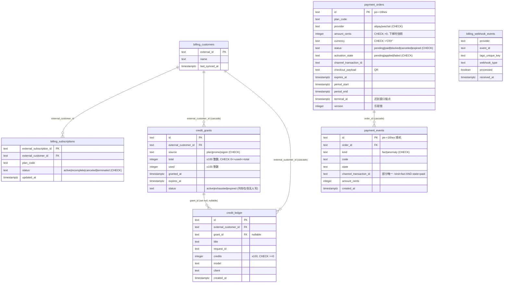
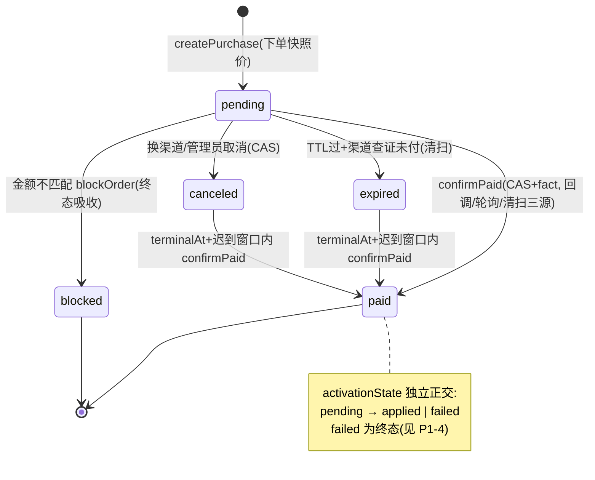
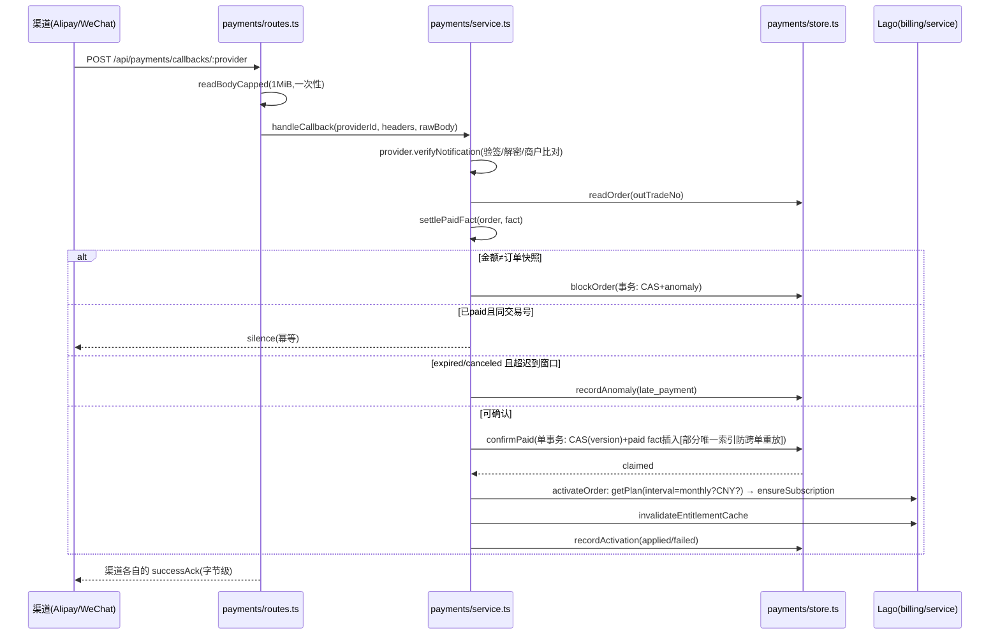
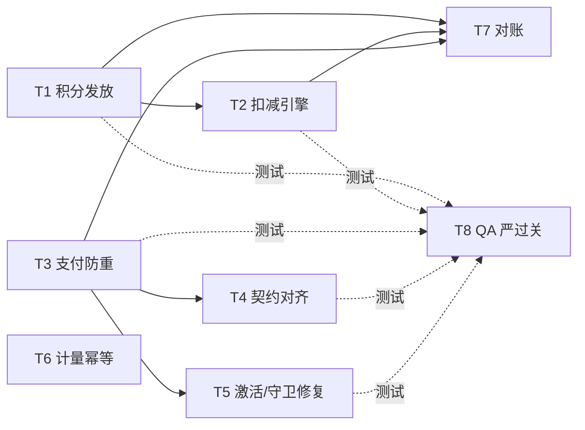

# OpenBot 计费模块（套餐/积分/账单/支付）设计评审报告

- 日期：2026-10-11
- 评审人：高见远（架构师）· software-company 专家团
- 评审方式：逐文件源码阅读，全部结论附文件+位置证据；未能从代码确证之处标注「未确认」
- 评审范围：套餐订阅（Lago 投影）、积分（credits）、账单（statements/invoices）、支付（alipay/wechat 直收）

---

## 一、现状说明

### 1.1 模块职责边界

**（a）Lago 投影层 `server/src/billing/`（订阅/计量/webhook）**
- `types.ts`：计费域中立词汇表（4 个 sentinel 错误码、Receipt、Entitlements、Statement/Credit 类型、`BillingService`/`BillingStore`/`WebhookVerifier` 接口）。Provider 词汇被隔离在 `lago.ts` 单文件。
- `lago.ts`：Lago HTTP 客户端唯一实现（native fetch、`redirect:"error"`、AbortSignal 超时、1MiB 读上限、429/5xx→`unreachable`、422 透传给 service 复读裁决；订阅历史按 liveliness 折叠 `foldSubscriptionHistory` L254-269）。
- `service.ts`：同步（read-before-create + 422 竞态复读）、webhook 编排（验签→inbox 查重→权威对象重读→投影→inbox 落行→200，L311-354）、entitlements 读（本地投影 + Lago 周期 courtesy 读）、usage 记账（fire-and-forget，`recordUsage` L394-428）。
- `store.ts`：`billing_customers`/`billing_subscriptions`/`billing_webhook_events` 的 upsert/inbox（`onConflictDoNothing` 防重）。
- `entitlement.ts`：per-customer TTL 缓存（成功 10min / 失败回退 fail-closed 60s，inFlight 去重）。
- `statements.ts`：套餐用量（=entitlements + Lago usage + 部署配额 `LAGO_PLAN_QUOTAS` JOIN）与账单列表（=本地 `payment_orders` 读作 statement）。
- `webhook-signature.ts`：JWT(RS256, alg 白名单, data-claim 结构等值比对)/HMAC 双模式验签；`raw-body.ts`：一次性、1MiB 封顶的原始体读取；`outbound.ts`：SSRF 出站门（scheme 白名单 + IP 表 + DNS 解析逐答案裁决）。

**（b）支付直收层 `server/src/billing/payments/`（支付宝/微信 → 本地订单 → Lago 激活）**
- `types.ts`：订单 5 态 + 激活 3 态 + `PaymentStore` 19 方法接口；`provider.ts`：渠道 seam（createSession/queryPayment/closePayment/verifyNotification/successAck）。
- `store.ts`：订单 CAS（version 乐观锁）+ `confirmPaid` 单事务（CAS + paid fact 插入，靠 `payment_events` 部分唯一索引跨单幂等）；短 id 冲突重试 5 次。
- `service.ts`：编排核心 `settlePaidFact`（金额门→重放裁决→迟到窗口→confirm 事务→激活）被回调/轮询/清扫三方共用。
- `alipay.ts`（官方 SDK 走同步调用、自研验签走异步通知）、`wechat.ts`（v3 签名 + AES-GCM 解密 + 时间偏斜窗口）、`channel-http.ts`（共享传输纪律）、`crypto.ts`（RSA/AES/精确分转换/证书序列）、`maintenance.ts`（60s 双清扫：过期 query-first + 激活重试）。

**（c）本地积分层 `server/src/billing/credits.ts` + `db/schema/credits.ts`**
- 只读模块：summary（plan/rewards 分列）/grants（临期排序）/consumption（窗口+分页）。状态派生不落库（`deriveGrantStatus`）。
- **关键事实：整个代码库不存在任何对 `credit_grants`/`credit_ledger` 的 INSERT/UPDATE 调用方**（全库 grep 仅 `credits.ts` 的 3 处 SELECT 与 schema/迁移文件），详见缺陷 P0-1。

**（d）装配与集成**
- `config.ts`：`LAGO_*`（API/验签/entitlements/quotas/planCatalog）、`PAYMENT_*`（渠道、价目、TTL、迟到窗口、外币开关）半配置即拒绝启动；支付渠道强制要求 billing 已配置（L2003-2007）。
- `index.ts` L3001-3240：出站门 fail-fast、`deploymentExternalCustomerId(tenantId)` 派生客户键（**单部署单客户**模型）、`setModelUsageMeter` 挂 LLM 计量、`reportCodeRunUsage` 挂代码运行计量、statements/credits 装配。
- `approvals/policy.ts`、`plugins/store.ts`、`computer/policy-listener.ts` 中 grep 无任何 credits 消费/校验调用点（policy.ts L106 的 "credit-card" 仅是审批黑名单正则）。
- `tenant-package.ts`：与计费无关（租户包 = 品牌/Bot/技能种子），仅 `tenantId` 参与客户键派生。

**（e）前端 `app/src/lib/billing/*` + `components/billing/*` + `settings/usage.tsx`**
- 类型镜像服务端契约（entitlements/credits/catalog/purchases/invoices），React Query 封装，404→`BillingUnavailableError` 区分「未配置」与「故障」。
- `usage.tsx` 四区块页（欢迎横幅/套餐卡/奖励积分/消耗明细），`upgrade-dialog.tsx` 三档套餐+四周期选择+扫码支付。

### 1.2 核心数据实体与关系

索引情况（已核对 `db/schema/*.ts` 与迁移 0065）：订阅按 customer 有索引；webhook inbox (provider,event_id) 唯一；payment_orders 有 (plan,provider,status) 普通索引（**非唯一**，见 P1-1）与 (status,expiresAt)；paid fact 部分唯一索引是全模块幂等基石。金额全整数分、积分 ×100 整数、时间全 `timestamptz`——精度纪律总体优秀。

### 1.3 关键状态机与流程

**支付单状态机（service.ts 文件头 + settlePaidFact 实现）：**

**支付回调时序（三源收敛核心）：**

**积分生命周期（设计意图 vs 实际）：** 派生状态机 `active→exhausted|expired`（credits.ts `deriveGrantStatus` L179-189，测试已钉死三态优先级）成立；但发放→扣减→过期回收的**写入链路整条不存在**（P0-1/P0-2）。

**订阅状态机：** 四态由 Lago 权威，本地仅投影；`ensureSubscription` 只认 live（active/incomplete），异套餐 live 存在即 terminal 冲突（service.ts L246-309）。

---

## 二、设计缺陷清单（核心交付物）

### 【P0-致命】

**P0-1 积分账本只有读路径，无任何写入方：发放、扣减、过期翻转全部缺失**
- 证据：`server/src/billing/credits.ts` 全文仅 summary/grants/consumption 三个 SELECT；全库 grep `insert(creditGrants`/`insert(creditLedger`/`update(creditGrants` 零命中（仅 schema 与迁移 0065 定义）。`db/schema/credits.ts:48-49` 注释宣称 "the sweeper flips the latter"，该 sweeper 不存在。支付激活成功路径 `payments/service.ts activateOrder`（L209-252）只做 getPlan→ensureSubscription→invalidateEntitlementCache→recordActivation，**不发放套餐积分**；也无任何 promo/signin 发放入口。
- 后果：套餐与积分页 summary/grants/consumption 永远空态；`credit_ledger.grant_id` 归因、过期、退款语义全部悬空；数据模型是「孤儿表」。前端全部积分 UI 是无数据来源的空壳。

**P0-2 积分/订阅不参与任何扣减与校验：模型调用只事后计量、不扣费、不拦余额**
- 证据：`index.ts` L3072-3090 `setModelUsageMeter` 与 `workshop/metering.ts` L36-59 均只调 `recordUsage`（fire-and-forget 上报 Lago）；无任何代码路径读取 credit summary 做余额判断（`approvals/policy.ts`、`plugins/store.ts`、`computer/policy-listener.ts` grep 均无 credits 调用点）。`billing/service.ts recordUsage` L397-404：无 active subscription 时 usage dropped 仅 `console.warn`，调用照常执行。
- 后果：付费墙不存在——无积分、无订阅的部署可无限免费使用；本地积分账与 Lago 计量两套账互不勾稽（见 P2-4 对账缺失）；「先扣后用/先用后扣」这一评审关注点当前答案是「都不扣」。

### 【P1-严重】

**P1-1 下单无原子防重：并发可产生同 (plan,provider) 双 pending 单；同套餐跨单重复支付不记异常**
- 证据：`payments/store.ts readPendingOrder`（L103-118）是普通 SELECT（newest wins）；`insertOrder`（L67-92）对 (planCode,provider,status) 无唯一约束（`db/schema/payment.ts` L87-93 仅普通索引）。`service.ts createPurchase`（L429-433）replay 检查与 `insertOrder` 之间无原子性。跨单重复检测仅覆盖 canceled 复活血单（`settlePaidFact` L371-384 `readLatestPaidOrder` 检查），fresh pending 单确认时不查。
- 后果：双击/双标签/超时重试 → 两张同时可付的 QR → 两笔都付（不同 channelTransactionId，paid fact 唯一索引拦不住）→ 双倍收款、一次权益、无 over_paid/duplicate_paid 异常记录，对账无法发现。

**P1-2 前端周期/渠道契约与后端购买接口断裂：四周期选择纯展示，永远按月价收月权益**
- 证据：`upgrade-dialog.tsx startCheckout`（L76-90）只传 `{planCode, provider:"alipay"}`——provider 硬编码（忽略 catalog.providers 与设计稿的微信扫码），cycle 状态完全不上送。服务端 `purchaseInput`（`payments/routes.ts` L134-140）只收 planCode+provider；`createPurchase` 按 `PAYMENT_PLAN_CATALOG` 月价快照；`settlePaidFact` L348-349 `periodEnd: addMonths(at, 1)` 硬编码 +1 月，`PaymentPlanConfig.periodMonths`（`config.ts` L1721-1725）被完全忽略。
- 后果：用户选「连续包年 ¥1344/年」实际按月价扣款、只获 1 个月权益（若 catalog 配了年价则直接多收）；年付周期不可购；「到期前一天自动续费」文案（L253-255）无任何续费实现支撑。属于会直接引发客诉/资损的契约级缺陷。

**P1-3 支付 QR 码经公共第三方服务渲染，支付凭据出域**
- 证据：`upgrade-dialog.tsx` L226 `https://api.qrserver.com/v1/create-qr-code/?data=${encodeURIComponent(order.checkout.payload)}`——把渠道返回的 code_url/qr_code（含商户号、订单号、金额）发给外部图片服务。
- 后果：支付链接被第三方留存/日志化，存在关联分析与中间人风险；应改本地 QR 库渲染（如 `qrcode` react 组件）。

**P1-4 activationState=failed 无任何重试路径，与代码注释承诺直接矛盾**
- 证据：`service.ts sweepActivations`（L641-653）只取 `listPaidPendingActivationOrders`（`store.ts` L343-356 过滤 `activation_state='pending'`）；`activateOrder`（L214-251）对 plan 缺失/interval≠monthly/币种不符写终态 `failed`。而 `PaymentService` 注释（L119-123）声称 "a failed activation … is retried here forever, so a rule fixed later still pays out"——实现相反。
- 迟到后果：钱已收、Lago 侧配置修复后订单永不激活，需人工改库；且无告警面。

**P1-5 单订阅守卫依赖 10 分钟 TTL 的 entitlement 缓存且失败回退 active:false，存在绕过与误判双窗口**
- 证据：`entitlement.ts` L19 `ANSWER_TTL_MS = 10*60_000`、L23-27 `FALLBACK = {active:false}`；`createPurchase` 守卫 `deps.activePlanCode()`（`service.ts` L419-427）在 `index.ts` L3185-3190 直读该缓存。`invalidateEntitlementCache` 仅在支付激活（L3191-3193）与 admin sync（`billing/routes.ts` L274）后调用。
- 后果：a) 缓存读失败回退 → 守卫判空放行 → 收款后 `ensureSubscription` 撞 live 异套餐终态失败（叠加 P1-4 形成钱收了不给权益且不重试）；b) 运营在 Lago 侧手工换套餐（无 webhook key 的部署投影不刷新）→ 10 分钟内购买被拒或放行错单。

### 【P2-一般】

**P2-1 LLM 计量 transactionId 含 Date.now()：重试不幂等、同毫秒同用量合并**
- 证据：`index.ts` L3081 `transactionId: \`llm-${key}-${Date.now()}-${input}-${output}\``，其上方注释（L3067-3071）宣称 "stable enough to deduplicate a retry"——不成立：重试产生新时间戳 → 同一调用双计量；同一毫秒两次相同 token 调用 → 同 id 被 Lago 去重合并 → 漏计。对照 `workshop/metering.ts` L45 `code-run:${runId}` 用业务 id 才是正确姿势。

**P2-2 payment_events 的 anomaly 行随机主键、无业务去重键：渠道重投导致异常行无限累积**
- 证据：`store.ts eventInput`（L52-63）用 `generateOutTradeNo()` 随机 id；anomaly 不受部分唯一索引约束（`schema/payment.ts` L133-135 仅 `kind='fact' AND state='paid'`）；`recordAnomaly`（L296-300）每次插入新行。渠道对 409/404/500 应答会持续重投同一通知（Alipay 重试机制），同一笔 late_payment 每次重投新增一行。
- 后果：事件表膨胀、对账噪音、异常统计失真。

**P2-3 金额缺失的 paid 事实可使订单永久 pending 并让清扫空转**
- 证据：`settlePaidFact` L266-278：`amountCents === undefined` → 记 `amount_unreadable` + 返回不确认；`sweepExpired`（L603-639）对 query 返回 paid 的单 `settle → continue`，**不 expire**。若渠道持续返回 paid 但不带金额（WeChat SUCCESS 通常带金额，Alipay total_amount 一般存在——属边缘场景，标注：触发概率低、未确认线上是否出现），该单每分钟被重复查询、永不终结。

**P2-4 账期双真相：本地 `payment_orders.period*`（支付时刻 +1 月）与 Lago `currentPeriod*` 各说各话**
- 证据：`service.ts` L348-349 本地写 `periodStart=at, periodEnd=at+1mo`；`statements.ts invoiceOf`（L202-216）账单用本地值，`planUsage`（L67-135）套餐卡用 provider 值（`service.ts` L180-200 courtesy 读）。两者起点不同（支付时刻 vs Lago 订阅创建时刻）。
- 后果：账单页「有效期至」与套餐卡「下次权益周期更新」可互相矛盾；勾稽（支付流水 ↔ 订阅周期 ↔ 积分发放）无从谈起。另 `reconcile()` 显式 `throw unsupported`（`service.ts` L559-561），全系统无对账作业。

**P2-5 webhook 投影接受任意 externalCustomerId，无归属过滤**
- 证据：`webhook-signature.ts deliveryOf`（L107-136）提取事件中任意客户 id；`service.ts refreshFor`（L158-165）对任意客户 `listSubscriptions` 并 upsert 本地投影。
- 后果：单 Lago 组织多客户部署（或验签密钥泄露时）本地投影表膨胀、snapshot 计数失真。entitlement 读按固定 key 查询不被污染，故降为 P2。

### 【P3-建议】

- **P3-1** `credit_grants.status` 存储列与 `deriveGrantStatus` 派生双真相（`credits.ts` L179-189 vs `schema/credits.ts` L49）；当前无写入方故无害，接入 P0-1 的发放逻辑后将成隐患——建议要么删列要么让写入方维护并加约束。
- **P3-2** `alipay.ts` L177-179 残留 `TEMP DIAGNOSTIC` `console.warn`，把 SDK 原始 error 字符串打进日志，违背本模块「错误只携带 sentinel code」的纪律（可能含 URL/参数）。
- **P3-3** `GET /api/billing/purchases/:id`（`payments/routes.ts` L204-210）不校验属主：任意登录用户可读任意单，pending 单的 checkout QR 对所有登录用户可见（`toView` L161-179）。id 为 16 hex 随机不可枚举，风险低；购买本身仅 admin（POST 有 requireAdmin），但读取面与写入面不对称。
- **P3-4** `readSubscriptions` 后 `find(status==="active")`（`service.ts` L176/372/398/442）在 provider 侧出现多个 active 记录时任意取第一条，无确定性排序。
- **P3-5** 展示层浮点：`statements.ts wholeUnits`（L53-56）用 `Number()` 解析 units 字符串、`credits.ts scaleDown`（L214-216）浮点除法进入 API。token 量级下精度尚可，但违背该模块自己「units 保持字符串以保精度」的声明（`types.ts` L119-121）。
- **P3-6** 前端 `upgrade-dialog.tsx` comparePlans 按钮 onClick 为空（L209-217）、autoRenew 文案无实现支撑；`usage.tsx windowFor`（L69-78）以浏览器本地时区构造「今天」窗口，与服务端/其他时区读者口径不一。
- **P3-7** 积分消费的幂等设计缺位前置提醒：`credit_ledger` 无 (request_id/幂等键) 唯一索引——实现扣减时（T2）必须补，否则重试将双扣。

### 值得保留的优点（避免重构时误伤）
支付幂等三件套（version CAS + confirmPaid 单事务 + paid fact 部分唯一索引跨单防重放）设计扎实；webhook「inbox 后置写入=完成态证明」的顺序（对照注释中 Go 版教训）；验签纪律（JWT alg 白名单 + data-claim 与 body 结构等值、WeChat 时间偏斜+商户比对、常量时间比较）；SSRF 出站门带 DNS 逐答案裁决；金额全整数分、积分 ×100；raw body 一次性封顶读取；query-first 清扫 + 迟到支付窗口防资损。

---

## 三、改进建议与重构方向

**数据模型层**
1. `credit_grants.status` 列删除或由唯一写入方维护（解决 P3-1）；为 `credit_ledger` 增加 `(external_customer_id, idempotency_key)` 唯一索引，为消费幂等铺路（前置解决 P3-7）。
2. `payment_orders` 增加 `(plan_code, provider)` 上的 partial unique index `WHERE status='pending'`，把「每对至多一张待付单」下沉为数据库约束（解决 P1-1）。
3. 账期唯一真相：`period_start/end` 改为激活时从 Lago `currentPeriod*` 回填，或全系统统一以 Lago 为准、本地列仅作展示缓存（解决 P2-4）。

**服务层（积分闭环）**
4. 新增 `creditWriter` 模块：`grantCredits(source, total, expiresAt, reason)` 与 `consumeCredits(amount, {title, requestId, model, client})`。扣减语义建议**先扣后用**：单事务内按 `expires_at ASC, granted_at ASC` 顺序对 live grant 执行原子 `UPDATE credit_grants SET used = used + n WHERE id=$1 AND used + n <= total`（行级原子，天然防并发超扣；check 约束 `used<=total` 是最后防线），跨 grant 拆分时循环分配，同事务写 `credit_ledger` 并带幂等键（解决 P0-1、P0-2）。
5. 支付激活成功后按 `LAGO_PLAN_CATALOG.credits` 发放 plan grant（周期对齐 Lago currentPeriodEnd）；新增 admin 发放 promo/signin 接口（挂 requireAdmin + audit，复用现有双 layer 模式）（解决 P0-1）。
6. 余额不足处理：`consumeCredits` 返回不足时在模型调用前置校验点返回明确错误码（建议 402 语义），并区分「无任何 live grant」与「余额不够」（解决 P0-2）。
7. LLM 计量 transactionId 改业务 id（run/session/request id），与 `code-run:${runId}` 对齐（解决 P2-1）。

**支付集成**
8. `createPurchase` 改为 `INSERT ... ON CONFLICT (partial unique) DO NOTHING RETURNING`，冲突即重读返回已有 pending 单；`settlePaidFact` 对 pending→paid 也执行 `readLatestPaidOrder` 跨单重复检测（解决 P1-1）。
9. 购买契约升级：`purchaseInput` 增加 `cycle`/`provider`（enum 校验），价格按所选周期快照，`periodEnd` 用 `addMonths(at, periodMonths)`；前端渠道选择 UI + provider 由 catalog.providers 驱动（解决 P1-2）；QR 改本地渲染（解决 P1-3）。
10. `sweepActivations` 将 `failed` 纳入重试（或提供 admin 手动重试端点 + 失败告警），并修正注释（解决 P1-4）。
11. 单订阅守卫改为直读投影（绕过 TTL 缓存）或在 createPurchase 前强制 `invalidateEntitlementCache`（解决 P1-5）。
12. anomaly 事件增加业务键 `(order_id, code, channel_transaction_id)` 唯一约束（on conflict do nothing）（解决 P2-2）；为 amount_unreadable 定义终结策略（N 次后转人工/告警）（解决 P2-3）。

**对账**
13. 落地 `reconcile()`：三向对账 payment_orders(paid) ↔ payment_events(fact) ↔ Lago 订阅/发票；积分侧 grants.total-Σledger.credits 恒等式校验；产出差异报告（解决 P2-4 及总体勾稽缺失）。

**前端**
14. 本地 QR 组件替换 qrserver（P1-3）；周期/渠道真实上送（P1-2）；移除超前文案或补齐能力（P3-6）；消耗窗口改服务端口径或 UTC（P3-6）。

---

## 四、任务拆分与分工计划

角色：寇豆码（工程师，实施）、严过关（QA，测试与验收）。批次为建议实施顺序。

| 任务 | 内容 | 主要文件 | 负责 | 依赖 | 批次 | 工作量 |
|---|---|---|---|---|---|---|
| T1 | 积分发放闭环：creditWriter.grantCredits + 支付激活后发 plan 积分 + admin 发放接口（含 audit）+ status 列处置 | billing/credits-writer.ts(新)、payments/service.ts、billing/routes.ts、db/schema/credits.ts | 寇豆码 | — | 1 | M |
| T2 | 积分扣减与校验引擎：原子 UPDATE 先扣后用、余额不足错误码、幂等键唯一索引、接入 meter 两个调用点 | billing/credits-writer.ts、db/schema/credits.ts、index.ts、workshop/metering.ts | 寇豆码 | T1 | 2 | L |
| T3 | 支付防重与跨单重复检测：partial unique index + ON CONFLICT 下单 + settle 全路径 duplicate 检测 | payments/store.ts、payments/service.ts、db/schema/payment.ts | 寇豆码 | — | 1 | S |
| T4 | 购买契约对齐：cycle/provider 上送与校验、periodMonths 生效、账期真相统一、前端渠道选择+本地 QR | payments/routes.ts、payments/service.ts、statements.ts、upgrade-dialog.tsx | 寇豆码 | T3 | 2 | M |
| T5 | 激活与守卫修复：failed 重试/人工端点+告警、createPurchase 绕过缓存读投影、anomaly 业务键、amount_unreadable 终结 | payments/service.ts、payments/store.ts、db/schema/payment.ts、billing/service.ts | 寇豆码 | T3 | 2 | S |
| T6 | 计量幂等修复：llm transactionId 改业务 id，统一 metering 入口 | index.ts、workshop/metering.ts | 寇豆码 | — | 1 | S |
| T7 | 对账骨架：reconcile 三向对账 + 积分恒等式校验 + 差异报告；清理 alipay 诊断日志 | billing/service.ts、payments/store.ts、billing/credits.ts、alipay.ts | 寇豆码 | T1,T2,T3 | 3 | M |
| T8 | QA 专项：并发扣减压测（同 grant 并发 consume）、双下单竞态、webhook/回调重放与乱序、金额篡改与验签绕过、Lago 故障注入（unreachable/422/404）、周期购买端到端、前端契约走查 | tests/billing-*.test.ts、tests/payment-*.test.ts（新增集成用例） | 严过关 | T1-T6 各自交付即介入，汇总于批次 3 | 2-3（随批次） | L |

批次建议：**批次1** = T1+T3+T6（互不依赖、均为堵资损/闭环缺口的短平快）；**批次2** = T2+T4+T5；**批次3** = T7 收口。T8 随各批次交付滚动介入，批次 3 做端到端验收。

---

## 补充说明（未确认项）

- P2-3 的「paid 无金额」场景在线上触发概率未确认（两渠道正常都带金额）。
- P1-5 的双窗口为推演场景，未在测试中复现。
- `LAGO_PLAN_CATALOG` 与 `PAYMENT_PLAN_CATALOG` 的年付价格是否已在生产环境配置——未确认（代码仅见 config 校验逻辑）。
