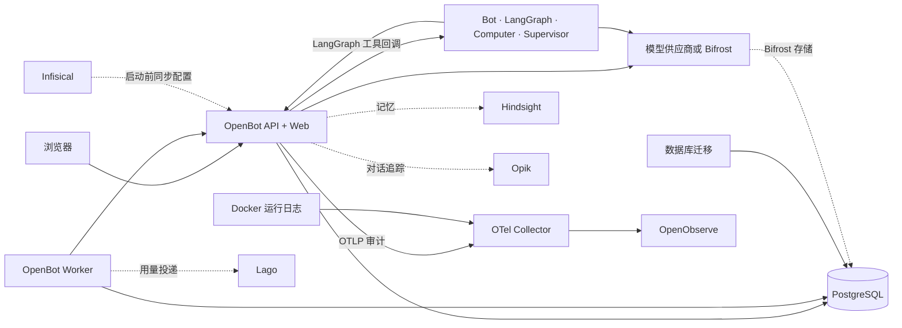

# OpenBot 部署入口

在单台 Docker 主机上部署时，按 **PostgreSQL → Agent 服务 → OpenBot** 的顺序启动。OpenBot 的 Compose 还引用观测网络。先创建该网络，需要采集日志时再启动 OpenObserve 和 OTel Collector。模型可以直接使用已配置的供应商，也可以经 Bifrost 转发。

- 首次部署按下方步骤配置并启动服务。
- 在 1Panel 安装 OpenBot 或独立中间件时，使用[本地应用商店包](1panel/README.md)。
- 维护现有服务时，使用 `deploy/compose.sh <组件> ps` 或 `deploy/compose.sh <组件> logs --tail 50`。
- 使用已经搭好的本机全量环境时，见[本机源码部署与验收](local-development.md)。
- 迁移已有实例、设置日志保留期或使用可选服务时，见[中间件运维手册](operations.md)。

## 服务拓扑



OpenBot API 和 Worker 通过数据库网络访问 PostgreSQL。Agent 和 Computer 在 `openbot-agents_default`，OpenBot API 在该网络的别名为 `openbot-api`。Collector 通过 `openbot-observability` 接收审计日志，并在观测项目内部写入 OpenObserve。Infisical 有独立数据库和 Redis，通过配置同步工具供给环境文件。

## Compose 项目和配置

| 组件 | 目录 | 默认宿主机端口 | 什么时候启动 |
| --- | --- | --- | --- |
| PostgreSQL | [postgres](postgres/docker-compose.yml) | 15432 | 使用 Compose 管理数据库时启动。已有数据库可复用 |
| OpenBot API、Web、Worker | [openbot](openbot/docker-compose.yml) | 18001 | 主应用。Compose 先执行迁移，再启动 API 和 Worker |
| Bot、LangGraph、Computer、Supervisor | [agents](agents/docker-compose.yml) | 4200、4201、4100、4500 | 提供对话 Agent 和隔离浏览器 |
| Bifrost | [bifrost](bifrost/docker-compose.yml) | 18080 | 统一模型路由或启用技能市场 |
| OpenObserve、OTel Collector | [openobserve](openobserve/docker-compose.yml) | 15080、14318 | 收集和查询运行日志、审计日志 |
| Infisical | [infisical](infisical/README.md) | 18082 | 统一管理私有配置时使用 |
| Hindsight | [hindsight](hindsight/docker-compose.yml) | 18888 | 个人记忆召回 |
| Opik | [opik](opik/docker-compose.yml) | 15173 | Web 对话追踪或评测 |
| Lago | [lago](lago/docker-compose.yml) | 13000、13001 | Worker 用量事件投递 |
| SPIRE | [根目录 Compose](../docker-compose.yml) | Docker 内部 | 签发工作负载身份。独立 Agent 项目默认关闭 |

`deploy/compose.sh` 从表中的目录读取 `.env`，并加载同目录的 `docker-compose.override.yml`。OpenBot API 另读 `openbot/.env.server`。现有本机全量环境用 `--local` 加载 `deploy/.local/` 内的配置和网络 override。

## 准备服务器文件

将包含这套部署配置的 OpenBot 源码检出到服务器，例如 `/opt/openbot`。Agent 镜像构建需要仓库根目录的 Compose、源码和锁文件。准备服务器配置时，以各服务自己的 `.env.example` 为起点。服务器环境使用独立凭据，`deploy/.local/`、本机私有 `.env*` 和本机日志留在原机器。

## 首次启动

1. 安装 Docker Engine 和 Docker Compose 2.24.4 或更新版本。在仓库根目录运行后续命令。
2. 用各组件的 `.env.example` 创建私有 `.env`，填入各自凭据。给 OpenBot 设置 `DATABASE_URL`、`WORKER_SHARED_SECRET` 和 `OPENBOT_IMAGE`，复制 [API 环境样例](openbot/server.env.example) 到 `openbot/.env.server` 并填写凭据。Agent 端填写源码绝对路径和模型配置，设置 `OPENBOT_TOOL_URL=http://openbot-api:3001/api/agent-tools/call`。两端使用匹配的 Computer、Supervisor、Agent 和工具回调令牌。
3. 启动 PostgreSQL，按[数据库准备说明](operations.md#postgresql-和登录)创建专用数据库。使用本仓库的 PostgreSQL 项目时，把 OpenBot 的 `MIDDLEWARE_POSTGRES_NETWORK` 设为 `openbot-postgres`。
4. 建立观测网络，启动 Agent 与 OpenBot。若选择 Bifrost 作为模型入口，先完成 [Bifrost 配置](operations.md#postgresql-和登录)，再给 OpenBot 和 Agent 设置各自容器可到达的模型地址。

```sh
./deploy/compose.sh postgres config --quiet
./deploy/compose.sh postgres up -d --wait

docker network inspect openbot-observability >/dev/null 2>&1 \
  || docker network create --internal openbot-observability
./deploy/compose.sh agents config --quiet
./deploy/compose.sh agents up -d --build --wait
./deploy/compose.sh openbot config --quiet
./deploy/compose.sh openbot up -d --wait

curl --fail http://127.0.0.1:18001/health
./deploy/compose.sh openbot ps -a
```

从当前源码构建主应用时，先执行 `docker build -f deploy/openbot/Dockerfile -t openbot:local .`，再将 `OPENBOT_IMAGE` 设为 `openbot:local`。多人访问需配置登录和受信任的访问地址。本机单用户模式通过回环地址访问。

部署可选服务后，按[运维手册](operations.md#应用入口和日志)把对应的容器网络和地址接入 OpenBot。启用观测时，先启动 OpenObserve 配置日志流和写入令牌，再启动 Collector。
