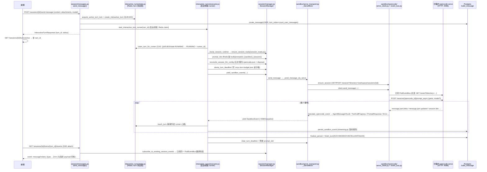

# Craft → OpenBot TypeScript 复刻：架构分析报告

> 分析人：顾图南（架构）｜范围：onyx `backend/onyx/server/features/build/`（71 文件 / 27,584 行）→ OpenBot `server/src/craft/`
> 结论先行：**核心链路必须一对一复刻的是 6 个文件簇（session manager / streaming / interactive_turns / serve_transport+serve_client / opencode_config+agent_instructions / DB 层），约 8,000 行 Python → 预估 6,000 行 TypeScript；k8s/docker 双沙箱后端、审批、定时任务、OAuth、egress proxy、user_library 共约 19,000 行可首期不做。Mastra 不引入。**

---

## 一、核心调用链路图（从用户发消息到落库）

### 逐步源文件定位（发消息 → SSE → 落库）

| # | 步骤 | 源文件 | 关键函数/符号 |
|---|---|---|---|
| 1 | 路由入口 | `session/messages.py:80` | `send_message()`：幂等（client_request_id→turn_id 复用）、active-turn 冲突 409、`session_runtime_stale` 触发 `reload_session_skills`、落 USER 消息、`create_interactive_turn`、`start_interactive_turn_runner` |
| 2 | turn 状态机（Redis） | `interactive_turns/state.py` | `InteractiveTurn` dataclass；键 `craft:interactive_turn:{id}` / `craft:session:{id}:active_turn` / `…:turn_request:{user}:{req}` / `…:active_turn_lock`；`claim_turn_for_runner`（RUNNER_STALE_AFTER=90s 可夺回）、`touch_turn`、`finish_turn` |
| 3 | 后台 runner | `interactive_turns/executor.py:119` | `start_interactive_turn_runner`（线程+tenant contextvar）→ `_drive_interactive_turn`：超时续跑 `drive_one_prompt` 最多 `MAX_TIMEOUT_CONTINUATIONS=2` 次、硬帽 30min、PromptResponse.stopReason=="cancelled" → CANCELLED |
| 4 | 会话准备 | `session/session_ready.py:65` | `ensure_session_ready`（须持用户级 session_creation_lock）：`ensure_sandbox_ready` → workspace 存在则直接 ACTIVE；否则 `restore_snapshot`/`setup_session_workspace` |
| 5 | SessionManager | `session/manager.py:170` | `SessionManager`（每请求实例，非单例）：`reconcile_session_llm_config`、`yield_sandbox_events`、`persist_sandbox_event`、`finalize_persist`（headless 复用同一套） |
| 6 | 事件流传输 | `sandbox/serve_transport.py:554` | `_ServeMixin._send_message_via_serve`：ensure_session → client.send_message；GeneratorExit 时按 `should_abort_on_teardown` 决定是否 abort |
| 7 | opencode HTTP 客户端 | `sandbox/opencode/serve_client.py:957` | `OpencodeServeClient`：`ensure_session`（404→mint 新 id，`on_opencode_session_resolved` 回写 DB）、`_post_prompt_async`（parts=[text,…file 附件 file:// URI]）、`_consume_from_bus`（inactivity 200s/absolute timeout→abort+Error/ActivityTimeoutError） |
| 8 | 事件翻译 | `serve_client.py:520` | `translate_opencode_event()`：纯函数。`message.part.delta`(field=text, part.type=text→AgentMessageChunk / reasoning→AgentThoughtChunk)；`message.part.updated`(tool→ToolCallStart 首见+ToolCallProgress；text/reasoning→gap-fill 对账)；`session.idle`/`session.status:idle`→PromptResponse（每 turn 恰一次）；`message.updated`→context_usage + error 终止；`session.compacted`→CompactionPacket；`session.created(parentID==当前)`→SubagentStartedPacket；子孙会话事件打 `_meta{sessionId,parentSessionId}` 转发 |
| 9 | Pod 事件总线 | `sandbox/opencode/event_bus.py` | `PodEventBus`：每 (pod,directory) 一条长连 /event SSE，扇出到每 session 订阅队列（maxsize 500，满则丢+计数）；指数退避重连（1s→30s，连续 20 次失败自杀）；opencode 无 Last-Event-ID，靠 part.text 累积值 gap-fill |
| 10 | 落库 | `session/streaming.py:634` | `persist_sandbox_event`：chunk 累积（routing_meta 变化或事件类型变化时 flush）；tool 仅 completed/failed 落（TodoWrite 每次落）；task 工具完成→合成 agent_message(source=task_output，剥 `<task_metadata>`)；plan upsert；`finalize_persist` 落 context_usage 一行/turn |
| 11 | SSE 下行 | `interactive_turns/api.py:128` | attach 端点：轮询 turn active + opencode_session_id + sandbox active → `subscribe_to_existing_session_events`（含 40ms 文本合并 `LIVE_TEXT_COALESCE_SECONDS`）；终态事件 `prompt_response`/`error` 后 return |
| 12 | 消息读取 | `session/api.py` + `db/build_session.py:471` | `GET /sessions/{id}/messages`：`get_session_messages` 按 (turn_index, created_at) 排序返回 message_metadata JSON |

### 会话创建链（预置空会话，前端落页即建）

`session/api.py:106 create_session` → `session_creation_lock(user)`（Redis，`session/locks.py`）→ `manager.get_or_create_empty_session`（用户行锁去重；存在则轻路径 `reconcile_session_llm_config`+`_prewarm_opencode_session` 或修复路径）→ `_ready_sandbox`（`sandbox_lifecycle.ensure_sandbox_ready`，reserve→reconcile→finalize 三段，attempt_number CAS）→ `create_build_session__no_commit`（INITIALIZING）→ `reserve_nextjs_port__no_commit`（[3010,3100) 逐个 OS bind 探测 + 部分唯一索引）→ `_reconcile_session`：`setup_session_workspace`（写 AGENTS.md/opencode.json/目录骨架/start-webapp.sh）→ `ensure_opencode_session`（mint opencode id）→ `finalize_session_initialization__no_commit`（CAS INITIALIZING→ACTIVE，失败标 FAILED 可修复）。

### 中断链

`POST /sessions/{id}/interrupt`（messages.py:289）→ `manager.interrupt_message` → `request_interrupt`（Redis fence `buildsessioninterrupt_fence_{id}`，TTL 10min，`interrupt_signal.py`）+ 后台线程 `abort_opencode_session`（直接 POST /session/{id}/abort）。runner 的 consume loop 每秒查 fence → abort + 合成 `PromptResponse(stopReason="cancelled")` → turn CANCELLED。

---

## 二、模块映射表（onyx → OpenBot）

建议目录：`server/src/craft/`，与 `workshop/` 平级、同风格（store/routes/orchestrator 分层 + DI 装配工厂）。

| onyx 源文件（行数） | OpenBot 目标 | 复刻要点 / OpenBot 可复用设施 |
|---|---|---|
| `api.py`(78, 聚合路由) + `utils.py` `is_craft_enabled_for_user` | `craft/config.ts` + `craft/routes.ts`（`createCraftRoutes(requireUser)`） | ENABLE_CRAFT 门控用 OpenBot `config.ts` 的 DeploymentConfig 模式（env→显式对象）；路由按 app.ts 惯例 `app.route("/api/craft", craftRoutes({requireUser}))` 条件挂载。`sanitize_filename`/`validate_file` 照搬进 `craft/files.ts` |
| `session/api.py`(983) | `craft/session-routes.ts` | 端点清单见 §四.1。fastapi Depends → Hono middleware（`requireUser` + `context.var.actor`） |
| `session/messages.py`(302) | `craft/message-routes.ts` | send-message 幂等/冲突/attachments 校验（路径必须 `attachments/` 下）；turn 状态机调用 |
| `session/manager.py`(1856) | `craft/manager.ts` | SessionManager 类拆薄：LLM 配置部分（build_llm_configs/reconcile）独立成 `craft/llm-config.ts`；artifact/文件操作 → `craft/files.ts`；会话 CRUD → 直接调 store |
| `session/streaming.py`(1009) | `craft/streaming.ts` | BuildStreamingState + persist_sandbox_event + finalize_persist + event_to_sse 一字不差地移植（这是行为契约核心） |
| `session/locks.py`(49) | `craft/locks.ts` | Redis 复用 `server/src/redis.ts` 的 RedisPort（SET NX PX + Lua）；单副本内存降级复用 `workshop/locks.ts` 的双实现模式 |
| `session/interrupt_signal.py`(38) | `craft/interrupt.ts` | 3 个函数，Redis set/exists/delete |
| `session/errors.py`(25) | `craft/errors.ts` | 4 个错误类（UploadLimitExceeded/SandboxProvisioning[InProgress]/StaleProvisioningAttempt） |
| `session/naming.py`(125) | `craft/naming.ts` | LLM 起名；OpenBot 侧直接用已配置的模型客户端（Intelligence/Mastra 已有通路），fallback 逻辑照搬 |
| `session/session_ready.py`(192) | `craft/session-ready.ts` | ensure_session_ready + session_runtime_intact |
| `session/sandbox_lifecycle.py`(1021) | `craft/sandbox-lifecycle.ts`（首期大幅裁剪，见 §五） | reserve→reconcile→finalize 状态机 + attempt_number CAS；OpenBot `db/schema/sandbox-instances.ts` 已有同构设计（status/attemptNumber/lastHeartbeatAt），直接复用该表 |
| `interactive_turns/state.py`(348) | `craft/turn-state.ts` | Redis 状态机照搬（键名保留 `craft:` 前缀）；TTL 常量照搬 |
| `interactive_turns/executor.py`(588) | `craft/turn-executor.ts` | runner=Bun 进程内异步任务（无线程，用 `AbortController`+async iterator）；claim/touch/finish、超时续跑、interrupt fence 轮询语义不变 |
| `interactive_turns/api.py`(275) + `models.py` | `craft/turn-routes.ts` | turns/active + turns/{id}/events SSE |
| `sandbox/event_schema.py`(51) | `craft/events/types.ts` | 直接内联 ACP 子集 TS 类型（AgentMessageChunk…），负数错误码 -1/-2/-3 保留 |
| `packets.py`(115) | `craft/events/packets.ts` | 6 个自定义 packet ErrorPacket/ApprovalRequested/SubagentStarted/ConnectAppRequest/ContextUsage/Compaction |
| `sandbox/opencode/serve_client.py`(1849) | `craft/opencode/serve-client.ts` | 翻译器 `translateOpencodeEvent` 为最重资产，逐分支移植；HTTP 层用 fetch；`_TOOL_KIND/_TOOL_TITLE/_TOOL_STATUS_MAP` 照搬 |
| `sandbox/opencode/event_bus.py`(426) | `craft/opencode/event-bus.ts` | PodEventBus：/event 长连 + 每会话队列 + 重连退避；TS 用 ReadableStream reader |
| `sandbox/serve_transport.py`(944) | `craft/opencode/serve-transport.ts` | PromptSlot（Redis 锁 extend/keep_alive）、_send_message_via_serve、subscribe_to_opencode_session（40ms 文本合并） |
| `sandbox/base.py`(814) + `factory.py`(57) | `craft/sandbox/manager.ts`（接口）+ 首期单实现 | OpenBot 的沙箱由外部 agent-sandbox 服务承担（`codesandbox/client.ts` 走 token 网关），因此 SandboxManager 抽象保留但只有一个 `AgentSandboxManager` 实现，k8s/docker 后端不移植 |
| `sandbox/models.py`(117) | `craft/sandbox/models.ts` | PromptAttachment/CraftLLMProviderConfig/SnapshotResult/FilesystemEntry/DirectoryListing 等 zod schema |
| `sandbox/util/opencode_config.py`(255) | `craft/opencode-config.ts` | `_PERMISSIONS_TEMPLATE` 全量照搬；provider block（openai-compatible npm + 显式 models）；MCP block 首期可省（无 egress proxy 语义） |
| `sandbox/util/agent_instructions.py`(171) + `AGENTS.template.md` | `craft/agent-instructions.ts` + `craft/AGENTS.template.md` | 占位符替换逻辑（{{USER_CONTEXT}}…{{ORGANIZATION_INSTRUCTIONS_SECTION}} 最后替换）；模板内容按 OpenBot 语境改写（无 egress proxy/webapp 工具则删对应段） |
| `sandbox/session_workspace.py`(105) | `craft/workspace.ts` | setup 脚本生成（mkdir/ln -s/写 AGENTS.md/opencode.json/flock 串行化）；首期视 agent-sandbox 能力改为 API 写文件 |
| `db/build_session.py`(616) + `db/sandbox.py`(363) + `db/artifact.py` + `db/receipt.py` | `db/schema/craft.ts` + `craft/store.ts` | Drizzle 表见 §三；store 按 `workshop/store.ts` 风格（一个 createCraftStore(db) 工厂，方法名对应 onyx 函数） |
| `timeouts.py`(205) | `craft/timeouts.ts` | 全部常量照搬（含推导关系注释） |
| `configs.py`(249) | 并入 `config.ts`（DeploymentConfig.craft 字段）+ `craft/config.ts` | 见 §四.3 |
| `webapp_proxy.py`(398) | `craft/webapp-proxy.ts`（二期） | 首期可不做：OpenBot workshop 已有 preview.ts（webappPort 概念已存在于 workshopSessions） |
| `session/md_to_docx.py`(853) / pptx preview / nextjs_dev.py / snapshot_manager.py | 不移植（二期） | DOCX 导出可后续用 JS 库；快照依赖 FileStore，OpenBot 沙箱若常驻则首期不需要 sleep/snapshot |
| `approvals/`(334+db) 、`scheduled_tasks/`(1450)、`external_apps/`+`oauth`(1400)、`connect_app.py`、`user_library/`、`craft_gateway.py`、`debug.py`、`sandbox/image/`(沙箱内 daemon)、`sandbox/kubernetes/`+`docker/`(4754) | 首期不实现 | 见 §五 |

**OpenBot 已有设施可复用清单**：`redis.ts`（RedisPort 七方法 + 内存降级模式）、`workshop/locks.ts`（TurnLease 语义 ≈ PromptSlot）、`workshop/orchestrator.ts`（turn enqueue/heartbeat/recoverStale 骨架 ≈ interactive_turns）、`workshop/events.ts`（persist-before-publish + Last-Event-ID replay，可给 craft SSE 复用思想）、`codesandbox/client.ts`（对 agent-sandbox 的 HTTP 通路，craft 的 OpencodeServeClient 在它之上加 directory/认证/事件翻译）、`db/schema/sandbox-instances.ts`（沙箱生命周期表）、`approvals/*`（审批服务已在，craft 审批接它而非复刻 onyx approvals）、`audit`（审计事件）。

---

## 三、数据模型清单（DB 表）

### 1. `build_session`（onyx `db/models.py BuildSession`）
| 字段 | 类型 | 语义 |
|---|---|---|
| id | UUID PK | |
| user_id | UUID FK user, nullable, CASCADE | 所有者 |
| name | str? | 展示名（LLM 生成或手改） |
| status | enum `INITIALIZING/ACTIVE/IDLE/FAILED`（default ACTIVE，代码实际出生 INITIALIZING） | IDLE=沙箱已睡需 restore |
| created_at / last_activity_at | timestamptz | last_activity 每 get_session/update 刷新 |
| nextjs_port | int? | [3010,3100)，**(user_id, nextjs_port) 部分唯一索引**（仅非 NULL） |
| sharing_scope | `private/public_org` default private | webapp 分享范围 |
| origin | `INTERACTIVE/SCHEDULED/SLACK` | 侧栏只列 INTERACTIVE 且有消息的 |
| opencode_session_id | str? | opencode-serve 会话 id，首 turn 懒 mint，404 时重铸回写 |
| agent_provider / agent_model | str? | 当前模型选择（provider_id/model 或 wire id） |
| skills_hash / mcp_config_hash | str(64)? | 会话已确认的托管内容指纹；与 sandbox 行不一致 ⇒ skills_stale ⇒ reload |
| 关系 | artifacts/receipts/messages cascade | |
| 索引 | `ix_build_session_user_origin_created (user_id, origin, created_at DESC)` 覆盖侧栏查询 | |

### 2. `build_message`
| 字段 | 类型 | 语义 |
|---|---|---|
| id | UUID PK | |
| session_id | UUID FK CASCADE | |
| turn_index | int | 0 起用户消息序号，聚合助手回复 |
| type | enum `user/assistant/system/…`（MessageType） | |
| message_metadata | **JSONB** | 整个事件包原样：user_message / agent_message / agent_thought / tool_call_progress / agent_plan_update / context_usage / compaction / error(task 失败行)；子代理路由靠包内 `_meta{sessionId,parentSessionId}` |
| created_at | timestamptz | 排序键 |
| 索引 | `(session_id, turn_index, created_at)` | |

### 3. `sandbox`（每用户一行）
| 字段 | 类型 | 语义 |
|---|---|---|
| id / user_id(unique) | UUID | |
| container_id | str? | 后端容器/pod 标识 |
| status | `provisioning/running/sleeping/terminated/failed` | |
| created_at / last_heartbeat | timestamptz | 心跳驱动 idle reaper（3600s 默认） |
| skills_hash / mcp_config_hash | str(64)? | 沙箱当前托管内容指纹 |
| encrypted_pat | 加密 str? | 沙箱回连 API 的 PAT（OpenBot 用 x-sandbox-token 方案替代） |
| provisioning_attempt_number | int default 0 | **CAS 核心**：每次新尝试 +1（用户行锁内），一切状态写都带 attempt 条件 |
| provisioning_started_at | timestamptz? | 判死取（超 ATTEMPT_DEADLINE≈240s 可被接管） |
| 索引 | status / container_id | |

### 4. `snapshot`（会话快照）
| 字段 | 语义 |
|---|---|
| id / session_id FK / storage_path（FileStore 路径）/ size_bytes / created_at | sleep 前打包 outputs+attachments，restore 取最新；索引 (session_id, created_at DESC) |

### 5. `artifact`（产出物；当前主链路 list_artifacts 已改为即时扫 outputs/，表供 receipt/manifest 管道用）
id / session_id FK / type(enum web_app…code) / path(outputs/ 相对，**unique(session_id,path)**) / name / turn_index? / size_bytes? / content_hash? / version / deleted(软删) / archive_file_id? / created_at / updated_at。

### 6. 非核心表（首期不做，列出备查）
`action_approval`（审批：approval_id PK, session_id FK, actions JSONB, decision null=pending, decided_via…）、`action_receipt`、`craft_scheduled_task`/`craft_scheduled_task_run`、`external_app`/`external_oauth_token`、`user_library_file`、`skill_file`（managed skills 推送源）。

**Redis 结构（非表但必须移植）**：`craft:interactive_turn:{turn_id}`（JSON 状态）、`craft:session:{id}:active_turn`、`craft:session:{id}:active_turn_lock`、`craft:session:{id}:turn_request:{user}:{req}`（幂等）、`buildpromptslot_{sandbox}_{session}`（prompt slot，lease 120s）、`buildsessioninterrupt_fence_{session}`（TTL 600s）、`craft:llm_config_dispose_pending:{session}`（TTL 24h）、`build:approval:announce` 类 BLPOP 通道（首期省）。

---

## 四、行为契约

### 1. HTTP 端点清单（前缀 `/api/build`，OpenBot 建议 `/api/craft`）

**会话**：`GET/POST /sessions`、`GET /sessions/{id}`（含 session_loaded_in_sandbox/skills_stale）、`POST /sessions/{id}/skills/reload`、`GET /sessions/{id}/sandbox-status`、`GET /sessions/{id}/pre-provisioned-check`、`POST /sessions/{id}/generate-name`、`PUT /sessions/{id}/name`、`PATCH /sessions/{id}/public`、`DELETE /sessions/{id}`（原子：沙箱清失败则回滚不删）、`POST /sessions/{id}/restore`（非阻塞锁，占用 409）。
**消息/turn**：`GET /sessions/{id}/messages`、`POST /sessions/{id}/send-message`（返回 turn，不流式）、`POST /sessions/{id}/subagents/{oc_session_id}/send-message`（SSE 直推）、`POST /sessions/{id}/interrupt`、`GET /sessions/{id}/turns/active`、`GET /sessions/{id}/turns/{turn_id}/events`（SSE）。
**工件/文件**：`GET /sessions/{id}/artifacts`、`GET /sessions/{id}/files?path=`、`GET /sessions/{id}/artifacts/{path}`（下载）、`GET export-docx|pptx-preview/{path}`（二期）、`GET webapp-info`、`GET webapp-download`、`GET download-directory/{path}`、`POST upload`（multipart，仅限大小）、`DELETE files/{path}`。
**快照**：`POST /sessions/{id}/snapshot`、`POST opencode-history-snapshot`（二期）。

### 2. SSE 线格式（前端契约，必须逐字复刻）

- 帧：`event: message\ndata: {JSON}\n\n`；keepalive：`": keepalive\n\n"`（SSE 注释行）。响应头 `Cache-Control: no-cache, no-transform`、`Connection: keep-alive`、`X-Accel-Buffering: no`，`text/event-stream`，keepalive 间隔 15s（SSE_KEEPALIVE_INTERVAL）。
- data JSON 统一带 `type` + `timestamp`（ISO UTC）。事件类型全集（`streaming._get_event_type` + packets）：
  - `agent_message_chunk` / `agent_thought_chunk`：`{type, sessionUpdate:"agent_message_chunk"|"agent_thought_chunk", content:{type:"text",text}}`
  - `tool_call_start` / `tool_call_progress`：`{type, sessionUpdate:"tool_call"|"tool_call_update", toolCallId, title, kind(execute/read/edit/search/fetch/other), status(pending|in_progress|completed|failed), rawInput, rawOutput:{output,…}, content?:[{type:"diff",path,oldText,newText}|{type:"content",content:{…}}], _meta:{toolName}, field_meta?}`（camelCase by_alias）
  - `agent_plan_update`：`{type, entries:[…]}`（每 turn upsert）
  - `current_mode_update` / `prompt_response`（`{stopReason: end_turn|max_tokens|refusal|cancelled…}`，终态）/ `error`（`{code, message}`，code<0 为 Onyx 合成：-1 会话错误 / -2 超时 / -3 传输）
  - 自定义包：`error{message}`、`subagent_started{subagent_session_id,parent_session_id}`、`context_usage{used_tokens,cost?}`、`compaction{summary?}`、`approval_requested{approval_id,session_id}`（首期省）、`connect_app_request`（省）
  - 子代理事件：包级 `_meta:{sessionId, parentSessionId}`（或 task 工具上的 `subagentSessionId`）——前端据此挂到子代理流。
- 错误帧：`{type:"error", message, timestamp}`（attach 流失败时）。
- 终态判定：`prompt_response` 或 `error` 出现即关流（TERMINAL_STREAM_EVENT_TYPES）。

### 3. 落库规则（persist_sandbox_event，与 SSE 同 payload 落 build_message.message_metadata）
chunk 累积 → 非同类/路由变化时 flush 为整段 `agent_message`/`agent_thought`；tool 仅终态落（todowrite 例外，每次 progress 都落）；task 完成→额外合成 `agent_message(source:"task_output")`；plan 每 turn 一行 upsert；context_usage 每 turn 末一行；current_mode/prompt_response/error 不落（turn 失败由 executor 落用户可见 error 行，文案后缀 "Files written to the workspace are saved — send a follow-up message to continue."）。

### 4. AGENTS.template.md 占位符（`generate_agent_instructions`，替换顺序有讲究）
`{{USER_CONTEXT}}`（"You are assisting **{name}**…"，空则空串）→ `{{LLM_PROVIDER_NAME}}`（display 名映射表 openai→OpenAI…）→ `{{LLM_MODEL_NAME}}` → `{{APPROVAL_WAIT_TIMEOUT_SECONDS}}`（180）→ `{{APPROVAL_CLIENT_TIMEOUT_SECONDS}}`（200=180+20 margin）→ `{{DISABLED_TOOLS_SECTION}}`（"**Disabled Tools**: question"）→ `{{CONNECTABLE_APPS_LIST}}`（无 app 时 "No connectable apps available."）→ 最后 `{{ORGANIZATION_INSTRUCTIONS_SECTION}}`（防管理员文本内嵌 token 被二次展开）。

### 5. opencode.json 生成（`build_provider_opencode_config`）
`{$schema, model:"{provider}/{model}", provider:{<id>:{npm:"@ai-sdk/openai-compatible",options:{apiKey,baseURL},name,models:{<id>:{name,attachment,reasoning,temperature,tool_call,modalities,limit:{context,input,output}}}}}, enabled_providers:[id], permission:{…全量 bash/edit/write/read 禁改 opencode.json 与 start-webapp.sh、外部目录仅 /tmp、MCP key_* 通配…}}`。默认模型不在目录则抛错。

### 6. 配置项（configs.py 全量语义，OpenBot 命名建议 `OPENBOT_CRAFT_*`）
| onyx 配置 | 默认 | 语义 |
|---|---|---|
| SANDBOX_BACKEND | kubernetes | OpenBot 不需要（agent-sandbox 服务承担） |
| OPENCODE_DISABLED_TOOLS | "question" | 禁用工具逗号表 |
| SANDBOX_IDLE_TIMEOUT_SECONDS | 3600 | idle reaper 阈值（首期沙箱常驻可不实现） |
| SANDBOX_APPROVAL_WAIT_TIMEOUT_SECONDS / _MARGIN | 180/20 | 审批等待（首期省） |
| SANDBOX_HEARTBEAT_REFRESH_INTERVAL_SECONDS | 60 | 流中心跳刷新 |
| SANDBOX_NEXTJS_PORT_START/END | 3010/3100 | 端口池（workshop 已有 ports jsonb 概念） |
| MAX_UPLOAD_FILE_SIZE_MB / FILES_PER_SESSION / TOTAL_MB | 50/20/200 | 上传限额 |
| SANDBOX_NAMESPACE/CONTAINER_IMAGE/… | — | k8s 专属，不移植 |
| ENABLE_CRAFT | false | 总开关（→ DeploymentConfig.craft.enabled） |
| ENABLE_BROWSER | true | 沙箱内置 browser skill 门 |
| ONYX_SERVER_URL | "" | 沙箱可达的 API 地址 |
| SSE_KEEPALIVE_INTERVAL | 15.0 | SSE/runner 存活基频 |
| OPENCODE_PROMPT_INACTIVITY_TIMEOUT_SECONDS | 200 | 单步无输出上限（>审批窗） |
| TURN_BUDGET_FILE_NAME | .onyx-turn-budget.json | turn 预算插件契约（若 OpenBot 沙箱镜像无该插件可省 stamp，但保留接口） |
| PROMPT_SLOT_LEASE_SECONDS | 120 | prompt slot 租约 |
| OPENCODE_SERVE_PORT / USERNAME / PASSWORD 变量名 | 4096/"opencode"/OPENCODE_SERVER_PASSWORD | 与沙箱镜像约定 |
| OPENCODE_SERVE_CONNECT/REQUEST/EVENT_READ_TIMEOUT | 5/30/60 | HTTP 超时三件套 |
| USER_LIBRARY_* | 500MB/10GB/100 | 首期省 |
| timeouts.py 派生族 | 见源 | PROVISION_DEADLINE 180s / ATTEMPT_DEADLINE 240s / INTERACTIVE_TURN_HARD_CAP 1800s / SOFT=0.4×HARD / RUNNER_STALE=6×keepalive=90s / ACTIVE_TURN_TTL=2700s / REQUEST_ID_TTL=3600s / POLL 0.5s |

---

## 五、复刻范围与取舍建议

### 必须一对一（核心链路，~6,000 行 TS）
1. **事件翻译层**（serve_client.translate + event_bus）：整个产品的正确性都压在 delta/updated 对账、part 类型路由、assistant 过滤（delta 先于 message.updated 到达需 REST hydrate）、terminator 恰一次、子代理 _meta 路由上。不许简化。
2. **turn 状态机 + runner**（interactive_turns 三件）：send-message 异步化、幂等、崩溃恢复（RUNNER_STALE 夺回）、超时续跑（ActivityTimeout→steer prompt 最多 2 次）、硬帽、cancel 语义。
3. **落库管线**（streaming.persist/finalize + BuildStreamingState）：SSE 与 DB 同构，重载/回放全靠它。
4. **会话生命周期**（manager 的 create/repair/reconcile + session_ready + locks + port 预留 + attempt CAS）：分布式的正确性来源。可裁：多租户 contextvar、跨副本 401 密码自愈（OpenBot 单网关 token 已覆盖部分场景，保留接口即可）。
5. **opencode.json / AGENTS.md 生成**。
6. **Drizzle schema + store**（craft_sessions/craft_messages/craft_snapshots + 复用 sandbox_instances）。

### 首期不做（及理由）
| 子系统 | 行数 | 理由 |
|---|---|---|
| k8s/docker 沙箱管理器 | 4,754 | OpenBot 沙箱由 agent-sandbox 服务 + `codesandbox/client.ts` 网关承担，生命周期已有 sandbox_instances 表与 supervisor；craft 只需要"每会话 directory + opencode 会话"语义，不需要自管容器 |
| 沙箱镜像内 daemon（sandbox/image/） | ~1,600 | 属沙箱侧；首期用现成 agent-sandbox 能力（session/file/abort/events 端点族已在） |
| 审批（approvals/ + action_approval + proxy 网关链） | ~1,400 | 依赖 egress proxy 停靠注入这一整套安全模型；OpenBot 已有自己的 `approvals/*` 服务与 approval_requests 表，未来 craft 需要审批时接自己的，而非复刻 onyx 的 |
| 定时任务（scheduled_tasks/） | ~1,450 | 独立外围；OpenBot 已有 workshop schedule + routines 基建，未来需要时包一层 headless turn 即可（SessionManager 的 yield/persist/finalize 分层正是为此预留） |
| external_apps + OAuth + connect_app | ~1,400 | 依赖 onyx 插件生态与 proxy 凭据注入；OpenBot 有自己的 plugins/broker |
| user_library / skills 推送 / 快照 sleep-wake（snapshot_manager + idle reaper + restore） | ~1,800 | 前提是"沙箱会睡"；首期 OpenBot 沙箱常驻，craft_sessions 直接落 ACTIVE，IDLE/快照链路整体延后。restore 端点保留为 no-op 兼容 |
| webapp_proxy / nextjs_dev / pptx 预览 / md→docx | ~1,700 | workshop preview.ts 已覆盖 webapp 预览一半语义；DOCX/PPTX 是纯增量功能 |
| egress proxy（mitmproxy CA/凭据注入）| 配置层 | 不在 build/ 目录但整条审批/凭据链都挂在它上；不做审批即可不做 |
| craft_gateway / debug / webapp SSE 的 scheduled-run 旁路 | ~700 | 依赖 Celery 多 worker 拓扑 |

### Mastra 判断：**不引入**
Craft 的运行时是"服务器进程驱动沙箱内 opencode-serve"，LLM 调用全部发生在沙箱内 opencode 进程里（经 openai-compatible baseURL 指到网关）。服务器侧需要的只是：① 每秒轮询 Redis fence；② SSE 长连转发；③ 事件翻译纯函数；④ 少量 LLM 调用（会话起名）。这些用原生 `AsyncGenerator` + `fetch` + 现有 RedisPort 就是最低摩擦实现。引入 Mastra（agent/workflow/memory 抽象）反而：与 workshop/orchestrator 已固化的 turn 模型形成两套状态机、增加运行时依赖、且 Mastra 的 streaming 原语不是为"翻译第三方事件流"设计的。**唯一例外**：会话起名如想复用现有 Mastra 模型客户端可以做一次性 `generate()`，但这不构成"引入 Mastra 框架"。

### 首期实现顺序建议（给任务 #2/#3）
1. schema（craft_sessions/craft_messages/craft_snapshots，含全部索引与 CAS 列）→ 2. events/types + packets + opencode 翻译层（可单测，onpx 有大量行为可对照）→ 3. event-bus + serve-client（对 agent-sandbox 实测）→ 4. turn-state + executor → 5. streaming 落库 + manager → 6. routes 装配 + config 门控 → 7. 冒烟（建会话→发消息→SSE→重载消息→interrupt）。

---

## 附：关键风险点
1. **agent-sandbox 的 opencode 版本/端点差异**：onyx 锁定 opencode 1.15.x 语义（prompt_async、part 生命周期、permission.asked、instance/dispose）。OpenBot 沙箱若 opencode 版本不同，翻译层第 8 步的分支需要逐条回归。`POST /session` 非 401 不重试、abort 幂等等细节都是实测踩出来的。
2. **directory 作用域**：opencode-serve 一切端点都带 `?directory=/workspace/sessions/{session_id}`，漏了会静默落到 /workspace 默认实例——这是最隐蔽的坑，serve-client 的每个调用都必须带。
3. **单副本 vs 多副本**：onyx 所有锁/状态在 Redis。OpenBot 的 RedisPort 有内存降级，craft 的 turn 状态机应同样提供内存实现（复用 workshop/locks 模式），但 prompt slot 建议要求 Redis（fail-open 语义照 onyx）。
4. **Bun 无线程**：executor 的"runner 心跳每事件 touch + slot.extend"改为 async loop 内逐事件调用即可，但 `delete_session` 里的 slot keep-alive 后台线程需换成定时器 + finally 清理。
5. **message_metadata JSONB 大小**：tool_call_progress.rawOutput 可能很大（bash 输出），onyx 未截断直接落库；OpenBot 建议沿用（行为一致优先），但 schema 评审时确认 jsonb 无额外限制。
