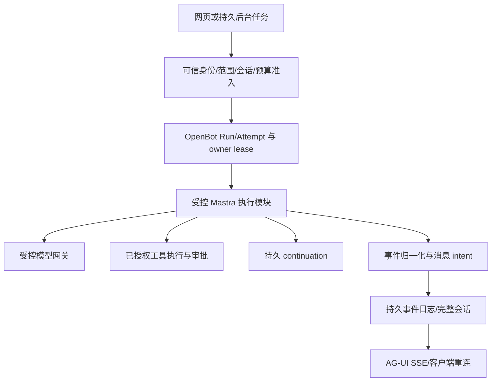

# Spec: 内置 Agent 执行迁移 Mastra

日期：2026-10-19。状态：**方案与 16 张业务子 Issue 拆分已由用户于 2026-10-19 确认；授权发布 Issues，尚未授权代码实施或生产上线**。

来源：本会话用户依次要求分析迁移范围、编写实施计划、设计详细方案并拆解具体 Issue。方案承接上一轮计划；“已写成可验收的规格”“允许创建 Issue”“批准设计”“授权实施/上线”是不同状态，不互相推导。

## Problem Statement

当前内置 Bot 执行依赖 CopilotKit BuiltInAgent，网页与后台还通过不同的 Runner、历史读取和审批恢复装配执行。仓库虽有 Mastra 租户存储、兼容探针与远程 harness，但它们没有完成内置执行迁移。直接替换构造函数会遗漏工具授权、逐步预算、用量结算、附件、暂停恢复、后台任务、学习和多租户隔离。

用户需要将内置 Agent 执行统一到 Mastra，同时保留现有工作台的交互和权限规则；不能为了迁框架而丢失历史、重复执行危险工具、改变付款方，或者使某些后台入口继续走旧引擎。

## Solution

将 Mastra 作为内置 Bot 的模型与工具循环执行框架，OpenBot 继续作为业务身份、范围、Run/Attempt、预算、审批、消息写入和工具副作用的权威。通过现有网页运行入口与后台执行入口接入一个受控执行模块，对外保持 AG-UI 和现有 CopilotKit React/SSE 客户端兼容。

迁移按可演示的完整业务切片展开：受控文本聊天 → 历史附件 → 连接器工具 → 审批恢复 → Computer/前端工具 → 记忆/技能 → 后台与交接 → 迁移切换 → 无强制 Intelligence 部署与最终验收。学习服务保留为独立可选适配器；完全替换其自动学习算法另立需求。

## User Stories

1. 作为工作台用户，我希望迁移后仍能给现有 Bot 发消息并逐字看到回答，以便保持原工作流程。
2. 作为用户，我希望 Bot 保留自己的角色与我的常驻指令，以便迁移不改变职责。
3. 作为用户，我希望刷新或重新连接后看到同一份历史，以便不丢消息或出现重复答案。
4. 作为用户，我希望上传的文件和图片在本轮与后续授权会话中正确引用，以便 Bot 理解材料。
5. 作为用户，我希望工具调用和结果保留准确对应，以便理解 Bot 做了什么。
6. 作为用户，我希望 Bot 只使用我授予的连接工具，以便我的其他连接不会被擅自使用。
7. 作为用户，我希望供应商拒绝与平台政策拒绝分别显示，以便知道如何解决问题。
8. 作为用户，我希望涉及审批的操作先停下来等待，以便先核对动作与参数。
9. 作为用户，我希望批准后准确继续原操作，以便不必重新描述整项任务。
10. 作为用户，我希望拒绝、过期和撤权之后工具不会执行，以便决定得到遵守。
11. 作为用户，我希望重复点击批准或系统重启不会重复发送邮件等外部动作，以便避免重复副作用。
12. 作为用户，我希望未知外部结果显示为待处置，以免系统猜测成功或自动重复操作。
13. 作为用户，我希望需要浏览器或本地参与的工具等待真实结果，以便系统不伪造执行。
14. 作为用户，我希望停止当前运行，而不误停新运行或另一人的运行，以便控制准确。
15. 作为用户，我希望普通网络断连不等同于主动取消，以便重新连接后继续查看状态。
16. 作为用户，我希望 Bot 仍使用本人已确认且有权访问的记忆，以便跨会话保持连续。
17. 作为用户，我希望未审核、已遗忘和失去来源权限的记忆不进入回答，以便记忆控制有效。
18. 作为已启用学习的用户，我希望已发布技能及其撤销仍有效，以便迁移不悄悄取消学习能力。
19. 作为未启用学习的部署管理员，我希望不配置 Intelligence 也能运行基础功能，以便减少必需依赖。
20. 作为用户，我希望定时任务和职责自动推进使用与网页相同的权限与预算，以便入口不会改变规则。
21. 作为用户，我希望 Bot 交接只把有权分享的信息交给有权运行的目标，以便委派不扩大访问。
22. 作为使用 OpenMuse/Workshop 的用户，我希望其调用 OpenBot 的任务仍能执行和回传产物，以便迁移不中断现有集成。
23. 作为付费用户，我希望每次模型调用都受预算约束并按权威用量结算，以便不会重复扣费或悄悄换付款账户。
24. 作为同属多家公司或团队的用户，我希望角色、记忆、凭据、附件和执行环境彼此隔离，以免串用状态。
25. 作为运维人员，我希望先盘点旧历史和暂停记录并做 dry-run，以便知道哪些能迁、哪些需隔离。
26. 作为用户，我希望切换和回滚都保留新消息与结果，以免回滚变成数据丢失。
27. 作为运维人员，我希望能沿同一运行标识找到模型、工具、审批与结算证据，以便诊断故障。
28. 作为维护者，我希望每张实施 Issue 都有明确范围和验收，以便另一个 Agent 能快速接手。

## Implementation Decisions

### 1. 架构与权威分工

| 事项 | 权威 | Mastra 的角色 |
| --- | --- | --- |
| 身份、公司/团队/本人/Bot 范围、来源权限 | OpenBot 可信目录与授权模块 | 仅消费经过签发并在运行时重验的上下文 |
| Run、Attempt、generation、owner lease、取消 | OpenBot RunService | 引擎运行标识映射到业务运行，不自行批准业务终态 |
| 预算、付款方、capability、实际结算 | OpenBot 网关与积分台账 | 通过受控 LanguageModel 执行每次模型调用 |
| 工具 grant、policy、审批、审计与 receipt | OpenBot 工具执行模块 | 选择已提供的工具并提交参数 |
| 对话、附件引用、intent、稳定顺序 | OpenBot ConversationService | 使用授权历史；不对同一会话另开自动写入者 |
| 持久挂起与恢复 | OpenBot continuation + 受限引擎 snapshot | 保存/恢复框架执行状态；不代替身份与审批检查 |
| 个人记忆 | OpenBot 审核与来源权威；既有 Hindsight 集成 | 使用已确认且当前有权访问的内容 |
| 学习技能 | 既有可选学习提供者与 OpenBot 配置 | 消费经校验的当次技能快照 |

不建立第二套授权、预算或消息权威。采用 expand → 按业务入口迁移 → contract：旧代码在迁移未完成时可存在，但同一业务范围只允许一个活跃执行/消息写入者，不允许错误后自动换引擎绕过拒绝。

### 2. 主执行路径与 Interface

主 seam 是“已准入的业务运行”：消费服务端签发的执行绑定、授权历史、固定模型路由/付款方式、授权工具、AbortSignal 和可选可信恢复引用；返回现有规范事件流。绑定至少区分 tenant、workspace、principal、actor、bot、run、attempt、generation 和引擎执行标识。

客户端只提交既有业务输入和幂等键；不能通过 context/forwardedProps 选择可信 scope、provider key、route、引擎、owner 或恢复快照。公开客户端 DTO 维持兼容；新的内部消息表示采用版本化完整 parts，不把展示文本投影当完整模型历史。

### 3. 模型治理

- 使用已有 LanguageModelV3 网关适配，而不是让 Mastra 按 provider 字符串自行找 key。每一步获得独立的、绑定当前 Run/Attempt/generation 的调用 capability。
- 运行聚合预算同时约束输入与输出；模型每次请求的输出上限不大于当前允许值，既有输入上界证明继续成立。示例：总额度 100，已确认实际消耗 70，下一调用最多只能申请剩余 30，并继续接受持久准入核验。
- 禁止 SDK 自动 retry、fallback、自动标题/摘要/embedding 等隐式模型调用；若未来启用，必须先提供独立明确的预算、调用身份与结算合同。
- 余额不足、未知价格、非法帧或无法结算时拒绝/失败；未知用量保留既有待结算规则，不虚构零消费或成功。
- API 积分路径与订阅 harness 路径保持原先固定选择；拒绝后不得切换 payer、credential 或付费方式。

### 4. 工具、消息与事件

- 受控工具保留参数校验、授权复核、initiator、供应商错误、不可信内容包装及审计。发现 MCP 工具不等于已授予工具，不能直接挂载原始工具绕过执行器。
- 保留完整 message parts、tool-call/result、附件引用与 activity/state；读取前验证 thread/resource 与来源权限，附件在授权后加载字节。
- Mastra fullStream 转换成现有文本、工具参数增量、结果、状态、挂起、错误和终态事件。控制事件不可静默丢弃；损坏或未知控制语义阻断本轮执行。
- 稳定标识区分消息、模型调用、工具调用和业务操作。一个业务操作在合法恢复/重试中保留同一 operationId 与参数摘要；新 generation 不是重新执行已完成外部操作的理由。
- 事件先持久化再发布；消息通过 intent/幂等键落盘，不依赖浏览器把显示内容回传成为历史。工具结果只有持久 receipt 或真实客户端执行结果才可进入后续上下文。

### 5. 生命周期、断连与失败

| 触发 | 业务状态/行为 | 禁止的行为 |
| --- | --- | --- |
| 准入通过且获得当前 lease | queued → running；开始模型/工具 | 未准入直连 provider |
| 需要审批 | running → waiting_approval，先保存恢复证据 | 把 waiting 当 succeeded |
| 等待用户回答或前端工具结果 | running → suspended，并展示下一动作 | 假造回答或工具结果 |
| 恢复输入与当前授权一致 | 认领准确 continuation，受控恢复 | 无条件新建一次全量执行 |
| 模型结束、用量已确认、输出已持久化 | 当前 owner 才能 running → succeeded | 仅见引擎 finish 即成功 |
| 主动 stop | 对精确 Run/Attempt 取消，阻断后续敏感调用 | 按 thread 模糊取消另一新运行 |
| 网络连接消失 | 仅断开订阅；已有 owner 按合同推进/保存可恢复状态，重连重放事件 | 把断连冒充用户取消或无限占用 lease |
| owner 过期或失去授权 | 阻断新模型/工具/成功写入；按现有失败恢复合同处理 | 失效实例继续发布终态 |
| 进程在模型调用中崩溃 | 保留未知用量/失败证据，显式处置 | 声称模型流可从任意 token 自动续算 |
| 外部调用可能已生效但 receipt 未确认 | 标记未知、待核对；有供应商幂等/查询证据才决定重试 | 自动重复发送/扣款等写动作 |

Mastra 不是第二个业务调度器。本版不引入 durable agent/workflow 作为 Run 状态权威。普通 Agent、审批 snapshot 与任意进程故障自动恢复是不同能力。

### 6. continuation 与跨存储一致性

- continuation 存储有独立 schemaVersion、引擎版本指纹、业务绑定、稳定操作身份、toolCallId、工具名、参数摘要、受保护 snapshot 引用、revision、认领与终态。
- snapshot 只含恢复必需的数据，不保存 provider key、capability 明文、函数或实时 AbortSignal。租户数据使用受限角色与既有隔离存储。
- 审批展示的动作和参数摘要必须与将执行的动作一致；回答/客户端工具结果引用认证后落盘的记录，不信任任意 body 文本作为已认证工具事实。
- 恢复时重验身份、团队/来源权限、工具 grant、Bot 访问、generation 与预算；使用数据库 CAS/受限 claim 防并发。claim 有过期回收规则，回收不能自动重放未知副作用。
- 审批、OpenBot continuation 与 Mastra snapshot 可能跨存储，采用持久 intent、可重试对账和明确中间态。不能将连续两个写请求当成原子事务；恢复证据缺失时不向用户发布“可恢复”。
- 已完成 receipt 在恢复中复用；参数/授权/计划改变使旧批准失效。未知引擎快照版本不得自动反序列化执行，进入受控不兼容状态。

### 7. 记忆、技能与既有需求复用

- 本方案不重做 Hindsight：个人记忆退出 Intelligence 的行为由已有 #395 交付，本迁移的记忆 Ticket 只适配并验证消费该合同。#395 当前开放，需核验已审查实现，不能因为旧代码存在就声称就绪。
- 仅使用本人已确认且当前来源权限允许的记忆；候选、已遗忘、来源已撤销、只有 Intelligence 无 OpenBot 记录的内容不可进入新上下文。Hindsight 未就绪/故障时只用合规的已确认本地记录。
- 现有学习的快照、归档校验、技能文件读取、刷新与撤销保持。恢复使用绑定的内容版本，但每次敏感读取仍核对当前撤销；服务故障不伪装成用户关闭学习。
- 不启用学习时不构造 Intelligence 客户端；启用时独立解析凭据并保持真实 delivery/health 状态。只读旧历史导入 reader 也为可选服务，不参与新运行执行。

### 8. 后台执行与集成

后台记录保存业务归属、受限执行身份、稳定推进意图和预算来源，执行时从可信目录重新签发当前范围。队列载荷里的 tenant/owner 字符串不构成可信身份；缺 scope 或预算明确拒绝，不能猜默认公司、管理员身份或无限预算。

定时任务、职责、投递、唤醒、交接、审批续跑和主仓库 OpenMuse/Workshop 调用均走同一受控模块。每种入口保留其去重、结果回传、深度、私有分享和产物授权。仅迁移对 OpenBot 的调用装配，不改写 OpenMuse 子模块、Computer/Craft 自身引擎或新的长任务产品行为。

### 9. 迁移、版本与回滚

- 精确锁定实际解析的 Mastra/AI SDK/AG-UI/Zod 组合，以当前 manifest 组为起点，先验证模型、工具、完整流及独立进程审批恢复。最新官方文档不是当前已安装包的兼容证据。
- 新旧实现共存期间以服务端 engine/version 和写入 fence 固定运行，不能让客户端随意选引擎，也不能一次失败后转另一引擎。
- 导入流程 inspect/dry-run/apply/verify/rollback，默认只读；记录分页游标、稳定源 ID、数量/摘要与未知归属，支持中断续跑。
- 切换前停止目标范围新准入并排空旧 writer/活跃 lease；暂停记录按“可兼容转换”“旧路径排空”“受控隔离/人工重新发起”逐项处置，不能丢下旧暂停记录就删除恢复器。
- 先验证 staging，再切单写入者。保留旧数据只读，不 drop 表、不删除卷。迁移旧聊天不等于迁移个人长期记忆。
- 切换后已有新消息/快照时，回滚到仍能理解新数据与隔离合同的兼容应用版本，保持当前历史权威；不能简单指回旧库。无法安全回退时停在维护状态，明确原因。

### 10. 需求验收编号

| 编号 | 必须可观察的结果 | 责任 Ticket |
| --- | --- | --- |
| A01 | 锁定依赖下模型/工具/跨进程暂停恢复可验证 | ME01 |
| A02 | 原聊天入口由 Mastra 产生非空流式回答 | ME02 |
| A03 | 每次调用受预算与权威结算，拒绝不换付款方式 | ME02、ME04 |
| A04 | thread/history/附件/tool parts 重读完整且幂等 | ME03 |
| A05 | 只执行已授权工具，错误/审计与撤权合同不回退 | ME04 |
| A06 | 审批/问答保存、刷新、重启后准确恢复且无盲重放 | ME05 |
| A07 | Computer、gallery、前端工具等待真实参与和结果 | ME06 |
| A08 | 个人记忆遵守审核、来源、暂停与遗忘规则 | ME07 |
| A09 | 技能快照/校验/撤销保留，学习为可选服务 | ME08 |
| A10 | 定时任务同一 scope/预算/历史合同、重复投递去重 | ME09 |
| A11 | 职责/投递/唤醒/审批续跑无旧执行旁路 | ME10 |
| A12 | Bot 交接目标/分享/深度/回传受控 | ME11 |
| A13 | 主仓库 OpenMuse/Workshop 调用兼容且产物有授权 | ME12 |
| A14 | 旧历史分页、幂等导入、归属隔离与摘要对账 | ME13 |
| A15 | 在途暂停有处置、单 writer 切换、回滚保留新数据 | ME14 |
| A16 | 不配置 Intelligence 能运行基础功能，缺核心能力拒绝启动 | ME15 |
| A17 | 观测关联准确、无重复计费/内容泄漏 | ME02–ME12、ME15 |
| A18 | 并发/跨实例/restart/stop/撤权/RLS 均有行为证据 | ME05、ME14–ME16 |
| A19 | 原客户端刷新、重连、停止、语音历史保持一致 | ME02、ME03、ME05、ME06、ME16 |
| A20 | 旧内置执行路径退出，完整审查和最终范围可核验 | ME16 |

## Testing Decisions

主 seam 是真实挂载的业务运行入口，观察事件、消息、准入/结算事实、实际供应商调用、可见性和 UI。后台从持久任务认领入口验证同一合同；工具/模型确定性 fixture 可替代外部供应商，但不能替代真实数据库 CAS/RLS/租约证据。

每张 Ticket 自带正向演示、越权/撤权、取消或失败注入；不等最终收尾才第一次测集成。身份矩阵至少两家公司、同公司两团队、同团队另一人、双团队成员和后台受限执行身份；同一个全局用户跨公司运行不能串状态。

沿用既有 Copilot/Runner、Mastra compatibility、gateway、审批、headless、handoff、memory/learning 与客户端历史测试风格。测试调度按 ADR 0008 统一 e2e，native/driven 分区有清单，产物目录唯一，用例数非零；数据库测试使用专用受限角色 fixture。缺环境写 unverified，不写通过。

恢复必须独立进程/实例验证；外部副作用必须区分“请求未发”“已发有 receipt”“已发未知”，不以 mock 调用次数证明分布式 exactly-once。预算测试同时核对实际调用和台账/待结算状态。

最终要求：验收映射无缺口、适用类型检查/Lint/构建、独立 Spec+quality Review、完整交付范围 OCR 及有效 critical/high/medium 问题清零。此文未运行这些验证。

## Out of Scope

- 完全移除 CopilotKit React/SSE SDK；更换 UI 设计或在本迁移中实施 HeroUI。
- 替换 Intelligence 自动学习算法或丢弃现有技能；增加 Mastra 原生自动长期记忆。
- 实现 Hindsight 产品功能、记忆迁移、删除算法；消费既有 #376/#395 合同。
- 新的跨几天/月的任务产品、durable agent/workflow 调度或任意 token 中途续算承诺。
- 开放当前预算无法验证的 remote_ag_ui/remote_mastra，替换所有独立 harness。
- 改写 OpenMuse 子模块的 TanStack Agent、Craft/Computer 执行引擎、计费或权限产品规则。
- 恢复已下线 KB，自动删除旧表/卷，执行生产导入、停机、部署或发布。

## Further Notes

- GitHub 目标仓库：`1123786563/OpenBot`。拟发布一张独立父 Spec 和 16 张正式子 Issue；contains 与 depends_on 分开保存。新迁移不是 #6 的整体重做，不修改已有父 Issue 正文/状态。
- 当前实现计划提供 HOW 的文件级指引，本 Spec 冻结 WHAT/WHY。二者冲突以本次已确认 Spec 为准；方案确认不等于实施或上线授权。
- 已有 #92/#94 定义适配器归属和执行保证；本方案复用其接口并补 Mastra 行为证据。已有 #395 管个人记忆退出，不能另发重复票重做；#162 虽关闭仍需核验代码与迁移证据。#436 为 fresh-schema 环境风险，独立测试库若被它阻塞应引用事实，不扩大为本轮数据库重构。
- 官方能力读取于 2026-10-19：[流式事件](https://mastra.ai/docs/guides/streaming)、[审批与挂起](https://mastra.ai/docs/agents/human-in-the-loop)、[durable agents](https://mastra.ai/docs/harness/durable-agents)。官方说明支持框架能力判断；具体当前版本和数据库可靠性由 ME01/ME05 验证，不能据文档宣称已经通过。
- 测试 seam、方案和 16 张 Issue 的粒度与依赖已在本会话获用户确认；按拓扑序发布、添加 ready-for-agent、正式 sub-issue 和原生 blocked_by（不可用时保留正文依赖并披露）。标签不代表前置依赖完成、实现授权或上线许可。

## 业务子 Issue 与依赖

正式子 Issue 使用 GitHub 原生关系展示；下表是已确认的稳定业务编号，不是 GitHub 编号。

| 编号 | 交付 | Blocked by |
| --- | --- | --- |
| ME01 | 锁定 Mastra 兼容组合并演示可持久恢复的最小执行 | None |
| ME02 | 现有聊天入口通过 Mastra 完成受预算约束的文本回答 | ME01 |
| ME03 | 聊天刷新与附件往返保留完整历史和稳定顺序 | ME02 |
| ME04 | Bot 通过本人授权的连接器工具完成多步工作 | ME03 |
| ME05 | 危险操作与用户问答可持久挂起并准确恢复 | ME04 |
| ME06 | Computer 与前端工具在有人和无人值守场景中保持真实执行 | ME05 |
| ME07 | Mastra 对话与后台只消费已确认且获授权的个人记忆 | ME04; https://github.com/1123786563/OpenBot/issues/395 |
| ME08 | 保留可选学习技能的快照校验、加载与撤销 | ME05 |
| ME09 | 定时任务通过统一 Mastra 执行并回写原会话 | ME06, ME07, ME08 |
| ME10 | 职责、投递、唤醒与审批续跑统一执行和回传 | ME09 |
| ME11 | Bot 交接与回收重试保持授权、分享和深度限制 | ME10 |
| ME12 | OpenMuse 与 Workshop 调用保留任务、产物和作用域 | ME09 |
| ME13 | 盘点并幂等导入旧会话与完整消息 | ME03, ME05 |
| ME14 | 处置在途运行并完成单写切换与无数据损失回滚演练 | ME11, ME12, ME13 |
| ME15 | 无强制 Intelligence 部署可运行并诊断全部基础入口 | ME14 |
| ME16 | 退出旧内置执行路径并完成全入口交付验收 | ME15 |

<!-- openbot:mastra-agent-execution:ME-SPEC -->
