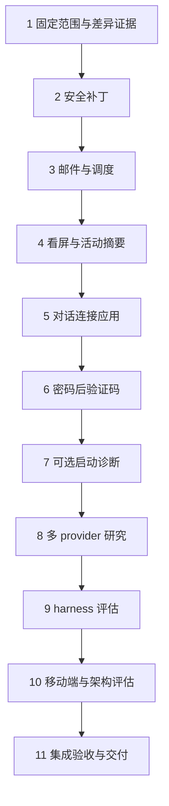

# OpenBot 上游能力更新 Implementation Plan

详细派发版已补充：[18 项任务、共享接口、DAG 与验收步骤](2026-10-20-upstream-openbot-refactor/implementation-plan.md)。本文件保留总体范围，实际任务拆分与兼容决策以详细版为准。

> **For agentic workers:** REQUIRED SUB-SKILL: Use superpowers:subagent-driven-development to implement this plan task-by-task. Steps use checkbox (`- [ ]`) syntax for tracking.

**Goal:** 在保留 OpenMuse 公司/团队隔离、模型授权与计费、Craft、Hindsight 和 Mastra 迁移方向的前提下，吸收上游安全修复、对话体验和连接器扩展。

**Architecture:** 按功能移植，优先保留本地接口和治理入口。先处理无迁移补丁，再处理跨 UI/API 协议，最后评估 harness、移动端和执行引擎；上游 toolkit 不成为本次必需依赖。

**Tech Stack:** Bun（当前 packageManager 为 `bun@1.4.3`）、TypeScript、React、Hono、Drizzle/PostgreSQL、Tauri/Rust、Python agent harness、AG-UI；测试遵循 ADR 0008 的 native/driven 两层。

**Spec:** 本次用户要求“详细的更新方案”，承接 [逐功能比较](../research/2026-10-20-upstream-openbot-feature-matrix.md)。该对照表只是调查输入，并非批准需求。本计划的需求边界由下文定义；架构约束来自根 `CONTEXT.md`、ADR 0002–0010，以及 [Mastra 迁移 Spec](../specs/2026-10-19-mastra-agent-execution-migration-design.md)。用户已于 2026-10-20 采用详细设计并授权发布 Issue；正式父 Spec 为 #489，未授权本轮启动实施或上线。

## Global Constraints

- 公司、团队、个人身份由 OpenBot 可信上下文决定；前端传入的 tenant/workspace/user ID 不构成授权。
- 逐调用授权、审批、预算、Payer 与结算权威继续属于 OpenBot；新增工具走原治理路径。
- ADR 0005：Hindsight 是已批准的个人记忆方向。不得因同步上游重新建立 Intelligence 为第二套长期权威。
- ADR 0009：已删除 KB 域不得通过上游种子、工具、页面、迁移或容器依赖恢复。
- ADR 0010：Mastra 执行迁移方向优先；本次不整体引入上游 BuiltInAgent/toolkit 执行架构。
- 保留中文/英文、本地设计组件与可访问性；不得用上游整页替换抹掉本地功能。
- 上游 SQL 编号不直接复制。本地迁移按当前 journal 分配，不修改已应用迁移。
- 测试源按 ADR 0008 选择 native/driven 层；不得整批替换本地测试入口或复制上游 bun:test 后不登记。
- 实施时使用隔离工作区，记录原始 BASE、任务检查点和实际验证证据；默认串行实施，不使用共享 stash。
- 本次无提交、推送、合并、生产部署授权。后续实施若仍无提交授权，使用未提交检查点和 workspace OCR。

## Review Focus

1. OAuth 在新标签页完成或被浏览器阻止时，卡片只根据服务端账户状态确认连接；撤销记录不算有效连接。Task 5 覆盖。
2. 公司/团队切换或授权撤销期间，屏幕事件、账户轮询和诊断请求不能读取旧范围数据。Task 4、5、7 覆盖。
3. 验证码提交超时、重试和服务重启不得重复执行登录动作、保存验证码或把它送入模型历史。Task 6 覆盖。
4. 新 provider 在缺凭据、超时、SSRF 或治理拒绝时不得悄悄改走别的供应商、额外收费或扩大工具授权。Task 8 覆盖。
5. 灰度开关关闭、滚回旧应用与数据库保留新 schema 时，旧版本仍可启动且不重放已产生的副作用。Task 6、11 覆盖。

## 1. 基线、证据与需修正的前提

调查起始本地为 `d7f68d0ea60b1cfe6da4ff70c4522c227510580d`，上游固定为 `e8bb27368ff436958b614292ae91283e51d5a813`。2026-10-20 编写本计划时本地已由其他工作推进到 `3b4a7c68132c3507300408346a44fb9d56f3c14c`；应在实际实施前再次固定 BASE。该时点工作区只有此前生成的功能对照表未跟踪，本计划随后新增。此前“214 项未提交”已不是当前状态。

上游来源：[固定提交](https://github.com/CopilotKit/OpenBot/tree/e8bb27368ff436958b614292ae91283e51d5a813)、[固定版 CHANGELOG](https://github.com/CopilotKit/OpenBot/blob/e8bb27368ff436958b614292ae91283e51d5a813/CHANGELOG.md)。后续上游提交不自动扩大本次范围。

对照表需要先修正以下结论：

| 原调查表述 | 本次复核 | 对更新范围的影响 |
|---|---|---|
| 本地无移动端目录，因此缺移动端 | 根目录没有上游 `mobile/`；但 gitlink `apps/openmuse` 指向 `491d6215fa508808289053757e5084c875b7318c`，其 `apps/mobile/` 已有实现 | 不复制第二套移动端；先做现有客户端能力映射 |
| Intelligence 已确认记忆镜像可能缺失 | `server/src/memory/store.ts` 有 `mirrorEligible`、`mirrorRow`、串行 mirror 和 confirmed/edited 过滤；`memory/intelligence.ts` 已有适配 | 不重复开发镜像，不覆盖 Hindsight 决策 |
| Learning 自动分配是上游新增 | 本地 `learning/auto-assign.ts` 与上游差异主要可见于 import 路径；已有 ensure-container | 按已有能力回归，不另设功能补全任务 |
| `server/src/web-research.ts` 是上游入口 | 上游没有该文件；provider 角色表在 `shared/research.ts`，适配在 plugins 模块 | Task 8 以实际源码入口为准 |
| 缺 toolkit 就是缺执行能力 | 本地有 `routines/run-turn.ts`、`copilot.ts` 与 agents；上游拆包含结构迁移 | 作为后续架构评估，不纳入必须追平 |
| 已有安全域即可判行为等价 | 只能证明基础能力存在 | 逐个补丁比较，并给每个结论附证据 |

规划时未读取上游完整 Issue 树；2026-10-20 用户采用后，本方案已登记为 #489 及 12 张子 Issue。上游 PR 编号在这里用于定位变更，不代表本地执行依赖。执行 Issue 流程时另做正式摄取与验收映射。

## 2. 采用策略与范围

**本次建议实施范围：Task 1–8、11。** Task 9、10 交付评估结论，不自动授权 Antigravity 接入、第二套移动端或 toolkit 重构。

| 批次 | 内容 | 策略 | 原因 |
|---|---|---|---|
| A | 无 host URL 拒绝、遥测 flag 凭据脱敏、邮件 charset/HTML 引用、cron 重复分钟 | 精确移植补丁 | 改动小，可独立验收 |
| B | 自动看屏、工具活动摘要、对话连接应用、分步验证码 | 以本地 UI/API 重新适配 | 涉及前后端协议和已有企业权限 |
| C | 启动诊断、Exa/Firecrawl | 可选、治理约束下接入 | 不应改变默认费用或强制依赖 |
| D | harness 目录/Antigravity、移动端、toolkit/turn-engine | 比较与决策记录 | 与当前产品方向和 Mastra 迁移有关 |
| E | 全量集成审查、迁移演练、交付 | SDD + OCR | 避免局部通过而跨功能失败 |

不整体 merge 上游；不重新引入 KB/默认 Knowledge Bot；不把上游“默认启用后台研究/记忆来源”的策略覆盖到当前授权与预算模型；不升级所有依赖。Actions、Helm digest/volume/Composio、Bun 版本仅做差异盘点，有确凿缺口才另立兼容变更。

## 3. 任务 DAG 与接口预检

`contains`：本方案包含 T01–T11；下列 `depends_on` 来自执行前提，不来自 PR 时间先后。



这是一条刻意串行的实施链：T02–T08 多处共享 `index.ts`、plugins、copilot 工具与测试登记，串行可以减少同时迁移接口的冲突。真正业务前提为 T01→全部、T04→T05、T05→T06、全部选定实施项→T11；其余边为调度约束，可在独立工作区且稳定接口后调整。

| id | source | acceptance | owner / validator | owned_files（主要） | verification | status |
|---|---|---|---|---|---|---|
| T01 | 用户比较请求/本方案 | 固定 SHA、逐项移植/已有/排除有据 | researcher / reviewer | 本计划、比较表、执行 ledger | Git 与文件入口核验 | pending |
| T02 | 上游 #795/#764 | 拒绝无 host 配置；敏感命令脱敏 | backend_implementer / backend_validator | config、scrub、安全测试 | 边界输入与导出链 | pending |
| T03 | #787/#807/#803 | 邮件正确解码、cron 文案去重 | backend_implementer / backend_validator | responsibilities/email、routines/schedule | 解析/调度回归 | pending |
| T04 | #798 及工具活动 UI | 屏幕只随有效事件开关；活动摘要准确 | frontend_implementer；必要协议任务 backend_implementer / 对应 validator | computer-activity、屏幕 hook、transcript、activity | 事件序列与 UI | pending |
| T05 | #798 | 对话 OAuth 连接闭环且不自动重放 | backend_implementer→frontend_implementer / 双端 validator | plugins 拒绝类型、连接卡片、locales | OAuth/撤权/跨范围 | pending |
| T06 | #780 | 密码之后出现验证码；一次性恢复 | backend_implementer→frontend_implementer / 双端 validator | sign-in、schema/migration、前端表单 | 状态机与重试 | pending |
| T07 | #771/#782 | 诊断可解释、无凭据泄漏、可选依赖 | backend_implementer / backend_validator | startup checks、index、config | 超时/缺配置/禁用场景 | pending |
| T08 | #790 | 三 provider 共用授权、预算和审计 | backend_implementer→frontend_implementer / 双端 validator | research、catalogue、tools、locales | provider 合约+计费回归 | pending |
| T09 | #799/#808 | 目录/凭据需求与现有框架逐项映射 | architect / reviewer | 评估报告；不改生产代码 | 兼容矩阵 | pending |
| T10 | mobile/#784 | 现有移动端能力映射；执行架构取舍明确 | architect / reviewer | 评估报告；不改生产代码 | ADR/Spec 对齐 | pending |
| T11 | 本方案全范围 | 选定验收全覆盖、独立 Review/OCR 通过 | 主控 / 双端 validator + reviewer | 集成证据与报告 | 检查、全范围 OCR | pending |

角色专业分工不改变纵向任务范围；跨端任务按稳定协议先后派发同一 Task 下的实现 brief。所有子 Agent 只接单个 brief，不继承主会话、不继续派发；主控集成。

**共享接口预检：** T01 固定现有 account DTO、computer activity、sign-in status、研究工具 ID、模型治理 context 与测试登记入口。T04 先确定事件字段，T05/06 再消费；T08 复用既有工具 ID，不用供应商名覆盖真实 tool name。每次修改共享 schema 或 `index.ts`，都更新接口快照及相关消费者检查。新签名在对应任务内给出；现有类型以固定 BASE 的导出为准，不凭本计划猜测。

## 4. 详细任务

### Task 1：固定更新清单与执行基线

**Depends on:** 无。**Files:** 本计划、`docs/plans/research/2026-10-20-upstream-openbot-feature-matrix.md`；创建计划专属目录中的 `ledger.md`、`patch-manifest.md`、`interfaces.md`。实施开始才建立执行工作区。

**Interfaces:** Consumes：固定本地/上游 SHA、ADR、现有 approved specs。Produces：每个功能的 `source_sha / touched_paths / local_equivalent / decision / acceptance / evidence`，和共享接口快照。

- [ ] 使用 using-git-worktrees 建立或核验隔离工作区，记录 BASE、分支、原有用户修改；将这份未提交计划显式复制并校验哈希。
- [ ] 比较 HEAD 与规划 BASE，逐个更新 T02–T08 的真实缺口。已由其他工作完成的项目，只补证据，不重复实现。
- [ ] 修正比较表中移动端、记忆镜像、研究路径和架构差异的错误，给不确定项保留“待核验”说明。
- [ ] 从固定上游 PR/commit 提取相关 diff 和原始测试，登记非目标删除项及本地冲突点；不要把所有 HEAD..upstream commits 当成未实现功能。
- [ ] 记录现有接口和测试层归属。验证：清单每行都有证据路径、决策、验收，无空引用、循环或未覆盖需求。
- [ ] 形成 T01 检查点并独立 Review；后续任务只读取集成后的该检查点。

**失败处理：** 上游不可读取时可用已固定本地 upstream 对象；对象也缺失则标明该功能证据不足，只阻塞该功能。未解决的 Spec/ADR 冲突进入决策记录，不自行改需求。

### Task 2：配置边界与凭据脱敏

**Files:** 修改 `server/src/config.ts`、`server/src/telemetry/scrub.ts`；定位并扩展现有 `server/tests/single-user.test.ts`、scrub/export 测试；必要时修改 `server/tests/otel-export-scrubbing.test.ts`。上游参考 #795 `e8bb2736`、#764 `916ea9a1`。

**Interfaces:** Consumes：现有配置读取和命令 scrub API。Produces：保持现有函数签名；没有可解析 hostname 的地址不得在 single-user 模式被判作私有地址。

- [ ] RED：添加 `example.com:3010`、无 scheme 的 localhost、空 hostname、合法 HTTP localhost、真实公网 host 的配置用例；前四类中无 host 输入须明确拒绝，不误伤合法本地 URL。
- [ ] RED：添加 `--password value`、docker/sshpass/redis 命令参数、引号、紧邻参数、裸 flag、curl 凭据的输入；敏感值消失且不会吞掉无关后续参数。
- [ ] 使用适用的 ADR 0008 层运行新增用例，确认现有版本的真实失败；实施最小修改。
- [ ] GREEN：检查 audit/OTel/export 最终载荷而非只检查帮助函数；确认既有 tenant key 脱敏和日志结构保持。
- [ ] Review 并记录补丁检查点；有重叠但已修复的输入只登记通过证据。

**验收/失败处理：** 无 host 不能绕过启动拒绝；凭据不出现在任何被覆盖的导出载荷。误拒合法配置则缩小解析变更，不能降回“解析失败算私网”。

### Task 3：邮件解析与例程文案修复

**Files:** `server/src/responsibilities/email.ts`、`server/src/routines/schedule.ts`、`server/tests/routine-schedule.test.ts` 和 T01 定位的 email 测试。参考 #787 `cf426553`、#807 `06be0f97`、#803 `aa932104`。

**Interfaces:** Consumes：现有 inbound SNS/MIME 解析与 `describeCron(cron: string): string`。Produces：保持触发入参/调度执行语义，仅修复正文和描述。

- [ ] RED：base64 与 quoted-printable 的 iso-8859-1/UTF-8、未知 charset 回落 UTF-8、多 MIME part 不同 charset。
- [ ] RED：HTML-only `&amp;`、十进制/十六进制引用、`&nbsp;`，`&amp;lt;` 只解一层；plain text 不执行 HTML 解码、不把转义文本再次变为标签。
- [ ] RED：`describeCron('0,30,0 9 * * *')` 必须只含 `09:00` 一次，并保持升序/原时区及现有 weekday 行为。
- [ ] 分别移植最小解析与 `Set` 去重修改；不引入 MIME 大范围重写。
- [ ] GREEN：触发路由仍验证 SNS 签名、topic allowlist、正文上限；描述修复不改变下一次触发时刻。完成 Review/检查点。

**失败处理：** 不支持的编码按已定义回落；无有效解码能力的包依赖升级另记，不以乱码静默通过。

### Task 4：自动看屏与工具活动摘要

**Files:** `app/src/lib/copilot/computer-activity.ts`、新增 `app/src/components/computer/use-auto-watch-screen.ts`、`app/src/components/channels/chat-transcript.tsx`、`browser-activity.tsx`、新工具活动组件、`app/src/locales/{en,zh-CN}/` 对应词条；如缺事件生产方，单独后端 brief 拥有 Computer/工具事件生产入口。

**Interfaces:** Consumes：T01 固定的现有 Bot/run/tool-call 标识。Produces：活动和撤回必须能关联同一 Bot、run 与 call/announcement；不得仅凭“最近一次事件”关闭屏幕。优先复用上游字段定义，兼容本地 AG-UI。

- [ ] RED：文本回复、文件读写、shell 不自动开屏；真正浏览器动作开屏；被拒动作只撤回自己打开的屏幕。
- [ ] RED：用户手动开的屏幕不被关闭；同 run 手动关闭后不再自动开；旧 run/其他 Bot/旧组织事件无效。
- [ ] 先补协议生产方（若需要）并 Review，再实现 hook 和本地路由接入，保持原有手动屏幕入口。
- [ ] RED/GREEN：相邻研究/connector/browser calls 折为摘要，展开仍有原参数/结果；审批与连接卡片保持独立，失败计数依据最终 tool result。
- [ ] 校验移动窄屏、键盘展开/关闭、读屏标签、中英文；完成 UI 验证和独立 Review。

**失败处理：** 自动开屏与摘要分别可关闭；无法可靠关联的事件不自动关闭用户面板，原始工具记录仍保留。

### Task 5：在对话内完成账户连接引导

**Files:** 后端拥有 `server/src/plugins/tools.ts` 及现有拒绝结果组装入口；前端拥有新增 `app/src/components/channels/connect-app-card.tsx`、transcript、`app/src/lib/plugins/{queries,mutations}.ts` 与 locales。参考上游 connect-app-card 及 #798。

**Interfaces:** 后端产生可辨识的连接要求，最小语义为 `{kind:'connection_required', serverId:string, title:string, mode:'oauth'|'key'|'admin', message:string}`；最终字段沿用既有结果 envelope，新字段以兼容扩展加入。前端不得从任意 tool 输出文字解析 URL 或权限。

- [ ] 后端 RED/GREEN：从未连接、运行中断连、凭据被撤销统一归入正确模式；禁止普通用户连接团队/部署管理员账户。
- [ ] 前端 RED：点击当下预占标签页，服务端返回授权 URL 后导航，切断 opener；被弹窗拦截有显式可点击退路。
- [ ] 实现有限时长的当前用户/当前组织查询，只有服务端返回未撤销有效账户才显示连接成功；切组织和卸载时停轮询。
- [ ] key 模式转到现有输入页面；admin 模式提示管理员操作；慢网络和错误允许重试。
- [ ] 验收：原对话保留，连接后提示用户再次发起，不自动重放写操作；身份隔离、撤权与失败流程经过双端验证和 Review。

**失败处理：** 关闭卡片入口后仍能走现有设置页面；新增结果字段不使旧客户端崩溃。

### Task 6：密码后再提交验证码

**Files:** `agent-computer/src/sign-in.ts`、Computer HTTP 路由/authorisation、server sign-in 状态读写入口（T01 精确定位）、`server/src/db/schema/` 对应 schema、本地新 migration、`app/src/lib/copilot/sign-in-tool.tsx` 和相关表单/locales。

**Interfaces:** 服务器新增可兼容的 `code_required` 状态；Computer 密码提交结果报告是否等待 code，独立 code 提交只接受当前 pending request、相同用户/组织和可信 origin。响应不返回密码/code。不得直接采用上游 0056 编号。

- [ ] 先确定 transition 表：pending→password submitted→code_required→completed；拒绝/过期/取消为终态。重启从持久状态恢复，秘密值不持久化。
- [ ] RED：无 code 页面时不询问验证码；密码未过时不跳 code；code 错误可重试但有现有速率限制，过期 code 不触发动作。
- [ ] 迁移只扩展允许状态，验证旧值可读、重复启动不重复迁移；对新增状态旧版应用的兼容性列为发布约束。
- [ ] 后端实现并 Review 后再接入前端两阶段表单；密码/code 不进入 transcript、audit 内容、异常日志或模型上下文。
- [ ] 验证并发提交、浏览器跳转 origin 变化、组织切换、重启和取消；确认每次外部提交具有明确请求身份及可审计结果。

**验收/回滚：** API server 与 Computer 协调发布。回滚前停止新验证码请求，完成/取消现有 code_required 请求；保留扩展 schema 后回滚应用，不强行缩窄约束或恢复已过期秘密。

### Task 7：有界且可选的启动诊断

**Files:** 新增 `server/src/model-availability-check.ts`、`server/src/intelligence-entitlement-check.ts`（或按本地模式适配）；修改 `server/src/index.ts`、config、对应测试。参考上游同名模块。

**Interfaces:** 新模块通过注入的 read-only check 与 logger 返回诊断结果；启动调用带超时且 catch，不改变业务授权。模型探测必须通过批准的 provider/gateway 路径，不拿虚拟 Key 跨用户探测供应商。

- [ ] RED：未配置 Intelligence/学习已关闭时跳过 entitlement 查询；普通启动可用，不新增强依赖。
- [ ] RED：供应商凭据拒绝、模型不存在、超时和兼容 endpoint 不支持 model lookup 分别处理，不能把兼容 API 的 404 直接判为模型不存在。
- [ ] 实现有超时预算的非阻断诊断，日志只包含安全模型标识、分类和修复建议，无 key 或含凭据 URL。
- [ ] 企业模型目录/Bifrost 已有等价诊断时接入该入口并减少重复网络请求。
- [ ] 验证关闭/缺配置/网络失败/范围切换不会污染运行身份；Review/检查点。

**失败处理：** 诊断失败只报告 unknown/unreadable，不阻塞已合法配置的聊天。发现需要新的供应商管理权限时不扩大凭据作用域。

### Task 8：Exa/Firecrawl 与 Parallel 统一研究能力

**Files:** 新增本地 `shared/research.ts`；修改 `server/src/plugins/catalogue.ts`、`tools.ts`、MCP 注册/角色适配入口；新增/扩展 research 测试，前端工具活动标签、locales、`.env.example` 和 `reference/web-research.md`。上游真实参考为 `shared/research.ts`、plugins 模块和 `server/tests/web-research.test.ts`。

**Interfaces:** provider 角色表统一 provider、search/fetch/notes 工具名与认证需求；以固定上游类型为参考、映射本地 GrantedTool 类型。保留工具真实名字、部署连接 ID、实际 actor/payer 和调用审计。

- [ ] RED：三 provider 的 search/fetch 工具识别及仅只读工具被提供；未知/写工具不因 provider 标签绕过授权。
- [ ] 适配现有 MCP/catalogue 机制，缺某 provider key 时该 provider 不可用，Parallel 原配置仍工作。
- [ ] 使用本地凭据加密/授权路径，URL 走现有 egress；说明按 provider 计费，既有预算拒绝不转供应商。
- [ ] RED/GREEN：超时、撤权、上游错误返回真实失败；用户需要来源链接时保留 provider 的原始 URL/来源字段，不伪造引用。
- [ ] 验证当前用户与公司 Payer 不变、一个真实调用只有一次计量；更新 UI 标签和双语文档。
- [ ] 单 provider 关闭回到原可用集合，默认不打开全部 provider、不自动引入后台研究；Review/检查点。

**失败处理：** 实际 provider 联调需要环境凭据，只能标 integration blocked；离线合约通过不等于线上联调通过。禁止为测试编造或打印凭据。

### Task 9：harness 目录和 Antigravity 可行性评估

**Files:** 创建 `docs/plans/research/2026-10-20-upstream-harness-adoption.md`；只读 `shared/harnesses.json`（上游）、本地创建向导、`desktop/src-tauri/src/harness.rs`、agent-*、现有 provider/model-access 规则。

**Interfaces:** 输出每个 harness 的 `framework / install_image / runtime_endpoint / credential_requirement / web_create / desktop_install / governance_compatibility` 映射表。

- [ ] 比较上游统一目录与本地所有框架选项，保留本地 trpc/sandbox/Mastra 等差异，不因上游目录未列入就删除。
- [ ] 针对 Antigravity 验证其依赖、Gemini 凭据需求与当前模型网关/授权方式是否兼容；无法兼容时明确列为当前不采用。
- [ ] 单一目录复用方案须明确 TypeScript/Rust 的读取或生成关系，不能运行时从网络获取目录。
- [ ] 给出采用/延期结论、必要的新 Spec/ADR 与可验收后续范围。此任务完成仅代表评估交付，不代表框架已上线。

**失败处理：** 不支持现有逐用户模型授权时，不提供绕过网关输入部署 key 的临时接入。

### Task 10：现有移动端与执行架构差距评估

**Files:** 创建 `docs/plans/research/2026-10-20-upstream-mobile-runtime-adoption.md`；只读 `apps/openmuse/apps/mobile/`、相关 mobile BFF、上游 `mobile/` 与 `toolkit/`、本地 Mastra Spec。

**Interfaces:** 输出移动能力映射（聊天、Bot、审批、屏幕、插件、记忆、例程、通知、登录/组织切换），及执行接口映射（turn admission、lease/lock、history、approval resume、cancel/stop）。

- [ ] 固定子模块 SHA，记录有代码/有后端接口/有验证证据三种不同状态，不把有页面等同于可用。
- [ ] 仅把现有移动产品缺失且有需求依据的能力列后续增量，不创建根 `mobile/` 作为第二套客户端。
- [ ] 比较上游 toolkit 中有价值的线程锁、settle 和 lease 行为，与 Mastra 迁移任务逐项去重。
- [ ] 决定保持本地结构或在 Mastra 计划中吸收必要约束；任何新的拆包实施独立立项，不混入本次 UI/安全批次。
- [ ] Review 检查没有恢复 KB、第二套 memory 权威或第二套 Run/Attempt 权威。

### Task 11：集成验收、OCR 与交付清单

**Files:** 创建计划专属 `verification-summary.md`、`rulings.md`、`ocr-round-N.*`，更新 ledger 与验收映射；发布说明写入仓库现有文档位置。

**Interfaces:** Consumes：全部选定交付任务的已集成、已 Review 检查点。Produces：绑定同一 Git 状态/文件哈希的验收、Review、OCR 和回滚证据。

- [ ] 在与发布形状一致的单一工作区验证正常聊天、工具授权/撤权、审批恢复、公司/个人 Payer、跨团队不可见、Craft 预览、记忆候选不可召回。
- [ ] 按 ADR 0008 执行 native/driven/engine 适用测试；新增 suite 完成分类及实际执行覆盖对账，未执行与失败分别列明。
- [ ] 运行 `bun run typecheck`、`bun run lint`、`bun run build`；受改动影响的 Rust/Python 包执行其本地既有检查，Bun root 命令不能替代它们。
- [ ] 无迁移批次、sign-in 迁移批次分别演练前进/回滚。确认 API/Computer 版本组合和 pending code 请求处理。
- [ ] 主控派发独立 Spec/质量 Review；修复后补影响范围验证。实现者不批准自己的改动。
- [ ] 主控按 open-code-review Skill 运行 OCR，始终 `--audience agent`；有未提交交付用 workspace，若另有提交再覆盖原始 BASE..HEAD。完整记录退出码、失败/跳过文件、警告及范围。
- [ ] 对有效 critical/high/medium finding 进入编号修复计划，经 writing-plans→SDD→独立复审→完整 OCR；报告覆盖不完整不能放行。
- [ ] 最终记录采用/已有不改/延期项、用户可见变化、测试与 blocked 项。持久保存证据后按 finishing-a-development-branch 收尾；上线需要已有或新增明确授权。

**完成条件：** 选定实施 Task 的实际验收全部通过，评估 Task 有审查结论，最终完整范围没有未解决阻塞性 finding。真实环境/凭据阻塞不算功能已完成。

## 5. 验证命令与证据口径

计划阶段没有运行测试。下列命令是实施时的检查模板，不代表当前通过；T01 必须根据目标 suite 的 import 和 ADR 0008 更新后的真实入口确认归属。

```bash
# native 层，仅用于已确认在 Node/e2e 层的 suite
bunx e2e run --config e2e.unit.config.ts <suite-path>

# driven 层单文件诊断；必须另验证由统一驱动登记并实际执行
bun test ./<suite-path>

# 整体守门（会包含环境依赖，应准备独立数据库/服务）
bun run test:ci
bun run typecheck
bun run lint
bun run build
```

每份证据包括工作区、HEAD/检查点哈希、命令、退出码、实际执行数量、skipped/blocked 原因和报告路径。不能把 exit 0 且全 skip 作为通过。外部模型/MCP、OAuth 和邮箱真实链路使用受控测试账户与最小凭据，证据中仅保留脱敏结果。

## 6. 分批交付与回滚

| 交付批次 | 前置与内容 | 放行条件 | 回滚 |
|---|---|---|---|
| A | T01–03；配置/脱敏/解析小补丁 | 定向回归、独立 Review、该批 OCR | 回滚应用；无数据库变更 |
| B | T04–06；体验和验证码 | 前后端协议兼容、真实浏览器验收、sign-in 迁移演练 | 关闭新入口；清理在途 code 状态；API/Computer 协同回滚；保留扩展 schema |
| C | T07–08；诊断/provider | 可选服务关闭可启动、授权/预算/外部合约证据 | 禁用新 provider/诊断；保留原连接配置与审计，不重放工具 |
| D | T09–10 评估；T11 全范围验收 | 清楚列出采用/延期和未解决约束 | 评估不改运行行为，无生产回滚 |

若后续批准分批发布，每批都需针对已选范围完成 Review/OCR；最终仍需原始 BASE 到交付 HEAD 加全部未提交内容的完整覆盖。迁移前备份和恢复演练不能替代副作用去重；恢复后要重放撤权/遗忘等治理记录，禁止复活已失效权限。

## 7. 粗略工作量与执行建议

在单流串行、依赖环境可用且不新增产品发现的条件下，T01–03 约 2–4 工程日，T04–06 约 5–9 工程日，T07–08 约 3–5 工程日，T09–10 约 2–3 工程日，T11 及常规修复约 2–4 工程日，总体约 **14–25 工程日**。这是规划估算，不是完成承诺；第三方联调等待、现有基线失败和需求冲突单列。

优先交付 A；B/C 在稳定接口上逐项推进。Antigravity、移动端补全及 toolkit 重构的实施量没有包含在估算中，因为本次只安排评估，不把未解决架构问题算作已决定工作。

## 8. 计划自查

- [x] 用现有 ADR 约束上游采用范围，未恢复 KB、第二套 memory/执行权威。
- [x] 区分前一轮调查基线与当前 HEAD，保留重新固定 BASE 的步骤。
- [x] 每个实施 Task 有来源、文件责任、输入输出、可观察验收与失败处理。
- [x] 共享入口串行安排；跨端先协议后 UI；Review 和实现分开。
- [x] 不把本地文件缺目录等同于业务能力缺失，不把架构拆包等同于产品落后。
- [x] 标注未做 Issue 树摄取、未运行测试、未实施，避免把计划当完成证据。
- [x] 计划仅新增文档；后续实施需再次读取 Ledger/Git 并核验已存在工作，不重复派发。
