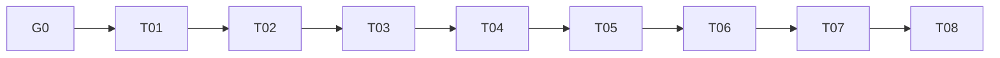

# Better Auth Agent Delivery Implementation Plan

> **For agentic workers:** REQUIRED SUB-SKILL: Use superpowers:subagent-driven-development (recommended) or superpowers:executing-plans to implement this plan task-by-task. Steps use checkbox (`- [ ]`) syntax for tracking.

**Goal:** 将已完成24项缺陷整改的候选设计（v2.3，含第三轮F-01–F-10）拆为可在独立上下文中交付、可验证、可审查的细粒度Issue，并保持原P01–P25及BA01–BA20全部需求。

**Architecture:** 沿原Spec T01–T08业务切片，叶子Issue按已冻结接口串行交接。先完成固定版可行性、事务/authority及M0–M3工具，再迁入gate/写路径；企业Mobile先交付OpenBot authority和保留OpenMuse server的BFF，再接真实App。最后演练M4切换与恢复，独立验收和Review/OCR通过后只形成发布准备包。

**Tech Stack:** Bun/Hono、Better Auth 1.7.1候选固定版本、Drizzle/PostgreSQL、React/Vite/TanStack、Mastra/Worker、Tauri、Expo/OpenMuse及Bifrost Go；tester-army e2e统一根调度。

**Spec:** [v2.2候选设计](../../specs/2026-10-22-better-auth-full-integration-design.md)；[原25任务计划](../2026-10-22-better-auth-full-integration/plan.md)、[冻结接口](../2026-10-22-better-auth-full-integration/interfaces.md)、[验收合同](../2026-10-22-better-auth-full-integration/acceptance.md)。本轮仅编写计划与GitHub Issues，**不批准Spec、不实施生产代码、不提交/推送/合并/发布**。

## Global Constraints

- 一User一Principal；保留既有User/Tenant/Workspace、payer、历史费用和外部issuer/subject，不按邮箱合并。公司成员移除只影响本公司；全局身份禁用才失效个人身份能力。
- authority与release分开：M0/M1原legacy读写/DTO保留；M2/M3只暂停目录写；M4原子切BA。新配置只在对应BA/enterprise模式启用时要求，不让legacy因新环境变量缺失停机。
- 可信actor/Scope/tx/capability只由服务器签发，selector/active/header是意图；每个新敏感动作实时核验。公司管理、内容、财务、平台权限分判；不增加默认管理员/公司/团队。
- 安全写、最终投影、clocks、审计和outbox同事务；不在锁中等待外部系统。个人Key/Grant/凭据来源版本缺失或过期不得用当前身份补齐，恢复身份不复活旧能力。
- 保留Bun/Hono、React/Vite/TanStack、Mastra/Worker、现有账务权威。首期不做KB恢复、跨公司分享、自助建公司、动态角色或模拟登录。
- 只改本Issue文件。你不是工作区内唯一协作者，不回退他人改动；共享文件串行接管。当前没有提交/推送/合并/发布授权，使用未提交检查点，不操作生产数据。
- “每个成员关系只有一个写入权威”；目录/身份安全写、clock/tombstone、投影、审计、outbox同事务；固定版延迟hook必须分类，禁止全局连接补写，邮件callback吞错仍由receipt提交围栏拒绝半状态。
- “成员撤销提交后，新业务事务和后续敏感动作的准入不能继续使用旧资格”；下载HWM0串行pull、一次enqueue最多262144字节，真实Bun/Hono缓冲计数。公司challenge最长600秒，proof使用签名声明真实认证时间。
- 个人Model Access Grant/Key保存身份来源代际，claim/renew与实际Bifrost包括免费模型的新dispatch在线检查；outbox停机仍拒绝，restore不复活旧能力。原payer及历史费用不改，未知费用不自动退款。
- 密码部署sendResetPassword、3600秒token及真实邮件必需；原生POST唯一消费token和写hash，同事务Identity finalizer推进代际、撤全部session/proof。纯SSO不开放密码恢复。
- 移动enterprise保留OpenMuse server及原Workspace DTO；PKCE code120秒单次、handle不超过1800秒、媒体定位票据不超过60秒且每次pull在线检查。App/MuseApi/CopilotKit/媒体/回调实际接线，accessKey/sample/local-user不兜底。
- 原生Admin/Organization51个HTTP及无path addMember逐项处置，所有Organization GET有三类反例；删除/模拟登录/动态角色后端拒绝。默认/Web/Mobile测试收集互斥，缺origin在任何导航前失败。
- 无提交授权时使用完整未提交检查点，转移依赖源码并校验hash；ready-for-agent不是未阻塞。用户其他staged/unstaged/untracked改动保留，禁止共享stash协调。

## Review Focus

1. BA吞邮件callback异常或把after hook推到外层pendingHooks：不允许token孤存、投影漏写、事务外补写；T01.04/T02.12/T04.05/T05.05具名故障反例。
2. 用户禁用与远程Key创建/free模型dispatch交错、恢复后旧Grant仍active：不披露新Key、不新dispatch、不改历史payer；T05.10/T05.11/T06.11/T06.12/T07.02。
3. 改gate时旧公司没有BA clock，或M4切换时旧writer仍活跃：legacy不退化、paused目录503、M4一次切换并围栏旧进程；T02.10/T02.15及每迁入Task矩阵/T08.01。
4. SAML缺AuthnInstant/RelayState被改，或密码登录关联了公司IdP却无公司proof：拒绝且不以callback时间代替；T01.06/T01.07/T05.02/T05.03/T05.04。
5. 默认浏览器错收Mobile、manifest只登记files，或断开真实App/Bifrost接线后helper仍通过：静态审计/0网络preflight/实际消费者反例必须失败；T01.01/T01.02/T01.10/T04.12/T06.12/T07.13。

---

## 1. 范围、基线与批准门槛

规划基线为本地HEAD `bcf51633f16201aa453ed5f4dbe81007f498de55` 加本轮读取到的未提交候选设计四文件。仓库同时有其他工作的改动，本计划不将它们认定为本需求已交付；最终源码派发前重新核对。ADR0011仅批准技术方向，不把旧作废Issue #6恢复为需求。

本轮复用当前checkout进行文档工作，未建立实施工作区。实现时必须用using-git-worktrees/Orca规则建立或核验隔离工作区，并显式带入已批准设计、计划与已审查前置检查点；未提交文件不会自然出现在新worktree。运行证据保存于 `.archive/runs/2026-10-22-better-auth-ticket-planning/`，因被忽略需显式转移，不声称远端已有本地未提交文件。

### G0：唯一实施准备门槛（不是开发任务）

- [ ] 用户明确批准实施范围及候选Spec的最终版本；计划/Issue发布不替代这项批准。
- [ ] 主控读取新根Issue树、评论与原生依赖，记录快照并校验完整性；把批准Spec及本计划完整带入执行区并校验本文四文件hash。
- [ ] 核验工作区/BASE/分支、当前用户改动、各专业角色与无提交策略；建立执行DAG/Ledger和任务检查点目录。
- [ ] 准备专属PostgreSQL五角色同库URL与实际邮件/IdP/SCIM/对象存储/Bifrost/支持客户端环境；没有环境的相关必需验收保持blocked，不猜凭据、owner、payer映射或恢复高水位。
- [ ] 确认已启用能力与支持平台清单；额外启用能力若不在本计划，先新增边界清晰的小Issue，不把禁用功能误判为已实现。

所有无开发前置的叶子原生blocked_by指向G0，其余经依赖传递受G0约束。G0由主控维护，不能交代码Agent自行批准。

## 2. 分解与一个上下文的交付合同

共105个叶子：102个实现/测试Issue，2个独立行为验收和1个最终Review/OCR汇总门槛；另有G0准备项、8个业务父项和1个根Spec，共115个GitHub Issues。父项只聚合验收，不重复子Issue实现。

每个实现Issue通常3–7个主文件、1–2个目标测试；schema迁移/journal、固定UI最小生成闭包和本Task的runner登记为明确附属件。最多8主文件+2测试/辅助输入，目标输入约12–24k tokens，读取大型文件的目标函数区段。跨端通过接口切开，后端和前端分别由专业Agent负责；本计划不声称CPU耗时/外部等待一定能在某个分钟数内完成。

主控每次给一个全新上下文：本Issue全文、必要Global Constraints、直接前置的已审查源码检查点、准确文件/接口/测试命令、工作区与提交策略。不得把整份25任务计划、其他104份Issue或历史聊天打包交给实现者。若现场证实超预算或新增消费者，不强迫Agent临场横跨系统，回主控按稳定接口再拆Issue并更新依赖。

默认按下面拓扑序串行；就绪并不授权并行。实现者完成RED/GREEN/自查和报告，validator只验证不改源，独立reviewer分别判Spec与质量；证据绑定同一hash，才可verified。无关改动是基线，不能被顺手整理。实现者不派生Agent。

命令中的 `.archive/runs/ba-execution` 是本计划给出的默认执行run根，主控开工可换为实际run-key并在Brief明确展开；不是待定接口。RED/GREEN和Task输出隔离。每个BA DB测试稳定组名为 `server/tests/better-auth:TaskId`，由T01.01生成而非手工维护files/groups。外部子模块先由T01.10建立根固定白名单driver，再由消费者登记本任务已存在测试。

每个相关后端任务都要加入 `legacy_authority_keeps_existing_tenancy_green` 矩阵；每个前端以authority广告选择原adapter或BA adapter。合入时的新环境变量不应破坏legacy模式。所有原P任务覆盖包含本职责内的schema、接线、测试和登记，不留到末尾“统一补测试”。

T08.06–T08.08是验收/汇总Issue，不是让一个代码Agent重做整个系统；主控复用各叶子当前hash的独立证据，按模块发窄范围审查包并汇总全范围OCR，缺项则阻断，不修改源“修到通过”。

## 3. 业务父项与具体任务

contains与depends_on分别维护；父项成员关系不代表执行顺序。下表是静态计划定义，运行状态仅写执行Ledger。

| 父项 | 目的 | 叶子数 |
| --- | --- | --- |
| T01 固定版本与可行性 | 先证明真实事务、hook、SSO证据与UI兼容，建立可信测试入口；不提前切换生产权威。 | 10 |
| T02 目录事务与前置迁移 | 稳定ID/Principal/clocks、单写命令与authority分支就绪，先完成M0–M3离线工具。 | 15 |
| T03 公司开通与可信选择 | 平台开通、生命周期、实时Scope与真实Web切换闭环。 | 7 |
| T04 邀请成员与账户恢复 | 邀请/角色/owner/团队管理Grant及真实邮件/密码恢复安全闭环。 | 12 |
| T05 公司认证与全局身份 | 原始SSO证据、SCIM/JIT、平台身份命令、个人Grant/Key及移动authority合同。 | 16 |
| T06 业务准入与实际执行 | 私有资源、逐pull下载、Run/Worker/审批/lease、真实Bifrost和启用外部消费者。 | 18 |
| T07 企业BFF三端与账务 | OpenMuse企业BFF、Web/Desktop/Mobile真实接线、财务/容量/审计分权。 | 19 |
| T08 迁移恢复与统一验收 | 最终M4切换预演、恢复与高水位、完整surface装配、独立验收和Review/OCR；不自动发布。 | 8 |

**图仅展示业务主线；精确执行依赖以下表及各Issue为准。** 细任务允许跨父项提前交付稳定服务器合同，不能仅按父项编号整批开工。

| Task | 目标 / 详细步骤 | 直接前置 | 实现 / 验证 | 原任务 |
| --- | --- | --- | --- | --- |
| T01.01 | [让 Bun 清单与实际执行严格对账](../tickets/better-auth/T01.01.md) | G0 | backend_implementer / backend_validator | P01 |
| T01.02 | [为 BA 套件提供独立数据库角色与真实 HTTP 夹具](../tickets/better-auth/T01.02.md) | T01.01 | backend_implementer / backend_validator | P01 |
| T01.03 | [证明固定版 BA 同连接事务与邀请原错误保留](../tickets/better-auth/T01.03.md) | T01.02 | backend_implementer / backend_validator | P01 |
| T01.04 | [证明延迟 hook 与邮件吞错均可被提交围栏控制](../tickets/better-auth/T01.04.md) | T01.03 | backend_implementer / backend_validator | P01 |
| T01.05 | [证明普通成员的精确团队命令无需管理员会话](../tickets/better-auth/T01.05.md) | T01.03 | backend_implementer / backend_validator | P01 |
| T01.06 | [证明 OIDC 原始签名证据可绑定公司挑战](../tickets/better-auth/T01.06.md) | T01.02 | backend_implementer / backend_validator | P01 |
| T01.07 | [证明 SAML 原断言与 RelayState 可用于公司证明](../tickets/better-auth/T01.07.md) | T01.02, T01.06 | backend_implementer / backend_validator | P01 |
| T01.08 | [固定 BA UI 来源并接入现有 React Provider](../tickets/better-auth/T01.08.md) | T01.03 | frontend_implementer / frontend_validator | P02 |
| T01.09 | [接通固定 UI 的 Organization 与账户 client adapter](../tickets/better-auth/T01.09.md) | T01.08 | frontend_implementer / frontend_validator | P02 |
| T01.10 | [先交付子模块测试的根调度与固定白名单合同](../tickets/better-auth/T01.10.md) | T01.01 | backend_implementer / backend_validator | P01, P17, P20 |
| T02.01 | [扩展 BA 目录与稳定业务 ID 映射](../tickets/better-auth/T02.01.md) | T01.04, T01.05, T01.06, T01.07 | backend_implementer / backend_validator | P03 |
| T02.02 | [建立 Principal 身份代际与持久资格 clock](../tickets/better-auth/T02.02.md) | T02.01 | backend_implementer / backend_validator | P03 |
| T02.03 | [建立命令终结、authority 与 outbox 持久模型](../tickets/better-auth/T02.03.md) | T02.02 | backend_implementer / backend_validator | P03 |
| T02.04 | [为长期授权与个人模型凭据追加来源代际](../tickets/better-auth/T02.04.md) | T02.02 | backend_implementer / backend_validator | P03 |
| T02.05 | [建立公司认证 challenge 与 proof 存储](../tickets/better-auth/T02.05.md) | T02.03 | backend_implementer / backend_validator | P03 |
| T02.06 | [落实受限连接、DML guard 与延迟约束](../tickets/better-auth/T02.06.md) | T02.03, T02.04, T02.05 | backend_implementer / backend_validator | P03 |
| T02.07 | [实现无公司前提的 PrincipalRegistry](../tickets/better-auth/T02.07.md) | T02.06 | backend_implementer / backend_validator | P04 |
| T02.08 | [完成 Directory 同事务命令 executor 与 finalizer](../tickets/better-auth/T02.08.md) | T02.07, T02.10, T02.12 | backend_implementer / backend_validator | P04 |
| T02.09 | [建立独立 Identity 命令与恢复事务内核](../tickets/better-auth/T02.09.md) | T02.07, T02.10, T02.12, T02.08 | backend_implementer / backend_validator | P04 |
| T02.10 | [产出 authority 分支与关闭的 CompanyAssurance](../tickets/better-auth/T02.10.md) | T02.06 | backend_implementer / backend_validator | P04 |
| T02.11 | [为原生 Admin/Organization 入口建立强制分类与读 gate](../tickets/better-auth/T02.11.md) | T02.08, T02.09 | backend_implementer / backend_validator | P04 |
| T02.12 | [提供事务内 outbox 与 callback 完成 receipt 围栏](../tickets/better-auth/T02.12.md) | T02.06, T01.04 | backend_implementer / backend_validator | P04 |
| T02.13 | [交付 M0 目录与授权来源只读盘点](../tickets/better-auth/T02.13.md) | T02.08, T02.09, T02.11 | backend_implementer / backend_validator | P25 |
| T02.14 | [实现 M1 expand 与 M2 停写回填工具](../tickets/better-auth/T02.14.md) | T02.13 | backend_implementer / backend_validator | P25 |
| T02.15 | [交付 M3 对账与后续任务可复用 authority 矩阵](../tickets/better-auth/T02.15.md) | T02.14 | backend_implementer / backend_validator | P25 |
| T03.01 | [让真实 Scope gate 比较持久身份和两层资格版本](../tickets/better-auth/T03.01.md) | T02.15 | backend_implementer / backend_validator | P05 |
| T03.02 | [提供稳定 ID 的公司团队发现和选择校验接口](../tickets/better-auth/T03.02.md) | T03.01 | backend_implementer / backend_validator | P05 |
| T03.03 | [从平台入口原子开通公司并固定 payer](../tickets/better-auth/T03.03.md) | T03.02 | backend_implementer / backend_validator | P06 |
| T03.04 | [实现公司暂停恢复及安全删除申请](../tickets/better-auth/T03.04.md) | T03.03 | backend_implementer / backend_validator | P06 |
| T03.05 | [实现 Web 唯一公司团队切换协调器](../tickets/better-auth/T03.05.md) | T01.09, T03.02, T03.04 | frontend_implementer / frontend_validator | P07 |
| T03.06 | [让 Web 缓存多标签和长流随选择代际清理](../tickets/better-auth/T03.06.md) | T03.05 | frontend_implementer / frontend_validator | P07 |
| T03.07 | [接通真实 Web 壳和公司团队空态](../tickets/better-auth/T03.07.md) | T03.06 | frontend_implementer / frontend_validator | P07 |
| T04.01 | [实现邀请创建取消重发与本人窄读](../tickets/better-auth/T04.01.md) | T03.04, T02.11 | backend_implementer / backend_validator | P08 |
| T04.02 | [实现邀请接受拒绝和首次主体原子建立](../tickets/better-auth/T04.02.md) | T04.01 | backend_implementer / backend_validator | P08 |
| T04.03 | [实现成员暂停移除恢复和最后 owner 保护](../tickets/better-auth/T04.03.md) | T04.02 | backend_implementer / backend_validator | P08 |
| T04.04 | [完成验证邮箱真实邮件与邀请前置闭环](../tickets/better-auth/T04.04.md) | T04.02, T02.12 | backend_implementer / backend_validator | P08 |
| T04.05 | [完成请求密码重置的 token 与邮件原子登记](../tickets/better-auth/T04.05.md) | T04.04, T02.09 | backend_implementer / backend_validator | P08 |
| T04.06 | [完成原生密码重置唯一消费与安全代际终结](../tickets/better-auth/T04.06.md) | T04.05 | backend_implementer / backend_validator | P08 |
| T04.07 | [提供公司管理员授予撤销团队管理 Grant 的接口](../tickets/better-auth/T04.07.md) | T04.03, T02.04 | backend_implementer / backend_validator | P09 |
| T04.08 | [接通指定团队管理员成员增删命令](../tickets/better-auth/T04.08.md) | T04.07, T01.05 | backend_implementer / backend_validator | P09 |
| T04.09 | [接通公司资料与团队管理真实页面](../tickets/better-auth/T04.09.md) | T03.07, T04.08 | frontend_implementer / frontend_validator | P10 |
| T04.10 | [接通人员角色与团队管理 Grant UI](../tickets/better-auth/T04.10.md) | T04.09 | frontend_implementer / frontend_validator | P10 |
| T04.11 | [完成公开邀请落地与登录换账号恢复](../tickets/better-auth/T04.11.md) | T04.10, T04.04 | frontend_implementer / frontend_validator | P10 |
| T04.12 | [隔离默认与 BA Web 浏览器套件并审计 target](../tickets/better-auth/T04.12.md) | T04.11, T01.01 | frontend_implementer / frontend_validator | P10 |
| T05.01 | [实现公司追加认证 challenge 的持久绑定](../tickets/better-auth/T05.01.md) | T04.03, T02.05, T03.01 | backend_implementer / backend_validator | P11 |
| T05.02 | [接通 OIDC 公司证明原始证据回调](../tickets/better-auth/T05.02.md) | T05.01, T01.06 | backend_implementer / backend_validator | P11 |
| T05.03 | [接通 SAML 公司证明自有 SP 与 ACS](../tickets/better-auth/T05.03.md) | T05.01, T01.07 | backend_implementer / backend_validator | P11 |
| T05.04 | [在目录与业务 gate 中实时验证公司证明](../tickets/better-auth/T05.04.md) | T05.02, T05.03 | backend_implementer / backend_validator | P11 |
| T05.05 | [把 SCIM 全方法接入原子目录命令](../tickets/better-auth/T05.05.md) | T05.04, T04.08 | backend_implementer / backend_validator | P12 |
| T05.06 | [把 JIT 与批准组规则接入单次团队能力](../tickets/better-auth/T05.06.md) | T05.05 | backend_implementer / backend_validator | P12 |
| T05.07 | [接通全局禁用恢复角色与会话撤销真实入口](../tickets/better-auth/T05.07.md) | T05.06, T02.09 | backend_implementer / backend_validator | P12 |
| T05.08 | [接通平台用户创建资料编辑与管理员密码重置](../tickets/better-auth/T05.08.md) | T05.07, T04.06 | backend_implementer / backend_validator | P12 |
| T05.09 | [固定跨部署 issuer+subject 与原生回调身份](../tickets/better-auth/T05.09.md) | T05.07 | backend_implementer / backend_validator | P12 |
| T05.10 | [让个人模型授权保存实时身份来源并安全重授权](../tickets/better-auth/T05.10.md) | T05.07, T02.04 | backend_implementer / backend_validator | P12 |
| T05.11 | [封闭已挂载 Bot Service claim 与 renew 身份旁路](../tickets/better-auth/T05.11.md) | T05.10 | backend_implementer / backend_validator | P12 |
| T05.12 | [实现移动企业模式一次性 PKCE session 交接](../tickets/better-auth/T05.12.md) | T05.09 | backend_implementer / backend_validator | P12 |
| T05.13 | [实现 BFF 每次动作的在线身份范围准入](../tickets/better-auth/T05.13.md) | T05.12, T05.04, T03.02 | backend_implementer / backend_validator | P12 |
| T05.14 | [接通 Web 账户验证与忘记重置密码页面](../tickets/better-auth/T05.14.md) | T04.11, T04.06, T05.08, T04.12 | frontend_implementer / frontend_validator | P13 |
| T05.15 | [接通 Web 公司追加认证与受控恢复交互](../tickets/better-auth/T05.15.md) | T05.14, T05.04 | frontend_implementer / frontend_validator | P13 |
| T05.16 | [接通平台用户管理与会话安全页面](../tickets/better-auth/T05.16.md) | T05.15, T05.08 | frontend_implementer / frontend_validator | P13 |
| T06.01 | [让私有 Bot 与团队发布使用真实资源动作授权](../tickets/better-auth/T06.01.md) | T04.08, T05.07, T03.01 | backend_implementer / backend_validator | P14 |
| T06.02 | [让会话与 Channel 操作检查创建者和对象动作](../tickets/better-auth/T06.02.md) | T06.01 | backend_implementer / backend_validator | P14 |
| T06.03 | [在凭据 use 和明文披露前比较授权来源代际](../tickets/better-auth/T06.03.md) | T06.01, T02.04, T04.03 | backend_implementer / backend_validator | P14 |
| T06.04 | [让 Memory 召回保留来源授权和个人隔离](../tickets/better-auth/T06.04.md) | T06.02, T06.03 | backend_implementer / backend_validator | P14 |
| T06.05 | [隔离插件安装实例与 Skills Components 资源](../tickets/better-auth/T06.05.md) | T06.01 | backend_implementer / backend_validator | P14 |
| T06.06 | [实现逐 pull 准入的敏感文件下载代理](../tickets/better-auth/T06.06.md) | T06.02 | backend_implementer / backend_validator | P15 |
| T06.07 | [把旧文件和产物路由逐项接入在线下载代理](../tickets/better-auth/T06.07.md) | T06.06, T06.16 | backend_implementer / backend_validator | P15 |
| T06.08 | [持久化 Run 的原始身份范围证明与 payer](../tickets/better-auth/T06.08.md) | T06.03, T05.04 | backend_implementer / backend_validator | P16 |
| T06.09 | [在 Worker 领取重试恢复时重建持久 Run 范围](../tickets/better-auth/T06.09.md) | T06.08 | backend_implementer / backend_validator | P16 |
| T06.10 | [在工具和凭据租约新动作前验证来源能力](../tickets/better-auth/T06.10.md) | T06.09, T06.03, T06.17 | backend_implementer / backend_validator | P16 |
| T06.11 | [为实际网关提供个人 Key 在线身份准入](../tickets/better-auth/T06.11.md) | T05.11, T06.08 | backend_implementer / backend_validator | P16 |
| T06.12 | [在部署启用的 Bifrost dispatch 前接在线身份准入](../tickets/better-auth/T06.12.md) | T06.11, T01.10 | backend_implementer / backend_validator | P16 |
| T06.13 | [隔离浏览器沙箱池与外部可变状态](../tickets/better-auth/T06.13.md) | T06.10, T06.18 | backend_implementer / backend_validator | P17 |
| T06.14 | [让入站 webhook OAuth callback 和事件订阅固定归属](../tickets/better-auth/T06.14.md) | T06.13 | backend_implementer / backend_validator | P17 |
| T06.15 | [隔离公司观测审计元数据与私有内容导出](../tickets/better-auth/T06.15.md) | T06.14, T06.02 | backend_implementer / backend_validator | P17 |
| T06.16 | [交付旧对象 URL 失效适配与 Computer 预览代理](../tickets/better-auth/T06.16.md) | T06.06 | backend_implementer / backend_validator | P15 |
| T06.17 | [为共享审批持久化来源代际并在消费时重验](../tickets/better-auth/T06.17.md) | T06.09 | backend_implementer / backend_validator | P16 |
| T06.18 | [封闭 Host 与外部执行租约的离线撤权窗口](../tickets/better-auth/T06.18.md) | T06.10 | backend_implementer / backend_validator | P16 |
| T07.01 | [让公司财务入口消费独立财务 Grant](../tickets/better-auth/T07.01.md) | T06.08, T06.15, T02.04 | backend_implementer / backend_validator | P18 |
| T07.02 | [验证团队共用公司余额与禁用后历史费用归属](../tickets/better-auth/T07.02.md) | T07.01, T05.11 | backend_implementer / backend_validator | P18 |
| T07.03 | [在成员接受与真实资源动作 enforce 容量配额](../tickets/better-auth/T07.03.md) | T07.02, T04.03 | backend_implementer / backend_validator | P18 |
| T07.04 | [统一身份目录业务审计的失败与脱敏合同](../tickets/better-auth/T07.04.md) | T07.03 | backend_implementer / backend_validator | P18 |
| T07.05 | [实现 OpenMuse 企业 session 与原 Workspace 映射](../tickets/better-auth/T07.05.md) | T05.13, T06.02, T06.04, T07.01, T01.10 | backend_implementer / backend_validator | P17 |
| T07.06 | [接通企业 BFF 的真实 CopilotKit 流与运行准入](../tickets/better-auth/T07.06.md) | T07.05, T06.10, T01.10 | backend_implementer / backend_validator | P17 |
| T07.07 | [接通 BFF 媒体票据在线读取与公司追加认证代理](../tickets/better-auth/T07.07.md) | T07.06, T06.06, T05.04, T01.10 | backend_implementer / backend_validator | P17 |
| T07.08 | [让 Desktop 唯一选择状态与本地缓存保持一致](../tickets/better-auth/T07.08.md) | T05.15, T07.04 | frontend_implementer / frontend_validator | P19 |
| T07.09 | [固定 Desktop 原生登录与追加认证 callback 意图](../tickets/better-auth/T07.09.md) | T07.08, T05.09 | frontend_implementer / frontend_validator | P19 |
| T07.10 | [接通真实 Mobile App 的企业 PKCE 登录与 MuseApi](../tickets/better-auth/T07.10.md) | T07.07, T05.14, T07.19, T01.10 | frontend_implementer / frontend_validator | P20 |
| T07.11 | [让 Mobile 选择切换与 CopilotKit 流共享同一 session](../tickets/better-auth/T07.11.md) | T07.10, T03.06, T01.10 | frontend_implementer / frontend_validator | P20 |
| T07.12 | [接通 Mobile 公司追加认证深链与 PDF 媒体读取](../tickets/better-auth/T07.12.md) | T07.11, T01.10 | frontend_implementer / frontend_validator | P20 |
| T07.13 | [为真实 Mobile App 增加隔离浏览器入口和五链路验收](../tickets/better-auth/T07.13.md) | T07.12, T04.12 | frontend_implementer / frontend_validator | P20 |
| T07.14 | [把 Web Bot 和 Channel query mutation 接统一范围代际](../tickets/better-auth/T07.14.md) | T05.16, T06.02, T03.06 | frontend_implementer / frontend_validator | P21 |
| T07.15 | [把 Memory Craft Workshop 与审批页面接范围和下载合同](../tickets/better-auth/T07.15.md) | T07.14, T06.04, T06.07, T06.10 | frontend_implementer / frontend_validator | P21 |
| T07.16 | [接通财务分权与观测页面并补真实业务浏览器矩阵](../tickets/better-auth/T07.16.md) | T07.15, T07.04, T06.15 | frontend_implementer / frontend_validator | P21 |
| T07.17 | [让 BFF 邮件日历草稿会话和审批消费受控 namespace](../tickets/better-auth/T07.17.md) | T07.07, T01.10 | backend_implementer / backend_validator | P17 |
| T07.18 | [让 BFF 浏览器与 Computer 控制逐动作在线准入](../tickets/better-auth/T07.18.md) | T07.17, T06.13, T06.18, T01.10 | backend_implementer / backend_validator | P17 |
| T07.19 | [把 BFF Google OAuth 与附件导入绑定原始企业意图](../tickets/better-auth/T07.19.md) | T07.18, T06.14, T01.10 | backend_implementer / backend_validator | P17 |
| T08.01 | [扩充最终迁移模型并实现 M3→M4 原子权威切换](../tickets/better-auth/T08.01.md) | T02.15, T07.09, T07.13, T07.16, T06.12, T06.05 | backend_implementer / backend_validator | P22 |
| T08.02 | [实现不重置 clock 的投影重建与旧能力核验](../tickets/better-auth/T08.02.md) | T08.01 | backend_implementer / backend_validator | P22 |
| T08.03 | [实现可信撤权高水位恢复与明确回退界限](../tickets/better-auth/T08.03.md) | T08.02 | backend_implementer / backend_validator | P22 |
| T08.04 | [建立实际路由消费者与测试证据的版本化覆盖清单](../tickets/better-auth/T08.04.md) | T08.03 | backend_implementer / backend_validator | P23 |
| T08.05 | [完成真实启动和 Worker 装配拒绝旁路](../tickets/better-auth/T08.05.md) | T08.04 | backend_implementer / backend_validator | P23 |
| T08.06 | [独立验收真实数据库 IdP 邮件下载和实际网关](../tickets/better-auth/T08.06.md) | T08.05 | backend_validator / reviewer | P24 |
| T08.07 | [独立验收真实 Web Desktop Mobile 与原生回调](../tickets/better-auth/T08.07.md) | T08.05 | frontend_validator / reviewer | P24 |
| T08.08 | [完成全范围独立 Review OCR 与发布准备交接](../tickets/better-auth/T08.08.md) | T08.06, T08.07 | reviewer / 主控（独立汇总，不自批生产改动） | P24 |

## 4. 规范拓扑顺序

T01.01 → T01.02 → T01.03 → T01.04 → T01.05 → T01.06 → T01.07 → T01.08 → T01.09 → T01.10 → T02.01 → T02.02 → T02.03 → T02.04 → T02.05 → T02.06 → T02.07 → T02.10 → T02.12 → T02.08 → T02.09 → T02.11 → T02.13 → T02.14 → T02.15 → T03.01 → T03.02 → T03.03 → T03.04 → T03.05 → T03.06 → T03.07 → T04.01 → T04.02 → T04.03 → T04.04 → T04.05 → T04.06 → T04.07 → T04.08 → T04.09 → T04.10 → T04.11 → T04.12 → T05.01 → T05.02 → T05.03 → T05.04 → T05.05 → T05.06 → T05.07 → T05.08 → T05.09 → T05.10 → T05.11 → T05.12 → T05.13 → T05.14 → T05.15 → T05.16 → T06.01 → T06.02 → T06.03 → T06.04 → T06.05 → T06.06 → T06.08 → T06.09 → T06.11 → T06.12 → T06.16 → T06.07 → T06.17 → T06.10 → T06.18 → T06.13 → T06.14 → T06.15 → T07.01 → T07.02 → T07.03 → T07.04 → T07.05 → T07.06 → T07.07 → T07.08 → T07.09 → T07.14 → T07.15 → T07.16 → T07.17 → T07.18 → T07.19 → T07.10 → T07.11 → T07.12 → T07.13 → T08.01 → T08.02 → T08.03 → T08.04 → T08.05 → T08.06 → T08.07 → T08.08

这是一个合法串行拓扑序。主控恢复时先读Git/Ledger，已verified且已集成的任务不重派；依赖未verified不能执行下游。共享文件只由当前活动任务写，后继串行接管；当前任务改变接口后必须更新所有消费者Brief再派发。

## 5. 需求与缺陷覆盖

| 缺陷 | 主责任细任务 | 必需行为 |
| --- | --- | --- |
| F1 | T02.04 T05.07 T05.10 T05.11 T06.11 T06.12 T07.02 T08.03 | 个人Grant/Key及实际免费/付费模型新dispatch在线检查；outbox暂停仍拒绝；restore不复活旧授权；历史payer不变 |
| F2 | T05.12 T05.13 T07.05 T07.06 T07.07 T07.17 T07.18 T07.19 T07.10 T07.11 T07.12 T07.13 | OpenBot authority+保留OpenMuse BFF原Workspace，真实App登录/workspace/流/媒体/追加认证；断线失败且accessKey不得兜底 |
| F3 | T01.04 T02.09 T02.12 T04.04 T04.05 T04.06 T05.14 | 真实reset邮件/唯一消费/3600秒/安全代际及旧session/proof/能力失效；吞错和迟到callback不能半提交 |
| F4 | T04.12 T07.13 T08.04 | 默认/BA Web/BA Mobile互斥收集，强制origin/digest/target preflight；零网络负例 |
| F-01 | T01.03 T02.08 T02.11 T08.04 T08.05 | 原生HTTP目录写由ingress转auth.api于外层事务；executor禁止auth.handler；直写清单扫描一致；handler可达写端点为失败 |
| F-02 | T05.05 T05.06 T02.14 | organizationProvisioning disabled硬前提并启动拒绝；ingress拒客户端organizationId；回调不产生member；M2核验sso_providers.organization_id为空 |
| F-03 | T01.03 T04.01 T08.04 T08.05 | 固定版不经ALS直写清单逐项处置；resend不走原生分支；包升级清单外直写失败 |
| F-04 | T02.13 T04.03 T05.06 T08.02 | legacy目录写入者静态清单为必需产物；deletion-semantics/root-backfill/enterprise-runtime-seed逐项处置 |
| F-05 | T02.13 T02.14 T03.03 | BA slug按interfaces §2派生/归一化/碰撞/幂等；重放不重派；check-slug同规则 |
| F-06 | T04.08 | 不新增同形DELETE成员路由；path ID固定OpenBot principalId，服务端解析BA userId |
| F-07 | T01.08 T01.09 | 组织组件不调X类原生GET；ui-source.json逐组件声明注入adapter或不复用 |
| F-08 | T01.04 T02.12 T04.04 | link-account dispatchVerificationEmail按通知类登记并由outbox接管，启用前先接管 |
| F-09 | T02.02 | 既有epoch integer与新建bigint版本列逐列固定，Number.isSafeInteger比较不失效 |
| F-10 | T02.06 | auth-writer→principals、data→clocks/assurance最小GRANT；缺授权启动/反例失败 |
| H1 | T01.03 T01.04 T02.08 T02.12 T05.05 T05.06 | pendingHooks分类且不丢；原子写进finalizer、通知进outbox；全局连接写拒绝；事务配置不依赖SCIM开关 |
| H2 | T01.06 T01.07 T05.01 T05.02 T05.03 T05.04 | 签名OIDC/SAML真实认证时间/强度及state/nonce/RelayState/InResponseTo，固定版本不可行则阻断 |
| H3 | T02.11 T05.04 T08.04 T08.05 | 每个原生Organization GET均有暂停成员/暂停公司/缺证明反例或后端关闭 |
| H4 | T02.03 T02.10 T02.13 T02.14 T02.15 T03.01 T04.08 T08.01 | M0/M1保留legacy、M2/M3目录停写、M4原子切换；每个迁入gate任务双authority回归；工具前移 |
| M1 | T02.11 T05.07 T05.08 T05.16 T08.04 | 51原生HTTP+无path addMember逐项处置；create/profile/password/批撤session走Identity；删除/模拟登录后端拒绝 |
| M2 | T06.06 T06.07 T06.16 T07.07 | HWM0串行pull/一次enqueue<=262144字节，实际Bun/Hono缓冲计数及慢客户端反例 |
| M3 | T01.01 T01.02 T01.10 T04.12 T08.04 | files=flatten(groups)、稳定组、BA五URL独立注入；子模块真实驱动，不以登记代替执行 |
| L1 | T01.03 | 邀请补偿不以25P02掩盖首个SQLSTATE，最终整事务回滚 |
| L2 | T03.01 T03.02 T04.08 | tenancy/store、scope-gate、revocation、workspace-admin、workspace-scope-routes真实路径逐项核验 |
| L3 | T02.10 T03.01 T05.04 | CompanyAssurance类型/关闭实现先产出，消费者必须注入，legacy不退化 |

| 需求 | 细任务覆盖来源 | 最终验收 |
| --- | --- | --- |
| BA-R01 身份/业务 ID/payer 保留 | P03, P06, P12, P22 的全部细分叶子（见上表） | BA01, BA15 |
| BA-R02 目录唯一写权威与原子性 | P01, P03, P04, P08, P12, P23 的全部细分叶子（见上表） | BA08, BA09, BA18 |
| BA-R03 公司/邀请/角色/owner 生命周期 | P04, P06, P08, P10, P13 的全部细分叶子（见上表） | BA04, BA05, BA06 |
| BA-R04 管理/财务/内容分权 | P08, P09, P10, P14, P18 的全部细分叶子（见上表） | BA03, BA04, BA17 |
| BA-R05 显式范围、切换/流/缓存 | P05, P07, P19, P20, P21 的全部细分叶子（见上表） | BA02, BA13 |
| BA-R06 即时新准入撤权与持久版本 | P03, P04, P05, P08, P12, P14, P15, P16, P22 的全部细分叶子（见上表） | BA06, BA07, BA14, BA19 |
| BA-R07 SSO/SCIM 与会话公司证明 | P11, P12, P13, P16, P19, P20 的全部细分叶子（见上表） | BA10, BA20 |
| BA-R08 全业务与启用外部能力隔离 | P14, P15, P16, P17, P21, P23 的全部细分叶子（见上表） | BA02, BA03, BA09, BA14, BA16 |
| BA-R09 固定发起范围与付款 | P06, P16, P18 的全部细分叶子（见上表） | BA11, BA12 |
| BA-R10 BA UI 与现有客户端/账户恢复/空态 | P02, P07, P08, P10, P12, P13, P17, P19, P20, P21 的全部细分叶子（见上表） | BA01, BA05, BA13, BA17 |
| BA-R11 平台/审计/容量/财务控制 | P04, P06, P08, P12, P13, P18 的全部细分叶子（见上表） | BA04, BA05, BA08, BA12 |
| BA-R12 迁移/恢复/单权威切换门槛 | P01, P03, P04, P05, P22, P23, P24, P25 的全部细分叶子（见上表） | BA15, BA16, BA18, BA19 |

| 验收 | 判定 | 叶子责任追溯 |
| --- | --- | --- |
| BA01 | 原账户/会话/account/password/历史 Run/订单/付款方不重复；已启用登录与客户端正向；密码部署真实 request-reset→邮件→设密码→重新登录，纯 SSO 保持关闭 | P02, P08, P12, P13, P22 → 本表叶子；T08.06/T08.07汇总实际同版证据 |
| BA02 | A/B、伪 selector、A tenant+B team、猜 ID；显式目标不跟随 active | P05, P07, P14 → 本表叶子；T08.06/T08.07汇总实际同版证据 |
| BA03 | 公共 Bot 正向、同团队私有/凭据拒绝、共享动作/依赖不扩大 | P14, P21 → 本表叶子；T08.06/T08.07汇总实际同版证据 |
| BA04 | 最后 owner 并发、跨公司身份角色、财务/内容/平台分权 | P06, P08, P12, P18 → 本表叶子；T08.06/T08.07汇总实际同版证据 |
| BA05 | 初始化失败保持 provisioning；无 Principal 新用户验证邮箱后接受邀请，同事务唯一主体/clock/投影；邀请状态/角色/并发席位、真实提交后邮件 | P04, P06, P08, P10, P13, P18 → 本表叶子；T08.06/T08.07汇总实际同版证据 |
| BA06 | 真实共享/排他锁时序；撤权先提交后新业务/敏感动作拒绝 | P05, P08, P15, P16 → 本表叶子；T08.06/T08.07汇总实际同版证据 |
| BA07 | 删除再加入/恢复不复活旧 Scope/资源及财务 Grant/审批/lease、凭据动作及个人凭据；新 Scope 也不能凭旧来源签新 lease/解密；幂等不增版 | P03, P04, P05, P09, P14, P16, P18 → 本表叶子；T08.06/T08.07汇总实际同版证据 |
| BA08 | Principal/BA/clock/投影/审计/outbox 每阶段故障全回滚；Identity 的 User/Principal/代际/session/proof 同样全回滚；BA 权威下 HTTP/auth.api/SCIM/JIT/Admin/CLI/startup 无信封不可写；延迟 hook 不丢、不用全局连接补写，SCIM HTTP 首建故障 roles/SCIM投影/member/clock 全回滚 | P01, P04, P08, P12, P23 → 本表叶子；T08.06/T08.07汇总实际同版证据 |
| BA09 | 真实受限角色/RLS/复合 FK、池复用、存储/授权故障及 schema mismatch | P03, P05, P14, P23 → 本表叶子；T08.06/T08.07汇总实际同版证据 |
| BA10 | 密码/A IdP session 不满足 B proof；SCIM A deactivate 保留 B；无邀请/无 Principal 首次 provisioning；批准规则团队加入、撤规则/跨公司/能力跨请求拒绝；每个原生目录 GET 的暂停成员/暂停公司/缺 proof 反例；OIDC/SAML 签名断言时间与 state/RelayState 绑定；已启用真实 IdP/SCIM 测试租户；SSO 回调携带 provider.organizationId 不创建 member（organizationProvisioning 禁用） | P01, P04, P11, P12, P23 → 本表叶子；T08.06/T08.07汇总实际同版证据 |
| BA11 | 真 Run/Job 领取重放/重试/恢复/离职保持 payer，proof 到期挂起，外部事实不重复 | P16, P18 → 本表叶子；T08.06/T08.07汇总实际同版证据 |
| BA12 | 多团队同余额并发、个人 Key/账户分离、财务动作与用量账本对账 | P18, P21 → 本表叶子；T08.06/T08.07汇总实际同版证据 |
| BA13 | 真实 Mobile App/MuseApi/CopilotKit/媒体接线及 Web 多标签、Desktop、启用 iOS/Android 的真实回调/切换/登出/撤权；适配层测试不能替代 native | P07, P19, P20, P21 → 本表叶子；T08.06/T08.07汇总实际同版证据 |
| BA14 | 实际存储旧 URL/CDN、代理新请求/HEAD/Range/批次、lease、沙箱/浏览器/Memory/观测 | P14, P15, P17, P21 → 本表叶子；T08.06/T08.07汇总实际同版证据 |
| BA15 | 同名/重复 workspace ID 保留、集合/哈希/FK/payer/owner、legacy/ba/paused 读写、M3→M4 同请求矩阵和真实备份恢复/回退；legacy tenant 回填获得按 interfaces §2 规则派生的确定性唯一 slug | P03, P04, P22, P25 → 本表叶子；T08.06/T08.07汇总实际同版证据 |
| BA16 | 固定版所有 Admin/Organization 读写逐项处置，删除/模拟登录/动态角色后端拒绝；全部实际路由/consumer/client/启用 provider 有正反证据；无未知例外 | P17, P23, P24 → 本表叶子；T08.06/T08.07汇总实际同版证据 |
| BA17 | 从公司管理 API 授予/撤销/重授新团队 Grant 后，普通 member 仅甲团队成功，乙/公司角色/外部邀请/原生 BA 入口拒绝；不得自行委派，双身份/规则来源审计 | P01, P09, P10 → 本表叶子；T08.06/T08.07汇总实际同版证据 |
| BA18 | 实际 adapter 合法中间顺序可提交；缺 member/缺终结/故障无半份状态或提前邮件 | P01, P04, P08 → 本表叶子；T08.06/T08.07汇总实际同版证据 |
| BA19 | 保留旧/新 Grant/审批/lease 及凭据授权来源，移除再加、重建不改 clock；内部自洽的旧恢复点无可信撤权高水位也拒绝重开；缺失/倒退/丢 tombstone 阻断 | P03, P22 → 本表叶子；T08.06/T08.07汇总实际同版证据 |
| BA20 | 超时/策略/安全代际/session revoke/续期/重放/换账号/轮换/未知 claims 均有确定结论 | P11, P12, P13, P19, P20 → 本表叶子；T08.06/T08.07汇总实际同版证据 |

细分没有删除或降级原P01–P25验收；同一P跨多个叶子的职责并集才算原P完成。上表责任分配不是运行通过证明。细任务与原任务的完全映射见 [task-map.json](task-map.json)，此文件只记录静态定义，不记录执行状态。

## 6. 文件与接口所有权

首先复用原interfaces.md的类型/HTTP合同；每份Issue嵌入直接相关接口摘录及前置产出，开发Agent无需猜测跨仓库方案。T01.03冻结事务，T02.10先产CompanyAssurance类型/关闭实现与authority，T05.12持久化mobile code/handle，T05.13提供逐操作在线准入，T06.11冻结Bifrost wire，T07.05–T07.19分组消费BFF，避免类型/路由生产者晚于消费者。

本细化新增的稳定测试合同：T01.01按TaskId追加BA组且保留旧组；T01.10新增 `tests/better-auth-foreign.test.ts`、support和固定white-list输入，真正调度OpenMuse/Bifrost并解析目标用例数。Go foreign登记当前不是已执行，本计划要求新增实际调用后才可标记invoked。

T06.11与T06.12共同采用 `POST /api/gateway/identity-admission`、credit_service专用服务认证、闭集 `{requestId,keyId,valueHash,operation:"model.dispatch",modelRef}`；服务端只从Key定位用户/授权，返回 `{allowed:true,requestId,admissionId}` 供当前同步dispatch一次，不缓存；每次retry重验。401服务认证/403 KEY_IDENTITY_INVALID/503 IDENTITY_ADMISSION_UNAVAILABLE，不披露用户。这个新细化seam在T06.11验收冻结后再交Go消费者；若实际固定部署不能安全接入，阻断F1验收并修订设计，不能声称credit helper足够。

所有新增文件及Create/Modify/Test精确路径在各Issue。schema附属Drizzle输出使用运行时工具生成的真实序号；UI源码闭包先展开最多8文件清单；这些生成物不能被用来夹带其他重构。当前检查到的tenancy文件路径均在 `server/src/enterprise/tenancy/`，不使用不存在的根store/scope-gate。

## 7. 交付、验证和失败处理

- [ ] 每个实现叶子有真实RED/GREEN、当前检查点hash与独立验证/Review，目标用例非零、不skip，测试registry与实际执行对账。
- [ ] T08.01–T08.03先在隔离副本演练M0–M4、投影重建和可信撤权高水位恢复；旧payer/能力不会因回退重开。
- [ ] T08.04–T08.05逐原生HTTP/server API/实际consumer/target核对，并证明未接线与未知入口会被关闭；线上开通不是本轮授权。
- [ ] T08.06/T08.07补齐真实数据库、IdP/邮件/存储/Bifrost、Web/Expo/支持native平台证据。环境缺失/零用例/断言被跳过保持blocked。
- [ ] T08.08独立Review和OCR覆盖完整原始BASE..HEAD、未提交交付、子模块源码。真实critical/high/medium回原职责细任务，用编号修复计划/SDD修复复审，不能让验收Agent修改业务代码。
- [ ] 保存计划/Issue树/DAG/验收映射/源快照/检查点/Review/OCR及裁决到执行run再收尾。最终只交发布准备包；提交、推送、合并、生产迁移、M6开放仍须相应授权。

共同失败处理：行为失败在本Issue修复；接口不可行/Spec冲突先阻断并修订事实源；缺环境披露具体资源和恢复条件。连续两轮同问题无进展触发systematic-debugging，Task最多5轮，4–5轮升级。不能把时间/预算耗尽等同完成。

## 8. GitHub 与版本锚点

正式tracker：`1123786563/OpenBot`。根Spec、G0、8父项和105叶子的实际链接见 [Issue索引](issues.md)。所有新Issue用原生sub-issue记录contains，用blocked_by记录精确依赖；正文保留同一TaskId与稳定marker供重入去重。用户未要求改动已有Spec Issue，本轮不编辑/关闭任何旧Issue。

| 事实源 | SHA-256 |
| --- | --- |
| `docs/specs/2026-10-22-better-auth-full-integration-design.md` | `bafef820abcfcbb0e5fb5a18a21f395e3ec50fd30cdbb90f5fa55ffe4243e47c` |
| `docs/plans/2026-10-22-better-auth-full-integration/interfaces.md` | `66952d99c0c252c60d39683aab94b185949d2ad52e5d6943aa8ebdd66770a7d1` |
| `docs/plans/2026-10-22-better-auth-full-integration/plan.md` | `60cdc7063d3f950a7d6c1ed1a0e9c21890a228052206dc36266b1f154da9fde6` |
| `docs/plans/2026-10-22-better-auth-full-integration/acceptance.md` | `3bb52a6ec451a2e670454309c50e4dc635f945bfb69d0a02a4f8078c4158e968` |

这些hash锚定本轮规划输入；未来批准/修订后主控重新生成检查点，不能将过期hash上的验证报告搬到新代码。发布Issue与关系的读取时间、响应与验证结果归档于本轮run的receipts/verification，不在docs登记“已实施”。
