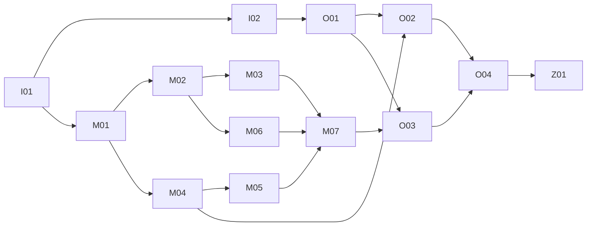

# 通用记忆服务跨仓库 Implementation Plan

> **For agentic workers:** REQUIRED SUB-SKILL: Use superpowers:executing-plans 按任务实施；如用户明确选择多 Agent，再使用 superpowers:subagent-driven-development。Steps use checkbox (`- [ ]`) syntax for tracking.

**Goal:** 建立独立身份中心与通用个人记忆服务，并在 OpenBot 内嵌同一管理界面、移除旧记忆运行路径。

**Architecture:** 独立 Better Auth OIDC 身份中心为 OpenBot 和记忆服务提供统一身份。记忆服务独占业务数据库、后台任务和 React/HeroUI 管理界面；OpenBot 通过受管客户端及来源核验接口接入。

**Tech Stack:** Bun/Hono、PostgreSQL、React、HeroUI、Better Auth、Hindsight；Drizzle 和数据库持久任务采用已批准设计中的实现起点。

**Spec:** [SPEC-INDEPENDENT-MEMORY-20261030 v3](../../specs/2026-10-30-independent-memory-service-design.md)，Q26 已批准。计划状态：待实施审阅，尚未建仓或执行产品变更。

## Global Constraints

- 此计划按后续实施的完整档规划：身份权限、数据所有权、持久写入、预算和部署均需独立行为验收与 Review，适用代码须 OCR。
- 个人记忆默认按应用隔离；本人委托和逐版本共享分开；来源在线核验、确认和遗忘规则不得放宽。
- 原始片段处理结束后一天内清除，排队最长 30 天，候选 30 天过期；受控备份不超过 30 天，恢复先重放撤销。
- 独立身份中心与业务数据库分离；不迁移旧记忆，不删除旧记忆数据；现有稳定身份、公司/团队资格及历史业务引用连续。
- 菜单内嵌必须保留 OpenBot 侧栏，同时独立站可用；登录走浏览器顶层，不以父窗口 cookie 或任意消息建立身份。
- 规划只写文档。实施方式、实际新仓库路径和外部写入授权须在执行前落实；计划中的路径为拟建结构，不声明文件已存在。

## Review Focus

1. 已登记应用伪造另一个本人或来源范围，应拒绝且不泄露候选数量——M01、O02。
2. 更正/撤销发生在检索与返回之间，旧结果不得作为新准入返回——M04、M05。
3. 重试、崩溃或预算不足，不得重复候选、重复成本或无限保留原片段——M02、M03、M06。
4. 内嵌登录后回错宿主、跨站存储受限或退出后残留身份，不得串用户——O03。
5. 身份切换造成重复人或历史成员资格改变，必须在实际接入前拒绝切换——I02、O01。

## 计划分册与依赖

| 分册 | 可独立验收的交付 | Task |
| --- | --- | --- |
| [身份中心](identity.md) | OIDC 提供方、稳定主体映射及停用状态合同 | I01–I02 |
| [记忆服务](memory.md) | 应用 API、生命周期、后台处理、管理独立站 | M01–M07 |
| [OpenBot 接入与集成](openbot.md) | 来源核验、统一运行客户端、内嵌和旧路径删除 | O01–O04、Z01 |
| [跨仓库合同](contracts.md) | DTO、内部能力、API 及失败语义的唯一计划定义 | 所有 Task 消费 |

默认串行执行；DAG 表示前置关系，不授权并行写入。跨仓库合同修改须先更新本计划，再迁移全部实际消费者。

## 工作区与文件所有权

逻辑仓库名 `IDENTITY`、`MEMORY`、`OPENBOT` 分别指拟建身份中心仓库、拟建记忆服务仓库和当前仓库。拟建本地目录可采用同级 `openbot-identity/`、`openbot-memory/`，正式路径和远端名在执行启动时记录，不在本轮创建。

每个分册列出的 `src/…`、`tests/…` 均相对该分册指定仓库。OpenBot 变更限于接入、来源核验、记忆入口和旧路径的真实消费者；当前工作区已有其他人的改动，执行时重新取基线并按必要隔离处理，不能整仓提交。

身份中心第一阶段拥有全局用户/账户/会话/OIDC 事实。OpenBot 公司/团队目录继续保持其已有 Better Auth 受控单一写入权威和事务边界；不在本项目另复制一份可独立编辑的公司目录。OpenBot 本地用户行若因现有外键需保留，定位为已验证稳定主体的兼容投影，不能继续作为第二个独立登录/注册/身份编辑权威。将公司目录进一步搬到远端不是本计划的隐含工作。

## 验证与证据

新仓库在 I01/M01 定义 `test`（`e2e run --config e2e.unit.config.ts`）、`typecheck`、`build`。HTTP/数据库测试由 e2e Node target 启动隔离 Bun 服务，避免为测试重写生产驱动。OpenBot 沿用 ADR 0008 的现有原生/受驱动分区，不把 `bun test` 作为正式入口。

数据库只用核实归属的 `TEST_DATABASE_URL`；身份/记忆/OpenBot 使用不同数据库或命名空间。真实 OIDC、Hindsight、网关和浏览器测试用独立 fixture 用户、来源与应用，记录版本、非零用例数、失败/跳过、预算和清理。实际运行报告归 `.archive/runs/<run-key>/`，计划不存运行日志。

## 发布与回滚边界

先验证身份中心及稳定主体，再发布独立记忆服务，再接入 OpenBot 的来源和内嵌。所有消费者迁移后才删除旧运行路径；最终 OpenBot 故障策略是无记忆继续或显式暂停，不能靠恢复旧记忆路径回滚。身份切换可在切换前验证阶段中止；切换后的身份回滚必须保持单一权威，不双写两套身份库。

提交、推送、创建远端仓库、合并、生产身份迁移、发布和数据清理各遵守当时明确授权。本计划的每个 Task 完成后先记录相关验证和独立审查；未获提交授权时保留可审阅差异，不执行提交命令。

## Spec 验收映射

| 验收 | 主要实现与验证 Task |
| --- | --- |
| A01、A02 | M01、M04、O02 |
| A03、A08 | M02、M03、M04、M06 |
| A04、A05、A06 | M04、M05、O02 |
| A07、A16 | M05、M06、O02 |
| A09 | M02、M03、M06 |
| A10、A11 | M06 |
| A12、A19 | I01、I02、O01、Z01 |
| A13 | M04、O02 |
| A14 | M01、M07 |
| A15 | O02、O04 |
| A17、A18 | M07、O03 |

Z01 对全部 A01–A19 做组合验收。执行者逐项填写结果及证据，不用表中“有任务”替代真实验证。
