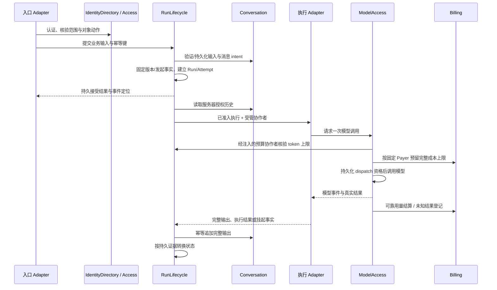

# 运行链路与一致性

继承[架构主文档](../../specs/2026-10-23-modular-architecture-design.md)的状态。本文按目标职责解释既有行为的收拢位置；新增产品能力仍需对应 Spec 批准。Interface 语义见[合同分册](interface-contracts.md)。

## 1. 聊天：输入、执行、消息与费用

图中 M→R 表示注入协作者调用，不产生 ModelAccess 对 RunLifecycle 的静态 import。记录真实费用不依赖 SSE 是否仍连接。输入 intent/Run/包 pin 的原子要求由具名启动用例实现，不能把图中的顺序当作允许半状态提交的依据。

开始执行前固定：原身份、业务归属、Bot/专家版本、thread、模型路由与上限、Payer，以及实际使用的安装版本。当前实现缺少的持久字段在获批任务中补齐，不能仅写入内存对象。

HTTP 返回已接受不是运行完成；普通断线不自动等于主动取消。取消停止后续可取消工作，但已发生或未知费用仍按原账户结算。禁止以结束流、释放租约或 terminal Run 自动释放全部资金预留。

## 2. 审批、挂起与恢复

1. 执行 Adapter 提出工具动作；ToolAccess 固定 operation、参数摘要、目标、连接/来源代次并判断审批要求。
2. 需要人工参与时，持久保存可恢复事实；RunLifecycle 保存对应 WaitRef/continuation 和当前 Attempt/generation 后，才发布等待事件。snapshot 保存失败不展示可恢复成功。
3. 用户批准/拒绝走原 action 的授权入口。ToolAccess 记录决定；同一批准重放返回原决定，参数变化要求按新动作处理。
4. 恢复通知可重试；driver 只 claim 原 continuation 的当前 revision。旧 driver、旧 generation、已结束 Run 均不能执行。
5. Access/ToolAccess 重验当前资格、审批摘要及来源版本。恢复使用持久发起范围/Payer，与当前 UI 选择无关。
6. 工具执行先取得本动作执行权，返回并保存真实 receipt；driver 再把结果交给引擎，并通过 Conversation 持久化。
7. 通知丢失、进程重启和重复点击都依据原 action/receipt 继续；供应商结果未知则进入待处置，不自动再发一次。

审批决定、工具 receipt、Run 等待和 continuation 各有唯一所有者。禁止两个 Module 同时把自己状态解释成“工具已执行”。人工 sign-in/前端工具需要真实客户端结果，不能由引擎填充假成功。

## 3. 后台触发、Worker 与交接

Automation 拥有日程/职责/投递触发事实，幂等产生 Job 或工作请求。队列消息只定位持久事实，不把历史序列化 Scope 当作永久授权。

Worker 领取时：解析原 Job/Run→重验原身份/归属/授权来源→claim 当前租约与 generation→调用 RunLifecycle。领取失败按原队列合同退回或记录失败，不创建另一套 turn 实现。

重新投递使用同一业务幂等键；交接或新关联任务按明确目标授权建立自己的运行事实，不搬走原审批或付款依据。原账户不足时不自动切换公司/个人余额。

调度宿主可以是 worker、server 内循环或部署 CronJob；触发频率与领取资格和真正执行分别维护。进程重启恢复持久工作，不恢复旧内存 capability。

## 4. 外部 Bot 与个人模型 Key

Registered Bot 服务认证只能证明 Bot 身份；Bot User Binding 与 Model Access Grant 证明用户关联和代表其调用模型的授权。不能从 Bot owner 推断实际消费用户。

ModelAccess 发放有期限的 Virtual Key，绑定个人授权与服务器确定的个人 Payer。外部 Bot 直连 Bifrost 时，实际新 dispatch 仍执行身份/授权检查及 Billing 预留。Key 存在、模型免费、Outbox 未送达均不是免检查理由。

用量和异步结果按原调用 ID/预留结算，Key 到期不删除既有费用责任。个人 Key 不授权公司资源或业务工具；完整个人工作台仍是独立候选规划。

## 5. Craft 会话、沙箱与预览

1. Craft 入口经 Access 解析原会话和当前动作资格。
2. ExecutionEnvironment 绑定可信范围、Bot、实际环境与代次；Craft 取得文件、serve、event、snapshot 等目的受限能力。
3. 传输 Adapter 自动发送已核验归属和协议头。范围缺失或代次失效时不向沙箱发送无归属请求，不用默认公司/团队补齐。
4. Craft 生成/启动逻辑使用该能力完成真实工作区操作。file absent 与空文件是不同结果，保持现有远端合同。
5. Craft 内部 Preview 负责源会话绑定、票据、代理、basePath、Origin、cookie 策略、TLS 可用性和 HMR；主站认证写入口维持 preview Origin 拒绝规则。
6. 部署装配只解析一份端口范围和预览配置，输出已校验配置。预览不可用与会话执行失败分别表达，不能用另一环境静默兜底。

对应 #618 验证范围传播；#619 验证端口事实源；#358 验证预览安全与实际可交互合同。环境 Module 不承担生成页面的产品逻辑，Preview 不直接改写其他 Module 的认证。

## 6. 记忆提出、审核、召回与遗忘

对话或授权来源→PersonalMemory 提出候选→本人审核/编辑→OpenBot 权威状态落库→幂等同步 Hindsight。未审核记录即使已被远端索引，也不得进入可用上下文。

召回时，索引返回候选引用；PersonalMemory 从 OpenBot 重读原文、来源、审核/有效时间及依据，结合 Access 当前资格过滤后才交给运行。Hindsight 故障时可用的本地降级继续通过同一过滤。

遗忘/来源撤销先持久阻断使用并使旧同步不可复活，随后远端清理与备份恢复控制按合同处理。UI 分别展示“停止使用”和“受控副本清理”；来源受限内容不因本人确认改为通用偏好。

后台判断/索引涉及有成本模型时经过 ModelAccess/Billing；预算不足可形成积压，不能标记为已学习。Learning 产生的 Skill 与个人记忆的审核事实保持独立。

## 7. 插件包安装、升级与运行

预览：PackageLifecycle 校验受信 manifest、固定 revision，返回权限/资源差异；可浏览不等于有安装权限。

安装：固定当前范围和请求摘要，调用 BotCatalog/ToolAccess/SkillProvider 创建或关联资源，记录安装操作进度。部分失败保留恢复点，补偿只处理本次新建且允许撤销的资源，不删除用户原有资产。

运行：启动用例固定 installation/revision 与资源快照，持久写 pin。执行通过 ToolAccess 与 RunLifecycle，审批恢复仍用原 pin；来源撤销/安全撤回按合同阻断后续敏感动作。

升级/回滚：建立新的版本事实和差异，原在途 pin 不被覆盖。停用/卸载保留用户资产与历史 receipt，不借新安装绕过外部未知动作的处理。

## 8. 支付与权益交付

购买入口按独立财务资格固定订单 Payer、套餐与价格。支付 callback 验证渠道签名与交易身份，只按订单服务器映射处理；当前 UI 选择和请求 companyId 不改变付款账户。

Billing 分别持久：订单意图、独立收款事实、权益交付进度、积分账本事实。渠道重复/迟到交易保留真实到账记录，权益按幂等依据只发放一次。收款成功但权益暂失败要可查询和恢复。

Reconciliation 只读核查；Settlement Resolution 是有资格的证据化处置。退款、调整和未知费用释放分别授权，不能通过重构合并成一个任意改余额方法。

## 9. 观测与评测

生产 Module 产生受控观察→内部 observer/sink→脱敏投影→可选 Opik/OTel Adapter。观察归属使用服务器 Run/Attempt/动作事实，客户端标签不决定权限。

读取 trace/导出时重新检查本人权限；公司汇总不能自动读取员工私人内容。纯观测故障与强制安全审计失败分别处理。

实验先固定数据集/被评测版本/配置和成本资格，逐样本调用 ModelAccess。评测工具只接隔离 Adapter，失败不能回落到生产连接；取消后的未知模型费用照常保留结算责任。

## 10. 失败与恢复矩阵

| 失败点 | 持久状态与处理 | 负责 Module |
| --- | --- | --- |
| 身份/授权事实无法读取 | 相关新动作拒绝，不切换默认身份或范围 | IdentityDirectory / Access |
| Run 创建响应丢失 | 原幂等键查询/重试获得同一 Run | RunLifecycle |
| token 预算已占用、资金未预留 | 不 dispatch；按可证明未发送的状态恢复/补偿 | RunLifecycle / ModelAccess / Billing |
| provider 请求发送后超时 | dispatch/费用未知，保留预留并恢复查询 | ModelAccess / Billing |
| 工具执行后响应丢失 | 原 operation receipt 查询；无法确认则 unknown | ToolAccess |
| 审批已保存、恢复通知丢失 | outbox 重放；单次 claim 驱动，不重复副作用 | ToolAccess / RunLifecycle |
| 消息写成功、intent finalize 失败 | 按同一 intent 对账；不再写另一条消息 | Conversation |
| 环境复位/换代 | 旧句柄拒绝，按原业务事实重新绑定 | ExecutionEnvironment |
| 记忆撤销、远端清理失败 | 本地立即不可用，清理继续重试并留证据 | PersonalMemory |
| 收款成功、权益未交付 | 保留收款事实与待交付，幂等恢复 | Billing |
| 索引/观测可选系统故障 | 按具名降级/积压合同处理，不伪造成功 | PersonalMemory / Observability |

以上状态遵循各自现有模型。比如 Pending Settlement 是资金状态，不新增为 shared RunStatus；工具 unknown 也不默认映射成成功 Run。任何新状态或 wire 变化需单独版本与兼容设计。
