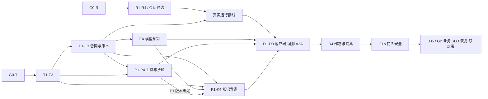

# 企业 AI 平台 MVP 总实施计划

> **面向执行 Agent：** 必须使用 `subagent-driven-development` 或 `executing-plans` 技能逐任务执行；遵守工具与委派权限。步骤以复选框跟踪。当前只获准编写计划，没有获准安装、编码、迁移、部署或提交 Git。

**目标：** 保留 TypeScript 控制平面，验证独立 Go Agent 运行时，交付同时可用于 SaaS 试点与私有化的安全 MVP。

**架构：** Hono/Bun 继续拥有业务、身份映射、权限、资产、运行账本和预算。Go 只作为可替换的执行适配器；平台业务模型不导入框架内部状态。独立 Node Worker 负责 Temporal 编排；知识处理、插件执行与浏览器分别隔离。

**技术栈：** 当前 React/TypeScript/Hono/Bun/Drizzle/PostgreSQL/AG-UI；候选 tRPC-Agent-Go；独立 Temporal Node Worker；PostgreSQL ACL 与本地 TypeScript Authz/ActionPolicy；Higress、OpenBao 或客户等价秘密服务；pgvector、对象存储、Kubernetes/gVisor。当前整个 MVP 不引入 OpenFGA/OPA。

**文档基线：** `enterprise-mvp-v0.2`，修订日期 2026-10-09。总体方案与 00/01/02 同步修订；本次授权仅覆盖文档修改，不代表准许代码、安装、迁移、部署或 Git 操作。本文 §1 为规范性决策索引，§4 为跨文档契约入口，§6 为门禁唯一注册表；其他文档不得另行放宽。发现冲突应先修订并确认，不以文件先后顺序悄悄覆盖安全要求。

**规格：** [总体方案](docs/superpowers/specs/2026-10-09-enterprise-ai-platform-design.md)；[评审问题快照](2026-10-09-enterprise-ai-documents-review.md)。评审行号是修订前快照，现行定位使用章节与问题编号。

## 全局约束

以下引号内为原规格要求，所有子计划继承：

- “同一产品，两类部署”。
- “MVP 不建设几十个微服务。”
- “身份验证、租户隔离、危险操作审批、沙箱、审计、预算上限和恢复演练不能推迟到‘企业版’。”
- “一个数据域一个写入方。”
- “同一计划不得同时被旧轮询和新调度器执行。”
- “运行引用具体版本，不能在执行中解析 latest。”
- “用户选择业务别名”。
- “私有化环境不依赖 SaaS 在线控制平面才能运行。”
- 容量假设沿用原稿：1–5 家租户、500–2,000 注册用户、100 活跃流连接、20–50 并行 Run、10 万份文档以内；这些是测试输入，不是实测能力。
- 不访问真实租户数据进行自动化测试；只能使用显式指定且经过安全检查的测试库与测试账号。
- 不改写用户现有变更，不自动提交或推送，不对外发送测试消息，不创建真实采购、付款或发布操作。

---

## 1. 本轮批准的基线修订

用户已明确选择：**先验证 Go 运行时；MVP 详细＋后续路线**。

本轮将评审建议落实为以下文档决策；总体方案第 0、3、4、7、24 章已同步，不再保留相反的规范性要求。历史 Go 控制平面与外部授权引擎路线仅作为已取代选项，不自动转为后续 MVP 任务：

| 决策 | 本计划执行规则 |
|---|---|
| 控制平面 | 保留 Hono/Bun，新增 `server/src/enterprise/` 领域模块 |
| Go | `runtime-go/` 为已有候选；G1a 只验证协议，G1b 验证持久安全，G2 才可准入批准的试点；不直接替换所有 Agent |
| Go 控制平面迁移 | 不执行；只有另外批准的 ADR 才能启动 |
| 身份源 | 复用 Better Auth 与现有 OIDC/SAML 接缝；受控平台身份源＋人工成员授权，不强制迁移 Casdoor，不开放多企业 IdP 自动入驻 |
| 资源授权 | PostgreSQL 成员/ACL 为权威；本地 TS Authz 唯一实现；单短事务内成员、ACL、规则校验后返回受限元数据 |
| 动作策略 | 本地 TS ActionPolicy，由工具网关强制执行权限交集、危险参数、审批、网络及预算约束；read 不等于 execute/approve/publish |
| 外部授权引擎 | 当前整个 MVP 不引入 OpenFGA/OPA；不建其配置、模型、探针或后备适配器。未来引入需新 ADR；旧 CEL 仅遗留路径，不作为企业后备许可 |
| 最小领域 | Tenant→Workspace→Resource；显式单资源 read，无隐式管理员读取。Project、空间角色继承、跨租户共享放二期专项设计 |
| 运行身份 | MVP 人类 principal、个人会话、有限期可撤销的计划委托；机器服务身份不冒充业务用户。独立非人 principal 与共享会话二期 |
| 调度 | 独立 Node Worker；SDK、Node、镜像/CPU 架构冻结并实测，不仅凭 glibc 标签判断兼容；不 import Bun DB client |
| 状态所有者 | TS 运行域唯一写业务 Run/事件/检查点；Node 管理编排历史并调用内部命令；Go 执行态可重建，不直写业务库 |
| 现有 Intelligence | 旧线程保持原存储所有者；企业入口独立启动，不挂遗留业务或工具路由 |
| SaaS 发布 | 未完成租户治理的旧 UI/路由不得对共享租户开放；安全和业务门禁不能被功能开关代替 |

本次已有总体方案与 00/01/02；03–06 尚待编写，§3/§10 仅分配需求，不代表已覆盖设计或验收。授权引擎移出不删安全能力；后续分册必须落实本地策略和合同。未提供业务样本、容量阈值及部署环境的项目保留明确责任人与阻断门禁，不虚构输入。

## 2. 工作区事实与保护范围

初始检查日期：2026-10-09；历史基线提交 `4773ef6`，不能代表未提交工作区。根包管理器为 `bun@1.3.14`；server 已声明 Hono、Drizzle、Zod 和 AG-UI。本轮复核已存在 runtime-go module 及 adapter/identity/callback/server 组件；`cmd/runtime/main.go` 仍仅挂健康服务，不能据此宣称真实 AG-UI 启动接线完成。01 中历史 `[x]` 与本轮待验收清单分开保存，不重复初始化 module，也不重置用户进度。执行前重新记录 commit、相关 diff、文件摘要和测试制品，禁止复用过期状态。

关键接缝：

- `server/src/app.ts:212-438`：`createApp` 有大量位置参数，禁止为新模块插入位置参数导致错位。
- `server/src/auth/guards.ts:55-90`：`createRequireUser` 提供身份，不能替代租户成员校验。
- `server/src/agents/callback-token.ts:45,75-156`：运行断言默认 10 分钟；新长期任务不得使用 `ignoreExpiry` 绕过过期。
- `server/src/app.ts:1643-1742`：旧工具回调使用独立 Agent Token 和 signed run，不能仅相信 body.actorId。
- `server/src/copilot.ts:1101-1125`：现有 `HttpAgent` 是 Go 验证的接入点，不需重写整个 CopilotKit 包装层。
- `server/drizzle.config.ts:20-42` 与 `server/src/db/schema/index.ts`：新增表必须同时进入生成器清单与导出。
- `server/tests/support/database.ts`：测试必须使用 `testDatabaseUrl()`，禁止回退生产库。
- `server/tsconfig.json:28-32`：现有测试未纳入类型检查，新增 enterprise 测试使用独立 tsconfig 纳入门禁。
- `.gitignore:7` 忽略 `docs/superpowers/`；本计划不会更改忽略规则，交付通过文件展示。后续若要版本化，需用户授权明确路径，不能自动强制提交。

写计划时工作区已存在 `app` 的 i18n、布局、路由、测试 preload、package、tsconfig、bun.lock 与 `.trae/` 变更。它们不是本计划产生的代码。后续执行首先读取最新差异；触及这些文件须局部合并，不用旧快照覆盖。

## 3. 分册与依赖

文件计划位于同一目录，交付状态与需求分配明确区分：

| 分册 | 任务 | 文档状态 | 验收产物与前置 |
|---|---|---|---|
| `2026-10-09-enterprise-ai-01-runtime.md` | R1–R4 | 已有，v0.2修订；非已验收 | 协议/身份候选证据，前置 G0-R；本册不发生产准入 |
| `2026-10-09-enterprise-ai-02-tenancy.md` | T1–T3 | 已有，v0.2修订；非已验收 | 资源开通、单事务授权、RLS、真实身份独立入口；前置 G0-T |
| `2026-10-09-enterprise-ai-03-runs-models.md` | E1–E4 | 待编写 | E1账本合同/存储，E2状态恢复，E3事件，E4模型预算；依赖 T1–T3，真实运行接线另依赖 R4 |
| `2026-10-09-enterprise-ai-04-plugins-sandbox.md` | P1–P4 | 待编写 | 私有目录、供应链、ActionPolicy、工具操作账本、隔离；前置 T2、E1 |
| `2026-10-09-enterprise-ai-05-knowledge-experts.md` | K1–K4 | 待编写 | ACL RAG/专家版本；前置 T2、E1、E4；工具版本绑定另依赖 P1 |
| `2026-10-09-enterprise-ai-06-delivery.md` | D1–D5 | 待编写 | D1客户端、D2持久编排、D3最小A2A、D4部署隔离、D5试点验收；前置如下图并在分册细化 |

R/T 可独立验证；E 的合同/存储可在 R 完成前准备，但真实运行接线必须等 R4。下面只画完成依赖，不把契约草拟误作依赖已满足。P1–P4 内部顺序、D2 Activity 边界必须在对应分册批准后实现。共享 bootstrap、Schema 注册和根路由由一名集成人维护。



## 4. 共同契约与目录

代码步骤中的片段是实现的关键算法/接口和测试基线，不是已经落地或执行的文件。各任务必须完成列出的生产接线和故障用例，不能仅复制纯函数就宣称完成整个任务。

新增：

- `shared/enterprise/contracts.ts`：客户端可见、与框架无关的 DTO。
- `server/src/enterprise/contracts.ts`：可信 Scope、权限、账本、存储和运行服务端接口。
- `server/src/enterprise/{tenancy,authz,runs,models,plugins,tools,knowledge,experts,schedules,a2a}/`：领域代码。
- `server/src/db/schema/enterprise-*.ts`：按领域划分 Drizzle 表；具体文件由子计划指定。
- `server/src/enterprise/app.ts`：只包含新企业 API、认证和健康检查。
- `server/src/enterprise/bootstrap.ts`：对象参数 DI，组装真实适配器。
- `server/src/enterprise/index.ts`：独立启动入口，不导入当前 `server/src/index.ts`。
- `server/tests/enterprise/`：领域和集成测试。
- `runtime-go/`：隔离 Go module，不能直连业务数据库。
- `workflow-worker/`：独立 Node 包，专属锁文件和构建，不直接 import Bun DB client。
- `app/src/features/enterprise/`、`app/src/routes/_authed/enterprise/`：新 UI。
- `charts/openbot/templates/enterprise/`：独立 API/Worker/Runtime/NetworkPolicy。

所有代码中的新函数必须在所属任务定义；跨册优先引用上述 contracts，不复制不一致的类型。

### 4.1 入口与可信身份

| 入口 | 允许调用方 | 契约与禁止项 |
|---|---|---|
| `/api/enterprise/v1` | 经认证的用户 | 租户选择头 `x-openbot-tenant` 仅为选择器；公开入口不挂任何内部 listener 或遗留工具接口 |
| `/internal/enterprise/v1/runtime/validate` | 已认证 Go 服务 | POST；验证短期 invocation capability、绑定信封摘要、Run/attempt/lease，返回最小运行身份 |
| `/internal/enterprise/v1/tool-invocations/prepare` | 已认证 Runtime | POST；提议目标/参数，平台分配 operation_id并记录意图/审批需求；不产生外部副作用 |
| `/internal/enterprise/v1/tool-invocations/{operation_id}/execute` | 已认证 Runtime/编排服务 | POST；复核操作/审批/当前权限/预算/fencing 后执行，返回结构化回执 |
| `/api/agent-tools/call` 等遗留入口 | 明确隔离的旧部署 | 不挂新企业服务、不用于G1b/G2；G1a只能对隔离fake回调比较历史语义 |

内部路由是待实现合同而非现有端点；独立 listener、服务凭证、受众与网络策略同时限制，不靠 URL 命名隔离。T3 单独启动不需要挂内部路由；正式装配由 E/P 域负责。Go 地址仅来自部署配置，不接收请求提供的 endpoint/header。服务身份验证后仍须解析业务主体，不能把机器身份当 tenant 权限。旧断言缺 tenant/principal，不得按 body 补齐；只有权威 Run 映射能产生它们。

### 4.2 跨进程合同（wire schema v1）

下表是最低字段集合，使用 snake_case、strict Schema；TS 域内可映射 camelCase。E1 在实现前冻结 OpenAPI/JSON Schema、错误码和黄金样本；未冻结不得互相猜字段。内部秘密/身份字段不能进入客户端 shared DTO 或 AG-UI state。

| 合同 | 必需字段与语义 | 所有者 |
|---|---|---|
| RuntimeInvocation | `schema_version, tenant_id, principal_id, actor_id, initiator_kind, run_id, attempt_id, turn_id, thread_id, expert_version, input_digest, model_route_ref, budget_reservation_id, lease_id, fencing_token, expires_at`；计划触发另需 `delegation_ref` | TS运行域签发；Go只消费；service_identity来自认证层，不由body授权 |
| ToolPreparation | `run_id, attempt_id, tool_call_id, step_id, installation_version, target, args, args_digest, fencing_token`；稳定tool_call_id由平台的步骤/检查点映射，不由模型任意生成新业务键 | TS工具域按 `(tenant_id,run_id,tool_call_id)` 去重分配operation；内容不同409 |
| ToolExecution / Receipt | 请求：`operation_id, attempt_id, args_digest, approval_ref(如需), fencing_token`；回执：`operation_id, execution_attempt_id, status, receipt_ref, error_code, reconciliation_required` | TS工具域；status仅 `not_submitted/submitted/succeeded/failed/unknown`；HTTP接受不代表完成 |
| RunEvent | 源提案：`run_id, attempt_id, source_event_id, event_type, schema_version, payload`；平台确认后增加 `event_id, seq, occurred_at` | TS账本去重并分配单调seq；Go不分配最终seq；先持久化后发布/ACK |
| Checkpoint | `schema_version, expert_version, runtime_compatibility, run_id, attempt_id, step_id, message_refs, completed_operation_refs, pending_approval_ref, budget_reservation_id, artifact_refs, content_digest` | Go提案，TS校验当前fencing并存引用；不用任意框架对象作持久格式 |
| ResourceRead | 进程内 `ResourceReader.readAuthorizedResource(scope,id):Promise<ResourceView>` | T2；一次短READ COMMITTED事务内锁定成员/资源和执行Authz；不公开中间快照 |
| ActionPolicyDecision | `allow/deny/requires_approval, reason_code, policy_revision, constraints`，基于可信主体、安装/专家版本、委托、当前ACL、参数/目标、网络、预算 | P域本地TS确定性规则；未知动作/版本/状态默认拒绝；模型不做最终决定 |

短期 capability 通过受控认证头传输，限定 audience/服务/Run/attempt/摘要/期限；过期后由 TS 重验成员、委托、Run 和 lease 再签发，禁止 ignoreExpiry。MVP 仅自然人 principal 与个人thread；定时任务保留原人类主体和可撤销委托引用，不保存长期用户会话。独立服务业务账号、共享thread和跨租户委派需二期专项设计。

### 4.3 状态所有者、线性化点与故障收敛

- **单写：** TS运行域写Run/事件/检查点，TS工具域写操作/回执；Node只写Temporal历史并通过内部命令推进；Go只维护可重建执行态。各TS领域不直接改对方表。
- **标识：** 一个业务run可有多个attempt和AG-UI turn；平台持久保存映射。审批恢复保持run_id但换turn/必要时换attempt，Go adapter将input.RunID绑定turn_id，不把SDK RunFinished直接当业务成功。Temporal workflow_id稳定对应业务Run，Temporal自身run标识单独存储。
- **启动：** Run＋预算预留＋启动Outbox同事务；消费者以稳定workflow_id启动并记录回执。提交后崩溃由Outbox重发/查已有workflow，不新增第二个业务Run；启动永久失败释放未消耗预留并记原因。
- **事件：** 以 `(tenant_id,run_id,attempt_id,source_event_id)` 唯一去重；同键不同payload拒绝。持久化ACK丢失可重发相同事件；客户端按seq续流；无法持久化时背压/停止，禁止发布未确认终态。
- **工具：** prepare不执行；execute必须当前权限/参数摘要/审批/lease全匹配，先持久意图后调用。业务operation与执行attempt不同；submitted/unknown冻结自动重试（包括Agent下一轮、Activity或进程重启），先查回执或人工核对。确认failed且确实未生效后也需明确批准的重试策略，不自动换operation绕过去重。
- **取消/恢复：** cancel_requested只是意图；真实退出才能cancelled；外部已提交/未知保留reconciliation。Go丢失或lease过期进入suspended，旧fencing不能提交事件、检查点、工具或结果。恢复基于已确认checkpoint/receipt，不能整段重跑含副作用Agent Activity。
- **Temporal Activity：** 明确heartbeat、deadline、取消响应和重试分类；纯幂等步骤可重试，未知副作用不可重试。审批等待由工作流持久状态承载，不能靠长HTTP连接。
- **模型：** TS固定批准路由并预留预算；模型网关/受控代理验证短时能力、Run/attempt和额度，按model_attempt去重计量；Go无长期供应商密钥且网络禁止旁路。不存在能力限制的共享网关key不能替代逐Run预算。

最低状态转换合同：

| 状态/输入 | 允许转换及守卫 | 提交方 |
|---|---|---|
| 新请求 | 授权/版本/预算及幂等成功→queued＋Outbox | TS运行域 |
| queued | 已确认启动、有效lease→running；永久启动失败→failed并结算 | TS运行域接受编排回执 |
| running | 需要人类输入→waiting_input；需审批→waiting_approval；丢lease/未知效果→suspended | TS运行域接受已验证提案 |
| waiting_input / waiting_approval | 新输入/审批匹配＋当前授权＋预算→新turn/attempt进入queued；过期→expired | TS运行域；不得仅凭旧批准恢复 |
| suspended | 已对账checkpoint/操作回执＋新lease＋授权→queued；不能确认则保持suspended | TS运行域 |
| 非终态取消 | →cancel_requested；实际执行退出且未留活跃执行→cancelled，未知副作用仍保留核对账本 | TS运行域；HTTP返回只确认请求 |
| running结束 | 输出/事件/必要回执已持久化并结算→succeeded；确定不可恢复失败→failed | TS运行域；SDK结束不能直接触发成功 |
| 终态 | 不重新打开；新业务意图创建新Run，原记录保留 | TS运行域 |

E2/D2必须增加故障测试表：提交前后、启动ACK丢失、事件ACK丢失、调用前后、检查点前后、取消竞态、旧lease复活；未取得该证据不通过G1b。03在此基础上补状态图、CAS/revision条件与并发优先规则；取消、超时、成功竞争只允许一个有效终态。

## 5. 通用执行循环与测试工具

每个任务执行以下独立步骤，编码工作超过一个短步骤时按该任务列出的文件/算法再拆分，不把整册当一次提交：

- [ ] 写该任务给出的失败测试，先检查既有同类代码。
- [ ] 运行指定的目标命令，记录行为失败；依赖缺失、测试跳过、连接失败不等于期望 RED。
- [ ] 按接口与关键算法完成最小实现及实际路由/存储接线。
- [ ] 运行目标测试、集成故障用例和类型检查，记录真实输出。
- [ ] 检查差异与范围，确认未包含用户无关变更；用户另行授权提交后才逐任务 commit，不使用 `git add -A`。

当前项目检查命令已核对：

```bash
bun run format:check
bun run lint
bun run typecheck
bun run test:ci
NODE_OPTIONS=--max-old-space-size=4096 bun run build
```

新增测试的命令在子任务中给出；不运行根级 `bun run format` 修改整个脏工作区。集成测试库调用现有 `testDatabaseUrl()`；CI 必须显式提供隔离测试库，缺失直接失败，不以 skipped 作为通过。

Drizzle测试迁移只使用02 T1-B定义的隔离执行器，不使用会隐式加载部署`.env`的原db脚本。下列命令须在执行器实现、测试库验证、G0-T和操作授权就绪后运行：

```bash
bun --no-env-file server/scripts/enterprise-test-db.ts generate
bun --no-env-file server/scripts/enterprise-test-db.ts custom
bun --no-env-file server/scripts/enterprise-test-db.ts migrate
```

普通生成迁移不手改；RLS唯一可执行来源为generator登记的custom migration，禁止另维护policies.sql副本。编号由journal产生；角色由DBA单独管理。生产迁移只能经批准发布作业注入目标，不复用测试helper或让应用持迁移权限。企业类型检查必须纳入实际CI并包含enterprise runtime测试；test:ci的最低数量门槛不是每次新增用例都要改的精确总数。

## 6. 门禁唯一注册：G0-R / G0-T / G1a / G1b / G2

| 门禁 | 前置及证据 | 签署责任 | 通过后允许／仍禁止 |
|---|---|---|---|
| G0-R | 代码实施授权、保护工作区、锁定Go/TS依赖与工具链、隔离fake端点、无真实数据/副作用 | 技术/运行负责人 | 允许本地R候选；不要求提前配置全部生产基础设施；不准租户流量 |
| G0-T | 实施与数据库操作授权、经检查的隔离PostgreSQL及身份测试环境、DB角色/测试基线 | 后端/安全/DBA | 允许T集成；无库/无权限不能以skip通过 |
| G1a | R1–R4真实二进制＋TS HttpAgent、可信输入/身份、事件、fake工具/取消、受限负载证据 | 技术/运行/QA | 协议候选成立；不授予真实租户、真实写工具或持久恢复保证 |
| G1b | G1a；T1–T3、E1–E4、P2–P4、D2/D4；已批准专项规格；当前依赖风险闭环；Run/回执/模型预算/隔离/取消/重启故障证据 | 安全/运行/SRE/技术 | 允许申请试点业务验收；尚不等于SLO、灾备和业务质量合格 |
| G2 | G1b；D5、业务验收集与阈值、SaaS及受控联网私有化、容量/升级排空/安全水位恢复、值守手册 | 产品/业务/技术/安全/SRE | 仅批准范围内试点；不承诺离线完整版或无限租户规模 |

所有项只有实际执行后才填pass/fail；候选报告使用每门禁 `not_run/passed/failed/blocked` 与证据引用，不使用一个含糊的adoption布尔值替代。制品字段包括commit、工作区差异摘要、文档/代码/依赖hash、测试命令/环境/退出码、限制、审核者。

R4报告路径仍为 `runtime-go/testdata/compatibility-report.json`，只由测试产生。已有dependency-review.json记录未闭环风险，不是本轮复扫；运行/安全负责人须核对适用性、补丁候选和新依赖图，复跑受影响的R2–R4。冻结版本不是拒绝安全升级的理由；无修复或不适用证据则不通过G1b。

业务样本、数据出域限制、容量阈值、目标部署矩阵由对应负责人在相关门禁前补齐，不拿fake协议数据证明真实效果。失败时冻结候选并保留证据；平台契约可继续设计，真实执行等待修复或另批RuntimeAdapter，**不自动变成Go控制平面重写或外部授权引擎安装**。

## 7. 分期与人力安排（规划估算）

- 第 1–3 周：R1–R4、T1–T2、依赖与基础环境验证。
- 第 4–6 周：T3、E1–E3；E4/P1/K1 并行启动。
- 第 7–10 周：模型、知识、插件、沙箱和专家闭环；D1 用户界面并行。
- 第 11–13 周：D2 持久调度、D3 最小 A2A、D4 部署隔离。
- 第 14–16 周：D5 故障/容量/恢复验收、试点修复与交付。

统一起算点为实施获授权且对应G0输入齐备；第1–16周包含初始风险验证，不另加一段风险验证后再次计满MVP工期。03–06未完成、门禁等待和业务输入缺失需重新排期，不能当已承诺日期。团队能力参考总体建议约11名核心职责覆盖；技术负责人管契约/集成，后端管租户/账本/插件，运行工程管Go/RAG，前端管工作台，SRE管环境/恢复，QA记录证据；安全/业务参与门禁。

## 8. 二期工作包与进入条件

| 工作包 | 交付范围 | 进入条件 | 验收重点 |
|---|---|---|---|
| App / 小程序 | 复用 SDK，流式、弱网、推送、审批、设备撤销 | D1、D5；真机和目标平台账号可用 | 前后台切换不重复提交；通知不泄密 |
| 企业知识连接器 | 增量游标、ACL同步、删除传播、全量对账 | K3；客户源系统授权 | 撤权优先、断点续传、源删除不复活 |
| 插件运营市场 | 发布者治理、检索、维护记录、升级体验 | P1–P4；供应商责任约定 | 依赖权限变化必须重新批准 |
| 专家运营 | 可视图、版本对比、灰度、质量回归 | K4；真实评测数据 | 流量归因与版本可回滚 |
| 自动化运营 | 事件触发、补跑、配额公平、失败处置 | D2 | 不双跑、不无限补跑、不重试未知副作用 |
| 多租户规模化 | 新 Cell、专属租户、自动开通、用量分析 | D5 已证明单元容量 | 租户扩容不突破隔离或数据库容量 |

## 9. 企业级完整版本工作包

MVP私有化指受控联网、无需SaaS在线控制平面、使用客户批准身份/模型/存储服务；不等于完全air-gapped。离线包/本地镜像与插件目录/离线升级、跨地域灾备、分级密钥节点、商业权益、跨组织A2A和长期支持分别设项目，需合同、限制、真实恢复/容量和成本证据；不作为MVP隐含完成项。法定与合同安全要求始终适用，不因分期推迟。

Go 控制平面迁移也是独立工作包，其进入条件为：实测收益明确、团队维护能力达标、领域单写迁移方案批准、旧系统退役与回滚可行；本计划没有迁移任务。

## 10. 规格覆盖与证据归档

| 原规格领域 | 对应任务 |
|---|---|
| 业务定位、用户体验、多端 | D1、D5与二期工作包 |
| 租户身份、权限与安全 | T1–T3、P2–P4、D4–D5 |
| 插件市场与生命周期 | P1、P2；商业市场二期 |
| 沙箱与工具运行时 | R3、P3、P4 |
| 模型管理、成本与评测 | E4、K4、D5 |
| 知识导入、检索、更新、ACL | K1–K3 |
| 专家创建与发布 | K4、D1 |
| 定时任务与持久恢复 | E1–E3、D2 |
| AG-UI、A2A | R2–R4、E3、D1、D3 |
| 数据模型与API事件 | T1、E1–E4、各域contracts |
| 部署、HA、监控、DevOps | D4、D5 |
| 人员、周期、风险、分期 | 本文第6–9节 |

上表是需求分配索引，不表示待编写分册已覆盖其设计；01/02的文件存在也不表示验收通过。每项保存commit、相关未提交差异摘要、文档/制品/依赖hash、命令、环境、退出码、脱敏结果、失败原因及审核者。文档被忽略时通过批准文档库/摘要保存快照，不自动修改.gitignore或强制提交。

本轮仅改总体方案与00/01/02，未编写03–06、未执行测试/编译/迁移/部署。修订对应：X-01/02/03/05/06/07见§1/§4，M-01/02见§3/§10，M-03见§2，M-04/T-11见§5，X-04/R-05见§6，X-08见§7/§9及总体§21。文档合同补齐与实现风险消除是两件事，后者必须由实际门禁证明。
