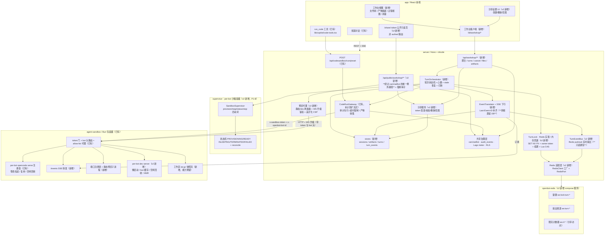
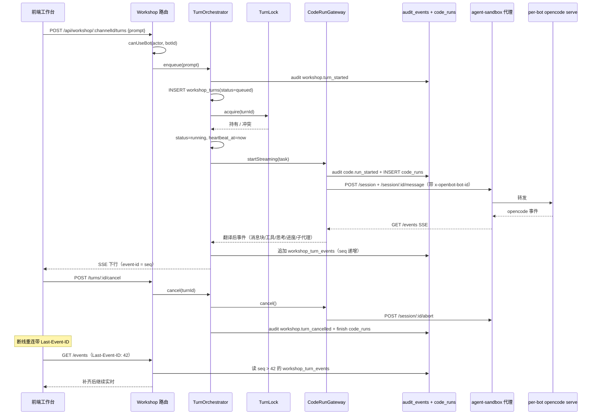
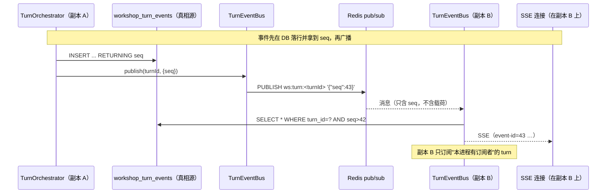
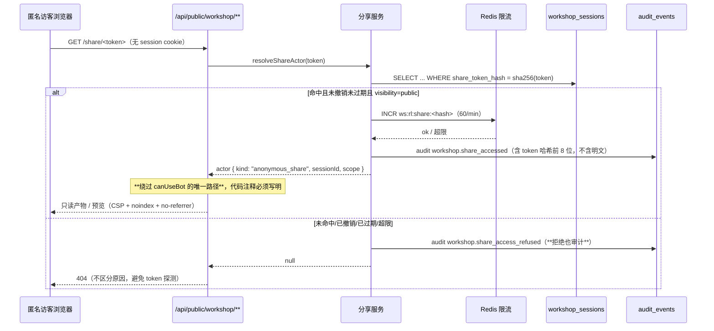
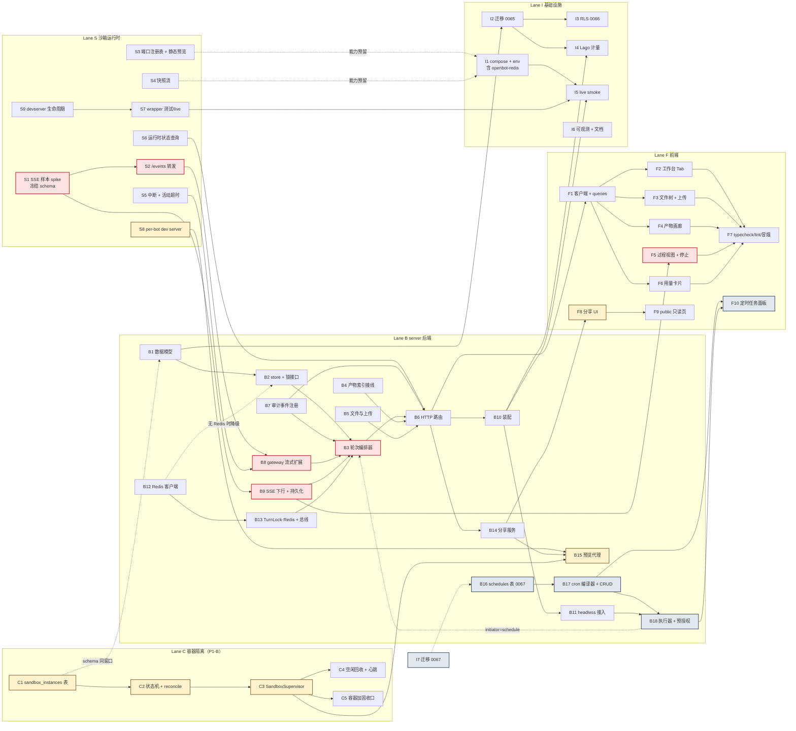

# Bot 工作台（Workshop）× Code Interpreter 统一架构与并行实施总计划

> 2026-10-10。作者：高见远（架构师）。
> 输入：`docs/specs/superpowers/2026-10-10-craft-workshop-design.md`（Workshop 产品设计，W1–W6）、`docs/plans/superpowers/2026-10-10-code-interpreter-run-code.md`（Code Interpreter Task 1–9 + P1 待办）、`docs/plans/superpowers/2026-10-10-sandbox-lifecycle-craft.md`（P1-A）。
> 前置动作：本计划先对仓库做了逐文件核实（见第 2 节），**不以设计文档的前置声明为准**。核实结论改变了排期：Code Interpreter 的 Task 1–9 与 P1-A 的 Task 1–5 均已落地，剩余的是"验证 + P1 待办"，而不是"从零实施"。
> 本次交付物只有本文档，不含任何代码改动。

---

## 0. 决策变更 v2（2026-10-11）

用户在 v1 的"待拍板四项"（原第 9.3 节）中拍板了三项。本节是 v1 → v2 的**变更单**，正文各节已就地修订并标注「（v2 修订）」。

| # | 决策 | v1 原方案 | v2 新方案 | 影响章节 | 任务增删 | 迁移影响 | 关键路径影响 |
|---|---|---|---|---|---|---|---|
| **D1** | **W2 引入 Redis** | DB 行 + **单进程内存锁**起步，`TurnLock` 只留抽象接口，多副本前再换 | W2 直接上 Redis：**分布式锁**（SET NX PX + owner token + 续期 + Lua CAS 释放）+ **pub/sub 事件总线**（多副本 SSE 扇出）；内存实现降级为"未配置 Redis 且显式单副本"时的回退 | §3.5（新增）、§4 Lane B、§5、§7 B12/B13、§8 #15/#16、§9.1 并发 | **+2**（B12 Redis 客户端、B13 锁与总线）；B2/B9/B10 标记 `[改]` | 无（锁与总线不落表） | 不延长（B12/B13 与 B8 并行），但**去掉了 v1 风险 #2** |
| **D2** | **真 dev server（W3）** | W3 只做静态预览，P1-B 列为**不做** | **P1-B（per-bot 容器隔离 + 状态机）升为 W3 前置并展开成任务**；per-bot dev server 懒启动 + HMR/WS 透传；静态预览保留为降级路径 | §3.6（新增）、§4 Lane C（新增）、§5、§7 C1–C5 / S8 / S9 / B15 / F8、§8 #17/#19、§9.2 | **+7**（C1–C5、S8、S9）；B15 新增预览代理；F8 分享/预览 UI | 无（容器状态机不新增表，见 §9.1） | **延长**：新增 W3 链 `C1→C2→C3→S8→B15→F8`，与 W2 链部分并行，总计约 10–12 工作日（v1 为 5–6 天） |
| **D3** | **public 分享** | 不做 `sharing_scope`，预览鉴权**复用频道成员 ACL** | 做对外公开分享：分享字段**直接进 0065 初版建表**（`visibility` / `share_token` / `share_expires_at` / `share_revoked_at` / `share_scope`）；预览代理新增**绕过 `canUseBot` 的显式例外路径**，全程审计 | §3.7（新增）、§4 Lane B/F、§5、§7 B1/B7/B14/B15/F9、§8 #18/#20、§9.2 风险 #3/#7 | **+4**（B14 分享服务、B15 预览代理、F8 分享 UI、F9 public 页）；B1/B7 标记 `[改]` | **不新增迁移号**：分享字段并入 0065，RLS 与匿名读角色并入 0066。独立 `workshop_share_links` 表**不做**（理由见 §3.7） | F9 与 F5 并行；B14/B15 在 B6 之后，不进一步延长 |

> **v2.3（2026-10-11 实施期）**：QA 深验发现 0067 的 instance 策略引用 agent_profiles 但未 GRANT——新增 **0068=RLS GRANT 微迁移**（已应用的 0067 不回改哈希），schedules 顺延 **0069**、share_links 预留 **0070**。同时确认 dev 库 enterprise 面（0054-0062 六迁移）历史性缺表，与 workshop 无关，**暂不补齐**（决策记录）。
> **v2.2（2026-10-11 实施期）**：迁移号整体顺延 +1——0065 被并行 billing 流（credits）在实施期实际占用，本计划让号：0066=workshop+sandbox_instances、0067=RLS（0068/0069 的 v2.2 分配已被 v2.3 覆盖）。I2 生成改为 worktree 模拟主仓完整状态，杜绝 drizzle-kit 对 credits 的 DROP 误判。

**（v2.1）四项决策全部拍板（2026-10-11）**：D1 Redis、D2 真 dev server、D3 public 分享、D4 **schedules 提前到 W2.5**（B11 之后插入 B16–B18 + F10 批次，迁移 0069【v2.2/v2.3 顺延】，详见 §7/§9.3）。无挂起事项。

**v2 一并处理的连带影响**：依赖图重画（§5）、泳道 4→5 条（§6，新开 Lane C）、任务 31→44（§7；v2.1 再 +4 至 **48**）、冲突热点 14→20 条（§8）、风险表重写（§9.2）、`app.ts` 锚点行号漂移修正（§2.4）。

| **D4** | **`workshop_schedules` 提前到 W2.5** | v2 建议"不提前"（排 W5），接缝只留 `initiator='schedule'` | **提前**：W5 的定时任务整块挪到 **B11（headless）之后**作为 W2.5 批次：B16 表（0067）→ B17 cron 编译器 + CRUD → B18 执行器（复用 `work/queue.ts` + `routines/sweep.ts` offer key）+ 预授权目标 → F10 编辑器面板与运行历史 | §1.2、§5、§7（B16–B18 / F10）、§8 #7、§9.1、§9.3 | **+4**（B16/B17/B18、F10）；I7 的生成范围加 0069 | 不延长（挂在 W2 链末端 B11 之后，与 W3 链并行推进） |

---

## 1. TL;DR 与范围边界

### 1.1 两条线各自交付什么

| 产品线 | 一句话 | 本计划交付到的状态 |
|---|---|---|
| **Code Interpreter（CI）** | Bot 在对话里拿到 `run_code`，任务进独立沙箱的 opencode agent，产出代码/结果/文件，全程审计 + 用量落库 | **P0 已上线**（核实确认）→ 本计划补齐 P1 的"流式与交互"（SSE 事件流、活动超时、打断、流式持久化）、计量上送 Lago、headless 接入，以及快照/预览的**运行时能力**（不含上层产品化） |
| **Workshop（W）** | 频道侧的工作台视图：看执行过程、浏览文件树、收产物、上传数据、定时重跑、治理与计量 | **W1 + W2**：工作台骨架（会话/产物/文件/上传/下载/前端 Tab）与流式轮次（状态机 + 打断 + 心跳 + 刷新补齐） |

### 1.2 本计划覆盖 / 不覆盖

**覆盖（有任务、有验收）**

- CI 线：SSE 事件转发与事件 schema 冻结、活动超时与挂钟超时分离、turn 打断、流式事件持久化、Lago 计量接线、headless（`run-turn.ts`）接入、wrapper 侧快照流与静态预览子进程（作为**运行时能力**，接口先备好）。
- W 线：`workshop_sessions` / `workshop_artifacts` / `workshop_turns` / `workshop_turn_events` 四张表、store 层、轮次编排器、artifact 索引接线、文件树与上传限额、`/api/workshop/**` 路由、SSE 下行、前端工作台 Tab（文件树 / 产物画廊 / 过程视图 / 用量卡片）。
- 横切：`workshop.*` 审计事件族、新表 RLS、迁移序号仲裁、compose/.env 增量、live smoke 扩展。
- **（v2 新增）** Redis 基础设施：`openbot-redis` 服务、Redis 客户端抽象、`TurnLock` 第二实现、跨副本事件总线与降级策略（§3.5）。
- **（v2 新增）** P1-B 容器隔离与状态机、per-bot dev server、预览代理的 WS/HMR 透传与差异化 CSP（§3.6）。
- **（v2 新增）** public 分享：分享建模、不可猜测 token、可过期/可撤销/可限范围、匿名访问的显式例外鉴权与安全收敛（§3.7）。

**明确不做（本计划不排任务，仅在架构中留接缝）**

| 不做项 | 归属 | 为什么本次不做 |
|---|---|---|
| ~~W3 的 server 预览代理 + 前端 iframe + 启停治理~~ | ~~W3~~ | **（v2 修订：D2 拍板"真 dev server 做"）改为本计划覆盖**：P1-B 前置展开为 C1–C5，dev server 为 S8/S9，预览代理与鉴权为 B15，UI 为 F8。静态预览保留为降级路径（`WORKSHOP_PREVIEW_MODE`，§3.6） |
| W4 的 `workshop_snapshots` 表 + restore 路由 + opencode 历史随快照 | W4 | 运行时流（S4）先备好，上层索引与恢复编排另开计划 |
| W5 定时任务（`workshop_schedules` + cron 编译器 + 执行器 + 预授权目标） | ~~W5~~ | **（v2.1 修订：D4 拍板"提前到 W2.5"）改为本计划覆盖**：B16（表 0067）→ B17（cron 编译器 + CRUD + 预授权目标）→ B18（执行器，复用 `work/queue.ts`/`routines/sweep.ts`，headless 轮次 initiator=`schedule`）+ F10（编辑器面板 + 运行历史），挂在 B11 之后 |
| W6 Bot 资产库 symlink + OpenConnector 凭据注入 | W6 | 依赖任务作用域凭据签发设施 |
| ~~P1-B：supervisor per-bot 沙箱容器 + 状态机~~ | ~~独立流~~ | **（v2 修订：D2 拍板）升为 W3 前置，展开为 C1–C5**，见 §3.6 与 §7 Lane C。S6 的状态查询接口成为它的对上契约 |
| 容器级 egress 白名单（iptables init + MITM CA 代理） | 多租户 GA 前置 | 涉及镜像与网络栈改造，独立评估 |
| 作用域 token 替代部署级模型 key | P1 | 依赖 server 侧 key 签发与吊销设施 |
| ~~public 分享（`sharing_scope`）~~ | ~~未定~~ | **（v2 修订：D3 拍板"做"）改为本计划覆盖**：分享字段并入 0065 建表（B1），分享服务与 public API（B14），预览代理的匿名例外鉴权（B15），分享 UI 与 public 只读页（F8/F9）。合规要求固化为 §3.7 的收敛措施清单 |
| Craft 的 k8s 后端、Redis、external_app 自建 OAuth | — | 设计文档第 9 节已明示不抄 |

### 1.3 一句话口径

> **沙箱运行时只有一套（per-bot opencode serve），治理入口只有一套（`CodeRunGateway`，审计先行），计量事实源只有一个（`code_runs`）；Workshop 是它上面的"长形态 + 产品视图"，不是第二套执行链。**

---

## 2. 现状盘点（代码事实）

核实方式：Glob / Grep / Read 逐文件确认，时间 2026-10-10，工作树未改动。

### 2.1 Code Interpreter 线

| 模块 | 文件（相对仓库根） | 状态 | 备注 |
|---|---|---|---|
| 独立工程骨架 | `agent-sandbox/package.json`、`tsconfig.json`、`bun.lock` | ✅ 已落地 | 自有 bun.lock，不进根 workspaces |
| 环境解析 / 配置生成 | `agent-sandbox/src/env.ts`、`src/opencode-config.ts`、`src/version.ts` | ✅ 已落地 | `SANDBOX_VERSION = "1.18.7"`；provider id `openbot`；0600 配置 |
| opencode serve 拉起 | `agent-sandbox/src/upstream.ts` | ✅ 已落地 | `spawnFn`/`fetchImpl` 可注入 |
| **per-bot 运行时注册表** | `agent-sandbox/src/bot-id.ts`、`src/bot-runtimes.ts` | ✅ 已落地 | `getOrSpawn/reapIdle/stopBot/stopAll/size`；cwd `/workspace/bots/<botId>` |
| **代理（token + bot 头 + allow-list + reset）** | `agent-sandbox/src/proxy.ts` | ✅ 已落地 | `tokenMatches` timing-safe；`x-openbot-bot-id` 缺失/非法 400；`POST /workspace/reset`；探活重试 30×500ms |
| 入口与清扫循环 | `agent-sandbox/src/index.ts` | ✅ 已落地 | `mode: "per-bot"`；sweep `reapIdle`；SIGTERM `stopAll` |
| 镜像 | `agent-sandbox/Dockerfile` | ✅ 已落地 | bun 1.3.14 摘要 pin、opencode 1.18.7、UID 1000、`SANDBOX_PORT=4300` |
| compose 服务 | `docker-compose.yml:173`（`agent-sandbox`）、`:962`（`openbot_sandbox` 网络）、`:975-976`（两个卷） | ✅ 已落地 | 卷名 `openbot-sandbox-workspace` / `openbot-sandbox-config`；**顶层 `volumes:` 在 964 行、`networks:` 在 950 行，新增必须并入既有段** |
| env 样板 | `.env.example:372-392` | ✅ 已落地 | 含 4 个生命周期变量（IDLE/SWEEP/PORT_BASE/WORKSPACE_TTL） |
| server 沙箱客户端 | `server/src/codesandbox/client.ts` | ✅ 已落地 | `botId` 必填；`x-sandbox-token`；超时用 `Promise.race` 强制生效 |
| 共享类型 | `server/src/codesandbox/types.ts` | ✅ 已落地 | `SandboxUsage`/`SandboxRunResult`/`SandboxArtifact` |
| `code_runs` 表 | `server/src/db/schema/code-runs.ts`、`schema/index.ts:4`（导出） | ✅ 已落地 | 导出插在 `billing` 之后 |
| 迁移 | `server/drizzle/0062_amused_fenris.sql` | ✅ 已落地 | **注意：计划文档写的是 0061，实际落在 0062**；该迁移**没有 ENABLE RLS**（合规缺口，见 I3） |
| store | `server/src/codesandbox/store.ts` | ✅ 已落地 | `create/finish/get`；`newCodeRunId()` = `cr-<24 hex>` |
| 网关 | `server/src/codesandbox/gateway.ts` | ✅ 已落地 | 审计先行；`clampRunSeconds`（默认 120、上限 600、下限 1）；产物 5 个 / 64KB；`resetWorkspace` |
| 路由 | `server/src/codesandbox/routes.ts` | ✅ 已落地 | `POST /runs`、`POST /reset`，均过 `canUseBot` |
| 审计事件 | `server/src/audit.ts:367-376` | ✅ 已落地 | `code.run_started/completed/refused/failed` + `code.workspace_reset` |
| app 装配 | `server/src/app.ts:1417-1421` | ✅ 已落地 | 挂 `/api/codesandbox`；`canUseBot` 定义在 `app.ts:1394` |
| 运行时接线 | `server/src/index.ts:3175-3197` | ✅ 已落地 | factory 内每次调用新建 client 并带 `botId` |
| 前端工具 | `app/src/lib/codesandbox/call.ts`、`app/src/lib/copilot/code-tools.tsx` | ✅ 已落地 | `run_code`，`timeoutSeconds` 1–600 |
| 前端挂载 | `app/src/lib/copilot/provider.tsx`（`<CodeSandboxTools />` 紧跟 `<ComputerTools />`） | ✅ 已落地 | 在 `<ActiveBotProvider>` 内 |
| live smoke | `scripts/codesandbox-smoke.ts`、根 `package.json:26` `test:live-codesandbox` | ✅ 已落地 | 带 `SANDBOX_TOKEN` 空值守卫 |
| 单测 | `server/tests/codesandbox-{client,gateway,routes}.test.ts`、`server/tests/code-run-store.test.ts`、`agent-sandbox/tests/{env,opencode-config,proxy,bot-runtimes}.test.ts` | ✅ 已落地 | — |
| **P1-A Task 6：双 bot 隔离 live 验证** | 无文件（纯验证任务） | ⚠️ 未开始 | 本计划并入 I5 |
| SSE 事件流 / 活动超时 / 打断 / 流式持久化 | 无 | ❌ 未开始 | P1 待办 → S1/S2/S5 + B8/B9 |
| per-bot **容器** + 状态机（P1-B） | 无（`server/src/computer/supervisor.ts` 是 computer 的，不是 sandbox 的） | ❌ 未开始 | 出本计划范围 |
| 快照 / restore | 无 | ❌ 未开始 | S4 备运行时能力 |
| 作用域 token | 无（仍为部署级 `SANDBOX_TOKEN`） | ❌ 未开始 | 出本计划范围 |
| Lago 计量上报 | 无（仅落 `code_runs.usage`） | ❌ 未开始 | I4 |
| egress 白名单 | 无（仅 `webfetch: deny` + `tools.webfetch=false`） | ❌ 未开始 | 出本计划范围 |
| headless（`run-turn.ts`）接入 | 无 | ❌ 未开始 | B11 |

### 2.2 Workshop 线

| 模块 | 文件 | 状态 |
|---|---|---|
| `server/src/workshop/` | — | ❌ 目录不存在 |
| `workshop_sessions` / `workshop_artifacts` / `workshop_turns` / `workshop_schedules` | — | ❌ 无表、无 schema 文件 |
| `workshop.*` 审计事件 | `server/src/audit.ts` 中 grep `workshop` 零命中 | ❌ 未注册 |
| `/api/workshop/**` | `server/src/app.ts` 中无挂载 | ❌ 不存在 |
| 前端工作台视图 | `app/src/components/channels/` 下无 workshop 组件 | ❌ 不存在 |
| 全仓 `workshop` 关键字（ts/tsx/md/yml） | 仅命中 1 个文件：`docs/specs/superpowers/2026-10-10-craft-workshop-design.md` | ❌ 纯文档 |

### 2.3 盘点结论（三条，直接改变排期）

1. **Code Interpreter 的"实施"已经结束**，剩下的是 P1 待办与一次 live 隔离验证。任何把它当"从零建"的任务分解都会与已落地代码冲突。
2. **Workshop 是零起点**，但它不必自建执行链——`CodeRunGateway` / `code_runs` / `canUseBot` / 审计 / 沙箱运行时全部现成，Workshop 只需在其上加"长形态编排 + 产品视图"。
3. **迁移序号的真实下一个是 `0065`**（`_journal.json` 最新 idx = 64，`0064_enterprise_runs_writer_catalog`）。并行分支若各自 `db:generate`，必撞号——必须串行化（见第 8 节）。

### 2.4 v2 补充核实（2026-10-11，为三项决策而做）

| 核实项 | 事实 | 对 v2 的影响 |
|---|---|---|
| Bun 版本 | 根 `package.json` `packageManager: bun@1.3.14`；`agent-sandbox/Dockerfile` 与根 `Dockerfile` 均 pin `oven/bun:1.3.14@sha256:e10577f0…`；本机实测 `bun 1.4.2` | **Bun.redis 运行时可用**（1.2.9 起提供、1.3 起为一等公民），版本不是否决理由 |
| Bun 内置 Redis 客户端 | 本机实测 `Bun.redis` 存在，prototype 含 `set / setnx / setex / pttl / expire / publish / subscribe / psubscribe / eval / evalsha / duplicate / command / send` | 能力上够用（锁 + 扇出 + CAS 释放） |
| **`@types/bun` 的 Redis 类型** | 已装 `@types/bun@1.4.0`，`grep -c "RedisClient"` = **0**，`grep -n "redis"` **零命中** | **否决理由**：`tsc --noEmit`（server 的 `typecheck`）必挂，需手写 ambient `.d.ts`，是长期维护债 |
| 依赖与 lock | 根 `bun.lock` 无 `redis` / `ioredis`；`server` 属根 workspaces（**走根 `bun.lock`**）；`agent-sandbox` 自带 `bun.lock`，不受影响 | 新增 `ioredis` 必须 `bun install`（根），且由**单一泳道一次完成**（§8 #16） |
| compose 里的 Redis | `lago-redis`（`redis@sha256:520775a4…`，`profiles: ["lago"]`，网络 `data`，healthcheck `redis-cli ping`）、`glitchtip-redis`（`redis:7-alpine`，`profiles: ["observability"]`）；**两者都归属第三方服务**，OpenBot 自身无实例 | 新增 `openbot-redis` 需独立卷与独立网络位；image pin 纪律照抄 `lago-redis` |
| compose 结构 | 顶层 `networks:` 在 **950** 行、`volumes:` 在 **964** 行（v1 记录的 950/964 仍准确） | 新增一律并入既有段 |
| `.env.example` | 664 行；`grep -i redis` **零命中**；Lago 的 `REDIS_URL` 只在 `x-lago-backend-environment` anchor（9–10 行）内，是 per-service 变量 | OpenBot 侧变量命名为 **`OPENBOT_REDIS_URL`**：既避免与 Lago anchor 同名混淆，也避免 Bun 内置客户端读到 `REDIS_URL` 后**自动建连**（它的默认读的就是这两个名字） |
| `app.ts` 锚点 | v1 记的 1394 / 1417 已漂：现 `canUseBot` 在 **1407**、`createCodeSandboxRoutes` 挂载在 **1433** | 再次印证 **用锚点不用行号**（§8 #3） |
| **既有分布式设施（重要）** | `server/src/work/queue.ts`（424 行）：`for update skip locked` + lease + attempt count + `pg_notify` 扇出（`WORK_OFFERED_TOPIC`、`startWorkOfferedListener`）；`work/loop.ts`、`work/culler.ts`；`routines/sweep.ts`（offer key 保证多副本只触发一次）、`routines/runner.ts`、`routines/schedule.ts`（`cron-parser`） | **W5 不需要 Redis 队列**，也不需要自建 firing 机制——复用 `work/queue.ts` 即可，Redis 只做可选加速（§3.5.5） |
| 前端路由形态 | TanStack Router：`app/src/routes/{__root.tsx,_authed/,sign.tsx}`；`sign.tsx` 是**既有非 authed 路由先例** | public 分享页放 `app/src/routes/share.$token.tsx`（在 `_authed` 之外） |
| 既有分享实现 | `server/src` 与 `app/src` grep `share_token` / `shareToken` / `/share` **零命中** | 纯新建，无历史包袱 |

**由核实直接得出的两条设计结论**

1. **Redis 客户端选 `ioredis`，不选 `Bun.redis`**（§3.5.1）。Bun.redis 是"能跑但会拖累类型与可注入性"，ioredis 是"多一个依赖但零摩擦"。
2. **Redis 只做锁与实时扇出，不做队列、不做真相源**（§3.5.4）。仓库已有 `work/queue.ts` 承担"多副本只做一次"的语义，重复造一套是 `routines/sweep.ts` 文件头注释明确警告过的反模式。

---

## 3. 统一架构总览

### 3.1 分层架构图



### 3.2 共享层 vs 独占模块

| 层 / 模块 | 归属 | 说明 |
|---|---|---|
| `agent-sandbox` 运行时（per-bot opencode serve、代理、工作区） | **共享** | 两条线唯一的执行面；CI 与 Workshop 都只经它 |
| `server/src/codesandbox/gateway.ts`（`CodeRunGateway`） | **共享** | 唯一的治理入口：审计先行、超时钳制、产物收集、`code_runs` 写入 |
| `server/src/db/schema/code-runs.ts` | **共享（CI 拥有，Workshop 引用）** | Workshop 的 turn 只要真调了沙箱，就产生一条 `code_runs`；`workshop_turns.code_run_id` 指向它 |
| `canUseBot`（`app.ts:1394`） | **共享** | 两条线所有新 API 强制 |
| 审计（`audit_events`，前缀 `code.*` / `workshop.*`） | **共享** | 事件族分开，落同一张表 |
| Lago 计量（billing meter） | **共享** | **事实源只有 `code_runs`**；`workshop_turns.usage` 是展示副本，不二次上报 |
| 端口注册表 | **共享** | opencode 池与 webapp 预览池分开，同一分配器 |
| 多租户 RLS | **共享** | 新表必须有 owner/租户外键 + 策略 |
| `POST /api/codesandbox/**`、`run_code` 前端工具 | **CI 独占** | 短形态：一次 HTTP 出结果 |
| `workshop_*` 表、`/api/workshop/**`、工作台视图、`TurnOrchestrator` | **Workshop 独占** | 长形态：跨连接存活、可打断、可补齐 |

### 3.3 关键决策：`workshop_turns` 与 `code_runs` 的关系

> **决策：并存，不合一。`code_runs` 是短形态的治理与计量记录，`workshop_turns` 是长形态的编排记录，两者用 `workshop_turns.code_run_id`（可空）单向串起来。**

| 维度 | `code_runs`（短形态） | `workshop_turns`（长形态） |
|---|---|---|
| 一句话 | 一次沙箱执行的治理与计量事实 | 工作台里一个人（或一个定时任务）发起的一轮 |
| 生命周期 | 一次同步调用；W2 起也覆盖流式 run | 跨 SSE 连接、跨刷新、可被打断、可被定时任务触发 |
| 谁写 | **只有 `CodeRunGateway` 写**（唯一写入者） | `TurnOrchestrator` 写 |
| 未配置沙箱时 | 写 `refused` 行（现状如此） | 仍写 turn 行，状态 `failed`，`code_run_id` 为空 |
| 状态集 | `running/completed/failed/timeout/refused` | `queued/running/succeeded/failed/cancelled` |
| 计量 | **唯一上报源** | `usage` 列是展示副本，不重复上报 |

**为什么不合一的四条理由**

1. `code_runs` 已上线、已被 live smoke 与审计页面依赖；合一等于把已交付的语义推倒重来。
2. 对话内的 `run_code`（同步、无 SSE、无打断）不该背轮次状态机的开销；它是 Workshop 之外的独立产品路径。
3. 两者关注的失败不同：`code_runs` 关心"沙箱这一段怎么结束的"（timeout / transport / refused），`workshop_turns` 关心"这一轮怎么结束的"（被用户取消、runner 心跳超时、编排层冲突）。
4. 合一会让"未配置沙箱也要留痕"这条既定原则失去落点——现状是写 refused 行，合一后 refused 没有归属对象。

**W2 之后的形态**：turn 不再由一次同步 HTTP 完成，`CodeRunGateway` 增加 `startStreaming()`（B8）返回 `{ runId, events, cancel() }`，**仍然先写审计行、先建 `code_runs` 行**，再开流。因此"审计先行 + 单点计量"这条纪律在流式路径上不变。

**状态映射（turn → run）**

| `workshop_turns.status` | 触发条件 | 对应 `code_runs.status` |
|---|---|---|
| `queued` | 已建行、未拿到锁或沙箱未就绪 | —（无行或 `running`） |
| `running` | 已调 gateway | `running` |
| `succeeded` | gateway 返回 completed | `completed` |
| `failed` | gateway 返回 failed / refused / 编排异常 | `failed` / `timeout` / `refused` |
| `cancelled` | 用户打断或 stale 回收 | 终态由 gateway 补（`failed` 或保持 `running` 后由 stale 任务结算） |

### 3.4 轮次时序（W2 目标形态）



---

## 3.5 Redis 层（v2 新增，决策 D1）

### 3.5.1 客户端选型：结论是 `ioredis`，不是 `Bun.redis`

**先回答"仓库的 bun 版本支不支持"：支持。** 根 `packageManager` 与两个 Dockerfile 均 pin `bun 1.3.14`，而 Bun 内置 Redis 客户端自 **1.2.9** 起提供、**1.3** 起为一等公民；本机 `bun 1.4.2` 实测 `Bun.redis` 存在且含 `set / setnx / pttl / publish / subscribe / psubscribe / eval / duplicate`。版本不是否决理由。

**仍然选 `ioredis`**，四条理由（按权重）：

| # | 理由 | 证据 / 后果 |
|---|---|---|
| 1 | **`@types/bun` 没有 Redis 类型** | 已装 `@types/bun@1.4.0`，`RedisClient` 命中数 **0**、`redis` 命中数 **0**。用 `Bun.redis` 必须手写 ambient `.d.ts`，而 server 的 `typecheck` 是 CI 门禁 → 手写类型随 bun 升级漂移，是长期债 |
| 2 | **官方仍标 experimental** | 锁与扇出是 W2 的正确性支点，不应押在实验性 API 上 |
| 3 | **可注入性与仓库纪律冲突** | `Bun.redis` 是读 `REDIS_URL`/`VALKEY_URL` 的单例，会**自动建连**；本仓库全部可测试性纪律（`fetchImpl` / `spawnFn` / `nowMs` 注入）要求连接可被替换 |
| 4 | **运维形态** | ioredis 有 Cluster / Sentinel / `enableAutoPipelining` / 成熟重连与 `lazyConnect`；Bun.redis 无 Cluster |

代价与收敛：新增 1 个依赖（`ioredis`，npm latest **6.0.0**；若 6.x 与 bun 1.3.14 有摩擦则退 `^5.8.4`，由安装者凭 `bun install` 结果定），落在 **`server/package.json`**（server 走根 `bun.lock`，`agent-sandbox` 自带 lock 不受影响）。

**留后路**：所有 Redis 使用只依赖一个窄接口 `RedisPort`（`get / set / eval / publish / subscribe / duplicate / quit`），实现在 `server/src/redis.ts` 一处。将来 `@types/bun` 补上类型且 Bun 标 stable 后，换回 `Bun.redis` 是**改一个文件**的事。

### 3.5.2 compose 与 env（`openbot-redis`）

| 项 | 取值 | 说明 |
|---|---|---|
| 服务名 | `openbot-redis` | 与 `lago-redis` / `glitchtip-redis` 区分，显式标注归属 OpenBot |
| `image` | `redis@sha256:<真实摘要>` | **照抄 `lago-redis` 的 digest pin 纪律**。摘要必须现场取：`docker pull redis:7-alpine && docker inspect --format '{{index .RepoDigests 0}}' redis:7-alpine`。**禁止凭记忆或从本文档抄写摘要**——编造的摘要会在部署时 `manifest unknown` |
| `command` | `--port 6379 --save '' --appendonly no` | **Redis 只做锁与实时扇出，不做持久化**：落盘会把锁状态带过重启，产生"幽灵锁"（重启后 key 仍在，owner 进程已死） |
| `restart` | `unless-stopped` | 同 lago-redis |
| `volumes` | `openbot-redis-data:/data` | 新卷并入**既有顶层 `volumes:` 段（964 行）**，字母序放在 `openbot-sandbox-*` 之前 |
| `networks` | `data` | 与 postgres 同网；**不得**放 `openbot_sandbox`（沙箱容器禁止解析到 Redis） |
| `ports` | `127.0.0.1:${OPENBOT_REDIS_PORT:-6379}:6379` | 只发布到 loopback：无认证 Redis 暴露到路由网络等于裸奔 |
| `healthcheck` | `["CMD","redis-cli","-p","6379","ping"]` + `interval 10s / timeout 5s / retries 5` | 同 lago-redis 形态 |
| `mem_limit` | `256m`（可 env 覆盖） | 纯内存态，给上限防失控 |

**变量命名：`OPENBOT_REDIS_URL`，不是 `REDIS_URL`。** 两个原因：① `REDIS_URL` 已被 `x-lago-backend-environment` anchor（compose 9–10 行）占用，同名会造成"server 读到 Lago 的地址"的误解；② Bun 内置客户端默认读 `REDIS_URL`/`VALKEY_URL` 并自动建连，不换名就会在某处 `import` 时白建一条连接。

`.env.example` 增量（**Lane I 独占写入，追加到沙箱小节之后**）：

```
# ── Workshop / Redis ─────────────────────────────────────────────────────────
# Named OPENBOT_REDIS_URL, not REDIS_URL: that name belongs to Lago inside Compose, and Bun's
# built-in client connects to whatever REDIS_URL says the moment it is imported.
# Unset it and the workshop runs single-replica with an in-process lock — deliberately, never
# silently: see WORKSHOP_REQUIRE_REDIS below.
OPENBOT_REDIS_URL=
# Fail startup when Redis is expected but unreachable. Set 1 in any multi-replica deployment.
WORKSHOP_REQUIRE_REDIS=0
# Lock TTL and renewal cadence. Renewal is TTL/3, so three missed renewals is one lost lock.
WORKSHOP_LOCK_TTL_MS=30000
# Turn event fan-out. "redis" (default when OPENBOT_REDIS_URL is set) or "poll" (database only).
WORKSHOP_FANOUT=auto
```

### 3.5.3 `TurnLock` 的第二实现（接口不变，实现升级）

v1 的抽象继续成立：**调用方只认识 `TurnLock`，换实现不动调用方**。v1 的形状是 `acquire(turnId): Promise<(() => void) | null>`；v2 因为需要**续期**，把返回值从"释放函数"升级为 `TurnLease`——两个实现同步升级，`TurnOrchestrator` 的调用形状不变（`null` 仍表示"抢不到"）。

```ts
type TurnLease = {
  /** Owner token: only the holder that presents this may release or renew. */
  readonly token: string;
  /** Extend the TTL. Returns false when the lock is no longer ours — the holder must stop. */
  renew(): Promise<boolean>;
  /** Compare-and-delete in Lua: `if redis.call("get",KEYS[1])==ARGV[1] then return redis.call("del",KEYS[1]) end`. */
  release(): Promise<void>;
  /** Set once renew() has failed, so a long turn can settle itself instead of running unguarded. */
  readonly lost: boolean;
};

type TurnLock = {
  acquire(turnId: string): Promise<TurnLease | null>;
  /** Mode the lock is actually running in, for logs and for a /health-style probe. */
  readonly mode: "redis" | "memory";
};
```

| 语义 | Redis 实现 | 内存实现（回退） |
|---|---|---|
| 抢占 | `SET ws:lock:turn:<turnId> <token> NX PX <ttl>` | `Map<string, token>` 存在即冲突 |
| 冲突 | 返回 `null` → 编排器写 `TurnConflictError` + 审计 | 同 |
| 续期 | `PEXPIRE`（Lua：`if get==token then pexpire`） | 返回 `true`（no-op） |
| 释放 | Lua CAS，token 不符**不删**（防止误删别人的锁） | 同 token 比较后 delete |
| 崩溃恢复 | TTL 到期自动释放 | 进程死则全释放 |
| 心跳 | `renew()` + 写 DB `workshop_turns.runner_heartbeat_at` | 同（DB 部分不变） |

**stale 恢复仍以 DB 为真相**：`recoverStale(nowMs, staleAfterMs)` 扫 `workshop_turns`（`status='running'` 且 `runner_heartbeat_at` 超时），Redis 只是让"两个副本同时判定"这件事变安全（它们会抢同一个锁，只有一个成功结算）。

### 3.5.4 多副本 SSE 下行：Redis 只做扇出，**DB 仍是真相源**



**边界（防止双写不一致的三条）**

1. **载荷不进 Redis**：bus 只带 `{ turnId, seq }`，收到后一律回 DB 按 `(turn_id, seq)` 读取。Redis 丢了消息 = 少一次"提醒"，绝不会丢事件，也不会出现"Redis 有、DB 没有"的幽灵事件。
2. **幂等由 seq 保证**：订阅端维护 `lastSeq`，`seq <= lastSeq` 直接丢弃。重复投递无害。
3. **补齐永远走 DB**：`Last-Event-ID` 的补齐路径**不经过 Redis**（v1 的 B9 设计不变），所以 Redis 全挂时断线重连仍然正确，只是实时性下降。

订阅策略：每个副本只 `psubscribe` 本进程当前有 SSE 订阅者的 turn（`ws:turn:*` 前缀订阅后本地过滤亦可，但要限制订阅 fan-out 与内存；默认实现用**按 turn 精确订阅 + 引用计数**）。

### 3.5.5 对 W5 的红利——**但 W5 不需要 Redis 队列**

核实发现仓库**已有**完整的多副本工作队列：`server/src/work/queue.ts`（`for update skip locked` + lease + attempt count + `pg_notify` 的 `WORK_OFFERED_TOPIC` / `startWorkOfferedListener`），以及 `routines/sweep.ts`（offer key 保证"三个副本同时醒来只产生一次触发"）。`routines/sweep.ts` 的文件头注释明确警告过"再长一套半对的副本触发机制"是反模式。

因此：

| W5 需要的能力 | 用什么 | Redis 是否必需 |
|---|---|---|
| 定时任务到期入队 | 复用 `server/src/work/queue.ts` | 否 |
| 多副本只触发一次 | 复用 `routines/sweep.ts` 的 offer key 幂等 | 否 |
| 执行与重试 | 复用 work queue 的 lease + attempt | 否 |
| sweep leader 选主 | Redis `SET NX PX` | **可选**（无则每个副本各扫一次，靠 DB 幂等仍正确） |
| due-minute 去重 | Redis `SET NX` + TTL | **可选** |
| 未来限流 / 配额 | Redis 计数器 | 可选 |

**结论**：Redis 让 W5 更省心（选主与去重不必再想一遍），但**不构成 W5 的前置依赖**。W5 因此不需要为"多副本执行器"另做设计，任务量下降——这正好抵消 D2 引入 P1-B 带来的增量。

### 3.5.6 失败模式：**非对称降级**（重要决策）

| 子系统 | Redis 不可用时的行为 | 为什么 |
|---|---|---|
| **锁** | **拒绝新轮次**：`POST /turns` 返回 503，写审计 `workshop.lock_unavailable`，不进沙箱 | 静默退回进程内锁 = 多副本下同一 turn **双跑**（重复计费 + 沙箱会话冲突），比拒绝更糟。宁可不可用，不可不正确 |
| **已在跑的轮次** | 继续运行并尝试续期；连续 3 次续期失败 → 自我结算为 `failed` + 审计，不硬等 TTL | 长任务不该被 Redis 抖动误杀，但也不能在无锁状态下无限跑 |
| **扇出** | **不拒绝**：降级为 DB 轮询（`WORKSHOP_FANOUT=poll`，1s 一次查 `seq > N`），并打 WARN | 事件下行可容忍延迟；DB 是真相源，降级不会不一致 |
| **启动期** | `OPENBOT_REDIS_URL` 未设置 → 内存锁 + 启动 WARN；若同时 `WORKSHOP_REQUIRE_REDIS=1` → **启动失败** | 让"我以为配了 Redis 其实没配"变成启动期硬错误，而不是线上双跑 |
| **分享访问限流** | 降级为进程内计数（宽松）并记录 | 限流是保护，不是正确性 |

一句话：**正确性相关的（锁）fail-closed，可用性相关的（扇出/限流）fail-degraded。**

## 3.6 真 dev server 与 P1-B 容器隔离（v2 新增，决策 D2）

### 3.6.1 P1-B 的位置：从"不做"升为 W3 前置

v1 把 P1-B 列为不做，只让 S6 暴露状态查询"铺路"。D2 之后它进入**关键路径**，展开为 C1–C5，形态刻意对齐既有的 `server/src/computer/supervisor.ts`——那个文件的头注释写得很清楚："server 永不碰 Docker，只问 supervisor，四个动词"。沙箱侧照抄这个姿势：

| 动词 | 语义 | 对应状态迁移 |
|---|---|---|
| `provision(botId)` | 为该 bot 供给一个沙箱容器，返回可访问地址与端口 | → `PROVISIONING` → `READY` |
| `status(botId)` | 查状态机当前状态与地址 | 只读 |
| `reap(botId)` | 空闲回收（转 `SLEEPING`，容器保留但进程停） | `READY` → `SLEEPING` |
| `stop(botId)` | 终止并清理（`TERMINATED`）；异常则 `FAILED` | → `TERMINATED` / `FAILED` |

**durable provisioning**（供给请求先落库再执行）与 **reconcile 循环**（定期比对 DB 与实际容器，孤儿容器回收、丢失容器重建）是状态机的两个硬要求——没有它们，进程重启就会留下没人认领的容器。

容器加固**沿用 v1 四件套**（与 `agent-sandbox` 服务现状一致）：`user: "1000:1000"`、`security_opt: [no-new-privileges:true]`、`cap_drop: [ALL]`、专用 bridge 网络 `openbot_sandbox`（沙箱解析不到 postgres/redis/minio）。

### 3.6.2 per-bot dev server

| 项 | 设计 |
|---|---|
| 端口池 | 复用 P1-A 的 `PortRegistry`，新增 `devserver` 池（base `SANDBOX_DEVSERVER_PORT_BASE=4600`，size 100），与 `opencode`(4400)、`webapp`(4500) **三池不重叠** |
| 启动 | 懒启动：`POST /devserver/start { dir, command? }`；首次访问预览时才拉起，不由轮次开始就拉起 |
| 依赖/bun 缓存 | 新增卷 `openbot-sandbox-bun-cache`（挂到容器内的 bun 全局缓存与 `node_modules/.cache`），避免每个 bot 重下一遍依赖——这是 dev server 冷启动能否在 10s 内完成的关键 |
| 生命周期 | 跟随 bot runtime：`BotRuntimes.stopBot` 时一并停 dev server；`reapIdle` 兼顾 dev server |
| 空闲回收 | `SANDBOX_DEVSERVER_IDLE_MS`（默认 900000，比 opencode 的 10 分钟更长——改页面的人会停下来想） |
| 并发上限 | `SANDBOX_DEVSERVER_MAX`（默认 8）；超限时返回明确错误 + 结构化日志 `sandbox-devserver-capacity`，**不排队静默等待** |
| 停止 | `POST /devserver/stop`；随 bot 一并 stopAll |

### 3.6.3 预览代理的差异化改造（静态 vs dev）

v1 只设计了静态预览的 HTTP 代理 + 严格 CSP。dev server 需要三处新东西：

| 维度 | 静态预览（v1） | dev server（v2 新增） |
|---|---|---|
| 来源白名单 | 不对外暴露端口，只经 server 代理 | 新增 `PREVIEW_ALLOWED_DEV_ORIGINS`（等价 Vite 的 `allowedDevOrigins`）：显式列出允许作为 dev server 来源的 `scheme://host:port`；**未列入的来源一律 403**，防止产物页面把任意内网地址塞进代理 |
| CSP | `default-src 'none'; script-src 'self'; img-src 'self' data:; style-src 'self' 'unsafe-inline'; frame-ancestors 'self'; object-src 'none'; base-uri 'none'` | dev 模式放宽 `script-src 'self' 'unsafe-inline' 'unsafe-eval' blob:; connect-src 'self' ws: wss:`，但 **`frame-ancestors` / `object-src` / `base-uri` 三条永不放宽**，`default-src` 也**不给 `*`**。放宽的是"脚本怎么执行"，不是"能碰到什么" |
| iframe sandbox | `sandbox="allow-scripts"` | dev 模式为 `allow-scripts allow-forms allow-popups`；**两种模式都不加 `allow-same-origin`**——加了就等于把产物 JS 提升到 server 同源，这正是 v1 风险 #3 想避免的事 |
| WebSocket | 无 | 新增 WS 升级：server 侧 `GET /:channelId/preview/ws` **先鉴权再升级**，鉴权通过后向 sandbox 发起带 `x-sandbox-token` + `x-openbot-bot-id` 的 `Upgrade`；sandbox `proxy.ts` 允许 101 透传。HMR 的 WS **不**对 public 分享开放（§3.7.4） |

### 3.6.4 资源治理

- 每个 per-bot 沙箱容器（`SANDBOX_DOCKER_MEMORY_LIMIT` 默认 2g / `cpus` 2）内，dev server 与 opencode serve **共存**，所以 dev server 的预算是容器内的**软约束**：靠 `SANDBOX_DEVSERVER_MAX` 限制并存数量，而不是再给子进程设 cgroup。
- 总预算 = `SANDBOX_DEVSERVER_MAX × 单容器 2g`；默认 8 × 2g = 16g，部署前必须核对宿主内存，并把默认值写进 `.env.example` 的注释里（由 I1 落笔）。
- 池耗尽 / 并发超限都必须**返回明确错误并写结构化日志**，不静默复用端口（v1 的端口注册表纪律）。

### 3.6.5 静态预览是否保留：**保留，作为降级路径**

开关 `WORKSHOP_PREVIEW_MODE=auto|static|devserver|off`：

| 值 | 行为 | 场景 |
|---|---|---|
| `auto`（默认） | 有 supervisor（P1-B 就绪）→ `devserver`；否则 → `static` | 生产默认 |
| `static` | 只跑构建产物静态服务（S3 的 `webapp.ts`），不启 dev server | 无容器环境（单容器镜像 / 笔记本） |
| `devserver` | 只跑 dev server | 明确要热更新的部署 |
| `off` | 预览整体关闭 | 合规收紧时的一键开关 |

理由：静态预览的运行时能力（S3）已经要为 dev server 写好端口注册表，保留它几乎是零成本，而且它给"没有 Docker socket 的部署"留了唯一能看产物的路径。

## 3.7 public 分享（v2 新增，决策 D3）

### 3.7.1 建模决策：**字段直接进 0065 初版建表**，不建独立表

| 方案 | 结论 |
|---|---|
| **A. 分享字段内置进 `workshop_sessions` / `workshop_artifacts`** | **采用** |
| B. 独立 `workshop_share_links` 表 | 不采用（见下） |

**选 A 的四条理由**

1. **不新增迁移号**：分享字段随 0065 一起建，RLS 与匿名读角色随 0066 一起建。**0065/0066 的分配不变，Lane I 的串行化窗口不增加**——这是本次最值钱的好处。
2. **分享是会话的固有属性，不是附属实体**：一个会话最多一个分享链接（当前需求），把它拆成表就要为"双份生命周期"买单——撤销/过期要在两处同步，任何一处漏掉就是越权。
3. **查询路径更短**：public 访问是**每次页面加载都要走**的热路径，"按 token 查一次 session"比"查 link 再 join session 再 join artifact"省一次往返，也让限流点更靠前。
4. **独立表的唯一真实收益是"一个会话多个不同范围的链接"，当前不存在这个需求**。

**B 方案的回归路径已写明**：真需要多链接时，申请 0070（v2.1/v2.2 已顺延两次；v2.3 因 RLS GRANT 微迁移再顺延）建 `workshop_share_links`，并把 0065 里的四个字段保留为"默认链接"，读取时合并——**不破坏既有数据**。

### 3.7.2 字段增量（并入 0065）

`workshop_sessions` 新增：

| 列 | 类型 | 说明 |
|---|---|---|
| `visibility` | `text` `private|unlisted|public`，默认 `private` | `unlisted` = 有 token 才能访问但不公开索引（默认分享建议用这个） |
| `share_token_hash` | `text`，可空，部分唯一索引 | **存 sha256(token)，不存明文**：库被拖走也无法批量构造链接。明文只在创建时返回一次 |
| `share_scope` | `text` `preview|preview_download`，默认 `preview` | 是否允许产物下载 |
| `share_expires_at` | `timestamptz`，可空 | 默认创建后 7 天；可空=长期有效但随时可撤销 |
| `share_revoked_at` | `timestamptz`，可空 | 撤销**不删行**，保留审计可追溯 |
| `share_created_by` / `share_created_at` | 外键 / `timestamptz` | 谁在什么时候打开的 |

`workshop_artifacts` 新增：`visibility`（`private|public`，默认继承 session）。**artifact 不重复持有 token**——一个分享链接覆盖该会话下所有 `public` 产物；artifact 级 `visibility` 的唯一用途是"从分享中排除某个产物"（例如含有敏感数据的中间文件）。

### 3.7.3 链接形态

`/share/<token>`，token = `crypto.getRandomValues(new Uint8Array(32))` → base32（26 字符，便于口头传达与放进二维码）。性质：**不可猜测**（128 位熵）、**只读**（public 路径下无任何写操作）、**可过期**（`share_expires_at`）、**可撤销**（`share_revoked_at`）、**可限范围**（`share_scope`）。

产物下载走**短时效签名 URL**：`/api/public/workshop/artifacts/:id?exp=<unix>&sig=<hmac>`，`sig = HMAC-SHA256(serverSecret, "<artifactId>|<exp>|<scope>")`，`exp` 默认 300s，比对用 `timingSafeEqual`（对齐 `x-sandbox-token` 纪律）。这样 `share_scope=preview` 的链接**根本拿不到下载签名**，而不只是"UI 上不显示下载按钮"。

### 3.7.4 预览代理的鉴权改造：**显式例外路径**



**四条硬性纪律**

1. **这是全仓唯一允许绕过 `canUseBot` 的读取路径**，必须在 `resolveShareActor` 的函数头注释里逐字写明，并由 B15 在 `server/src/workshop/sharing.ts` 里集中实现——**不允许任何第二处**写"跳过 bot 访问检查"的代码。
2. **拒绝也审计**（沿用 v1 的网关哲学）：`workshop.share_access_refused` 与 `workshop.share_accessed` 都必须落行，含 token 哈希前 8 位、来源归类，**永不写明文 token**。
3. 未命中 / 已撤销 / 已过期 **一律返回同一个 404**，响应体不区分原因——否则链接探测就变成了 token 枚举。
4. public 路径**不复用** `canUseBot` 的类型签名（匿名者没有 bot），但必须复用同一个审计写入器与同一套结构化日志字段。

### 3.7.5 安全收敛（public × dev server 叠加后的措施清单）

| 措施 | 取值 / 做法 | 覆盖的风险 |
|---|---|---|
| 只读 | public 路由下无任何 POST/PUT/DELETE；产物下载前校验 `share_scope` | 越权写 |
| CSP | 静态模式严格 CSP；dev 模式按 §3.6.3 放宽但保留三条底线 | 产物 JS 触碰内网 |
| `X-Robots-Tag` | `noindex, nofollow`（所有 public 响应） | 搜索引擎收录用户产物 |
| `Referrer-Policy` | `no-referrer` | 分享 URL（含 token）通过 Referer 泄漏到第三方 |
| 限流 | Redis `ws:rl:share:<hash>`，默认 60 次/分钟；超限 → refused + 审计 | 爬取 / 滥用 |
| **dev server 端口永不进 public 链接** | public 链接只服务**静态构建产物**；HMR/WS 只对通过 `canUseBot` 的登录用户开放 | dev server 逃逸面被公开放大 |
| 最小化响应 | public 响应只含产物内容与必要的展示元数据，**不返回** owner 邮箱、内部 bot id、session 内部标识 | 信息泄漏 |
| 默认关闭 | `visibility` 默认 `private`；打开 public 需显式操作并二次确认 | 误分享 |
| 滥用举报 | 页面提供一个"举报此内容"入口 → 审计事件 `workshop.share_reported`（只记录，不自动处理） | 内容安全 / DMCA 类投诉留痕与响应 |
| egress | 见 §9.2 风险 #8——公开可访问后它从"GA 前置"升级为**分享上线前置** | 产物服务器被当作出网跳板 |

### 3.7.6 审计事件增补（并入 B7 一次扩齐）

新增事件类型（全部以 `workshop.` 开头，命名沿用 `域.动词过去式`）：

```
workshop.share_created          workshop.share_revoked
workshop.share_accessed         workshop.share_access_refused
workshop.share_expired          workshop.share_reported
workshop.preview_started        workshop.preview_refused
workshop.preview_ws_upgraded    workshop.preview_ws_refused
workshop.devserver_started      workshop.devserver_stopped
workshop.devserver_capacity_refused
workshop.lock_unavailable       workshop.fanout_degraded
```

加上 v1 已有的 14 个，`workshop.*` 事件总数从 14 → **29**（B7 的验收标准相应改为 `grep -c "workshop\." ≥ 29`）。

---

## 4. 模块—文件归属矩阵（并行实现的冲突边界契约）

图例：🟢 本泳道独占，可随时改｜🟡 共享文件，须按第 8 节的串行化策略｜🔴 出本计划范围，禁止改。

### Lane S — 沙箱运行时（`agent-sandbox/`，独立 bun 工程）

| 模块 | 文件（新增/修改） | 归属 | 共享？ |
|---|---|---|---|
| 事件 schema | 新增 `agent-sandbox/src/events.ts`；新增 `agent-sandbox/docs/sse-samples.md` | 🟢 | 类型被 Lane B 的翻译层 import（**跨包只靠复制的常量与类型，不靠运行时 import**） |
| SSE 转发 | 修改 `agent-sandbox/src/proxy.ts`；新增 `agent-sandbox/src/sse.ts` | 🟡（proxy.ts 的 `ALLOWED` 是热点） | 是 |
| 运行时状态查询 | 修改 `agent-sandbox/src/bot-runtimes.ts` | 🟢 | 否 |
| 端口注册表 | 新增 `agent-sandbox/src/port-registry.ts` | 🟢 | 否（形状与 Lane B/C 对齐即可） |
| 静态预览子进程 | 新增 `agent-sandbox/src/webapp.ts` | 🟢 | 否 |
| 快照流 | 新增 `agent-sandbox/src/snapshot.ts` | 🟢 | 否 |
| 中断 | 修改 `agent-sandbox/src/proxy.ts`；修改 `agent-sandbox/src/bot-runtimes.ts` | 🟡 | 是 |
| **dev server（v2 新增）** | 新增 `agent-sandbox/src/devserver.ts`；修改 `agent-sandbox/src/port-registry.ts`（`devserver` 池）、`agent-sandbox/src/bot-runtimes.ts`（生命周期挂钩）、`agent-sandbox/src/proxy.ts`（`ALLOWED` + WS 101 透传） | 🟡（proxy.ts 热点） | 是 |
| dev server 测试 | 新增 `agent-sandbox/tests/devserver.test.ts` | 🟢 | 否 |
| env | 修改 `agent-sandbox/src/env.ts` | 🟢 | 否 |
| 入口 | 修改 `agent-sandbox/src/index.ts` | 🟢 | 否 |
| 测试 | `agent-sandbox/tests/*.test.ts` | 🟢 | 否 |
| 镜像/compose/env | `agent-sandbox/Dockerfile`、`docker-compose.yml`、`.env.example` | 🔴→**Lane I 独占** | 是 |

### Lane B — server 后端

| 模块 | 文件 | 归属 | 共享？ |
|---|---|---|---|
| 数据模型 | 新增 `server/src/db/schema/workshop.ts`；修改 `server/src/db/schema/index.ts` | 🟡（index.ts 热点） | 是 |
| 迁移产物 | `server/drizzle/0065_*.sql`、`meta/` | 🔴→**Lane I 独占生成** | 是 |
| store 层 | 新增 `server/src/workshop/store.ts`、`server/src/workshop/locks.ts` | 🟢 | 否 |
| 轮次编排 | 新增 `server/src/workshop/orchestrator.ts` | 🟢 | 否 |
| 事件翻译 | 新增 `server/src/workshop/events.ts`（翻译 + 持久化） | 🟢 | 否 |
| 产物索引 | 新增 `server/src/workshop/artifacts.ts` | 🟢 | 否 |
| 文件与上传 | 新增 `server/src/workshop/files.ts` | 🟢 | 否 |
| HTTP 路由 | 新增 `server/src/workshop/routes.ts` | 🟢 | 否 |
| 审计事件类型 | 修改 `server/src/audit.ts` | 🟡（热点，B 独占写入） | 是 |
| gateway 扩展 | 修改 `server/src/codesandbox/gateway.ts`、`client.ts`、`types.ts` | 🟡（CI 已落地代码） | 是 |
| 装配 | 修改 `server/src/app.ts`、`server/src/index.ts` | 🟡（热点） | 是 |
| headless | 修改 `server/src/agents/run-turn.ts`（或等价装配点） | 🟢 | 否 |
| **Redis 适配（v2 新增）** | 新增 `server/src/redis.ts`（`RedisPort` 窄接口 + ioredis 实现工厂）；依赖 `ioredis` 落 `server/package.json` + 根 `bun.lock` | 🟡（依赖安装单点，§8 #16） | 是 |
| **锁与事件总线（v2 新增）** | 新增 `server/src/workshop/locks.ts`（Redis 实现 + 内存回退）、`server/src/workshop/bus.ts`（pub/sub 扇出 + poll 降级） | 🟢 | 否 |
| **分享服务（v2 新增）** | 新增 `server/src/workshop/sharing.ts`（token 签发/校验/撤销 + `resolveShareActor`） | 🟢 | 否 |
| **public 路由（v2 新增）** | 新增 `server/src/workshop/public-routes.ts`（`/api/public/workshop/**`，**全仓唯一绕过 `canUseBot` 的读取路径**） | 🟢 | 否 |
| **预览代理（v2 新增）** | 新增 `server/src/workshop/preview.ts`（静态/dev 两路 + WS 升级鉴权 + 差异化 CSP） | 🟢 | 否 |
| 测试 | `server/tests/workshop-*.test.ts` | 🟢 | 否 |
| 计量接线 | `server/src/billing/**` | 🔴→**Lane I 独占** | 是 |

### Lane F — 前端工作台视图

| 模块 | 文件 | 归属 | 共享？ |
|---|---|---|---|
| API 客户端 | 新增 `app/src/lib/workshop/client.ts`、`app/src/lib/workshop/queries.ts` | 🟢 | 否 |
| SSE 客户端 | 新增 `app/src/lib/workshop/stream.ts` | 🟢 | 否 |
| 工作台容器 | 新增 `app/src/components/channels/workshop-panel.tsx` | 🟢 | 否 |
| 文件树 / 上传 | 新增 `app/src/components/channels/workshop-files.tsx` | 🟢 | 否 |
| 产物画廊 | 新增 `app/src/components/channels/workshop-artifacts.tsx` | 🟢 | 否 |
| 过程视图 | 新增 `app/src/components/channels/workshop-turn.tsx` | 🟢 | 否 |
| 用量卡片 | 新增 `app/src/components/channels/workshop-usage.tsx` | 🟢 | 否 |
| copilot 工具挂载 | 修改 `app/src/lib/copilot/provider.tsx` | 🟡（热点） | 是 |
| **分享设置 UI（v2 新增）** | 新增 `app/src/components/channels/workshop-share.tsx` | 🟢 | 否 |
| **public 只读页（v2 新增）** | 新增 `app/src/routes/share.$token.tsx`（**`_authed` 之外**，对齐 `sign.tsx` 先例） | 🟢 | 否 |
| 既有 `run_code` | `app/src/lib/copilot/code-tools.tsx`、`app/src/lib/codesandbox/call.ts` | 🔴 不改 | 是 |

### Lane I — 基础设施 / 合规 / 计量

| 模块 | 文件 | 归属 | 共享？ |
|---|---|---|---|
| compose / env | 修改 `docker-compose.yml`、`.env.example` | 🟢（Lane I 独占） | 是 |
| **`openbot-redis` 服务（v2 新增）** | 修改 `docker-compose.yml`（§3.5.2 全表）+ `OPENBOT_REDIS_URL` 等变量 | 🟢（Lane I 独占） | 是 |
| 迁移生成与序号仲裁 | `server/drizzle/**` | 🟢（Lane I 独占） | 是 |
| RLS | 新增 `server/drizzle/0066_*.sql`（自定义策略） | 🟢 | 是 |
| 计量 | 修改 `server/src/billing/**`（meter 接线） | 🟢 | 是 |
| live smoke | 修改 `scripts/codesandbox-smoke.ts`；新增 `scripts/workshop-smoke.ts`；修改根 `package.json` | 🟢 | 是 |
| 可观测 / 文档 | 新增 `reference/configuration.md` 小节、`docs/observability/**` 增补 | 🟢 | 否 |

### Lane C — per-bot 容器隔离与 P1-B 状态机（v2 新增）

| 模块 | 文件（新增/修改） | 归属 | 共享？ |
|---|---|---|---|
| 沙箱 supervisor | 新增 `server/src/sandbox/supervisor.ts`（provision/status/reap/stop 四动词，形态对齐 `server/src/computer/supervisor.ts`） | 🟢 | 是（Lane B 的 gateway/预览代理消费其接口） |
| 状态机与 reconcile | 新增 `server/src/sandbox/state.ts`（PROVISIONING/READY/SLEEPING/TERMINATED/FAILED + durable provisioning + reconcile 循环） | 🟢 | 否 |
| DB 模型 | 新增 `server/src/db/schema/sandbox-instances.ts`（`sandbox_instances` 表：bot_id、status、attempt_number、address、ports） | 🟡（index.ts 热点，随 B1 同窗口提交） | 是 |
| 容器编排 | 修改部署侧容器创建逻辑（沿用加固四件套：`user 1000:1000`、`cap_drop ALL`、`no-new-privileges`、专用 bridge） | 🟡（与 I1 的 compose 有交集，按 §8 #17 协调） | 是 |
| 测试 | 新增 `server/tests/sandbox-supervisor.test.ts`、`server/tests/sandbox-state.test.ts` | 🟢 | 否 |

---

## 5. 依赖图与关键路径



**关键路径（v2 修订；v2.1 增补 W2.5 链）：

```
W2 链（不变）：S1（SSE 样本 spike） → S2（wrapper /events） → B8（gateway 流式扩展）
  → B3（轮次编排器） → B9（SSE 下行 + 持久化） → F5（前端过程视图）
W3 链（v2 新增，与 W2 链部分并行）：C1（表） → C2（状态机） → C3（supervisor）
  → S8（dev server） → B15（预览代理） → F8/F9（分享 UI + public 页）
W2.5 链（v2.1 新增，挂在 W2 链末端）：B11（headless） → B16（表 0067） → B17（cron 编译器 + CRUD）
  → B18（执行器 + 预授权） → F10（编辑器面板 + 运行历史）
```

理由（v2 修订）：`workshop_turns` 的差异化价值仍压在 W2 链上，此链不变；D2 把 P1-B 拉进关键路径后新增 W3 链，两链在 **B3（编排器接入 supervisor）与 B15（预览代理）两个汇合点**耦合。总时长从 v1 的约 5–6 天（串行关键路径）变为**约 10–12 个工作日（两链并行时取较长链 + 汇合点等待）**。B12/B13（Redis）**不延长**关键路径——与 B8 并行，但替换掉了 v1 风险 #2（多副本锁失效）。

**可并行分支（关键路径之外，第一天即可开工）（v2 修订）**

- Lane B 的 `B1 → B2 → B4/B5 → B6`（W1 骨架，完全不依赖 SSE）；
- Lane B 的 `B12 → B13`（Redis 客户端与锁/总线，只依赖 I1 的 `openbot-redis` 服务定义先就位——**I1 第一天即可完成 compose 段**）；
- Lane F 的 `F1 → F2/F3/F4/F6`（W1 视图，只需 B6 的聚合接口，**可以先按契约打桩**）；
- Lane C 的 `C1 → C2`（表 + 状态机纯逻辑，不依赖容器编排，可先用假 Docker 打桩）；
- Lane S 的 `S3`、`S4`（能力预留，与关键路径无耦合）；
- Lane I 的 `I1`（compose/env 增量，**含 openbot-redis 段**）。

**（v2 新增）第一天开工矩阵**

| 第一天可开工 | 前置 |
|---|---|
| S1（spike）、S3、S4 | 无 |
| B1、B7、B12（依赖安装单点） | 无 |
| F1 | 无 |
| C1、C2 | 无 |
| I1 | 无 |

---

## 6. 并行泳道划分（v2 修订：4 → 5 条）

| 泳道 | 负责范围 | 自洽性（能独立编译测试） | 主要接口契约 |
|---|---|---|---|
| **Lane S** 沙箱运行时 | `agent-sandbox/` 全目录 | ✅ 独立 `bun.lock`、独立 `tsconfig`；`cd agent-sandbox && bun test` 全绿即自洽，不依赖 server 编译 | 对上暴露 HTTP 端点 + 一份事件 schema 常量；**跨包不共享运行时代码**，只共享文档化的类型形状 |
| **Lane B** server 后端 | `server/src/workshop/**` + `server/src/codesandbox/**` 扩展 + `server/src/redis.ts`（v2） | ✅ 用 `fetchImpl`/`fakeClient` 注入打桩，不打真实沙箱；`bun test server/tests/workshop-*.test.ts` | 对前端暴露 `/api/workshop/**` 的 JSON 与 SSE 契约；对下只经 `SandboxClient` 四个动词 + 新增的流式端点 |
| **Lane F** 前端工作台 | `app/src/lib/workshop/**` + `app/src/components/channels/workshop-*.tsx` + `app/src/routes/share.$token.tsx`（v2） | ✅ 用 MSW 风格的 fixture 或本地 stub server 打桩；`bun run --filter app typecheck` | 只消费 B 的 REST/SSE 契约；**先按契约文档打桩**，B 落地后切换 base URL |
| **Lane I** 基础设施/合规/计量 | `docker-compose.yml`（v2 含 `openbot-redis`）、`.env.example`、`server/drizzle/**`、`server/src/billing/**`、`scripts/**` | ✅ 迁移可用 `psql` 应用到测试库验证；smoke 脚本带环境守卫 | 需要 B 的 schema 文件与 S 的端口/env 需求；**生产物（迁移号）而不产类型** |
| **Lane C** per-bot 容器隔离（P1-B）（v2 新增） | `server/src/sandbox/**`、`server/src/db/schema/sandbox-instances.ts` | ✅ 状态机纯逻辑单测 + 假 Docker（接口注入）打桩；`bun test server/tests/sandbox-*.test.ts` | 对 B 暴露 supervisor 四动词（provision/status/reap/stop）；容器编排细节对 B 透明 |

### Lane 之间的接口契约（允许先打桩）（v2 修订）

| 契约 | 载体 | 打桩方式 |
|---|---|---|
| S → B：沙箱事件 | `WorkshopSandboxEvent` 类型 + `agent-sandbox/docs/sse-samples.md` 的样本 | B 侧用 fixture 数组驱动翻译层单测 |
| B → F：工作台 REST | `app/src/lib/workshop/client.ts` 里的响应类型（与 server 侧 `workshop/routes.ts` 的返回体逐字对齐） | F 侧用本地 stub |
| B → F：SSE | `GET /api/workshop/:channelId/events`，`event-id` = `workshop_turn_events.seq`，`Last-Event-ID` 补齐 | F 侧用 `EventSource` + 可注入 URL |
| **B → F：分享（v2 新增）** | `POST /:channelId/share`、`DELETE /:channelId/share`；public 页契约 `GET /api/public/workshop/share/<token>` | F8/F9 用 stub token 页面；B14 用注入的 store 打桩 |
| **C → B：supervisor（v2 新增）** | `SandboxSupervisor` 接口（provision/status/reap/stop 四动词） | B 侧用 `fakeSupervisor`（返回固定地址/端口）；C 侧用假 Docker |
| **I → B：Redis（v2 新增）** | `OPENBOT_REDIS_URL` + `server/src/redis.ts` 的 `RedisPort` 窄接口 | B13 用内存版 `RedisPort` 假实现（`Map` + 本地 listener）驱动单测 |
| B → I：迁移 | B 只写 `server/src/db/schema/workshop.ts`；I 跑 `db:generate` | B 的集成测试在 0065 落地前 `describe.skipIf(!process.env.TEST_DATABASE_URL)` |
| S → I：端口/env | S 在任务里声明需要的端口池与变量名，I 写进 compose/.env | S 本地用默认值跑通 |

---

## 7. 任务清单

字段口径：**涉及文件**用相对仓库根路径；**输入接口**=依赖谁产出什么；**输出接口**=产出什么类型/端点/表；**验收标准**=可执行命令或可观察行为。粒度目标：0.5–1 天。

### Lane S — 沙箱运行时（v2 修订：6 → 9 个任务）

#### S1 · opencode SSE 事件样本 spike 与 schema 冻结
- **目标**：先采一轮真实的 `GET /event` 事件样本，把五类事件 schema 冻成文档与常量，**避免翻译层照抄 Craft 而与 opencode 1.18.7 的实际行为不匹配**。
- **涉及文件**：新增 `agent-sandbox/docs/sse-samples.md`、新增 `agent-sandbox/src/events.ts`；新增 `agent-sandbox/tests/events.test.ts`
- **输入接口**：运行中的 `agent-sandbox`（`docker compose up -d agent-sandbox`）、`.env` 的 `SANDBOX_TOKEN`
- **输出接口**：`type SandboxEvent = { type: "message_chunk" | "thought" | "tool_call" | "progress" | "prompt_response" | "subagent"; ... }`；`SANDBOX_EVENT_TYPES` 常量数组
- **验收标准**：`sse-samples.md` 中至少含 5 类事件各 1 条原文（脱敏）；`bun test agent-sandbox/tests/events.test.ts` 通过（样本 fixture 能被 `parseSandboxEvent` 归类，未知类型落到 `unknown` 而非抛错）
- **前置依赖**：无（第 0 天即可开工）
- **可并行**：✅ 与 B1/F1/I1 完全并行

#### S2 · wrapper SSE 转发端点
- **目标**：代理新增 `GET /events`，按 bot 头路由到该 bot 的 opencode serve，带 token 校验与 keepalive。
- **涉及文件**：修改 `agent-sandbox/src/proxy.ts`（`ALLOWED` 一次性扩到最终形态，见第 8 节）、新增 `agent-sandbox/src/sse.ts`、修改 `agent-sandbox/tests/proxy.test.ts`
- **输入接口**：S1 的事件 schema；`BotRuntimes.getOrSpawn(botId)`
- **输出接口**：`GET /events`（`text/event-stream`），每 15s 一条 `: keepalive` 注释行；非法 bot 头 400、无 token 401
- **验收标准**：`cd agent-sandbox && bun test` 全绿；`curl -N -H "x-sandbox-token: ..." -H "x-openbot-bot-id: bot-a" http://127.0.0.1:4300/events` 在沙箱执行任务时持续吐事件
- **前置依赖**：S1
- **可并行**：✅ 与 B1/B2 并行

#### S3 · 端口注册表 + 静态预览子进程（能力预留，W3 前置）
- **目标**：给 webapp 预览一个受治理的端口池与子进程，供 W3 的 server 代理取用。
- **涉及文件**：新增 `agent-sandbox/src/port-registry.ts`、新增 `agent-sandbox/src/webapp.ts`、修改 `agent-sandbox/src/env.ts`（`SANDBOX_WEBAPP_PORT_BASE`）、修改 `agent-sandbox/src/proxy.ts`（`ALLOWED`）、新增 `agent-sandbox/tests/port-registry.test.ts`
- **输入接口**：`SandboxEnv`；共享知识第 9 节的 `PortRegistry` 形状
- **输出接口**：`createPortRegistry(pools)`；`POST /webapp/start`（body `{dir}`）、`POST /webapp/stop`、`GET /runtimes`（端口占用快照）
- **验收标准**：单测覆盖"同 bot 复用同端口 / 停后释放 / 池耗尽返回明确错误"；`GET /runtimes` 输出 `{"opencode":{"bot-a":4400},"webapp":{}}`
- **前置依赖**：无
- **可并行**：✅ 完全独立

#### S4 · 工作区快照流（能力预留，W4 前置）
- **目标**：`GET /workspace/snapshot` 流式吐 tar.gz；`POST /workspace/restore` 停 serve → 解包 → 重拉 → 校验哨兵。
- **涉及文件**：新增 `agent-sandbox/src/snapshot.ts`、修改 `agent-sandbox/src/proxy.ts`（`ALLOWED`）、新增 `agent-sandbox/tests/snapshot.test.ts`
- **输入接口**：`BotRuntimes.stopBot/getOrSpawn`
- **输出接口**：`GET /workspace/snapshot`（`application/gzip`）、`POST /workspace/restore`（body `{archiveBase64}`）
- **验收标准**：单测用临时目录验证 tar 内容含哨兵文件；restore 后哨兵存在。**agent 容器永不持有对象存储凭据**（凭据在 server 侧）
- **前置依赖**：无
- **可并行**：✅ 完全独立

#### S5 · 会话中断 + 活动超时
- **目标**：让"卡死但没超时"的 turn 能被回收；让打断有底层落点。
- **涉及文件**：修改 `agent-sandbox/src/proxy.ts`（新增 `POST /session/:id/abort`）、修改 `agent-sandbox/src/bot-runtimes.ts`（记录 `lastActivityAtMs`，`reapIdle` 兼顾活动超时）、修改 `agent-sandbox/src/env.ts`（`SANDBOX_ACTIVITY_TIMEOUT_MS`，默认 300000）、修改 `agent-sandbox/tests/bot-runtimes.test.ts`
- **输入接口**：S1 的事件流（有事件即刷新 `lastActivityAtMs`）
- **输出接口**：`POST /session/:id/abort`；`reapIdle` 的判定改为"空闲 且 静默"；结构化日志 `sandbox-runtime-stalled {botId, silentMs}`
- **验收标准**：单测：静默超过 `SANDBOX_ACTIVITY_TIMEOUT_MS` 的 bot 被回收并写 `sandbox-runtime-stalled`；刚有事件的 bot 不被误回收
- **前置依赖**：S1、S2
- **可并行**：✅ 与 B 的 W1 骨架并行

#### S6 · 运行时状态查询（P1-B 铺路）
- **目标**：暴露每个 bot 运行时的可观测状态，为 supervisor 状态机留接口。
- **涉及文件**：修改 `agent-sandbox/src/bot-runtimes.ts`、修改 `agent-sandbox/src/proxy.ts`（`GET /runtimes`）、修改 `agent-sandbox/tests/bot-runtimes.test.ts`
- **输入接口**：S3 的 `PortRegistry`
- **输出接口**：`GET /runtimes` → `{ bots: [{ botId, status: "up"|"down", port, workspaceDir, lastUsedAtMs, lastActivityAtMs, spawnAttempts }] }`
- **验收标准**：`curl .../runtimes -H "x-sandbox-token: ..."` 返回上述形状；`cd agent-sandbox && bun test` 全绿
- **前置依赖**：S3
- **可并行**：✅

#### S7 · wrapper 全量测试与 live 验收（含 P1-A Task 6 的双 bot 隔离回归）
- **目标**：把 P1-A 未做的 live 验证补齐，并回归 SSE/中断/快照。
- **涉及文件**：`agent-sandbox/tests/**`（修改）；无新增源码
- **输入接口**：S1–S6 全部
- **输出接口**：无新接口
- **验收标准**：`cd agent-sandbox && bun test && bun run typecheck` 全绿；live 手工验证：`bot-a` 写 `only-a.txt` 后 `bot-b` 的 `GET /file?path=.` **不含** `only-a.txt`；`POST /workspace/reset` 后 `bots/bot-a` 目录清空
- **前置依赖**：S2、S5、S6
- **可并行**：❌（收口任务）

#### S8 · per-bot dev server（v2 新增）
- **目标**：W3 的真 dev server 落到 wrapper 侧：懒启动、端口池、bun 缓存、并发上限、HMR 透传。
- **涉及文件**：新增 `agent-sandbox/src/devserver.ts`、修改 `agent-sandbox/src/port-registry.ts`（新增 `devserver` 池：base `SANDBOX_DEVSERVER_PORT_BASE=4600`，size 100）、修改 `agent-sandbox/src/env.ts`（`SANDBOX_DEVSERVER_PORT_BASE`、`SANDBOX_DEVSERVER_IDLE_MS` 默认 900000、`SANDBOX_DEVSERVER_MAX` 默认 8）、修改 `agent-sandbox/src/proxy.ts`（`ALLOWED` 加 `POST /devserver/start`、`POST /devserver/stop`；WS 101 透传）、新增 `agent-sandbox/tests/devserver.test.ts`
- **输入接口**：S3 的 `PortRegistry`；§3.6.2 的设计表
- **输出接口**：`POST /devserver/start {dir, command?}`、`POST /devserver/stop`；并发上限内懒启动；超限返回明确错误 + 结构化日志 `sandbox-devserver-capacity`
- **验收标准**：`cd agent-sandbox && bun test` 全绿；单测覆盖：同 bot 复用同 dev server；`SANDBOX_DEVSERVER_MAX` 超限返回明确错误且**不排队**；`stopBot` 时 dev server 一并停止
- **前置依赖**：S3
- **可并行**：✅ 与 W2 链并行（不依赖 SSE）

#### S9 · dev server 生命周期与回收（v2 新增）
- **目标**：dev server 的空闲回收、bun 缓存卷、与 bot runtime 的启停联动收口。
- **涉及文件**：修改 `agent-sandbox/src/devserver.ts`（idle 回收）、修改 `agent-sandbox/src/bot-runtimes.ts`（`reapIdle` 兼顾 devserver；`stopBot` 级联）、修改 `agent-sandbox/tests/devserver.test.ts`
- **输入接口**：S8；`SANDBOX_DEVSERVER_IDLE_MS`
- **输出接口**：`reapIdle` 判定覆盖 devserver 池；结构化日志 `sandbox-devserver-reaped`
- **验收标准**：单测：空闲超过 `SANDBOX_DEVSERVER_IDLE_MS` 的 dev server 被回收；有活动的（10 分钟内有请求）不回收；bun 缓存卷挂载点在 env 里可配
- **前置依赖**：S8
- **可并行**：✅（与 C3/C4 并行）

---

### Lane B — server 后端（v2 修订：11 → 15 个任务；v2.1 增补 D4：18 个）

#### B1 · Workshop 数据模型（4 张表 + 分享字段）（v2 修订 `[改]`：并入 D3 的分享字段）
- **目标**：建 `workshop_sessions` / `workshop_artifacts` / `workshop_turns` / `workshop_turn_events`；`workshop_schedules` **不进 0065**（v2.1/D4：挪到 W2.5 批次的 B16，迁移 0067——表形状与编译器见 B16/B17）。分享字段**直接进 0065 初版建表**（§3.7.1 决策 A），避免后补迁移。
- **涉及文件**：新增 `server/src/db/schema/workshop.ts`；修改 `server/src/db/schema/index.ts`（按字母序在 `voice` 之后插入 `export * from "./workshop";`）
- **输入接口**：无
- **输出接口**：
  - `workshop_sessions(id, channel_id, bot_id, owner_user_id, status, opencode_session_id?, webapp_port?, created_at, last_activity_at, visibility, share_token_hash?, share_scope, share_expires_at?, share_revoked_at?, share_created_by?, share_created_at?)`
  - `workshop_artifacts(id, session_id, type, name, path, size_bytes, preview_url?, created_at, visibility)`
  - `workshop_turns(id, session_id, prompt, status, turn_index, code_run_id?, runner_heartbeat_at, error?, usage jsonb, started_at, finished_at, initiator)`
  - `workshop_turn_events(id, turn_id, seq, type, payload jsonb, created_at)`（唯一索引 `(turn_id, seq)`）
- **验收标准**：`bunx tsc --noEmit -p server/tsconfig.json` 无新增错误；`grep -n "workshop" server/src/db/schema/index.ts` 命中 1 行
- **前置依赖**：无
- **可并行**：✅ 与 S1/S3/S4/F1/I1/C1 并行

#### B2 · store 层与锁接口抽象（v2 修订 `[改]`：`TurnLock` 返回值升级为 `TurnLease`）
- **目标**：sessions/artifacts/turns/events 的读写，外加一个**可替换实现**的轮次锁。v2 按 §3.5.3 把 `acquire()` 的返回值从"释放函数"升级为 `TurnLease`（`token / renew() / release() / lost`），两个实现同步升级，调用方形状不变。
- **涉及文件**：新增 `server/src/workshop/store.ts`、新增 `server/src/workshop/locks.ts`；新增 `server/tests/workshop-store.test.ts`、`server/tests/workshop-locks.test.ts`
- **输入接口**：B1 的表
- **输出接口**：`WorkshopStore`；`type TurnLock = { acquire(turnId): Promise<TurnLease | null>; readonly mode: "redis" | "memory" }`（§3.5.3 定稿形状）；`createInProcessTurnLock()`（内存 Map，进程内互斥，**REDIS 未配置时的显式回退**）
- **验收标准**：`bun test server/tests/workshop-locks.test.ts` 全绿：并发 `acquire` 同一 turnId 只有一个成功；`renew()` 失败后 `lost=true`；`bun test server/tests/workshop-store.test.ts` 的纯逻辑用例全绿（DB 用例 `skipIf(!TEST_DATABASE_URL)`）
- **前置依赖**：B1
- **可并行**：✅ 与 S2/F1 并行

#### B3 · 轮次编排器（状态机 + 心跳 + stale 恢复 + 打断）（v2 修订 `[改]`：锁来源可为 Redis）
- **目标**：`workshop_turns` 的长形态大脑；**只要调沙箱就一定经 `CodeRunGateway`**。v2：锁由 B13 注入（Redis 优先、内存回退），编排器自身不感知实现。
- **涉及文件**：新增 `server/src/workshop/orchestrator.ts`；新增 `server/tests/workshop-orchestrator.test.ts`
- **输入接口**：B2 的 `WorkshopStore` + `TurnLock`；B7 的 `workshop.*` 审计事件；B8 的 `CodeRunGateway.startStreaming()`（W2 前用同步 `run()` 打桩）
- **输出接口**：`TurnOrchestrator = { enqueue(sessionId, prompt, initiator): Promise<{turnId}>; cancel(turnId): Promise<boolean>; recoverStale(nowMs, staleAfterMs): Promise<string[]>; heartbeat(turnId): Promise<void> }`
- **验收标准**：单测覆盖 5 条：queued→running→succeeded 全链路；`cancel` 把状态置 `cancelled` 且审计 `workshop.turn_cancelled`；心跳超时的 turn 被 `recoverStale` 结算为 `failed` 并写 `workshop.turn_stale_recovered`；并发 enqueue 同一 session 被锁挡住；gateway 返回 refused 时 turn 为 `failed` 且 `code_run_id` 仍被写入（gateway 保证了 code_runs 行存在）
- **（v2.2 QA 前瞻，硬性）**：消费 `enqueueTurn`/`appendEvent` 时对 PG 唯一索引冲突 **23505 做 catch-retry**——B2 的 turn_index/seq 用 insert 内联 max+1 取号，并发窗口输家会吃 23505（QA 已确认可接受，但属报错重试而非自动处理）；单 turn 事件由持锁 runner 顺序 append，竞态窗口很小，retry 一次即可
- **前置依赖**：B2、B7、B8
- **可并行**：⚠️ 编排器骨架可与 B8 并行写（对 `CodeRunGateway` 的流式方法用接口占位），集成用例等 B8

#### B4 · 产物索引接线
- **目标**：run 收集到的产物自动进 `workshop_artifacts`，让画廊有数据。
- **涉及文件**：新增 `server/src/workshop/artifacts.ts`；修改 `server/src/codesandbox/gateway.ts`（产物落表钩子，保持 gateway 仍是 `code_runs` 唯一写入者）；新增 `server/tests/workshop-artifacts.test.ts`
- **输入接口**：`CodeRunGateway` 的 `SandboxArtifact[]`；B1 的 `workshop_artifacts`
- **输出接口**：`indexArtifacts(sessionId, artifacts)`；`artifactTypeFor(path)`（`csv|chart|report|webapp|file|dataset` 判定）
- **验收标准**：单测：一次 run 产出 `out.csv` + `plot.png` 后，`workshop_artifacts` 出现两行且 type 正确；产物数超上限时不写超出部分
- **前置依赖**：B1、B2
- **可并行**：✅ 与 B5 并行（同层不同文件）

#### B5 · 文件树与上传（限额治理）
- **目标**：工作台能浏览沙箱文件、能传数据进去，且限额在 server 侧强制。
- **涉及文件**：新增 `server/src/workshop/files.ts`；新增 `server/tests/workshop-files.test.ts`
- **输入接口**：`SandboxClient.listFiles/readFile`；新增的沙箱写文件能力（若 allow-list 未开写路径，则由 S 侧在 `ALLOWED` 一次性扩，见第 8 节）
- **输出接口**：`listTree(sessionId, path)`；`upload(sessionId, files)`；限额常量 `MAX_UPLOAD_FILES=20`、`MAX_UPLOAD_BYTES=20MB`、`MAX_TOTAL_BYTES=100MB`；超限写审计 `workshop.file_upload_refused`
- **验收标准**：单测：超限文件被拒且**审计先于拒绝返回**；成功上传写 `workshop.file_uploaded`
- **前置依赖**：B2
- **可并行**：✅

#### B6 · HTTP 路由（`/api/workshop/**`）
- **目标**：工作台的 REST 面，全部过 `canUseBot`。
- **涉及文件**：新增 `server/src/workshop/routes.ts`；新增 `server/tests/workshop-routes.test.ts`
- **输入接口**：B2/B3/B4/B5；`requireUser`、`canUseBot`（`server/src/app.ts` 既有）
- **输出接口**：
  - `GET /:channelId`（聚合：session + artifacts + 沙箱状态 + usage）
  - `POST /:channelId/turns`、`POST /:channelId/turns/:id/cancel`
  - `GET /:channelId/files?path=`、`POST /:channelId/files/upload`
  - `GET /:channelId/artifacts/:id/download`（单文件 / 目录 zip）
  - `POST /:channelId/reset`
- **验收标准**：`bun test server/tests/workshop-routes.test.ts` 全绿：非 bot 使用者 403；缺失 `botId` 400 且不触达编排器；`canUseBot` 必须传入（构造时不传即类型报错）
- **前置依赖**：B3、B4、B5、B7
- **可并行**：⚠️ 与 B9 并行（不同 handler，但同文件——建议由同一人串行完成 B6 与 B9，或先定 handler 顺序再并行）

#### B7 · 审计事件族注册（一次性扩齐）（v2 修订 `[改]`：14 → 29 个 `workshop.*` 事件）
- **目标**：把 `workshop.*` 与新增的 `code.*` 事件类型一次注册完，避免 `audit.ts` 被反复改。v2 增补 §3.7.6 的 15 个分享/预览/devserver/Redis 事件。
- **涉及文件**：修改 `server/src/audit.ts`（`auditEventTypes` 数组，插在 `code.*` 段之后）
- **输入接口**：无
- **输出接口**：事件类型
  v1 原有 14 个：`workshop.session_created`、`workshop.session_archived`、`workshop.turn_started`、`workshop.turn_completed`、`workshop.turn_failed`、`workshop.turn_cancelled`、`workshop.turn_stale_recovered`、`workshop.artifact_downloaded`、`workshop.file_uploaded`、`workshop.file_upload_refused`、`workshop.sandbox_reset`、`workshop.preview_accessed`、`workshop.snapshot_created`、`workshop.snapshot_restored`、`code.run_cancelled`（新增）
  v2 增补 15 个（§3.7.6）：`workshop.share_created`、`workshop.share_revoked`、`workshop.share_accessed`、`workshop.share_access_refused`、`workshop.share_expired`、`workshop.share_reported`、`workshop.preview_started`、`workshop.preview_refused`、`workshop.preview_ws_upgraded`、`workshop.preview_ws_refused`、`workshop.devserver_started`、`workshop.devserver_stopped`、`workshop.devserver_capacity_refused`、`workshop.lock_unavailable`、`workshop.fanout_degraded`
  v2.1 增补 4 个（D4，B17 依赖）：`workshop.schedule_created`、`workshop.schedule_updated`、`workshop.schedule_deleted`、`workshop.schedule_enabled_toggled`（另执行侧复用 `workshop.turn_started/completed/failed`，不新增）
- **验收标准**：`grep -c "workshop\." server/src/audit.ts` ≥ 33；`bunx tsc --noEmit -p server/tsconfig.json` 无新增错误
- **前置依赖**：无（**必须早于 B3/B6**）
- **可并行**：✅ 与一切并行，但**是 B3/B6 的前置**

#### B8 · `CodeRunGateway` 流式扩展（活动超时 + cancel 传递）
- **目标**：让"审计先行 + 单点 `code_runs` 写入"在流式路径上保持成立。
- **涉及文件**：修改 `server/src/codesandbox/gateway.ts`、修改 `server/src/codesandbox/client.ts`、修改 `server/src/codesandbox/types.ts`；修改 `server/tests/codesandbox-gateway.test.ts`
- **输入接口**：S2 的 `/events`；S5 的 `/session/:id/abort`；S1 的事件 schema
- **输出接口**：`CodeRunGateway.startStreaming(task, opts)` → `{ runId, events: AsyncIterable<TranslatedEvent>, cancel(): Promise<void> }`；`CodeRunRunOptions` 加 `activityTimeoutMs?`（默认 300000）
- **验收标准**：单测三条：① 未配置沙箱时 `startStreaming` 仍先写 `code.run_refused` 审计与 `refused` 行；② 事件流静默超过 `activityTimeoutMs` 时迭代抛 `CodeSandboxActivityTimeoutError` 并 `finish(runId, {status:"timeout"})`；③ `cancel()` 后 `code_runs` 被结算、审计 `code.run_cancelled` 落行。**既有 `run()` 的测试必须仍全绿（不破坏 P0）**
- **前置依赖**：S2、S5、B7
- **可并行**：⚠️ 与 B3 的接口可先对齐（同一份类型草稿），实现串行

#### B9 · SSE 下行与流式事件持久化（v2 修订 `[改]`：扇出经 Redis 总线，补齐仍走 DB）
- **目标**：前端能实时看过程，且刷新/断线能补齐。v2：实时扇出经 B13 的 `TurnEventBus`（Redis pub/sub，载荷只带 `{turnId, seq}`）；`Last-Event-ID` 补齐路径**不经过 Redis**（§3.5.4 三条边界）。
- **涉及文件**：新增 `server/src/workshop/events.ts`；修改 `server/src/workshop/routes.ts`（挂 `GET /:channelId/events`）；新增 `server/tests/workshop-events.test.ts`
- **输入接口**：B8 的 `AsyncIterable<TranslatedEvent>`；B1 的 `workshop_turn_events`；S1 的 schema
- **输出接口**：`GET /:channelId/events`（`text/event-stream`，`event-id` = `seq`）；`Last-Event-ID` 请求头 → 从 `seq > N` 补齐；`translate(event): TranslatedEvent` 五类划分
- **验收标准**：单测：翻译层把 S1 的样本全部归类（未知类型 → `unknown`，不抛错）；带 `Last-Event-ID: 42` 的响应首条 `event-id` 为 43；事件按 `seq` 单调递增
- **前置依赖**：B1、B8、S1
- **可并行**：⚠️ 与 B6 同文件，见 B6 备注

#### B10 · 装配（app.ts / index.ts）（v2 修订 `[改]`：多挂 public 路由与 Redis 工厂）
- **目标**：把 workshop 模块挂进既有 app 工厂，与 computer/codesandbox 同款姿势。v2：额外挂 `/api/public/workshop`（B14/B15 的匿名只读面）并构造 `RedisPort` 工厂传给锁与总线。
- **涉及文件**：修改 `server/src/app.ts`（import + options 字段 + `app.route("/api/workshop", ...)`，挂载点紧随 `app.ts:1421` 的 codesandbox 之后）、修改 `server/src/index.ts`（构造 store/orchestrator/routes 依赖并传入）
- **输入接口**：B6 的 `createWorkshopRoutes`
- **输出接口**：`workshopRoutes?: WorkshopRoutesFactory` options 字段；`/api/workshop/**` 挂载
- **验收标准**：`bun run --filter server typecheck` 通过；`curl -b cookie -X POST /api/workshop/<channelId>/turns` 在无沙箱部署下返回 200 + turn `failed`，而非 404
- **前置依赖**：B6、B9
- **可并行**：❌（热点文件收口）

#### B11 · headless（`run-turn.ts`）接入
- **目标**：让非 web 路径（定时任务、API 触发）也能发起轮次。
- **涉及文件**：修改 `server/src/agents/run-turn.ts`（或等价的 `headlessTools` 装配点）；新增 `server/tests/workshop-headless.test.ts`
- **输入接口**：B3 的 `TurnOrchestrator`；B10 的装配
- **输出接口**：headless 工具 `run_workshop_turn`（参数 `{ botId, channelId, prompt, timeoutSeconds? }`），结果落 artifacts 而非 SSE
- **验收标准**：单测：headless 轮次写入 `workshop_turns` 且 `initiator` 标记非 `person`；不产生 SSE 订阅
- **前置依赖**：B10
- **可并行**：✅（在 B10 之后与 F7/I5 并行）

#### B12 · Redis 客户端接入（v2 新增）
- **目标**：`ioredis` 落地 `server/package.json`，`server/src/redis.ts` 提供 `RedisPort` 窄接口（`get/set/eval/publish/subscribe/duplicate/quit`）与工厂；`OPENBOT_REDIS_URL` 未设置时返回 `null`（调用方走内存回退），`WORKSHOP_REQUIRE_REDIS=1` 且未设置时**启动失败**。
- **涉及文件**：新增 `server/src/redis.ts`；修改 `server/package.json`（+`ioredis`，**根 bun.lock 由本任务一次性更新**）；新增 `server/tests/redis-port.test.ts`（用内存假实现测工厂分支）
- **输入接口**：§3.5.2 的 env 约定（`OPENBOT_REDIS_URL` / `WORKSHOP_REQUIRE_REDIS`）
- **输出接口**：`createRedisPort(env): RedisPort | null`；类型 `RedisPort`
- **验收标准**：`bun install` 成功且根 `bun.lock` 只增不改；`bun test server/tests/redis-port.test.ts` 全绿（未设置 URL → null；`WORKSHOP_REQUIRE_REDIS=1` 且未设置 → 抛启动错误）；`bun run --filter server typecheck` 通过
- **前置依赖**：I1 的 env 定义（变量清单，不必等服务跑起来）
- **可并行**：✅ 与 B8 并行（不同文件）

#### B13 · `TurnLock` Redis 实现 + `TurnEventBus`（v2 新增）
- **目标**：§3.5.3 / §3.5.4 的落点——分布式锁（SET NX PX + owner token + Lua CAS 释放 + TTL/3 续期）与 pub/sub 扇出（载荷只带 `{turnId, seq}`，DB 为真相源）。
- **涉及文件**：修改 `server/src/workshop/locks.ts`（Redis 实现并入）、新增 `server/src/workshop/bus.ts`；修改 `server/tests/workshop-locks.test.ts`、新增 `server/tests/workshop-bus.test.ts`
- **输入接口**：B12 的 `RedisPort`（**单测用内存假实现：`Map` + 本地 listener**）
- **输出接口**：`createRedisTurnLock(redis): TurnLock`；`createTurnEventBus(redis | null): TurnEventBus`（`publish(turnId, seq)` / `subscribe(turnId, cb)` / 引用计数退订）；`WORKSHOP_FANOUT=poll` 降级（1s 轮询 `seq > N`）与 `workshop.fanout_degraded` 审计
- **验收标准**：单测五条：① SET NX 抢锁只有一个成功；② 释放必须带 owner token（Lua CAS，错 token 不删）；③ `renew()` 失败置 `lost`；④ 总线重复投递幂等（`seq <= lastSeq` 丢弃）；⑤ Redis 假实现挂掉 → 锁路径拒绝新轮次（`workshop.lock_unavailable`）、扇出降级 poll（§3.5.6 非对称降级）
- **前置依赖**：B12、B2（接口）、B7（事件）
- **可并行**：⚠️ 与 B8 并行；**B3 集成它之前需要先落地**

#### B14 · 分享服务（v2 新增）
- **目标**：§3.7 的 token 签发/校验/撤销/范围，`resolveShareActor` 是**全仓唯一绕过 `canUseBot` 的读取路径**（函数头注释逐字写明）。
- **涉及文件**：新增 `server/src/workshop/sharing.ts`；新增 `server/tests/workshop-sharing.test.ts`
- **输入接口**：B1 的分享字段（`share_token_hash` 存 sha256、明文只返回一次）；B7 的 `workshop.share_*` 审计事件
- **输出接口**：`createShare(sessionId, {scope, expiresInDays}): {token}`；`revokeShare(sessionId)`（置 `share_revoked_at`，不删行）；`resolveShareActor(token): Promise<ShareActor | null>`；下载签名 `signArtifactUrl(artifactId, exp, scope)`（HMAC-SHA256 + `timingSafeEqual` 比对）；限流 `ws:rl:share:<hash>` 60/min（Redis 不可用时进程内宽松计数并记录）
- **验收标准**：单测六条：① 创建后按 `sha256(token)` 命中；② 过期/撤销/未命中**返回同一形状的 null**（不区分原因）；③ `preview` 范围拿不到下载签名（**接口层拿不到**，不只是 UI 不显示）；④ 撤销后访问被拒且审计 `share_access_refused`；⑤ 命中访问审计 `share_accessed` 且**不含明文 token**（只含哈希前 8 位）；⑥ 签名过期校验用 `timingSafeEqual`
- **前置依赖**：B1、B7、B12（限流；无 Redis 时降级）
- **可并行**：✅ 与 B4/B5 并行

#### B15 · 预览代理（v2 新增）
- **目标**：§3.6.3 的两条预览路（静态 / dev server）+ WS 升级鉴权 + 差异化 CSP；public 链接**只服务静态产物**，HMR/WS 永不进 public。
- **涉及文件**：新增 `server/src/workshop/preview.ts`、新增 `server/src/workshop/public-routes.ts`；新增 `server/tests/workshop-preview.test.ts`
- **输入接口**：S3（静态预览端口）、S8（devserver 端口）、C3（`SandboxSupervisor`，**接口注入，C 未落地时用 `fakeSupervisor`**）、B14（`resolveShareActor`）、`WORKSHOP_PREVIEW_MODE` 开关
- **输出接口**：`GET /api/workshop/:channelId/preview/*`（登录态，走 `canUseBot`）；`GET /api/public/workshop/share/:token/preview/*`（匿名，走 `resolveShareActor`）；`GET /:channelId/preview/ws`（**先鉴权再升级**，向沙箱带 token + bot 头透传 101）；CSP 按 §3.6.3 两档（`frame-ancestors`/`object-src`/`base-uri` 永不放宽）；public 响应统一加 `X-Robots-Tag: noindex` + `Referrer-Policy: no-referrer`；`PREVIEW_ALLOWED_DEV_ORIGINS` 来源白名单（未列入 403）
- **验收标准**：单测七条：① 匿名 token 有效 → 只读静态产物可看；② 同 token 请求 HMR/WS → 拒绝；③ dev CSP 含 `unsafe-eval` 但 `frame-ancestors` 仍受限；④ 白名单外 dev origin → 403 + `workshop.preview_refused`；⑤ WS 升级前鉴权失败 → 401 不升级；⑥ `WORKSHOP_PREVIEW_MODE=off` → 全部 404；⑦ supervisor 未就绪 + mode=auto → 回落静态预览
- **前置依赖**：B14、S3（静态）；dev 路依赖 S8、C3（可用 fake 先并行）
- **可并行**：⚠️ 静态路早做，dev 路等 S8/C3

#### B16 · `workshop_schedules` 表 + `workshop_schedule_runs`（v2.1 新增，D4；迁移号 v2.2/v2.3 顺延）
- **目标**：定时任务持久层，迁移 **0069**（Lane I 独占生成，§8 #7）。
- **涉及文件**：修改 `server/src/db/schema/workshop.ts`（同文件追加两张表）；新增迁移由 I7 生成（0069）
- **输入接口**：B1 的既有 `workshop.ts` schema；设计文档 W5 节的表形状
- **输出接口**：
  - `workshop_schedules(id, session_id, owner_user_id, cron, editor_mode(interval|daily|advanced), preapproved jsonb, next_run_at, last_run_id?, enabled, created_at, updated_at)`
  - `workshop_schedule_runs(id, schedule_id, turn_id?, status(queued|running|succeeded|failed), started_at, finished_at, error?, created_at)`（运行历史，对标 ScheduledTaskRun）
- **验收标准**：`bunx tsc --noEmit -p server/tsconfig.json` 无新增错误；表带 `owner_user_id` 外键与 `created_at`
- **前置依赖**：B1（同文件）；I2 的生成流程跑通后由 I7 落 0067
- **可并行**：✅ 与 B14/B15 并行（同文件不同段，注意 §8 #5 的 index.ts 不再触碰——workshop.ts 内部追加）

#### B17 · cron 编译器 + 定时任务 CRUD + 预授权目标（v2.1 新增，D4）
- **目标**：三模式编辑器（interval/daily/advanced）**编译为统一 cron** 的纯函数（对齐 Craft `schedule.py` 的纯函数设计）；CRUD 全走 `canUseBot`；预授权目标建模（跑时不触发人工审批的可触碰文件/工具范围）。
- **涉及文件**：新增 `server/src/workshop/schedule.ts`（编译器纯函数 + CRUD service）；修改 `server/src/workshop/routes.ts`（`GET/POST/DELETE /:channelId/schedules`、运行历史只读端点）；新增 `server/tests/workshop-schedule.test.ts`
- **输入接口**：B16 的表；`cron-parser`（仓库 `routines/schedule.ts` 已在用，**不加依赖**）
- **输出接口**：`compileIntervalToCron({every, unit})`、`compileDailyToCron({time, days?})`、`compileAdvanced(cron)`（校验五字段合法性）；`preapproved` jsonb 形状：`{ paths: string[], tools: string[], maxTurnsPerRun: number }`；CRUD 端点 + `workshop.schedule_*` 审计事件（B7 已注册的事件族之外**新增 4 个**：`workshop.schedule_created/updated/deleted/enabled_toggled`——**B7 需回补注册**，验收同步更新）
- **验收标准**：单测：interval/daily → cron 映射的典型用例 ≥ 6 条；非法 cron 被 `compileAdvanced` 拒绝；CRUD 非使用者 403；禁用中的 schedule 不产生 next_run_at 推进
- **前置依赖**：B16、B7（回补 4 事件）
- **可并行**：✅ 与 B18 的执行器骨架并行（接口先对齐）

#### B18 · 执行器 + headless 定时轮次（v2.1 新增，D4）
- **目标**：到点 → 拉起 bot 沙箱 → headless 轮次（无 SSE）→ 结果落 artifacts + 通知频道。**不自建队列**：复用 `server/src/work/queue.ts`（`for update skip locked` + lease + attempt）与 `routines/sweep.ts` 的 offer key 幂等；Redis 只做可选的 due-minute 去重（§3.5.5）。
- **涉及文件**：修改 `server/src/routines/schedule.ts`（或新增 `server/src/workshop/schedule-executor.ts` 挂进既有 sweep 循环）；修改 `server/src/agents/run-turn.ts` 装配点（initiator=`schedule` 的 headless 路径，复用 B11）；新增 `server/tests/workshop-schedule-executor.test.ts`
- **输入接口**：B17 的表与编译器；B3 的 `TurnOrchestrator.enqueue(prompt, initiator="schedule")`；B11 的 headless 装配
- **输出接口**：到点入队 → `workshop_schedule_runs` 建行 → turn 发起（`workshop_turns.initiator='schedule'`）→ 完成/失败落行；预授权范围内**不触发人工审批**；结果 artifact 归 session；频道通知（复用既有频道消息写入路径）
- **验收标准**：单测五条：① 到点只触发一次（两副本并发 sweep 靠 offer key 只入队一条）；② `enabled=false` 不触发；③ 执行失败写 `workshop_schedule_runs.error` 且不影响下次；④ 预授权外的工具调用仍走审批（范围外不豁免）；⑤ turn 的 `initiator='schedule'` 且不建立 SSE 订阅
- **前置依赖**：B11、B17
- **可并行**：⚠️ 依赖 W2 链末端（B11），与 W3 链并行推进

---

### Lane F — 前端工作台视图（v2 修订：7 → 9 个任务；v2.1 增补 D4：10 个）

#### F1 · 工作台 API 客户端与 query hooks
- **目标**：把 B6/B9 的契约固定成前端类型，供后续组件消费（**可先按契约打桩**）。
- **涉及文件**：新增 `app/src/lib/workshop/client.ts`、新增 `app/src/lib/workshop/queries.ts`
- **输入接口**：B6 的响应体形状（先按第 7 节契约文档手写类型）
- **输出接口**：`WorkshopSnapshot` / `WorkshopTurn` / `WorkshopArtifact` / `WorkshopFileNode` 类型；`workshopSnapshotQueryOptions(channelId)` 等 react-query options
- **验收标准**：`bun run --filter app typecheck` 通过；stub server 下 `useQuery` 能拿到数据
- **前置依赖**：无（**第 0 天即可开工**，与 B1 并行）
- **可并行**：✅

#### F2 · 工作台 Tab 与频道侧挂载
- **目标**：频道侧栏出现工作台入口，容器承载四个子视图。
- **涉及文件**：新增 `app/src/components/channels/workshop-panel.tsx`；修改频道容器（挂载 Tab）
- **输入接口**：F1
- **输出接口**：`<WorkshopPanel channelId botId />`，四个 Tab：文件 / 产物 / 过程 / 用量
- **验收标准**：`bun run --filter app typecheck` 通过；本地 stub 下能切换四个 Tab
- **前置依赖**：F1
- **可并行**：✅

#### F3 · 文件树 + 上传
- **目标**：浏览沙箱文件树、上传数据文件。
- **涉及文件**：新增 `app/src/components/channels/workshop-files.tsx`
- **输入接口**：F1；`GET /:channelId/files`、`POST /:channelId/files/upload`
- **输出接口**：文件树组件 + 上传控件（multipart，前端先校验数量/大小并在被拒时展示 server 的拒绝理由）
- **验收标准**：typecheck 通过；超限时展示 server 返回的理由，不静默失败
- **前置依赖**：F1、F2
- **可并行**：✅ 与 F4/F6 并行

#### F4 · 产物画廊 + 下载
- **目标**：artifact 列表、按类型渲染、单文件下载。
- **涉及文件**：新增 `app/src/components/channels/workshop-artifacts.tsx`
- **输入接口**：F1；`GET /:channelId/artifacts/:id/download`
- **输出接口**：画廊组件（csv/图表/报告/webapp/file/dataset 六种占位渲染），下载走带凭据的相对 URL
- **验收标准**：typecheck 通过；点下载触发 `credentials: "include"` 的请求
- **前置依赖**：F1、F2
- **可并行**：✅

#### F5 · 轮次过程视图（SSE 消费 + 停止按钮）
- **目标**：长任务可观看、可停止、刷新不丢。
- **涉及文件**：新增 `app/src/lib/workshop/stream.ts`、新增 `app/src/components/channels/workshop-turn.tsx`
- **输入接口**：F1；B9 的 SSE（`event-id` + `Last-Event-ID`）
- **输出接口**：`useWorkshopStream(channelId)`（自动带着 `Last-Event-ID` 重连）；五类事件的渲染；"停止"按钮 → `POST /turns/:id/cancel`
- **（v2.2 QA 前瞻，硬性）**：`stream.ts` 的 onmessage 里调 `parseWorkshopStreamEvent` **必须 try/catch**——畸形 JSON payload 会 throw SyntaxError（QA 实测），一条坏消息不得杀整条流；catch 后按 unknown 处理或跳过并续收
- **验收标准**：typecheck 通过；断网 3 秒后重连，过程视图补齐缺失事件不重复；点停止后流关闭且 turn 显示已取消
- **前置依赖**：F1、F2、B9
- **可并行**：❌ 依赖关键路径末端

#### F6 · 用量卡片
- **目标**：工作台里能看到这一会话的用量。
- **涉及文件**：新增 `app/src/components/channels/workshop-usage.tsx`
- **输入接口**：F1；`GET /:channelId` 聚合里的 usage 段（来自 `workshop_turns.usage`，是**展示副本**）
- **输出接口**：用量卡片（累计 input/output tokens、轮次数、失败数）
- **验收标准**：typecheck 通过；数据缺失时显示"暂无用量"而非 NaN
- **前置依赖**：F1、F2
- **可并行**：✅

#### F7 · 前端 typecheck / lint / 冒烟核对
- **目标**：前端收口。
- **涉及文件**：无新增（核对待改动文件）
- **输入接口**：F2–F6
- **输出接口**：无
- **验收标准**：`bun run --filter app typecheck && bunx biome lint app/src/lib/workshop app/src/components/channels` 无错误；浏览器冒烟：对 Bot 说"分析这份 CSV"→ 上传 → 产物画廊出现条目 → 下载成功
- **前置依赖**：F3、F4、F5、F6
- **可并行**：❌（收口）

#### F8 · 分享设置 UI（v2 新增）
- **目标**：工作台里的分享管理：创建（选范围 `preview|preview_download`、有效期）、复制链接、撤销、二次确认（`visibility` 从 `private` 打开需显式确认）。
- **涉及文件**：新增 `app/src/components/channels/workshop-share.tsx`；修改 `app/src/lib/workshop/client.ts`（share 相关方法与类型）
- **输入接口**：B14 的 REST 契约（`POST /:channelId/share`、`DELETE /:channelId/share`）
- **输出接口**：`<WorkshopSharePanel channelId />`；创建成功后**明文 token 只展示一次**（对齐 server"明文只返回一次"）
- **验收标准**：typecheck 通过；stub 下创建 → 显示链接与"仅展示一次"提示；撤销后链接访问预期 404；`preview` 范围下 UI 不出现下载入口
- **前置依赖**：F1、F2、B14（可先打桩）
- **可并行**：✅ 与 F3/F4/F6 并行

#### F9 · public 只读页（v2 新增）
- **目标**：`/share/:token` 匿名只读页：产物画廊只读版 + 预览 iframe（静态）+ 可选下载（按 `share_scope`）；带"举报此内容"入口（→ `workshop.share_reported`）。
- **涉及文件**：新增 `app/src/routes/share.$token.tsx`（**`_authed` 之外**，对齐 `sign.tsx` 先例）；修改 `app/src/lib/workshop/client.ts`（public 端点，无凭据调用）
- **输入接口**：B15 的 public 契约（`/api/public/workshop/share/:token/**`）；B14 的范围语义
- **输出接口**：只读页路由 + 组件；不渲染任何写操作入口
- **验收标准**：typecheck 通过；未登录浏览器打开有效 token → 能看产物与静态预览；过期/撤销/错误 token → 统一 404 页（不区分原因）；页面含举报入口且不暴露 owner 邮箱/内部 bot id
- **前置依赖**：F8、B15
- **可并行**：⚠️ 依赖 W3 链末端，契约可先打桩

#### F10 · 定时任务面板：三模式编辑器 + 运行历史（v2.1 新增，D4）
- **目标**：工作台里的定时任务管理：三模式（间隔/每天/高级 cron）编辑、启停、预授权范围圈选（文件/工具/每轮上限）、运行历史（只读，含每次 turn 的产物入口）。
- **涉及文件**：新增 `app/src/components/channels/workshop-schedules.tsx`；修改 `app/src/lib/workshop/client.ts`（schedules 端点与类型）
- **输入接口**：B17 的 CRUD 契约与三模式编译语义（前端只提交结构化参数，**cron 由 server 编译**，前端不自己拼 cron）；B18 的运行历史端点
- **输出接口**：`<WorkshopSchedulesPanel channelId />`：列表 + 新建/编辑（三模式切换）+ 启停开关 + 预授权范围选择器 + 运行历史时间线（状态、耗时、错误、产物链接）
- **验收标准**：typecheck 通过；stub 下三模式切换正确提交对应结构化参数；禁用开关即时生效；运行历史展示失败原因；预授权范围选择器限制在 session 已有文件与已启用工具内
- **前置依赖**：F1、F2、B17（可先打桩）
- **可并行**：✅ 与 F3/F4/F6/F8 并行（契约打桩）

---

### Lane I — 基础设施 / 合规 / 计量（v2 修订：6 个任务，I1 含 openbot-redis；v2.1 增补 D4：7 个）

#### I1 · compose 与 .env.example 增量（v2 修订 `[改]`：含 `openbot-redis` 服务）
- **目标**：把 S3/S4/S5/S8 与 Redis 需要的端口池、服务与环境变量一次写进既有段。`openbot-redis` 按 §3.5.2 全表落地（digest pin **现场取**、`--save '' --appendonly no` 纯内存、`data` 网络**不放 `openbot_sandbox`**、仅 loopback 发布、healthcheck、`mem_limit`）。
- **涉及文件**：修改 `docker-compose.yml`（并入**既有**顶层 `networks:` 与 `volumes:`，禁止重复键；新卷 `openbot-redis-data` 字母序置于 `openbot-sandbox-*` 之前）、修改 `.env.example`（沙箱小节之后追加 §3.5.2 的 5 个 Redis 变量 + `SANDBOX_DEVSERVER_PORT_BASE=4600`、`SANDBOX_DEVSERVER_IDLE_MS=900000`、`SANDBOX_DEVSERVER_MAX=8`、`WORKSHOP_PREVIEW_MODE=auto`、`PREVIEW_ALLOWED_DEV_ORIGINS=`）
- **输入接口**：S3/S5/S8 的变量与端口需求；§3.5.2 的 Redis 服务定义；§3.6.2 的 devserver 变量
- **输出接口**：`SANDBOX_WEBAPP_PORT_BASE=4500`、`SANDBOX_ACTIVITY_TIMEOUT_MS=300000`；`OPENBOT_REDIS_URL`、`WORKSHOP_REQUIRE_REDIS`、`WORKSHOP_LOCK_TTL_MS`、`WORKSHOP_FANOUT`；workshop 开关 `WORKSHOP_ENABLED`（默认 true）
- **验收标准**：`docker compose config -q` 无错误（无重复键、无未声明卷/网络）；`openbot-redis` 的 image 摘要来自现场 `docker inspect`（**禁止抄文档**）；`grep -c "OPENBOT_REDIS_URL" .env.example` = 1
- **前置依赖**：S3、S5、S8（变量清单确定即可，不必等实现完成）
- **可并行**：✅（与 S/B/F 并行，但是热点文件独占）

#### I2 · 迁移 0066 生成与序号仲裁（v2.2：0065 被并行流占用，让号）
- **目标**：workshop 四张表 + sandbox_instances 的迁移（0066），**全仓同一时间只有本任务能跑 `db:generate`**；因并行 billing 流占 0065，生成在 worktree 中模拟主仓完整状态执行（复制 credits 接线与 journal 进去），产物不含 credits、不含 DROP。
- **涉及文件**：`server/drizzle/0066_*.sql`、`server/drizzle/meta/**`
- **输入接口**：B1 落地的 `server/src/db/schema/workshop.ts`
- **输出接口**：`0066_*.sql` 含五张 `CREATE TABLE`（workshop 四表 + sandbox_instances）与 `(turn_id, seq)` 唯一索引
- **验收标准**：`cd server && bun run db:generate`；`grep -c "CREATE TABLE" drizzle/0066_*.sql` = 5；`grep -ci credits drizzle/0066_*.sql` = 0；`grep -ci "drop table" drizzle/0066_*.sql` = 0；`_journal.json` 末两条 = idx 65(credits) + idx 66(workshop)
- **前置依赖**：B1
- **可并行**：❌（迁移序号串行化，见第 8 节）

#### I3 · RLS 策略与租户外键收口（0067）（v2.2 顺延）
- **目标**：新表全部 RLS，并补上 `code_runs` 缺失的 RLS（现状 0062 迁移无 `ENABLE ROW LEVEL SECURITY`）。
- **涉及文件**：新增 `server/drizzle/0067_*.sql`（自定义迁移，参照 `0060_enterprise_runs_rls.sql` 的写法与注释纪律）
- **输入接口**：I2 的 0066；B1 的表定义
- **输出接口**：对 4 张 workshop 表 + `code_runs` 执行 `ENABLE` + `FORCE ROW LEVEL SECURITY`，按 `owner_user_id` / 租户上下文的最小策略与 GRANT
- **验收标准**：在测试库应用后，未设上下文的会话 `SELECT` 返回 0 行；设了正确上下文能读到自己的行
- **前置依赖**：I2
- **可并行**：❌（迁移序号串行）

#### I4 · Lago 计量接线（单一事实源）
- **目标**：把用量从"落表"推进到"上送计费"。
- **涉及文件**：修改 `server/src/billing/**`（meter 接线，具体 API 由该模块现状决定）；新增 `server/tests/workshop-metering.test.ts`
- **输入接口**：`code_runs`（**唯一上报源**）；`workshop_turns.usage`（展示副本，**不二次上报**）
- **输出接口**：`reportCodeRunUsage(runId)`，流式路径也在 `finish` 时触发；计量事件带 bot/owner/session 维度
- **验收标准**：单测：一次 run 只产生一条计量事件（重复调用幂等）；未配置 billing 时不报错、不丢 `code_runs` 记录
- **前置依赖**：I2、B10
- **可并行**：✅（在 B10 之后）

#### I5 · live smoke 扩展（含 P1-A Task 6 双 bot 隔离）
- **目标**：把"没做过的那份 live 验证"与 workshop 端到端一起脚本化。
- **涉及文件**：修改 `scripts/codesandbox-smoke.ts`；新增 `scripts/workshop-smoke.ts`；修改根 `package.json`（scripts）
- **输入接口**：B10、S7
- **输出接口**：`test:live-workshop` 脚本（带 `SANDBOX_TOKEN` 空值守卫，同 `test:live-codesandbox` 形态）
- **验收标准**：`bun run test:live-codesandbox` 仍输出 `OK: session ...`；新增的隔离断言：bot-a 写入的文件在 bot-b 的 `GET /file?path=.` 中不可见
- **前置依赖**：B10、S7
- **可并行**：❌（收口）

#### I6 · 可观测与文档
- **目标**：SSE 流、代理、执行器都挂上 request_id 与结构化日志；配置文档跟上。
- **涉及文件**：修改 `reference/configuration.md`（沙箱与工作台小节）；必要时增补 `docs/observability/**`
- **输入接口**：S2、B9、I1
- **输出接口**：配置项说明、事件 schema 索引指向 `agent-sandbox/docs/sse-samples.md`；v2 增补：Redis 降级语义（§3.5.6）与 `WORKSHOP_PREVIEW_MODE` 三态说明；v2.1 增补：定时任务配置（预授权范围说明、错过触发的补跑策略）
- **验收标准**：文档中的每一项变量都能在 `.env.example` 里 grep 到
- **前置依赖**：I1、S2、B9
- **可并行**：✅

#### I7 · 迁移 0069 生成（v2.1 新增，D4；v2.2/v2.3 顺延）
- **目标**：`workshop_schedules` + `workshop_schedule_runs` 两表的迁移（0069），**仍由 Lane I 独占 `db:generate`**（§8 #7 纪律延伸）。
- **涉及文件**：`server/drizzle/0069_*.sql`、`server/drizzle/meta/**`
- **输入接口**：B16 落进 `server/src/db/schema/workshop.ts` 的两张表
- **输出接口**：`0069_*.sql` 含两张 `CREATE TABLE`；schedules 两表的 RLS 随 0069 自带（已应用的 0067/0068 不回改）
- **验收标准**：`cd server && bun run db:generate`；`grep -c "CREATE TABLE" drizzle/0069_*.sql` = 2；`_journal.json` 新增 idx 69；`psql "$TEST_DATABASE_URL" -f server/drizzle/0069_*.sql` 成功
- **前置依赖**：B16、I2（0065 先落地，序号不撞）
- **可并行**：❌（迁移序号串行化）

---

### Lane C — per-bot 容器隔离与 P1-B 状态机（v2 新增：5 个任务）

#### C1 · `sandbox_instances` 表（v2 新增）
- **目标**：P1-B 状态机的持久层：每个 bot 的容器事实（状态、地址、端口、尝试次数）。
- **涉及文件**：新增 `server/src/db/schema/sandbox-instances.ts`；修改 `server/src/db/schema/index.ts`（`workshop` 之前插入，**与 B1 同一提交窗口**，见 §8 #5）
- **输入接口**：无
- **输出接口**：`sandbox_instances(id, bot_id, status, attempt_number, address, ports jsonb, provisioned_at, last_heartbeat_at, terminated_at, owner_user_id, tenant_id, created_at)`；状态枚举 `provisioning|ready|sleeping|terminated|failed`
- **验收标准**：`bunx tsc --noEmit -p server/tsconfig.json` 无新增错误；`(bot_id, status)` 有部分索引（活动状态唯一性由应用层 + 迁移约束保证）
- **前置依赖**：无
- **可并行**：✅ 与 B1 同窗口提交（schema/index.ts 只被碰一次）

#### C2 · 状态机与 reconcile（v2 新增）
- **目标**：§3.6.1 的五态状态机 + durable provisioning（attempt_number CAS）+ reconcile 循环（孤儿容器回收、丢失容器重建）——进程重启不留无人认领的容器。
- **涉及文件**：新增 `server/src/sandbox/state.ts`；新增 `server/tests/sandbox-state.test.ts`
- **输入接口**：C1 的表（单测 `skipIf(!TEST_DATABASE_URL)`）
- **输出接口**：`transition(botId, from, to)`（CAS 更新）；`durableProvision(botId)`（先落库再执行）；`reconcile(nowMs)`：DB 与假 Docker 容器列表比对，孤儿回收、丢失重建
- **验收标准**：单测五条：① 非法迁移被拒（如 `terminated → ready`）；② CAS：两个并发 provision 只有一个 attempt 生效；③ reconcile 回收 DB 有记录但容器不存在的孤儿；④ reconcile 重建容器存在但 DB 为 failed 的丢失；⑤ 心跳超时的 `ready` 转 `sleeping`
- **前置依赖**：C1
- **可并行**：✅（纯逻辑 + 假 Docker 注入）

#### C3 · `SandboxSupervisor` 四动词（v2 新增）
- **目标**：对齐 `server/src/computer/supervisor.ts` 的姿势（"server 永不碰 Docker，只问 supervisor"）——B 侧消费的唯一接口。
- **涉及文件**：新增 `server/src/sandbox/supervisor.ts`；新增 `server/tests/sandbox-supervisor.test.ts`
- **输入接口**：C2 的状态机；容器编排注入接口（`ContainerRuntime`，生产实现对接部署面，测试用假实现）
- **输出接口**：`SandboxSupervisor = { provision(botId): Promise<{address, ports}>; status(botId): Promise<SandboxStatus>; reap(botId): Promise<void>; stop(botId): Promise<void> }`
- **验收标准**：单测：provision 幂等（已 ready 直接返回地址）；stop 后 provision 重新走全流程；supervisor 对 B 侧**不暴露任何 Docker 细节**（类型层面只有四动词）
- **前置依赖**：C2
- **可并行**：✅ 与 S8 并行（B15 用 fakeSupervisor 先行）

#### C4 · 空闲回收与心跳（v2 新增）
- **目标**：supervisor 层的 idle reap（`ready → sleeping`）与心跳续期，与 agent-sandbox 侧 `reapIdle` 双向对齐。
- **涉及文件**：修改 `server/src/sandbox/supervisor.ts`、修改 `server/src/sandbox/state.ts`；修改 `server/tests/sandbox-supervisor.test.ts`
- **输入接口**：C3；S6 的 `GET /runtimes`（真实空闲信号来源）
- **输出接口**：`reapIdleSupervision(nowMs, idleMs)`；心跳写入 `sandbox_instances.last_heartbeat_at`
- **验收标准**：单测：空闲超 `idleMs` 的 ready 容器转 sleeping；心跳新鲜的容器不回收；reap 后 provision 唤醒
- **前置依赖**：C3
- **可并行**：✅（与 S9 对齐语义）

#### C5 · 容器加固与网络收口（v2 新增）
- **目标**：新容器全部带四件套（`user 1000:1000`、`cap_drop ALL`、`no-new-privileges`、专用 bridge 网络 `openbot_sandbox`），并保证沙箱解析不到 postgres/redis/minio。
- **涉及文件**：修改 `server/src/sandbox/supervisor.ts`（容器参数固化）；与 I1 协调 compose 侧网络声明（§8 #17）
- **输入接口**：C3；既有 `agent-sandbox` 服务的加固参数（现状即四件套，照抄）
- **输出接口**：`ContainerRuntime.create()` 的默认参数集；网络归属断言（沙箱网络 ≠ `data` 网络）
- **验收标准**：`docker inspect` 生成的容器四项全中；从沙箱容器内 `getent hosts postgres` 解析失败（网络隔离生效）
- **前置依赖**：C3
- **可并行**：⚠️ compose 侧与 I1 串行

---

### 任务计数与关键路径 recap（v2 修订；v2.1 增补 D4）

| 泳道 | 任务 | 编号 |
|---|---|---|
| Lane S | 9（+2） | S1–S9 |
| Lane B | 18（+7） | B1–B18 |
| Lane F | 10（+3） | F1–F10 |
| Lane I | 7（+1） | I1–I7 |
| Lane C | 5（新增泳道） | C1–C5 |
| **合计** | **49**（v1=31 → v2=44 → v2.1=49） | |

> 计数说明：v2.1 新增 B16/B17/B18、F10 四个功能任务 + I7 一个迁移任务 = **+5**，合计 **49**。

关键路径（v2 修订；v2.1 增补 W2.5 链）：

```
W2 链（不变）：S1 → S2 → B8 → B3 → B9 → F5（约 5–6 个工作日）
W3 链（v2）：C1 → C2 → C3 → S8 → B15 → F8/F9（约 5–6 个工作日）
W2.5 链（v2.1）：B11 → B16 → B17 → B18 → F10（约 3–4 个工作日，挂在 W2 链末端）
```

三链**并行推进**：W2.5 链起点 B11 依赖 W2 链的 B10 装配，但 B16/B17 与 W3 链完全并行。总时长仍约 **10–12 个工作日**（W2.5 链尾部略超出，但不阻塞其他链交付）。Redis（B12/B13）不延长关键路径。

W1 骨架分支（`B1 → B2 → B4/B5 → B6 → F1 → F2/F3/F4/F6`）与三条链都并行，约 4 天即可先上线。

**第一天开工矩阵**：S1/S3/S4、B1/B7/B12、F1、C1/C2、I1 —— 共 10 个任务零依赖即可启动（v2.1 不变；B16/B17/F10 可在 B1/F1 落地后立即按契约打桩开工）。

---

## 8. 冲突热点与串行化约束

| # | 热点文件 | 会被谁碰 | 串行化策略 |
|---|---|---|---|
| 1 | `docker-compose.yml` | S（需求）、I（落笔） | **Lane I 独占写入**。顶层 `networks:`（950 行）与 `volumes:`（964 行）已存在，新增一律并入既有段，**禁止出现第二个顶层 `volumes:`/`networks:` 键**。S 只在任务描述里声明"需要哪些端口/变量"，由 I1 一次性合并。验收：`docker compose config -q` |
| 2 | `.env.example` | S（需求）、I（落笔） | **Lane I 独占写入**。沙箱小节在 372–392 行，**追加不重写**；新增变量必须同时出现在 `docker-compose.yml` 的 `environment:` 里 |
| 3 | `server/src/app.ts` | B（唯一） | **Lane B 独占**。新增挂载点固定在 `app.ts:1421`（codesandbox 挂载）之后、`/api/host-access`（1423）之前——**用锚点定位，不用行号定位**，因为行号会漂 |
| 4 | `server/src/index.ts` | B（唯一） | **Lane B 独占**。装配对象插在既有 `codeRunGatewayFactory`（3175–3197）之后，保持"注释解释为什么"的既有文风 |
| 5 | `server/src/db/schema/index.ts` | B（唯一） | **Lane B 独占**。导出按文件名字母序：`workshop` 插在 **`work` 之后**（`work` 是 `workshop` 的前缀，短者在前；顺序为 `voice` → `work` → `workshop`）。**一次插入，不反复改** |
| 6 | `server/src/audit.ts` | B（唯一，B7 任务） | **Lane B 独占，且集中在 B7 一次扩齐**。规则：B7 必须早于 B3/B6/B8；其他任务**只读** `auditEventTypes`，不许再往数组里加。若后期确需新增类型，另开一个"审计事件补注册"任务并由 Lane B 执行 |
| 7 | `server/drizzle/` 迁移序号 | I（唯一）、B（只写 schema） | **Lane I 独占 `db:generate`**。规则：① Lane B 只提交 `server/src/db/schema/workshop.ts`，**永不跑 `db:generate`**；② 序号按计划预分配（v2.2 顺延：0065 被并行 billing 流的 credits 迁移实际占用，本计划让号）：**0066 = workshop 四表 + 分享字段 + `sandbox_instances`（B1 与 C1 同窗口）**、**0067 = RLS + 匿名读角色**、**0068 = RLS GRANT 微迁移（v2.3：QA 发现 0067 的 instance 策略引用 agent_profiles 但未 GRANT，角色化部署会 permission denied；已应用的 0067 不回改哈希）**、**0069 = `workshop_schedules` + `workshop_schedule_runs`（v2.1，D4；RLS 随 0069 自带）**；③ 任何计划外的新表必须重新申请号并重排下游；④ 并行分支**禁止同时**有未提交的 `meta/_journal.json` 改动 |
| 8 | `agent-sandbox/src/proxy.ts` 的 `ALLOWED` 集合 | S（唯一） | **Lane S 独占，且一次性扩到最终形态**。在同一个提交内把以下全部加入，避免多人反复改同一个 `Set`：<br/>`GET /events`、`POST /session/:id/abort`、`POST /webapp/start`、`POST /webapp/stop`、`GET /runtimes`、`GET /workspace/snapshot`、`POST /workspace/restore`、`POST /file`（上传，若采用）<br/>规则：未实现的端点可以先加进 `ALLOWED` 但返回 501，**优先保证 `ALLOWED` 一次成型** |
| 9 | `app/src/lib/copilot/provider.tsx` | F（唯一） | **Lane F 独占，一次性挂载** `<WorkshopTools />`（如需）。位置约定：`<CodeSandboxTools />` 之后、`<SignInTool />` 之前，且仍在 `<ActiveBotProvider>` 内 |
| 10 | `server/src/codesandbox/gateway.ts` | B（唯一） | **Lane B 独占**。硬性要求：改动**不得破坏既有 P0 行为**——`server/tests/codesandbox-gateway.test.ts` 与 `codesandbox-routes.test.ts` 必须全绿；`run()` 的签名保持向后兼容 |
| 11 | 根 `package.json` 的 scripts | I（唯一） | **Lane I 独占**。新增 `test:live-workshop` 时保持既有守卫形态（空 token 直接 `process.exit(1)`） |
| 12 | `server/src/billing/**` | I（唯一） | **Lane I 独占**；Lane B 只通过 `reportCodeRunUsage(runId)` 的接口调用，不直接改计费模块 |
| 13 | `server/src/db/schema/code-runs.ts` | B（如需加 `turn_id`）、I4（计量读） | **字段增补全部由 Lane B 在一个任务内一次完成**；I4 只读不写。注意：`workshop_turns.code_run_id` 已经建立了反向关联，**`code_runs` 不需要再加 `turn_id`**（避免双向外键） |
| 14 | `server/src/computer/supervisor.ts` | 无 | **本计划禁止触碰**——它是 computer 的 supervisor，不是 sandbox 的。P1-B（sandbox 的 per-bot 容器状态机）是独立流（v2：Lane C 落地为 `server/src/sandbox/supervisor.ts`，**只对齐姿势，不改原文件**） |
| 15（v2） | `server/package.json` + 根 `bun.lock`（`ioredis` 安装） | B12（唯一） | **B12 单点完成**：`bun install` 一次性加 `ioredis` 并更新根 `bun.lock`；其他任务禁止碰依赖清单。若 6.x 与 bun 1.3.14 有摩擦，同任务内退 `^5.8.4`（§3.5.1） |
| 16（v2） | `docker-compose.yml` 的 `openbot-redis` 段 | I1（唯一） | 并入既有顶层段，卷 `openbot-redis-data` 字母序置前；网络归属 `data`（**不放 `openbot_sandbox`**）；image 摘要**现场取**，禁止抄文档 |
| 17（v2） | Lane C 的容器编排 ↔ Lane I 的 compose 网络 | C5、I1 | C5 落容器默认参数（四件套），I1 落 compose 网络声明；两任务的 `openbot_sandbox` 网络语义必须逐字对齐——**先 I1 后 C5**（网络声明是参数的前提） |
| 18（v2） | `server/src/db/schema/index.ts`（v2 加 `sandbox-instances`） | B1（workshop）、C1（sandbox-instances） | **两个导出必须在同一提交窗口落地**（`voice` → `work` → `workshop` 之外再插 `sandbox-instances`，按字母序定位）：建议 B1 与 C1 由同一人或同一 PR 串行完成，index.ts 只被碰一次 |
| 19（v2） | `agent-sandbox/src/proxy.ts` 的 WS 101 透传 | S8（唯一） | WS 升级透传只服务预览代理（B15）；`ALLOWED` 与升级处理**一次成型**，未实现端点先 501（沿用 §8 #8 纪律） |
| 20（v2） | `app/src/routes/` 路由树（`share.$token.tsx`） | F9（唯一） | 新路由放 `_authed` 之外（对齐 `sign.tsx`）；**不得**在 `_authed` 布局里开匿名例外——匿名能力只经这一条路由进入 |

**跨泳道的三条硬规则**

1. **不共享运行时代码**：`agent-sandbox/src` 与 `server/src` 之间只通过 HTTP + 文档化的类型形状耦合。Lane B 需要事件类型时，在 `server/src/workshop/events.ts` 里重新声明（并在注释里指向 `agent-sandbox/docs/sse-samples.md`），**不要 import 跨包源码**。
2. **热点文件先到先得 + 锚点定位**：所有对热点文件的改动用"锚点注释/函数签名"定位，不用行号；提交前 `git diff` 自查是否碰到别家泳道的段落。
3. **迁移与审计是两个独占窗口**：`server/drizzle/**` 归 I，`server/src/audit.ts` 归 B。两者都不允许"边写边加"。

---

## 9. 共享知识（跨文件约定）与风险待办

### 9.1 硬性约定（来自仓库既有纪律，全部任务必须遵守）

**版本与 provider**
- opencode 版本 **pin 死 1.18.7**：`agent-sandbox/src/version.ts` 的 `SANDBOX_VERSION` 与 `Dockerfile` 的 `ARG OPENCODE_VERSION` 必须同值，改一起改。
- provider id 固定 **`openbot`**，模型显式指定，**绝不依赖 opencode 的默认解析**（实测 `glm` 会 `ProviderModelNotFoundError`）。

**边界与鉴权**
- 沙箱边界头 **`x-sandbox-token`**，用 `timingSafeEqual` 比较（`agent-sandbox/src/proxy.ts` 的 `tokenMatches` 已是样板）。
- 路由头 **`x-openbot-bot-id`**，缺失或非法一律 400；bot id 规则 `/^[A-Za-z0-9][A-Za-z0-9_-]*$/`，≤64 字符（`isPlainBotId`）——**它是唯一允许进入文件系统路径的输入**。
- **审计行写在沙箱调用之前**，被拒绝也要审计（`CodeRunGateway` 的既定哲学，不得在流式路径上破坏）。
- 所有新 API **必须传 `canUseBot`**，且是必填参数而非可选（类型层面强制）。

**超时**
- 挂钟超时：默认 **120s**、上限 **600s**、最小 **1s**（`clampRunSeconds`）。
- 活动超时（W2 新增）：默认 **300s**，与挂钟超时**分离**——静默但没到挂钟上限的 turn 也要能被回收。

**日志与 lint**
- `server/src` 与 `agent-sandbox/src` 禁止 `console.*`；唯一例外是结构化单行 `console.info(JSON.stringify({...}))`（日志 shipper 解析这个形状）。
- 结构化日志的 `type` 用短横线命名：`sandbox-listening`、`sandbox-runtimes-reaped`、`sandbox-runtime-stalled`、`sandbox-stopping`。
- 令牌、模型 key、文件内容**永不进日志**。

**测试**
- 单元测试**不打真实模型、不打真实沙箱**：`fetchImpl` / `spawnFn` / `nowMs` 注入 + fixture。
- 真实链路只走 live smoke 脚本（带环境变量空值守卫）。
- 测试命令从仓库根执行；`agent-sandbox` 自身测试除外（`cd agent-sandbox && bun test`）。

**数据库**
- 迁移用 `cd server && bun run db:generate`（**`drizzle-kit migrate` 会静默失败**）。
- **drizzle.config.ts 显式清单纪律（v2.2，I2 实测踩坑）**：`server/drizzle.config.ts` 的 schema 清单**不会**自动跟随 `schema/index.ts`——新增 schema 文件必须在同一变更里把它加进 config 清单，否则 `db:generate` **静默漏表**（I2 时 workshop 五表险些被漏掉，worktree 内补线后才生成）。任何生成任务（I2/I7）执行前先核对清单含目标表。
- **迁移链完整性纪律（v2.2）**：`meta/_journal.json` 已登记 idx 65（credits，并行流）而 0065 文件本体尚在其工作区未提交——并行流提交前任何人跑 `db:migrate` 会断链；催其尽快提交。
- 所有新表带 `owner_user_id`（以及既有的租户外键约定）与 `created_at`。
- 当前已提交最新迁移为 **0064**；并行 billing 流已在工作区占用 **0065（credits）**，本计划让号（v2.2）：**0066 = workshop 四表 + 分享字段 + `sandbox_instances`**（B1 与 C1 的 schema 同窗口提交后一次生成；生成用 worktree 模拟主仓完整状态，避免 drizzle-kit 对 credits 产生 DROP 误判）、**0067 = RLS + 匿名读角色**、**0068 = RLS GRANT 微迁移（v2.3）**、**0069 = `workshop_schedules` + `workshop_schedule_runs`（v2.1/D4；RLS 随 0069 自带）**。

**命名**
- 审计事件：`域.动词过去式`，与既有 `computer.*` / `code.*` 一致。前缀 `code.*` = Code Interpreter，`workshop.*` = 工作台。
- ID 前缀：code run = `cr-<24 hex>`；建议 workshop 用 `ws-`（session）、`wa-`（artifact）、`wt-`（turn），长度与形态对齐 `newCodeRunId()`。
- 文件名：server 侧 `server/src/workshop/{store,locks,orchestrator,events,artifacts,files,routes}.ts`；前端 `app/src/components/channels/workshop-*.tsx`。

**错误类型**
- 既有：`CodeSandboxTimeoutError`（挂钟超时）。
- 新增：`CodeSandboxActivityTimeoutError`（静默超时）、`TurnConflictError`（锁抢占失败）、`UploadLimitError`（上传超限，必须伴随审计 `workshop.file_upload_refused`）。
- 一律 `name` 显式赋值，`instanceof` 判定可跨模块工作。

**并发（v2 修订：W2 直接上 Redis，决策 D1）**
- `TurnLock` 接口见 §3.5.3（`acquire` 返回 `TurnLease`：`token / renew() / release() / lost`）；实现二选一：**`createRedisTurnLock(redis)`（默认，`OPENBOT_REDIS_URL` 已设置时）**，`createInProcessTurnLock()`（显式回退：未设置 URL 且 `WORKSHOP_REQUIRE_REDIS=0`，启动打 WARN）。
- 锁语义：`SET ws:lock:turn:<turnId> <token> NX PX <ttl>`，TTL/3 续期，Lua CAS 释放（token 不符不删）；Redis 不可用时**拒绝新轮次**（503 + `workshop.lock_unavailable`），**绝不静默退回内存锁**（§3.5.6 非对称降级）。
- 事件扇出：`TurnEventBus` 只发 `{turnId, seq}`，订阅端回 DB 读；`Last-Event-ID` 补齐永不过 Redis；`WORKSHOP_FANOUT=poll` 是降级态（1s 轮询）。
- stale 恢复仍以 DB 为真相（`runner_heartbeat_at`）；Redis 只保证"两个副本同时判定"时抢锁安全。

**端口注册表形状**（共享知识，Lane S 实现、Lane B/C 只读其语义）

```ts
type PortPool = { name: "opencode" | "webapp"; base: number; size: number };
type PortRegistry = {
  acquire(botId: string, pool: PortPool["name"]): number;
  release(botId: string, pool: PortPool["name"]): void;
  dump(): Record<string, Record<string, number>>;
};
```

- `opencode` 池：base `SANDBOX_UPSTREAM_PORT_BASE`（默认 4400），size 100。
- `webapp` 池：base `SANDBOX_WEBAPP_PORT_BASE`（默认 4500），size 100。
- 两池**不重叠**；注册表按 botId 记忆端口，被回收后再次拉起回到原端口（对齐现有 `bot-runtimes.ts` 的行为）。
- 池耗尽返回明确错误并写结构化日志，**不要静默复用端口**。
- 既有 `upstreamPort`（4399）保留作兼容读取，代理不再使用它。

**`workshop_turns` 与 `code_runs` 的写入纪律**
- `code_runs` 的**唯一写入者是 `CodeRunGateway`**（同步 `run()` 与流式 `startStreaming()` 都是）。
- `workshop_turns.code_run_id` 是**单向**外键（turn → run）；**不要**在 `code_runs` 上加 `turn_id`。
- Lago 计量**只读 `code_runs`**；`workshop_turns.usage` 是展示副本，**绝不二次上报**（避免双计）。

### 9.2 风险清单（v2 重写）

| # | 风险 | 影响 | 缓解 |
|---|---|---|---|
| 1 | **opencode SSE 实际事件形状与 Craft 的五类划分不匹配** | 翻译层返工，W2 延期 | S1 的半天 spike 前置；翻译层对未知类型降级为 `unknown` 而非抛错 |
| 2（v2 改写） | **Redis 单点**：锁依赖 Redis 可用 | Redis 宕机时新轮次全拒（503） | §3.5.6 非对称降级是**有意设计**：宁可不可用不可不正确（双跑比拒绝更糟）；`openbot-redis` 带 healthcheck + `restart: unless-stopped`；已在跑的轮次容忍 3 次续期失败再自我结算，不被误杀 |
| 3（v2 改写） | **public 分享 × dev server 叠加的攻击面**：用户产物 JS 被公网访问、token 被枚举探测 | 内网被产物 JS 触碰、分享链接被爬取 | §3.7.5 措施清单全量执行：public 只服务静态产物（HMR/WS 永不进 public）、统一 404 防枚举、CSP 三条底线永不放宽、`noindex`/`no-referrer`、60/min 限流、明文 token 只展示一次、`share_token_hash` 只存哈希 |
| 4 | **`code_runs` 与 workshop 新表目前无 RLS** | 多租户下越权读 | I3 补 0066；在此之前不得宣称多租户就绪 |
| 5 | **并行分支撞迁移号** | 迁移应用失败、meta 冲突 | 第 8 节第 7 条：Lane I 独占 `db:generate`，序号预分配（v2：B1 与 C1 的 schema 同窗口，0065 一次生成） |
| 6 | **改动 `CodeRunGateway` 破坏已上线的 P0** | run_code 全线回归 | B8 的验收标准里明确"既有 gateway 测试必须仍全绿" |
| 7 | **上传能力需要沙箱 `ALLOWED` 开写路径** | 若漏开会 404 | 第 8 节第 8 条：`ALLOWED` 一次扩到最终形态 |
| 8（v2 升级） | **egress 无白名单，沙箱可任意出网** | ~~多租户 GA 阻塞项~~ → **public 分享上线前置**（§3.7.5 最后一条：公开可访问后产物服务器可被当出网跳板） | 出本计划范围但**优先级升级**；在 public 分享真正对外放开（`visibility=public` 允许设置）之前必须有 egress 白名单或代理出口 |
| 9 | **快照/restore 会停 serve，可能打断进行中的 turn** | 用户在跑任务时 restore 失败 | restore 前先检查该 bot 无 running turn；有则拒绝并说明 |
| 10 | **活动超时误杀长思考** | 合法长任务被回收 | 活动超时（300s）必须**只在完全静默**时触发；任何事件（含 keepalive 之外的真实事件）都刷新 `lastActivityAtMs` |
| 11（v2） | **dev server 并存的内存/CPU 失控** | 宿主资源耗尽 | §3.6.4：`SANDBOX_DEVSERVER_MAX=8` × 单容器 2g 预算写进 `.env.example` 注释；超限明确报错不排队；I1 验收含预算核对 |
| 12（v2） | **多副本 SSE 一致性（Redis 扇出与 DB 真相源双轨）** | 事件丢失或幽灵事件 | §3.5.4 三条边界：载荷不进 Redis、seq 幂等、补齐永远走 DB——Redis 丢消息只是"少一次提醒"，不会不一致 |
| 13（v2） | **`sandbox_instances` 与实际容器漂移** | 孤儿容器、状态错乱 | C2 的 reconcile 循环 + durable provisioning（attempt CAS）；心跳超时转 sleeping |
| 14（v2） | **分享滥用/合规（内容安全、DMCA 类投诉）** | 平台责任 | §3.7.5：默认 `private` + 显式二次确认才可公开；`workshop.share_reported` 举报留痕；egress 白名单前置（风险 #8） |

### 9.3 需要用户拍板的事项（v2 修订：三项已拍板，剩一项）

**已拍板（2026-10-11，见第 0 节变更单）**：

1. ~~W2 是否引入 Redis？~~ → **拍板：引入**（D1）。分布式锁 + pub/sub 扇出，`ioredis` 客户端，非对称降级（§3.5.6）。
2. ~~静态预览 vs 真 dev server？~~ → **拍板：真 dev server**（D2）。P1-B 升为 W3 前置展开为 Lane C（C1–C5），静态预览保留为降级路径（`WORKSHOP_PREVIEW_MODE`）。
3. ~~public 分享做不做？~~ → **拍板：做**（D3）。分享字段并入 0065 初版建表（决策 A），`/share/:token` 匿名只读页，egress 白名单升为其前置。

**仍挂起**：无——**（v2.1）第 4 项已拍板**：

4. ~~`workshop_schedules` 是否提前到 W2.5？~~ → **拍板：提前**（D4）。W5 的定时任务整块挪到 B11 之后作为 W2.5 批次：B16（表 0069，v2.2/v2.3 顺延）→ B17（cron 编译器 + CRUD + 预授权）→ B18（执行器，复用 `work/queue.ts`/`routines/sweep.ts` offer key）+ F10（面板 + 运行历史）。不延长关键路径（与 W3 链并行）。v2.2：因 0065 让号给并行 credits 流，全部迁移号 +1——workshop=0066、RLS=0067、schedules=0068、`workshop_share_links` 预留=0069。

---

## 附：本计划与三份输入文档的对应关系

| 输入文档中的条目 | 本计划落到 |
|---|---|
| CI 计划 Task 1–9 | 全部已落地（第 2.1 节逐项核实），无新增任务 |
| CI 计划 P1：SSE 事件流 + 活动超时 + 打断 + 流式持久化 | S1/S2/S5 + B8/B9 |
| CI 计划 P1：per-bot 沙箱容器 + 状态机（P1-B） | **（v2 修订：D2 拍板后入范围）** Lane C（C1–C5）+ S6/S8/S9 |
| CI 计划 P1：空闲回收 | 已落地（P1-A），S5 扩展到活动超时；C4 做容器级回收 |
| CI 计划 P1：快照 | S4（运行时能力）；表与 restore 路由归 W4 |
| CI 计划 P1：作用域 token | **出范围**（依赖 key 签发设施） |
| CI 计划 P1：Lago 计量 | I4 |
| CI 计划 P1：egress 白名单 | **出范围但优先级升级**（public 分享的前置，§9.2 #8） |
| CI 计划 P1：headless 接入 | B11 |
| P1-A 计划 Task 1–5 | 全部已落地（第 2.1 节） |
| P1-A 计划 Task 6（live 双 bot 隔离验证） | S7 + I5 |
| Workshop 设计 W1 | B1/B2/B4/B5/B6/B10 + F1/F2/F3/F4/F6 + I1/I2 |
| Workshop 设计 W2 | S1/S2/S5 + B3/B7/B8/B9 + F5（v2 另加 B12/B13 的 Redis 支撑） |
| Workshop 设计 W3 | **（v2 修订：D2 拍板后入范围）** C1–C5 + S3/S8/S9 + B15 + F8（部分） |
| Workshop 设计：public 分享 | **（v2 修订：D3 拍板后入范围）** B14 + B15（public 路） + F8/F9 + 0065 分享字段 |
| Workshop 设计 W4–W6 | W4 快照只留接缝（S4 运行时能力）；**（v2.1）W5 定时任务入范围**（B16/B17/B18 + F10 + I7）；W6 资产库/凭据注入不排任务 |
