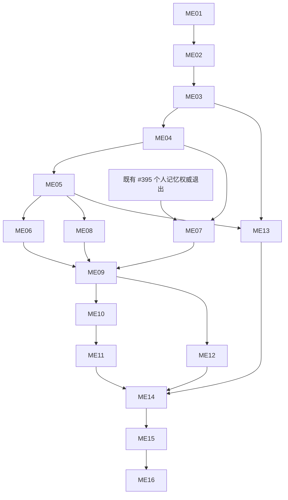

# Mastra Agent 执行迁移：Issue 拆解评审包

日期：2026-10-19。状态：**已发布并回读核验：父 Spec #472 + 16 张正式子 Issue**。

需求来自本次对话，目标 tracker 为 `1123786563/OpenBot`；本批使用独立父 Spec [#472](https://github.com/1123786563/OpenBot/issues/472)，现有 #6/#376 只作约束与关联，不修改其正文/状态，也不把新迁移挂成重复的多租户功能。

## 评审入口

- [详细方案](../../../specs/2026-10-19-mastra-agent-execution-migration-design.md)
- [已确认架构决定](../../../adr/0010-mastra-execution-openbot-governance.md)
- [已发布父 Issue 正文快照](parent-issue.md)
- [可恢复拆票清单、依赖、验收与正文哈希](tickets.json)
- 既有 Issue 的读取快照与依赖核对已归档至 `.archive/runs/legacy-plans/tickets/mastra-agent-execution/sources.json`。
- [已有文件级实施计划](../../../plans/2026-10-19-mastra-agent-execution-migration.md)

Issue 按业务可演示行为拆分，前后端专业分工放在票内，不将 15 个技术 Task 原样改名为 Issue。本轮共有 16 张子票；ME01 是必要的兼容性验证切片，其余是交互/后台/迁移完整路径。默认串行实施；DAG 分叉只表达真实依赖，不授权并行编辑共享模块。

本拆分已获用户确认，以批准 Spec 和本业务 DAG 决定范围及真实依赖；旧 15-Task 计划只作为文件/测试参考。实施前按每张 Issue 重新提取票内 Task Brief、核验已交付接口与共享文件所有权，不同时混用旧线性顺序和新业务 DAG 派发。

## 具体拆分

| 编号 | GitHub Issue / 本地正文 | Blocked by | 交付行为 |
| --- | --- | --- | --- |
| ME01 | [#473 锁定 Mastra 兼容组合并演示可持久恢复的最小执行](https://github.com/1123786563/OpenBot/issues/473) / [正文](issues/me01.md) | 无 | 维护者可用固定版本的最小 Bot 完成回答、一次受控工具调用和独立进程暂停恢复，证明迁移依赖可用。 |
| ME02 | [#474 现有聊天入口通过 Mastra 完成受预算约束的文本回答](https://github.com/1123786563/OpenBot/issues/474) / [正文](issues/me02.md) | [#473](https://github.com/1123786563/OpenBot/issues/473) | 用户在受控测试范围的现有聊天界面发送纯文本，获得 Mastra 流式回答、准确费用和可停止/重连的运行状态。 |
| ME03 | [#475 聊天刷新与附件往返保留完整历史和稳定顺序](https://github.com/1123786563/OpenBot/issues/475) / [正文](issues/me03.md) | [#474](https://github.com/1123786563/OpenBot/issues/474) | 用户上传文件或图片并继续对话，刷新、翻页或重连后仍能看到完整消息及工具关联，Bot 读取同一份有权限的历史。 |
| ME04 | [#476 Bot 通过本人授权的连接器工具完成多步工作](https://github.com/1123786563/OpenBot/issues/476) / [正文](issues/me04.md) | [#475](https://github.com/1123786563/OpenBot/issues/475) | 用户让 Bot 调用已连接应用，Bot 只使用被授权工具，正确处理结果/拒绝，并在多步执行中持续遵守预算。 |
| ME05 | [#477 危险操作与用户问答可持久挂起并准确恢复](https://github.com/1123786563/OpenBot/issues/477) / [正文](issues/me05.md) | [#476](https://github.com/1123786563/OpenBot/issues/476) | 用户看到工具动作和参数，批准、拒绝或补充回答；刷新或服务重启后仍能继续准确的待办，不重复执行外部动作。 |
| ME06 | [#478 Computer 与前端工具在有人和无人值守场景中保持真实执行](https://github.com/1123786563/OpenBot/issues/478) / [正文](issues/me06.md) | [#477](https://github.com/1123786563/OpenBot/issues/477) | 用户或后台 Bot 使用现有 Computer、gallery 和前端工具；需要本人参与时明确等待，并用真实工具结果继续回答。 |
| ME07 | [#479 Mastra 对话与后台只消费已确认且获授权的个人记忆](https://github.com/1123786563/OpenBot/issues/479) / [正文](issues/me07.md) | [#476](https://github.com/1123786563/OpenBot/issues/476), [#395](https://github.com/1123786563/OpenBot/issues/395) | 用户的记忆审核、暂停使用、来源撤权和遗忘在 Mastra 网页及后台上下文中继续有效。 |
| ME08 | [#480 保留可选学习技能的快照校验、加载与撤销](https://github.com/1123786563/OpenBot/issues/480) / [正文](issues/me08.md) | [#477](https://github.com/1123786563/OpenBot/issues/477) | 已启用学习的 Bot 在 Mastra 中继续使用原发布技能，未启用学习的部署无需连接 Intelligence。 |
| ME09 | [#481 定时任务通过统一 Mastra 执行并回写原会话](https://github.com/1123786563/OpenBot/issues/481) / [正文](issues/me09.md) | [#478](https://github.com/1123786563/OpenBot/issues/478), [#479](https://github.com/1123786563/OpenBot/issues/479), [#480](https://github.com/1123786563/OpenBot/issues/480) | 用户的定时任务到点后使用与网页相同的 Bot、工具、记忆和预算执行，结果出现在原会话且重复投递不重复推进。 |
| ME10 | [#482 职责、投递、唤醒与审批续跑统一执行和回传](https://github.com/1123786563/OpenBot/issues/482) / [正文](issues/me10.md) | [#481](https://github.com/1123786563/OpenBot/issues/481) | 职责推进、消息投递、唤醒和已批准操作续跑都使用同一受控 Mastra turn，保持各自稳定意图和用户可见状态。 |
| ME11 | [#483 Bot 交接与回收重试保持授权、分享和深度限制](https://github.com/1123786563/OpenBot/issues/483) / [正文](issues/me11.md) | [#482](https://github.com/1123786563/OpenBot/issues/482) | 用户把工作交给另一 Bot 时，目标只得到允许分享的上下文，并准确回传一次结果，后台回收器不重复推进。 |
| ME12 | [#484 OpenMuse 与 Workshop 调用保留任务、产物和作用域](https://github.com/1123786563/OpenBot/issues/484) / [正文](issues/me12.md) | [#481](https://github.com/1123786563/OpenBot/issues/481) | 通过主仓库调用 OpenBot 的 OpenMuse 任务与 Workshop 执行能使用统一 Mastra turn，并返回原业务可读取的结果和产物。 |
| ME13 | [#485 盘点并幂等导入旧会话与完整消息](https://github.com/1123786563/OpenBot/issues/485) / [正文](issues/me13.md) | [#475](https://github.com/1123786563/OpenBot/issues/475), [#477](https://github.com/1123786563/OpenBot/issues/477) | 运维先看到历史迁移 dry-run 与归属风险，再在隔离环境证明可中断重入导入，用户能完整读取迁入会话。 |
| ME14 | [#486 处置在途运行并完成单写切换与无数据损失回滚演练](https://github.com/1123786563/OpenBot/issues/486) / [正文](issues/me14.md) | [#483](https://github.com/1123786563/OpenBot/issues/483), [#484](https://github.com/1123786563/OpenBot/issues/484), [#485](https://github.com/1123786563/OpenBot/issues/485) | 运维能清楚处置每个在途/暂停任务，在维护窗口单写切换，并在故障时保留新消息和结果回退。 |
| ME15 | [#487 无强制 Intelligence 部署可运行并诊断全部基础入口](https://github.com/1123786563/OpenBot/issues/487) / [正文](issues/me15.md) | [#486](https://github.com/1123786563/OpenBot/issues/486) | 未启用学习的新部署不配置 Intelligence 也能运行聊天及后台；运维沿同一运行链路诊断模型、工具、审批和费用。 |
| ME16 | [#488 退出旧内置执行路径并完成全入口交付验收](https://github.com/1123786563/OpenBot/issues/488) / [正文](issues/me16.md) | [#487](https://github.com/1123786563/OpenBot/issues/487) | 维护者取得可审查的完整迁移交付，旧内置执行旁路退出，用户原业务在正向、越权和故障场景下保持可用。 |

## 已确认的测试 seam

1. 主 seam：真实挂载网页或持久后台任务的“已准入运行”入口，观察事件、历史、调用、receipt、用量及客户端行为。
2. 数据库集成：受限角色、真实 RLS/CAS/lease/intent，验证跨公司/团队/用户、重启及双实例；不以 mock 替代。
3. 外部依赖：确定性 provider/tool fixture 及锁定 Mastra 合约；必要真实能力缺环境则明确 unverified。

## 依赖图

## 既有 Issue 与范围交界

| 既有 Issue | 本轮关系 | 处理 |
| --- | --- | --- |
| #6 公司/团队多租户 | 授权与统一开放约束 | 保持其正文/状态；本迁移通过不表示其全功能门槛通过 |
| #92 TypeScript Agent 归属 | 已验证执行绑定合同 | 核验当前代码、复用合同；不按 OPEN/CLOSED 猜是否满足 |
| #94 执行上界/审批/脱敏 | 必须保留的保证 | 本轮每个适配加行为证据，不重做所有原生引擎 |
| #395 Intelligence 个人记忆退出 | **ME07 的真实外部前置** | 本轮只消费，避免重发退出票；当前为 OPEN |
| #162 外部状态归属迁移 | 旧映射证据参考 | 当前 CLOSED，但仍核验代码/映射；不重复迁浏览器/向量 |
| #436 fresh-schema 故障 | 可能影响独立测试库 | 当前 OPEN；以实际 schema 探测证据判阻塞，不整票纳入迁移范围 |
| HeroUI #443 等 | 同时可能改客户端 | 不重做视觉；实施时共享文件串行/分开集成 |

## 发布与回读结果

- 正式父 Spec：[#472](https://github.com/1123786563/OpenBot/issues/472)；16 张子 Issue 全部 open，标签为 enhancement 和 ready-for-agent。
- GitHub 原生 contains 关系：16 条；原生 blocked_by 关系：21 条，包含 ME07 → 既有 #395。
- 已按分页回读父/子正文、标题、标签、状态、正式子 Issue 集合和每票阻塞集合，核对本地正文 SHA256；没有修改既有 #6/#376 正文或状态。
- 发布核验报告已归档至 `.archive/runs/legacy-plans/tickets/mastra-agent-execution/publication-verification.json`；[清单](tickets.json) 保存真实编号/URL、原生依赖和批准记录。
- 方案、ADR、拆分与发布已确认；本次未启动代码实施，未提交、推送或执行生产迁移/部署。ready-for-agent 不代表所有前置已完成，目前只有 ME01 无实施依赖。
- 发布脚本逐条保存 receipt，网络失败可恢复；不要使用旧草案重新生成覆盖正式正文。恢复发布只核对本批，不更改已有父 Spec 正文和状态。

## 静态检查

历史文档校验工具已归档；它用于草案态重建本地正文，已批准/发布后只校验现有正文而不覆盖；校验唯一 ID、存在的依赖、无自环/环、拓扑顺序、每票至少五项验收、专业角色、外部依赖白名单和 A01–A20 完整覆盖；不调用 GitHub、不修改生产代码。这是文档校验，不是产品测试。
