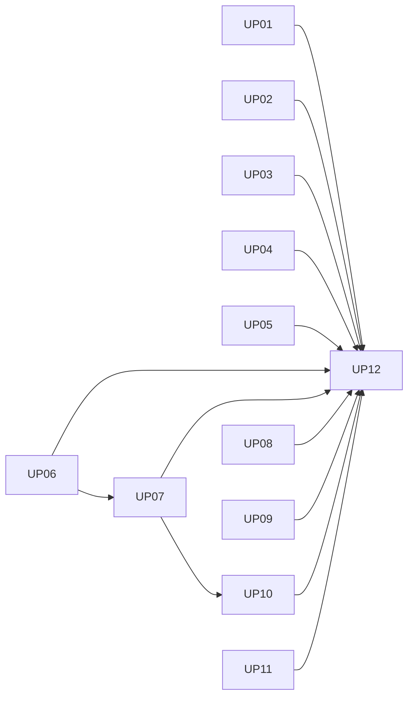

# OpenBot 上游能力更新：详细设计、Issue 草稿与交接包

日期：2026-10-20。状态：**用户已采用；父 Spec #489 + 12 张正式子 Issue 已发布，原生关系已回读核验；尚未启动代码实施**。

目标 tracker：`1123786563/OpenBot`。本轮完成设计采用与 Issue 发布，不启动生产代码改造；最终执行由用户向 Code Agent 发送执行提示词授权。

## 阅读入口

- 产品设计：`docs/specs/2026-10-20-upstream-openbot-adoption-design.md`。
- 实施细节：`docs/plans/upstream-sync/2026-10-20-upstream-openbot-refactor/implementation-plan.md`（18 个内部 Task）。
- 父 Issue 正文：`parent-issue.md`。
- 子 Issue：`issues/up01.md` 至 `issues/up12.md`，每票独立含行为、验收、边界、验证与交接。
- `tickets.json`：真实依赖、验收映射、内部 Task 对应及发布状态。
- `EXECUTION-PROMPT.md`：用户审阅后复制其中正文给另一 Code Agent。
- `publication-verification.json`：GitHub 正文、标签、12 条父子关系和 13 条依赖的回读证据。
- `validation.json`：本地文档与发布回执一致性校验，不代表产品测试通过。

## 业务票拆分

| ID | 交付 | 真正阻塞依赖 | 内部 Task |
|---|---|---|---|
| UP01 | 无 hostname 的无登录配置拒绝 | 无 | S00/S01 |
| UP02 | shell 参数秘密在事件导出前脱敏 | 无 | S00/S02 |
| UP03 | 邮件触发正确解码 charset/HTML | 无 | S00/S03 |
| UP04 | 例程描述去重且调度不变 | 无 | S00/S04 |
| UP05 | 按实际浏览器动作开屏并准确撤回 | 无 | S00/U01 |
| UP06 | 对话中安全连接个人应用 | 无 | S00/U02/U03 |
| UP07 | 工具活动摘要保留人工决定 | UP06 | U04 |
| UP08 | 完整 password→code 私有登录闭环 | 无 | S00/L01/L02/L03 |
| UP09 | 有界、非阻断启动诊断 | 无 | S00/D01 |
| UP10 | 三 provider 研究角色与授权闭环 | UP07 | R01/R02/R03 |
| UP11 | 移动端/harness/toolkit 采用评估 | 无 | S00/E01 |
| UP12 | 集成验收、回滚和完整 Review/OCR | UP01–UP11 | V01 |

S00 是共享的开工准备，只执行一次，不是要重复实现的业务前置；其他无阻塞票在固定基线之后可开始。默认仍串行，避免同时修改 transcript、plugins、登录 schema 或测试清单。

## 已发布 Issue

父 Spec：[#489](https://github.com/1123786563/OpenBot/issues/489)。

| Key | GitHub Issue | 标题 | 原生 Blocked by |
|---|---|---|---|
| UP01 | [#490](https://github.com/1123786563/OpenBot/issues/490) | 无 hostname 的无登录配置拒绝启动 | 无 |
| UP02 | [#491](https://github.com/1123786563/OpenBot/issues/491) | shell 参数凭据在事件导出前正确脱敏 | 无 |
| UP03 | [#492](https://github.com/1123786563/OpenBot/issues/492) | 邮件触发按正文编码与 HTML 字符读取内容 | 无 |
| UP04 | [#493](https://github.com/1123786563/OpenBot/issues/493) | 例程时间描述去重并保持实际调度不变 | 无 |
| UP05 | [#494](https://github.com/1123786563/OpenBot/issues/494) | 只有实际屏幕活动自动开屏并准确撤回拒绝动作 | 无 |
| UP06 | [#495](https://github.com/1123786563/OpenBot/issues/495) | 在当前对话安全连接 Bot 需要的个人应用 | 无 |
| UP07 | [#499](https://github.com/1123786563/OpenBot/issues/499) | 工具活动摘要可展开且人工决定始终可见 | #495 |
| UP08 | [#496](https://github.com/1123786563/OpenBot/issues/496) | 私有登录在密码之后安全完成验证码步骤 | 无 |
| UP09 | [#497](https://github.com/1123786563/OpenBot/issues/497) | 启动时有界诊断模型与已启用的可选服务 | 无 |
| UP10 | [#500](https://github.com/1123786563/OpenBot/issues/500) | 技能通过授权角色使用 Parallel Exa Firecrawl 研究 | #499 |
| UP11 | [#498](https://github.com/1123786563/OpenBot/issues/498) | 核验移动端 harness toolkit 与已批准方向的复用边界 | 无 |
| UP12 | [#501](https://github.com/1123786563/OpenBot/issues/501) | 完成更新集成验收回滚演练与全范围独立审查 | #490, #491, #492, #493, #494, #495, #499, #496, #497, #500, #498 |

## 发布与恢复规则

用户已于 2026-10-20 确认“采用”设计、测试边界与拆分；manifest 已回填真实编号/URL。UP key 仍是稳定业务标识，不是 GitHub 编号。

本次已按以下流程完成；如发布恢复，先核验现有回执：

1. 再查 tracker 现有同标题/同范围 Issue，避免重复。当前已做标题关键词查询，不能据此保证没有正文同义重复。
2. 建立新父 Spec Issue，正文使用 parent-issue.md；按拓扑序建立 12 张子票，每个正文用结构化 API 或 `gh --body-file` 传递，保留真实换行。
3. 将本地 UP key 回填为真实 GitHub URL/编号，在 child 中引用父 Issue；不修改已有 #472/#94/#11 等父票/状态。
4. 用原生 sub_issues 建 contains，用原生 dependencies/blocked_by 建真正依赖。可用写入方式在现有 Mastra 发布工具中有仓库先例；读取/写入能力仍以实际 API 结果为准。
5. `ready-for-agent` 表示设计和验收可派发；有未满足依赖的票不可立即实施。
6. 分页回读父子、blocking edges、body/labels/hash；每次成功写入立即保存 issue_id/number/url，恢复不重复创建。
7. 原生依赖写失败明确记录 partial，不声称发布已完整；只有 API 明确不支持时用正文 Blocked by 回退并保留证据。

当前已发布；后续执行者应读取正式父 Issue 树和实际依赖。用户本次采用并授权发布，不等于启动代码实施。

## 已有任务的边界

- #94：多租户执行上界/审批/机密脱敏回归；#11：Opik 内容投影。两者是背景与需协调的邻域，不自动成为本批 blocker。
- #472：Mastra 已有父 Spec，保持其事实源与权威边界，本批不修改其范围。
- 比较表中的“根 mobile 缺失”“记忆镜像可能缺失”“web-research.ts 入口”有已发现误判，以新 Spec 和实施计划的复核结论为准。

## 交接到另一 Agent

执行提示词已标注正式父 Issue，读取 manifest 中实际编号，无需手动替换 UP key。交接文档当前未提交，新 worktree/其他机器不会自动获得；请传递本目录、Spec、实施计划目录及必要约束，或使用同目录 handoff-bundle.tar.gz。

交接包只含文档/票据和生成工具，不含 .env、真实密钥、数据库、node_modules 或 Git 历史；它不是代码仓库副本。另一 Agent 仍需 checkout 同一个仓库，核验 BASE 并处理后续代码漂移。不要覆盖其已有改动。

## 生成与校验

`python3 docs/tickets/upstream-openbot-update/build.py` 只生成本地父/子票和 manifest，不调用 GitHub。用户编辑已生成票据后应相应更新源数据与 hash；发布后不能无检查运行生成工具覆盖真实编号。
