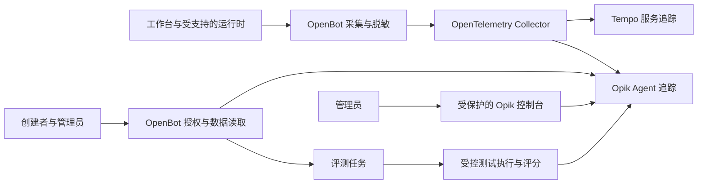

# Opik 自托管集成设计：工作台追踪、脱敏访问与评测

状态：已批准（2026-10-14）。用户在本次会话中批准书面设计，包括首期范围、接口约束、保留默认值与验收标准；批准进入实施计划阶段，尚未批准执行计划。
日期：2026-10-14
需求来源：本次 brainstorming 会话；没有关联的实施 Issue。

## 1. 目标与已确认决定

目标是建立「运行追踪 → 脱敏查看 → 案例沉淀 → 版本评测 → 退化定位」闭环。

已确认：

1. 使用自托管 Opik，同时支持追踪和质量评测。
2. 管理员在其管理范围内查看全局；Bot 创建者查看自己 Bot 的数据。
3. 创建者默认只看指标和脱敏内容，该规则覆盖样本、附件与导出。
4. OpenBot 负责身份与授权，Opik 负责追踪和评测存储；Opik 在内部网络，创建者通过 OpenBot 访问。
5. 复用 OpenTelemetry，并补充 Agent 运行、模型、工具与检索记录。
6. 企业租户正在设计，本次预留接入位置，不实现或冻结企业租户模型。

本文采用的首期设计：Opik 仅保存脱敏后的业务内容，管理员也不通过 Opik 获得额外原文访问权。更丰富的原文访问需要单独的需求与权限设计。

## 2. 事实源与现状

- `CONTEXT.md`：OpenBot、自托管部署、Credit Gate、Admission、Settlement 的领域约定。
- `reference/observability.md`、`docs/specs/superpowers/2026-10-10-observability-design.md`：现有日志、W3C 传播、OTLP、Tempo 与 Grafana。
- `docs/adr/0001-conservative-input-bound.md`：输入上界与计费准入约束。
- `shared/trace.ts`、`server/src/telemetry/trace-middleware.ts`：进程级 tracing 和 HTTP span；处理器返回 Response 后结束 span，不保证涵盖 SSE 的完整生命周期。
- `server/src/copilot.ts`、`server/src/agents/endpoint.ts`：工作台执行装配、AG-UI middleware 与带传播信息的受控出站调用。
- `.env.example`：本地启动默认托管端点指向 `agent-langgraph`；`agent-bot` 是协议参考运行时。
- `agent-langgraph/src/index.ts`、`agent-bot/src/index.ts`、`agent-trpc/internal/bot/bot.go`、`agent-mastra/src/mastra/index.ts`：不同框架运行时；能力不完全相同。
- `server/src/plugins/store.ts`、`server/src/agents/profile-policy.ts`：Bot 归属及现有授权应被复用，不能只相信客户端或 trace metadata。
- `reference/enterprise-runtime.md`、`server/src/db/schema/enterprise-conversations.ts`：企业运行与会话有独立的身份、账本及授权约束；本设计不修改它们。

企业相关现状只作为兼容性参考，不代表用户正在设计的租户模型已经批准。

## 3. 首期范围与非目标

### 首期交付

- 工作台的统一运行记录和可信关联索引，包含内置执行与经过 OpenBot 的远程 AG-UI 执行。
- 内置执行和默认 LangGraph 路径的模型、可观察工具执行、检索记录。
- 创建者运行列表、运行详情、版本化评测集、实验提交与对比页面。
- 管理员的全局汇总、按 Bot 过滤、采集健康状态和受保护的 Opik 控制台入口。
- 独立评测任务、规则评分和显式配置的模型评分、失败与取消处理。
- 可选的自托管部署装配、脱敏策略、保留与删除流程、验收证据。

### 首期能力分级

- `detailed`：运行、模型及适用步骤均可观察，并通过该运行时的契约验收。
- `basic`：只有 OpenBot 实际观察到的运行、AG-UI 事件与受控回调，缺少运行时内部步骤。
- `unavailable`：没有可靠采集证据或配置未开启。

`agent-bot`、`agent-trpc` 的工作台入口、Mastra 以及用户自带远程 Agent 首期保证通用执行路径的 basic 能力；升级内部记录需各自适配和验收。直接访问远程 Agent、绕过 OpenBot 的调用不计入覆盖。界面明确显示能力等级，不能将没有 span 解释为没有调用。

### 非目标

- 企业租户、企业管理角色、SSO、RLS、企业数据迁移与企业运行时适配。
- 将 Opik workspace 等同于未来租户，或根据普通 HTTP header 自动选择企业租户。
- 托管运行时之外的隐藏步骤、模型思维链、未经处理的原始附件。
- 替换现有会话、运行账本、计费台账、Prompt 生效配置或 Grafana/LGTM。
- 自动修改 Prompt、自动上线模型、在线评测触发真实业务写操作。
- fork Opik、修改 Bifrost 子模块，或引入第二套用户账号体系。

## 4. 总体架构

保留现有 HTTP tracing。新增运行 span 覆盖业务运行寿命；Collector 对 Agent 数据进行分流，保留建立父子关系需要的上下文。向 Opik 与 Tempo 发送的内容均遵守导出前脱敏规则。首期采用 OTel 作为执行采集路径，Opik SDK/API 用于评测和读取；框架集成不应另外上传一份未经治理的执行数据。

Opik ID 与 OTel ID 不假定同值。OpenBot 保存 `run_id`、OTel trace ID 与 Opik 记录定位信息的映射，验收需证明跨服务父子关系及多次运行关联正确。

## 5. 企业租户预留

### 已知变化与接入位置

OpenBot 存在工作台身份与企业身份两种真实执行模型。将授权、数据定位和任务执行资格集中到三个 seam；首期只实现工作台 adapter，企业 adapter 待企业 Spec 批准后实现。

1. **授权与范围解析**：从认证上下文、资源与动作生成已授权的范围，动作包括查看运行、查看评测、管理评测集、执行评测、导出与管理设置。调用者不能自带一个字符串便绕过授权。
2. **数据定位**：将已授权范围和 Bot 映射到 Opik workspace/project 及 OpenBot 本地索引。隐藏实际部署布局，业务页面不直接构造 Opik 查询。
3. **评测执行资格**：入队及实际执行前验证主体、Bot、数据集、版本、模型、工具测试配置和预算权限。

### 首期合同

- 工作台使用部署级命名空间；`scope_key` 是服务端生成的内部不透明键，不具有企业租户语义。
- 本地关联索引、缓存键、分页游标、导出任务、评测任务和数据定位均携带已授权的 scope。不同范围之间不能混用记录或游标。
- 原始资源与运行 ID 的唯一性按 scope 校验；不能依靠名称或全局 Bot ID 唯一性实现隔离。
- 浏览器、模型、AG-UI state 或 forwardedProps 中提供的 Bot/owner/scope 字段不能作为授权事实。采集上下文由已认证的 OpenBot 路径生成或校验，内部凭证本身不记录。
- 服务端缺少可靠 Bot/运行绑定的记录进入管理员可见的未绑定状态，不能暴露给创建者。运行时追加 metadata 不能修改本地权威归属。
- 将来企业入口必须提供已认证且已授权的 scope；缺失、未知或未配置的企业 scope 拒绝访问，不能回退到工作台范围。
- 管理员的全局访问在已授权范围内执行。未来企业管理员不能默认拥有跨租户权限。
- 工作台与企业数据以不同 scope 区分。禁止推测旧数据属于某租户；未来迁移需显式映射和独立授权。
- Opik workspace/project 是存储组织方式，不是访问权限证据；一租户对应一 workspace、一 project 或独立实例的选择留给未来租户 Spec。

以上预留只固定“所有敏感操作必须携带经授权的范围”，不固定租户表、ID 格式、成员角色、授权继承、数据库连接或分区数量。不创建假租户，不增加当前未使用的 tenant 表，也不接管企业运行信封。

## 6. 运行记录与正确性

### 关联字段

采集合同含 scope、Bot 引用、thread/run/attempt 引用、触发来源、运行时与能力等级、部署版本、Bot 配置版本、Prompt 指纹、模型配置标识、脱敏策略版本。用户关联使用部署内的匿名标识；用户身份与授权映射留在 OpenBot，Opik 不存邮箱等账号字段。

配置快照只保留非敏感字段及可重新定位的版本引用，不能包含密钥或完整内部能力信封。Opik 名称使用内部稳定标识，避免将敏感名称置于难以脱敏的字段。

### 生命周期

- 运行结束于实际完成、失败、取消或明确中断；HTTP headers 发出不表示 run 完成。
- 每个执行 attempt 唯一终结。重试产生独立 attempt，汇总不能重复计算。
- SSE 断连区分客户端停止观看与执行实际取消；运行仍在后台执行时不能提前标成 canceled。无法确认的结局标为 interrupted/unknown，不伪造完成。
- 工具调用提议与实际工具执行使用不同记录；浏览器工具只能记录可信执行结果。缺失回执标为 unobserved，不能标成 succeeded。
- token 来自 provider 实际报告；缺失为 unavailable，不以 0 代替。估算必须单独标注。
- Opik 的成本是分析信息；Credit Ledger 与 Settlement 继续保持唯一计费权威。
- 导出在有界队列中异步进行，Opik 不可达不改变 Agent 执行结果。丢弃、失败、延迟与未知终态有指标和管理员提示；不能将采集缺失解释为成功。
- 本地权威关联写入失败时，停止该运行向 Opik 导出业务内容并报告采集故障，避免产生无法可靠授权的数据；普通业务执行按其既有故障规则处理。

## 7. 脱敏与访问

### 导出前处理

输入、输出、工具参数和结果、检索片段、异常消息、metadata、评分理由、实验配置与样本均经过同一治理入口。规则按字段语义处理，不能只依赖关键词正则。

- 禁止采集认证头、token、密钥、签名能力、连接串和思维链。
- 已知结构化字段使用白名单和替换规则；正文启用 Bot 已配置的脱敏策略。无法可靠处理的自由文本仅记录长度、类型等安全指标。
- 原始附件首期不上传，也不返回可下载原文的 URL；只记录经授权的内部引用及安全元信息。
- 自动 SDK 采集与模型评分的诊断记录也必须经过处理，不能绕过治理入口。
- 超长正文和大型检索结果受字段与批次上限限制，明确标 truncated/omitted。
- 脱敏后的内容进入 Opik；原文只保留在已有的业务存储及其权限规则下。

### 访问合同

创建者复用当前 Bot 管理权限；仅有聊天使用权或分享访问权不授予观测权限。系统 Bot 无个人创建者时，管理员管理观测数据。授权使用当前权威归属，不使用采集时的 owner 快照；移交或撤销后旧持有人不能继续访问历史数据。

列表、聚合、详情、span、样本、实验、反馈、导出分别验证资源与 scope。Opik 过滤条件由服务端生成；客户端仅能传入经过验证的排序、时间和状态筛选，不提供任意 Opik 代理接口。对无权访问的 ID 返回统一不存在语义，不泄露资源存在性。

查询与缓存须绑定当前访问资格；权限变化后重新授权。生产 Opik 控制台与私有 API 都置于有认证的受保护入口，不能只保护网页首页。完整控制台仅向管理范围覆盖整实例的平台运维管理员开放；范围受限管理员使用 OpenBot 的受控页面。未来租户管理员不能因其 admin 角色获得整实例访问权。

## 8. 评测闭环

### 数据集与配置

用户从脱敏运行中创建候选案例，检查输入、参考结果及工具 fixture 后保存为评测集版本。仅有指标的记录不能自动成为文本评测样本；使用者需提供已审查的合成或脱敏案例。脱敏改变语义的案例不能据此声称原始任务质量。

每次实验固定数据集版本、Bot 非敏感配置快照、Prompt 版本或指纹、模型及参数、工具 fixture、评分器配置与版本。跨 Bot 复用数据集必须再次验证权限和显式复制，不能凭 dataset ID 共享。移除权限后，排队任务不继续使用此前获得的执行资格。

### 执行

- 评测作为独立有界并发任务运行，使用隔离 thread 和测试工具配置，不写入生产会话记忆或业务数据。
- 复用被测 Bot 的公共执行路径及适用的授权、Credit Gate、Admission、Reservation/Settlement，避免另写一套模型逻辑。
- 首期调用工具使用 fixture 或测试环境；调用未知生产写工具拒绝执行。
- 入队及每个样本实际执行前重新验证授权；取消停止调度新样本并终止可取消的当前执行。调用结果不明的 attempt 不自动重跑，以免重复调用和计费。
- 模型评分使用部署显式批准的模型入口、凭证及预算；不自动使用 Opik 默认模型。无法通过适用计费和准入合同的 Judge 配置拒绝启用，规则评分仍可使用。
- 规则评分支持格式、字段、关键条件和工具行为检查；模型评分针对有参考依据的相关性、任务完成度或 groundedness，保留评分理由与版本。
- prompt、参考答案和 Judge 输入只使用经过审查的评测样本。Judge 理由和 SDK 自动追踪再次经脱敏处理。
- 执行失败、评分失败、取消、等待数据同步分别展示；缺失评分不当作 0 分或从报表中隐藏。

### 对比

两次实验比较时显示样本集合、配置差异、完成率、有效评分样本数、逐项分数、耗时与实际 token，以及退化案例。对不相同的数据集或评分器不作可比结论；可比性不足时显式提示。

首期由人工根据结果判断版本效果，提供机器可读报告；自动阻断发布或自动上线属于后续需求。

## 9. 页面与操作

- **Bot → 运行记录**：时间、状态、能力等级、耗时、token、版本；详情显示步骤树与脱敏数据，并可创建候选评测案例。
- **Bot → 评测**：数据集版本、案例编辑、实验提交、任务状态、取消、两次实验对比、回到具体运行。
- **管理后台 → AI 可观测性**：管理范围内的汇总与筛选、数据采集健康状态、未绑定记录、保留策略说明及控制台入口。
- 配置未开启、无数据、无权访问、Opik 不可达、数据同步中、basic 记录缺少内部 span、内容被省略、token 不可用各有明确状态。
- 页面只提供与当前角色相关的操作；服务端仍执行同样授权，隐藏按钮不是权限控制。

## 10. 部署、存储与生命周期

Opik 是可选外部服务，沿用仓库独立可选 compose 栈的约定。本地使用独立 compose 装配；生产使用经过验证的上游 Kubernetes/Helm 部署。固定服务与 SDK 的兼容版本，记录版本、镜像来源、OTLP/评测/查询契约冒烟结果，不自动跟随 latest。

OpenBot 本地只保存权威关联、存储定位、评测任务与版本引用，不复制完整 span 和会话正文。Opik 故障时页面返回明确的暂不可用状态，不借故回退到无授权的上游查询。

首期默认运行追踪保留 7 天、评测集与实验保留 30 天；这是本文提出的待批准默认值，运维配置可以调整。删除数据集、Bot 或范围时按权威关联安排 Opik 数据删除，停止相关任务并失效缓存。保留期和删除实现需覆盖实际存储、附件、导出文件及备份策略；只在 OpenBot 隐藏条目不算完成删除。已生成报告仍适用其所在存储的保留规则。

删除先撤销可见性并记录删除任务；关联信息保留至上游清理完成，失败时重试并展示 pending/failed，不能报告物理删除成功。导出文件通过受控接口下载，权限撤销后的旧链接不能继续获取文件。没有完整删除或保留期证据的部署不能通过该项验收。

候选案例未独立保存成评测集时，随源追踪删除；用户显式保存后的脱敏评测案例采用评测保留期，并保留来源及策略版本。相关权限撤销即时生效，无需等待物理清理。

未启用 Opik 时不启动相应任务与导出。保留现有 tracing 配置和关闭语义，启用方式必须支持宿主机、容器与 supervisor 创建的进程；不同环境不能误用 loopback 地址。

## 11. 纵向实施切片建议

此处是后续 writing-plans/Issue 拆分依据，不是已批准实施计划。

1. **可查看的安全运行记录**：可信 scope/运行关联、基础采集、脱敏、受控查询与创建者列表/详情；同时建立可选 Opik 部署和健康检查。
2. **默认运行时的详细追踪**：内置执行与 LangGraph 的模型、工具、检索生命周期、跨服务关联、取消和缺失数据状态。
3. **可运行的评测闭环**：版本化案例、隔离执行、预算、规则评分、显式 Judge、任务和实验页面。
4. **可判断退化的对比与运维**：对比报告、管理员汇总、保留/删除、导出与完整权限回归。

企业集成作为未来独立业务切片，在租户 Spec 批准后提供三个 seam 的 enterprise adapter；不能通过给页面补一个 tenant 参数替代企业授权。

## 12. 验收标准

| ID | 可观察验收 |
| --- | --- |
| A1 | 未启用 Opik 时现有执行和 tracing 行为保持成立；配置开启后真实自托管实例接收到有效记录。 |
| A2 | 内置与 LangGraph 各跑一次带可观察工具/检索的执行，步骤关系和服务关联正确；其他远程路径明确标 basic。 |
| A3 | 成功、失败、SSE 断连、取消、重试均按真实执行终结；HTTP 提前返回不截断 run 耗时；工具提议不冒充执行。 |
| A4 | 令牌、签名能力、账号标识、敏感结构化字段及无法处理的正文不出现在实际 Opik 存储、详情、样本、Judge 记录或导出中。 |
| A5 | 创建者仅能访问自己有管理权的 Bot；共享聊天权、伪造 Bot/owner/scope、猜测记录 ID、附件及实验 ID 不能扩大范围。 |
| A6 | 管理员按管理范围汇总；移交和权限撤销即时影响历史查询、缓存、分页及排队任务。 |
| A7 | 使用同一已冻结评测集跑两种配置，规则评分与启用的 Judge 均可追溯；完整显示执行和评分失败。 |
| A8 | 评测不修改生产记忆与业务数据，生产写工具被拒绝；执行及 Judge 的适用准入、预算与结算均有证据。 |
| A9 | 对比页只对可比实验给出对比结论，显示有效样本数与退化案例，并可定位执行记录。 |
| A10 | Opik 停止、慢响应、队列饱和不使普通 Agent 运行失败；丢弃与采集故障可观察。 |
| A11 | 保留期、数据删除与缓存失效覆盖实际 Opik 数据和导出；已删除或无权资源不通过直接私有 API 泄露。 |
| A12 | 用授权模块的测试 adapter 构造两个 scope：相同资源 ID、跨 scope 游标/缓存/任务不能串用；未知企业 scope 拒绝而不回退。测试不需要真实租户表。 |
| A13 | 宿主机、容器导出及受支持的动态进程配置通过冒烟；跨服务 ID 映射和父子关系经真实 Opik 验证。 |

批准后，实施计划将验收映射到任务 DAG、实际文件所有权和检查命令。本文批准不表示生产代码已实现或所有验收已通过。

## 13. 官方依据与版本核验

资料查阅时间：2026-10-14。实施时锁定实际兼容版本并核验，避免仅凭文档片段假定能力。

- [Opik 仓库](https://github.com/comet-ml/opik)
- [OTel 接收、会话与 metadata 属性](https://www.comet.com/docs/opik/integrations/opentelemetry)
- [自托管及部署选项](https://www.comet.com/docs/opik/self-host/overview)
- [开源部署不具备工作区成员管理](https://www.comet.com/docs/opik/administration/workspace-settings/workspace_members)
- [TypeScript 评测、数据集与实验](https://www.comet.com/docs/opik/reference/typescript-sdk/evaluation/overview)
- [规则与模型评分器](https://www.comet.com/docs/opik/reference/typescript-sdk/evaluation/metrics)
- [Opik 分布式记录关联](https://www.comet.com/docs/opik/tracing/advanced/log_distributed_traces)

服务/SDK 兼容、OTel ID 映射、框架实际回调生命周期、模型评分的受控入口和 Opik 删除能力属于实施前必须取得的契约证据；核验失败需要调整 adapter 或报告真实阻塞，不能将不支持的路径标为完成。
