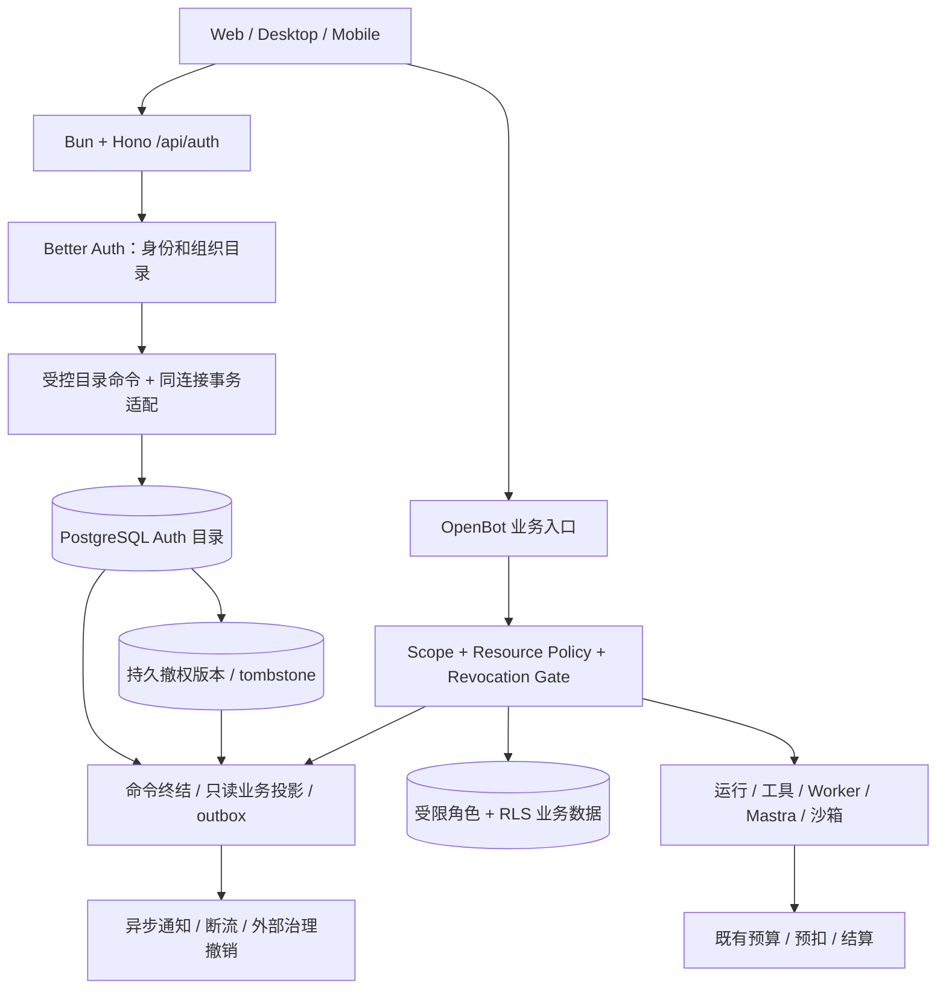

# OpenBot：Better Auth 全量接入与公司多租户体系设计

状态：**详细设计评审稿 v2.2，尚未批准实施**。日期：2026-10-22。本版整改用户确认的 F1–F4、H1–H4、M1–M3、L1–L3；编号与此前 F01–F06 等评审编号分别保存。

本文承接 ADR 0011 已确认的身份及目录选型。旧 ADR 0004 和旧多租户整改规格已作废；本稿重新列出独立候选需求与验收，不承接旧 Issue 的实施授权。新增物理模型、同步机制、角色、接口和上线步骤均为本稿建议；本次调整修复设计不等于批准实施、迁移或发布。当前代码事实是静态读取结果，不代表功能已通过部署或隔离验收。

## 1. 设计结论与事实源

采用 **Better Auth + Better Auth UI + PostgreSQL + OpenBot 既有业务授权**。Better Auth 统一管理身份、会话、公司目录、团队目录、成员与邀请；OpenBot 管理公司业务生命周期、可信 Scope、资源权限、运行审批、数据库隔离、公司/个人付款账户与审计。保留 Bun/Hono、React/Vite/TanStack Router、Mastra 执行适配及现有 Worker，不因参考文档示意而迁移到 Next.js 或重建 Go Platform Core。

本稿建议的首期候选范围是公司多租户完整交付，平台开通公司、公司管理员邀请员工；这是待重新批准的交付建议，不恢复旧整改排期。独立个人空间按 proposed ADR 0007 保留扩展位置；在产品决策改变前，不将缺少公司选择解释为完整个人业务空间。用户可自助创建公司的流程在 §8 给出可启用分支。这些默认值是可调整建议，不是已确认的实施需求。

### 1.1 依据和优先级

| 事实源 | 本稿处理 |
| --- | --- |
| [功能参考矩阵 F001–F094](2026-10-22-Better_Auth_Better_Auth_UI.md) | 作为能力目录；不作为当前代码已实现、组件兼容或版本锁定证明。 |
| [ADR 0011](../adr/0011-better-auth-identity-and-membership-authority.md) | 已接受的身份及目录选型、职责方向：BA 为目录唯一管理权威，OpenBot 保留业务治理，暂不引入 OpenFGA；不代表完整交付范围已批准。 |
| [ADR 0004（已作废）](../adr/0004-company-team-tenancy.md)、[旧公司多租户规格（已作废）](2026-10-14-company-team-multitenancy-design.md) | 仅作历史背景，不作为本轮需求、验收或排期依据。本稿候选范围须独立评审，原 Issue #6 及其子 Issue 不恢复。 |
| [ADR 0009](../adr/0009-remove-knowledge-base-domain.md) | KB 已决定下线；不因参考矩阵包含 Knowledge/RAG 而恢复 KB 服务或列入本次必建功能。 |
| [ADR 0006](../adr/0006-logical-private-bot-scoped-execution.md)、[ADR 0010](../adr/0010-mastra-execution-openbot-governance.md) | 保留逻辑私有 Bot、分范围执行环境，以及 OpenBot 的运行、审批和预算权威。 |
| [ADR 0007](../adr/0007-personal-space-business-scope-and-payer.md)、[个人/小企业规格](2026-10-16-enterprise-personal-agent-product-permissions-spec.md) | 区分已确认合同和 proposed 个人空间。个人模型消费不等于完整个人工作台。 |
| [CONTEXT.md 公司与团队、计费与积分](../../CONTEXT.md) | 用于现有词义：Tenant=公司，Workspace=公司内团队；术语存在不代表相应功能或交付范围已批准。 |

适用范围裁决：ADR 0011 的选型决定与旧整改作废可以同时成立。旧规格的批准状态、验收编号和任务树不向本稿传递；相邻 ADR 中引用旧多租户背景，也不构成旧整改重启依据。§1.3 是本稿重新提出的完整候选范围，§15 仅映射这些新需求。用户已明确要求提前展开详细计划，配套计划可在候选状态编写和修订；执行仍须完成该范围的重新立项、Spec 批准和实施授权，此次文档修订不代替这些决定。

### 1.2 候选方案必须满足的业务不变量

1. 一个全局 User 对应一个全局 Principal，可以分别加入多家公司、每家公司多个平级团队。
2. 有效公司资格是团队业务前提；有效团队资格不授予其他成员的私有内容或凭据。
3. 公司管理权、团队管理权、业务内容权、公司财务权、平台运维权分别判定。
4. `activeOrganizationId`、`activeTeamId`、header、URL 都只是选择器。服务端核验成员、对象归属和动作后才能生成可信 Scope。
5. 成员撤销提交后，新业务事务和后续敏感动作的准入不能继续使用旧资格；下载的新请求、Range 重试和后续输出批次也属于新准入。撤权前已准入的在途动作按 §5.5 的明确边界处理，不承诺追回已输出字节或已完成的外部副作用；未知费用继续原账户结算。
6. 公司工作台消费公司统一余额，团队只统计用量；个人 Bifrost 授权消费个人余额，余额不足不互相兜底。
7. 身份/权限/存储不可用时相关入口关闭，不回退默认公司、首个团队、部署管理员或开发用户。
8. 每个成员关系只有一个写入权威；兼容资格投影可由 BA 当前目录、OpenBot 生命周期和独立持久撤权版本事实重建，不可独立管理。撤权版本事实不能随投影重建而丢弃。

### 1.3 本稿独立候选需求与验收映射

以下 BA-R01–BA-R12 全部为本稿待批准的候选需求，不复用旧规格编号。§12 的 P0、§14 的 Task 和 §13 的上线步骤均以这些需求获批为前提；批准范围有变时须同步重做映射。现有代码只作为复用对象，不作为需求批准或功能完成证据。

| 编号 | 候选需求及边界 | 设计位置 | 验收 |
| --- | --- | --- | --- |
| BA-R01 | 保留全局 User/Principal、外部账号关联及历史业务 ID；不复制身份或改变既有 payer。 | §2、§4、§13 | BA01、BA15 |
| BA-R02 | BA 唯一管理公司/团队/成员/邀请；全部写入口受控，同事务完成目录、资格投影、撤权版本与审计。 | §4–§5 | BA08、BA09、BA18 |
| BA-R03 | 公司开通、邀请、角色、退出/移除、暂停与 owner 保护有完整闭环，固定角色首发。 | §6、§8 | BA04、BA05、BA06 |
| BA-R04 | 公司管理、指定团队管理、财务与内容动作分别授权；私有资源和显式分享不因目录角色扩大权限。 | §6、§10 | BA03、BA04、BA17 |
| BA-R05 | 明确公司/团队选择；服务端可信 Scope 与客户端缓存、流、多标签和原生切换一致。 | §7 | BA02、BA13 |
| BA-R06 | 即时阻断撤权后的新准入；旧能力不随重新加入或投影重建复活，下载在途边界可验证。 | §4.4、§5.4–§5.5 | BA06、BA07、BA14、BA19 |
| BA-R07 | 保留已启用 SSO/SCIM；公司认证证据绑定实际会话及公司，SCIM 只影响所绑定公司。 | §9 | BA10、BA20 |
| BA-R08 | §10 所列实际业务、外部状态及启用客户端具备公司/团队/个人隔离，未知归属受控隔离；不恢复 KB。 | §10 | BA02、BA03、BA09、BA14、BA16 |
| BA-R09 | 执行、Worker、审批与费用保持固定发起范围和 payer；公司共同余额与个人模型余额分离。 | §5、§10–§11 | BA11、BA12 |
| BA-R10 | BA UI 复用登录、账户、公司和团队管理；保留当前技术栈和已启用客户端，无公司/团队有明确空态。 | §7、§12 | BA01、BA05、BA13、BA17 |
| BA-R11 | 平台管理、审计、容量和财务动作独立受控；审计与配额失败按相应合同关闭操作。 | §6、§11 | BA04、BA05、BA08、BA12 |
| BA-R12 | 稳定映射、停写回填、单权威切换、备份恢复及完整验证有明确门槛；无证据不开放。 | §4.4、§13–§15 | BA15、BA16、BA18、BA19 |

## 2. 当前系统基线与实际差距

读取基线：工作区 `/Users/wuyongjun/trea/OpenBot`，HEAD `e8ea2102a33956705d4f01c4893b2bd388db395e`，2026-10-22。本次读取包含已有未提交文件；以下定位用于设计，实施前必须重核工作区与版本。

| 当前事实及代码位置 | 复用方式 | 缺口 |
| --- | --- | --- |
| `server/src/auth/index.ts` 已创建 Better Auth，装配 SSO、条件 SCIM、Electron、条件 Expo、generic OAuth。 | 扩展现有工厂与适用插件。 | 本次查看的 plugins 数组未启用 Organization/Admin；依赖存在不等于接入完成。 |
| `server/src/db/schema/core.ts` 已有 users/accounts/sessions/verifications。 | 原 User ID、Account 关联与历史身份保留。 | Organization schema、session active 字段、Admin 扩展需迁移；不能另建一份用户目录。 |
| `server/src/db/schema/enterprise-tenancy.ts` 有 Tenant/Principal/公司成员/团队/团队成员/Resource/Grant；公司成员有 epoch。 | 保留业务 ID、FK、资源和付款归属。 | 目录权威目前在 Enterprise 表，需要切换写入与明确投影地位。 |
| `tenancy/store.ts`、`scope-gate.ts`、`revocation.ts` 已有可信 Scope、实时成员重验、共享锁和撤权检查点。 | 保留集中判定和锁语义。 | Better Auth 的所有变更入口必须进入同一串行化规则，不能仅迁 UI。 |
| `workspace-admin.ts`、`workspace-scope-routes.ts`、`company-admin-routes.ts` 提供旧目录和管理入口。 | 保留必要的兼容 Interface，底层改调新目录 Module。 | 旧 SQL 写入、CLI、SCIM、初始化和离职入口都须停用或改路由，防止双主。 |
| `tenancy/connections.ts` 验证 directory/data/operator 受限连接角色。 | 继续限制业务数据库权限。 | Auth 目录写角色、投影函数和运行期管理能力需单独设计，不扩大 data 权限。 |
| `app/src/lib/auth/client.ts` 目前只装配 ssoClient；前端已有 scope selection、stream-scope、scoped-cache。 | 加入 organizationClient；复用现有缓存代际与流断开规则。 | 接入 UI provider、组织/团队页面、邀请路径和管理面；避免两套切换状态各自生效。 |
| server 声明 Better Auth `^1.7.1`，app 声明 `^1.6.27`；本次两处本地安装包均为 `1.7.1`。 | 先统一明确兼容的依赖与锁文件。 | 当前声明不是精确版本锁定；UI registry 产物也需记录版本/来源。 |
| `auth/organization.ts` 是远程 OpenBot authority 的组织登录交接；`organization-store.ts` 会 materialize 本地用户。 | 单独纳入跨部署身份合同。 | 这里的 organization 不等于新 Organization 插件；按 email 合并的现有路径必须审核，不能据此跨公司自动授权。 |

已有大量 tenancy 适配和回填代码，部分处于当前未提交状态。本文不宣布这些入口全部已装配或验收，不将其移除，也不默认它们可直接满足新的成员目录合同。

## 3. 目标架构与职责



Better Auth 可直接挂载到 Hono 的 Request/Response 入口，无需为了接入它改技术栈。[官方 Hono 集成](https://better-auth.com/docs/integrations/hono)

### 3.1 Module 与 Interface

| Module | 对外 Interface 与不变量 | 内部 Implementation |
| --- | --- | --- |
| Identity | `authenticate(request)`、`requireCompanyAssurance(identity, tenant)`：可信 actor/session 及适用的公司认证证明；禁用、撤销或证明不足拒绝。 | Better Auth 认证、原生客户端适配及 §9.1 的会话级认证证据。 |
| Organization Directory | `execute(command)`、`listEligibleScopes(actor)`：限定公司/团队、幂等、授权与变更原子完成。 | Better Auth Organization、受控团队扩展、同连接事务、命令终结、投影及审计；重建依赖 §4.4 的持久撤权事实。 |
| Business Scope | `resolveCompany`、`resolveWorkspace`、`transaction(scope, operation)`。Scope 不可由 JSON 恢复。 | 现有 resolver/gate、成员版本、锁、RLS 本地上下文。 |
| Resource Authorization | `authorize(scope, action, resource)`：对象归属、动作、发布、Grant 和依赖共同判定。 | 保留现有资源策略；目录角色不能替代资源判定。 |
| Tenant Lifecycle | `provision/suspend/requestDeletion`：只有 active 公司允许正常业务；清理可恢复。 | 公司业务状态、开通幂等、任务取消、资产交接、保留策略。 |
| Billing / Execution | 使用已验证 Scope 及固定 PayerRef。 | 复用 Run/Attempt、审批、能力租约和积分台账。 |

Seam 放在上述 Interface；业务调用者无需知道 Better Auth 的表名、hook 顺序或 UI 选择方式。先对现有 Module 深化，避免在每个路由重复拼组织管理、撤权和权限逻辑。

## 4. 领域模型与数据所有权

### 4.1 概念映射

| OpenBot 概念 | Better Auth 对应 | 权威与约束 |
| --- | --- | --- |
| OpenBot User | user | 全局身份，沿用 users.id。邮箱是可变属性，不能作为跨系统身份合并的唯一依据。 |
| Principal | 无需替换 | 继续一对一绑定 user；业务授权引用稳定 principal_id。 |
| Tenant | organization + OpenBot 公司业务扩展 | name/logo/slug 等目录字段由 BA 管；运行状态、payer、政策等由 OpenBot 管，不能相互覆盖。 |
| Workspace | team | 每个团队固定属于一家 Organization；公司内平级。 |
| Company Membership | member | `(organizationId,userId)` 唯一；业务资格同时要求公司/用户/成员有效。 |
| Workspace Membership | teamMember | 使用团队资格时必须是该组织有效 member；成员关联完整性在命令最终状态验证，暂停可保留无效的团队关系。公司移除使所有团队资格失效。 |
| Membership Invitation | invitation | pending 不授予权限；接受后才建立成员关系。 |
| Company Credit Account | 无对应钱包 | 原 Tenant→payer/customer 映射和账务事实保留。 |

以上沿用 CONTEXT.md 的既有词义，不新增另一份词汇表，也不据此推定功能范围已批准。下文“投影”“命令”“版本”是实现概念，不写入共享领域词汇。独立个人空间仍保留 proposed 状态。

### 4.2 推荐物理模型

新表名为设计建议，最终以固定版本生成 schema 后的 Drizzle 定义为准。

| 数据 | 推荐存储 | 规则 |
| --- | --- | --- |
| 原身份 | users/accounts/sessions/verifications + 原 Principal | 原 ID、外部账号 provider identity、历史引用保持；追加插件必需字段及 Principal 的服务器控制 `identity_generation`。全局禁用/安全重置在 principal 锁内递增该安全代际，不因恢复身份重置。 |
| BA 公司/团队目录 | `auth_organizations`、`auth_teams` | BA schema mapping 指向新目录表，不把既有业务表直接改成 BA 所有。 |
| BA 成员/邀请 | `auth_members`、`auth_team_members`、`auth_invitations` | BA 为唯一写入口；组织成员可增加服务器控制的 lifecycle 字段。 |
| 公司业务存根 | `enterprise_tenants` | 保留原 ID、业务 status、policyRevision 和所有历史外键；目录 name 是 BA 同事务投影，业务状态不是 BA profile。 |
| 团队业务存根与映射 | `enterprise_workspaces` + `auth_team_bindings` | 映射键 `(tenant_id,workspace_id)` 唯一，team_id 唯一；保留旧业务 ID。 |
| 公司/团队业务资格投影 | 原 `enterprise_memberships`、`enterprise_workspace_memberships` | 同事务派生、普通应用无直接 DML；保留历史 FK 和 epoch，不再提供独立成员管理。 |
| 持久撤权版本事实 | `auth_eligibility_clocks`，独立于可重建投影；投影及签发授权引用其 epoch/generation | 单调版本及 tombstone 不随 BA 物理删除或投影重建丢失，只能由受控命令推进；不独立授予资格，详见 §4.4。 |
| 公司认证证据 | `auth_company_session_assurances`、一次性认证 challenge | 绑定实际 session/user/company、可信身份源、认证时间、强度、有效期与策略版本；不从 accounts 关联反推当前会话，详见 §9.1。 |
| 指定团队管理授权 | 新增 `auth_team_management_grants` | 由公司 owner/admin 显式授予/撤销，固定团队及成员管理动作；保存被授权人的身份/公司/团队代际及 Grant generation，不沿用仅支持 read 的资源 Grant。 |
| Provisioning 规则 | `auth_provisioning_rules` | binding/company、外部组、固定 team、最低角色、批准状态及 rule revision；事件只能消费已批准的当前规则，不伪造团队管理 Grant。 |
| 凭据授权来源 | 扩展 `enterprise_credential_actions`、`enterprise_credentials` | use/disclose 动作及个人属主资格保存适用安全代际；签发新 lease 和直接明文披露也核验来源，不只比较旧 lease。 |
| 个人模型授权与 Key | 扩展 `access_grants`、`gateway_virtual_keys` 对应 schema | Model Access Grant 固定授权 user/principal/identityGeneration，Key 固定来源 Grant 及签发代际；claim、renew 和实际模型新调用在线核验，不能只检查 Bot 服务身份。个人授权不绑定某家公司成员资格。 |
| 事件与幂等 | 目录 command receipt / outbox，接入既有审计体系 | command_id、actor、目标、前后版本、结果、时间；唯一幂等键按 company/identity 域绑定 actor、目标、command type/payload hash。 |

#### 4.2.1 新用户的 Principal 建立

当前运行期没有通用的 Principal 创建路径，不能把 seed/backfill 当作首次入职的前置条件。P04 提供内部 `PrincipalRegistry.ensure(tx, userId)`：核验既有 BA User，在同一外层事务的 principal 锁层按 userId 稳定排序取锁，幂等取得或创建唯一 Principal；新 ID 由服务器生成，`user_id` 唯一约束兜底。公司命令先取 tenant 锁，再进入此层，之后才取成员/团队/资源锁；全局身份命令不在持 principal 锁后等待 tenant。

仅可确认从未建立业务主体的新用户初始化 `identity_generation=1`；已有 Principal 沿用 ID、状态和代际，禁止由 ensure 恢复 suspended 身份。已知历史映射/代际损坏属于恢复阻塞，不能当新用户补建。平台开通 owner、全新用户接受邀请、SCIM/JIT 首次建立关系及针对尚无 Principal 用户的身份管理均调用该接口；普通登录本身不授予公司资格。Principal、BA 成员、clock、投影、receipt 和审计的成功或回滚属于同一命令；finalizer 检验绑定完整，不能另开事务补行。

Tenant 主键已全局唯一，优先让 organization.id 沿用 tenant.id；Workspace 当前是复合主键，不得假定 workspace.id 跨公司唯一。因此新 team.id 使用独立全局 ID，由 binding 关联旧 `(tenant,workspace)`。同一个旧 workspace 名或 ID 在不同公司出现时不重写历史运行、文件、资源与费用。

BA 目录必须唯一约束 `(organization_id,user_id)` 和 `(team_id,user_id)`。团队关系在提交前须证明 team 的 organization 与公司 member 关联一致；不能只依赖 UUID。该跨表约束与投影按 §5.2.1 延后到命令最终状态验证，不要求插件中间每个 SQL 都已形成完整成员集合。Binding 建立后不允许换公司，移动资源必须走独立导出/交付流程。投影行不得因为 BA 物理删除而级联删除业务资产。

### 4.3 删除、暂停与重新加入

- 公司暂停：OpenBot `tenant.status` 关闭业务及组织目录读写，允许独立控制面的受控恢复与停用原因查询；成员目录仍保留。BA 原生 GET 不享有例外。
- 公司成员暂停：BA member 扩展服务器字段表达 `suspended`，客户端不能自行输入。所有组织管理和业务入口都必须检查，不仅业务 Scope。恢复是显式管理命令。
- 团队暂停：本地 1.7.1 `schema.teamMember` 类型没有 additionalFields 配置，**不假设它原生支持 status/epoch**。推荐通过移除 teamMember 撤销资格；持久撤权版本事实保留 tombstone 并推进代际，投影仅反映其版本。需要恢复时显式重新添加并重新核验。UI 用“移出团队/重新加入”，避免承诺原生暂停能力。
- 公司移除：BA member 删除，teamMember 清理；同事务推进持久撤权版本，兼容公司投影转 suspended/tombstone 并引用新 epoch，保留被 Run、Grant、审计引用的历史键。
- 重新加入：BA 可产生新 member.id，但业务 `(tenant,principal)` 的 epoch 必须继续增长，不能重置为 1。团队关系同理；旧 Scope/租约/分享/审批不因重新入职自动恢复。
- 删除组织/团队：首期禁止裸物理删除有业务资产的目录对象。先发起业务归档、资产交接、停止任务、财务与保留期检查，再最终清理。BA 表上的删除/级联不能直接删除账本或运行事实。
- 删除 User：先完成资产交接、历史主体保留或匿名化设计。当前 users→principals 有 cascade，不能直接开放通用 DeleteUser 组件。

### 4.4 持久撤权版本与投影重建

BA 当前目录表达“当前有哪些成员”，不能单独重建“以前撤销过哪些资格”。因此 `auth_eligibility_clocks` 是独立持久的撤权版本事实，不是缓存，也不是第二套可管理成员目录。它只提供版本比较；有效资格仍取决于 BA 当前关系、公司生命周期和全局身份，clock 行存在不能授予权限。

- 公司版本键为 `(tenant_id, principal_id, company, tenant_id)`；团队版本键为 `(tenant_id, principal_id, team, workspace_id)`，四列构成唯一键。记录 `epoch`、`generation`、`last_command_id` 及撤销 tombstone；关系物理删除后该键和版本仍保留，使用稳定业务 ID，不以新的 BA member.id 重新计数。
- 新关系经核验建立初始版本；资格/角色变更推进 epoch，暂停、移除及权限收缩还推进对应 generation。重新加入或恢复推进 epoch，沿用已经推进的 generation；重放同一成功 command 不再次推进。公司撤销使绑定旧 company generation 的全部团队能力失效，不依赖逐团队异步更新。角色降级可能保守地使该范围既有能力失效，重新签发须重新授权。
- command finalizer 在 §5.2 的排他锁及同一事务内，根据受控命令和最终 BA 状态推进 clock，再派生成员投影和审计。团队管理授权、财务授权、Resource Grant、审批、分享、执行与凭据租约均保存适用的 company/team generation；既有授权无法比较版本时不默认有效，须迁移核验或显式撤销。
- 普通应用角色不可直接重置、删除或更新 clock。clock 与稳定身份/映射、目录和业务授权共同备份；保留期至少覆盖全部仍可能引用该版本的授权及历史记录。outbox 投递完成可以清理投递状态，不能据此删除 clock 或 tombstone。首期不提供 clock 压缩或从当前 BA 关系猜测版本的恢复路径。

投影重建仅重建旧成员表的派生列，输入是同一恢复点的 BA 目录、业务生命周期、稳定映射和 clocks。重建期间关闭受影响业务及目录写入；在隔离副本对比成员集合、epoch/generation、历史 FK 和授权结果后才替换，不删除历史引用行。BA 已删除的成员按持久 tombstone 生成无效投影；重建本身不递增或重置版本，也不重放邮件、扣费或其他外部副作用。

若 clock 缺失、版本倒退或恢复点不一致，受影响范围保持关闭；只有恢复一致备份或另经批准的完整历史恢复方案才能解除，禁止按 active 成员补为 generation=1。恢复验收须保留旧 Grant/审批，经历移除、重新加入及投影重建，证明旧授权仍被拒绝、新授权仍有效。

## 5. 唯一写入、事务与撤权设计

### 5.1 方案取舍

| 方案 | 优点 | 问题 | 结论 |
| --- | --- | --- | --- |
| 直接把旧成员表映射为 BA 表 | 表少 | 复合键、principal/user、role/status、RLS、FK 与插件模型不一致；影响面大。 | 不推荐。 |
| BA 与旧成员表各自写，异步同步 | 接入快 | 双主冲突；撤权窗口；离职后旧目录仍可放行。 | 不接受。 |
| 所有业务直接改查 BA，立即删除旧表 | 长期模型简单 | 大量现有外键、gate、SQL 和历史审计都需同时改动。 | 可在后续独立演进，不作为首轮切换条件。 |
| **BA 唯一目录写入 + 同事务受控投影** | 保留业务合同，缩小迁移面，无异步资格窗口 | 需要固定事务 adapter、数据库函数与升级合同测试。 | **本稿推荐，必须先证明可行。** |

投影存在不等于第二套目录：旧表没有管理写权限、没有独立授权授予、没有异步 grant 同步入口；须从 BA 当前目录、OpenBot 生命周期和 §4.4 的持久撤权事实重建。当前 BA 成员集合与 outbox 均不能单独恢复已删除关系的历史代际。恢复时发现不一致先隔离并核验，不静默双向修复。

### 5.2 目录写入协议

所有 member/teamMember/role/invitation 的增加、接受、删除、退出、角色更新，以及 SSO JIT、SCIM、后台管理调用，必须进入同一协议：

1. 认证 actor 或受限 provisioning identity；解析服务器可信 command envelope。envelope 含 operation/actor/target tenant/action/idempotency，不接受客户端伪造 actor。
2. 对目标公司获取现有 tenant advisory **排他事务锁**，再按现有顺序获取必要 principal/member/team 锁。首期牺牲少量目录写并发，换取与全部业务 gate 的 tenant 共享锁一致；批量命令按稳定排序，不在多个公司间无序持锁。
3. 锁内重新读取操作者资格、公司状态、目标与管理权限。禁止在锁外通过权限检查后直接写入。
4. 用请求局部、绑定同一个数据库连接与外层事务的 BA adapter 执行 BA 命令。adapter 的 transaction 始终启用，不依赖 SCIM 开关。1.7.1 的 `runWithTransaction` 在外层 ALS 已 active 时只执行 fn，不自动建 savepoint；不能以此推断嵌套回滚隔离。
5. 按 §5.2.1 在 BA 同步步骤结束、after hook 已逐项分类后调用同事务 finalizer：验证最终目录状态，执行所有必须原子的 hook 写入、推进版本、更新投影、写审计及 outbox，再强制延迟约束。任何一步失败整体回滚。不能等待提交后运行的 database after hook 完成这些写入。
6. executor 独占外层 ALS store 的 `pendingHooks` 生命周期：提交前核对登记及分类，回滚时丢弃并记录；成功提交后恰好一次按登记顺序执行允许的只读 hook，再返回成功。通知只能消费已提交 outbox；提交后 hook 失败记录为 post-commit failure，不能伪报原事务回滚或重放安全写入。

这是应用集成设计，**不是 Better Auth 官方承诺的现成跨业务事务功能**。本地源码显示 remove-member 在 `adapter.deleteMember` 前后调用 hooks，deleteMember 内部另有 `runWithTransaction`，不足以证明外部 hook 与 BA 写入同事务。实施 T01 必须用实际 Drizzle adapter 验证连接绑定、嵌套事务、异常与所有写路径；失败则停止成员权威切换，修订 adapter 方案，不降级为异步成员投影。

同一端点内由插件执行的多个写入必须一起回滚，包括邀请状态更新、成员增加和团队加入；不能只保证每个 SQL 各自原子。邀请邮件及外部 webhook 回调改写成 outbox 意图，禁止插件在外层事务提交前实际发送。Profile/Invitation 之外的用户输入不得覆盖 status、epoch、eligibility generation 或 payer 等服务器字段。

#### 5.2.1 约束时序与命令终结

本地 1.7.1 的 `crud-invites.mjs` 在接受带团队的邀请时先建立 teamMember，再建立 member；`adapter.deleteMember` 则先删 member，再清理该公司的 teamMember。外层事务不会自动延后普通 FK 或触发器检查，因此首期采用“语句级登记变更、命令最终状态校验、提交前完成投影”的顺序：

| 时机 | 必须执行 | 不允许的行为 |
| --- | --- | --- |
| 每次 BA 目录 DML | 检查受控 command/actor/executor/action 与目标范围；登记受影响关系键；维持唯一键及可即时验证的结构约束。 | 在 teamMember 中间写入时要求公司 member 已存在，或立即投影 active 团队行。 |
| BA endpoint、私有团队扩展同步步骤结束且延迟 hook 已分类后 | finalizer 执行原子 hook 写入，按最终 BA 集合校验关联并推进版本；先公司/团队存根及公司成员，再团队投影、审计和 outbox。 | 在提交后补资格/角色/SCIM 投影、丢弃未分类 hook，或终结后继续写目录。 |
| 提交前 | 对有关联变更的 BA member/teamMember 配置 `DEFERRABLE INITIALLY DEFERRED` 的约束触发器；finalizer 完成后显式执行具名 `SET CONSTRAINTS … IMMEDIATE`，确认每个变更键均已终结且无孤立团队关系。 | 省略 finalizer 直接提交，或依靠跨表 `CHECK` 读取其他行来替代提交时校验。 |

延迟触发器读取事务最终状态验证结构关联，不能只根据某次事件的旧 NEW/OLD 状态判定。公司暂停可保留 teamMember 结构关系，但其业务资格无效；公司 member 物理删除后，提交状态不能留下该公司孤立 teamMember。两类状态分别检验，不能将“关联存在”误作“资格有效”。投影及 clock 的受控函数由 finalizer 调用，所有异常向外传播。缺少受影响键、未完成命令、越范围写入或投影/clock 不一致均使提交失败。

该顺序是本稿拟实现的集成合同，需在 T01 用实际 adapter、受限数据库角色和真实 PostgreSQL 验证；约束脚本与插件源码顺序一起进入升级检查。接受邀请、移除成员和任意中途故障都必须证明合法中间顺序可完成、非法最终状态不可提交。[PostgreSQL 延迟约束触发器](https://www.postgresql.org/docs/current/sql-createtrigger.html)

1.7.1 的 `databaseHooks.*.after` 经 `queueAfterTransactionHook` 加入外层队列。现有 `sso.provisionUser`/`user.create.after` 的 `seedRole`、`recordProvisioned`，以及 `session.create.after` 的 `stampSignIn` 都必须从全局 database 闭包移到同连接 finalizer；普通注册/登录使用无 tenant 的身份事务终结，不以公司成员资格为前提。`applyConfiguredAdmin` 的每次登录提权删除，初始化只走封存 bootstrap。通知转为事务内 outbox 意图；其余只读指标 hook 允许提交后执行，未知 hook 或闭包全局连接写入禁止。具体分类及队列接口见配套 interfaces.md §3.1。

接受邀请的 accepted→失败→pending 补偿不能覆盖原始 SQL 错误：P01 验证适配层在原错误处保留 cause/SQLSTATE；需要补偿的内部步骤显式使用 savepoint 并先 rollback-to-savepoint，或整命令直接回滚且保留原异常。不能用补偿得到的 `25P02` 替代最初 guard/约束错误。

### 5.3 强制覆盖所有路径

- `/api/auth/*` 可以挂载现有 handler，但 organization 写端点必须由集成层建立 envelope/事务上下文后才能调用；不提供绕过入口。
- organization 读入口也须分类。公司目录 GET 在 `DirectoryReadGate` 内检查实时 User/Principal、active 公司/成员、适用证明及原端点动作权限，再执行读；不能只依赖 BA 的 member 行存在检查。自身公司发现、本人邀请、邀请接受/拒绝使用接口表中的窄例外，不返回公司全目录；未知原生读写入口一律拒绝。
- `auth.api.*` 服务端调用、SCIM、SSO provisioning 和管理员操作同样受控，不能认为没有浏览器就可信。
- 目录写角色可写 BA 目录，不直接写业务投影；受控数据库函数可写明确列、固定 schema、固定 `search_path`，撤销 PUBLIC EXECUTE。若使用 SECURITY DEFINER，函数拥有者不得变成通用业务读写旁路。
- 投影写入必须检查可信命令上下文；缺少上下文、actor/action 或未知 BA 变更类型时失败。DB 结构约束覆盖成员归属；应用命令检查业务策略，双层各有职责。
- 旧 operator 成员管理 DML 权限需收回或限制到迁移角色；provision/startup/seed、旧 admin route、脚本、SCIM、离职任务逐个改为 Directory Interface。
- 后台任务不得直接拿普通 SQL 修改成员；迁移角色离线使用，切换时退出并记录。

### 5.4 并发语义与撤权完成定义

业务事务持 tenant 共享锁，目录变更持排他锁，因此先完成的事务定义顺序：业务事务先取得锁，可以完成该事务；撤权先提交，后续业务读实时投影和 epoch 必须失败。事务设短超时，不把外部模型流、浏览器调用或人工审批等待放在数据库事务锁内。

长运行在领取、恢复、工具执行、凭据获取、产物下载签发等检查点重验。Run 发起人离职默认阻止后续敏感执行；交接为单独审计命令，不能切到管理员或默认用户继续执行。队列 payload 只携带定位信息，Worker 从持久化 Run/Job 重新建立身份和 Scope。

公司成员、团队成员、角色、用户禁用、ACL/policy、能力租约都应携带适用版本。角色降级、停用、删除再加入都使旧版本失效。既有 gate 只检查当前 active 的路径需补查适用 epoch，防止移除再加回使旧能力复活。

Scope 合同需显式增加团队成员版本；既有 `memberEpoch` 继续表示公司成员版本，两者引用 §4.4 的持久 epoch。company/team eligibility generation 也取自该持久事实，用于区分资格变更及撤销前后的能力；适用授权保存签发时的代际并在使用时比较，或在同事务内明确置 revoked。旧授权缺少代际时只能经归属核验迁移，不能按当前成员状态自动补成有效。重新加入后可获得当前发布的团队公共 Bot 使用权，但不会恢复旧私有资源 Grant、个人凭据、财务授权和审批。这样不依赖异步批量删除就能关闭旧能力。

安全准入不依赖 outbox 通知。通知用于主动断开流、清缓存、吊销外部租约；**每次新的敏感动作仍查实时事实**。下载与外部能力的具体准入和在途边界统一见 §5.5；“短期”本身不构成即时撤权保证。

身份全局禁用由 §5.6 的受控身份命令在同事务内更新 user/Principal 有效性、递增持久 `identity_generation` 并撤销会话，锁与业务 principal 锁一致。Scope、认证证明及适用的长期能力同时比较该身份安全代际，恢复用户不能复活禁用前能力；不要通过删除某个公司成员来全局停用用户。历史费用仍按原固定 Payer 结算。

这也覆盖现有个人 Model Access Grant→Bot Service claim/renew→虚拟 Key→模型网关链，而非只覆盖用户 Cookie。P03 保存 Grant 的授权主体/identityGeneration 与 Key 的来源代际；P12 改造 `bot-services/access-grants.ts`、`gateway/key-issuance.ts`、`key-renewal.ts` 的实时判断及最终签发锁内重验；P16 接实际启用网关的每次新调用准入，P18 验账。有效 User/Principal、Bot、Grant、来源代际和 Key 期限须同时成立。身份禁用/安全密码重置先提交时，即使 outbox 停止和旧 Key 尚未远端吊销，也不能开始新调用；原 Key 不能只靠异步吊销保护。恢复推进新代际，不刷新旧 Grant/Key；显式重新授权才可签新 Key。公司移除成员不改变此个人授权。旧 Grant/Key 无代际不自动补有效，M2/M3 逐项核验重签或撤销，保留原 payer、历史及已产生费用。

实际 Bifrost 准入装配尚未在本轮验证。P16 必须从启用的网关入口、governance hook/远程准入调用及 provider dispatch 记录证明旧 Key 被阻断；只有 `credit-reserve` 辅助测试不能证明该保证。若部署存在不能在线重验的旁路，相应 Key 能力保持关闭，不能以短 TTL 代替。

凭据的**授权来源**也必须失效：`enterprise_credential_actions` 的 use/disclose 行保存被授权人的 identity/company generation，团队凭据另存来源团队 generation；个人凭据保存 owner 的 identity/company generation。签发新 lease、authorizeUse、disclosePlaintext 均在 gate 内比较这些来源版本，再签发下游能力；缺版本或不匹配不能盖上当前版本继续使用。旧个人凭据须显式重新核验/授权，不因 owner ID 未变而恢复。现有独立 `cleanupCompanyMemberData` 可作规则参考，不能作为所有撤权路径已覆盖的证据，也不得在 Directory 事务外另开 operator 事务补清理。P03/P14 负责来源模型与读写，P08/P12 负责资格变化，P16/P22 验证新签发和恢复均不可绕过。

### 5.5 下载与外部能力的撤权边界

首期敏感文件采用受控下载代理，浏览器、原生客户端、预览与分享都从同一验权入口读取。新请求、Range/续传重试、HEAD/预览元数据及每个后续输出批次，在实时 gate 中核验身份、公司/团队资格、授权代际和对象动作；不使用成员资格的正向缓存宽限期。撤权提交后新准入的允许窗口为零，判定顺序沿用 §5.4 的共享锁/排他锁。

代理采用拉取式 `ReadableStream<Uint8Array>`，`highWaterMark: 0`；不在 start、定时器、writer.write 循环或转换流中预授权。一次 `pull` 最多读取一个 **262144 字节（256 KiB）** 的私有未授权缓冲，随后在短 gate 事务准入，释放锁后最多一次 enqueue；同下载 pull 串行，不预排后续授权。**下一批准入就是下一次 pull 中的 gate**，不是 write 返回或声称字节已经交付；下一次 pull 即使来自 Bun/Hono 运行时预读也须重验。撤权前准入的一个批次可 enqueue，撤权后 pull 不可再准入；OS/网络/客户端缓存不承诺追回。Bun/Hono 响应链不增加应用层预读/压缩/代理队列；P15 以实际运行时 pull/enqueue 计数和最多一个批次、262144 字节的应用缓冲核验，无法约束则阻断下载验收。对象存储及网络等待均不持 DB 锁。[Streams backpressure 合同](https://streams.spec.whatwg.org/#rs-underlying-source)

短期能力可以作为代理定位凭证，但仍须绑定 actor、范围、对象及适用代际，并在每次使用时在线验权，过期拒绝。首期不向客户端返回仅靠签名及到期时间放行的敏感对象存储直连 URL，也不允许 CDN/共享缓存绕过代理；响应设置适用的私有/no-store 缓存策略。旧公开/签名 URL 须在切换前通过存储策略、对象位置/签名密钥失效等方式确认已不能取敏感内容；仅停止签发不算完成，无法证明失效的路径保持关闭。

外部租约须让每次新工具/文件/控制动作经过在线 gate；仅 outbox 通知供应商吊销不满足该合同。无法在线约束的离线租约首期不开放相应敏感能力。撤权前已准入的外部操作可产生无法撤回的结果，仍按原范围和 payer 记录；不能用这一在途例外允许撤权后重新准入。BA14 验收分别测量旧 URL 重用、新 Range、后续批次及旧租约调用，不能只检查是否还可签发新能力。

### 5.6 全局身份命令与目录命令分域

全局身份变更不伪造 tenantId。独立 `Identity.execute(actor, command)` 包括禁用/恢复、全局角色、用户创建/资料编辑、密码安全重置及单个/全部 session 撤销，精确 operation/payload 见 interfaces.md §2.1；信封以服务器确定的 targetUserId 和 idempotencyKey 定位，全局角色仅 user/admin。平台 actor 必须由服务端根据当前有效 session、实时 BA Admin 权限及部署认证策略签发；普通 session 仅能撤销自己的指定 session，SCIM/JIT 和公司管理员不能签发平台 actor。密码恢复另用已验证且单次消费的 reset-token 签发 recovery actor，仅能重置绑定目标，不授平台权限。首次管理员 bootstrap 是可封存的一次性离线初始化，不是每次登录执行 seedRole/setRole 的旁路。

身份命令复用同连接 adapter、命令记录、DML guard、payload hash、审计/outbox 和提交前终结要求，但以 identity 域及目标 user 作为 receipt 唯一域，审计属于平台域，不附带客户内容读取权。锁内重验当前操作者权限；按 §4.2.1 的 user/principal 稳定顺序取排他锁，不在此后申请 tenant 锁。禁用/恢复/全局角色的实际安全状态变更推进 identityGeneration 并撤销目标全部 session 和 proof；单 session 撤销只使该 session/proof 失效，不使其他 session 无故失效。重放不重复增版，恢复不能复活旧能力。密码安全重置明确推进 identityGeneration、撤全部 session/proof，并使个人模型 Grant/Key 及其他适用长期能力的旧代际失效；不自动恢复 disabled 用户。批量 session 撤销只撤指定用户全部 session/proof，不单独推进长期授权代际。User、Principal、密码 hash/reset-token、代际、session/proof、审计任一步失败整体回滚；缺终结或终结后再写安全字段不能提交。

P04 提供 Identity 协议、PrincipalRegistry 和入口分类，P12 完成实际 Admin/session/旧 role/bootstrap 接线；所有行政安全写入口均须分类为 Identity，未知变更拒绝。普通注册/登录及邮箱验证保持各自固定 BA 身份合同，不因没有公司而被目录 tenant gate 拒绝；它们不能写服务器控制的 Admin role、Principal 状态或安全代际。

## 6. 权限体系

Organization 插件提供组织成员、团队和组织管理权限，是目录基础；业务资源隔离由本稿和 OpenBot 授权 Module 实现。[官方 Organization 文档](https://better-auth.com/docs/plugins/organization)

### 6.1 角色与授权关系

| 身份/角色 | 可做什么 | 额外约束 |
| --- | --- | --- |
| 平台管理员 | 开通/暂停公司、管理全局用户和身份基础设施。 | 不因此读取客户私有内容；不把 tenant owner 迁为全局 admin。 |
| 公司 owner | 公司管理及所有权交接、删除申请。 | 最后一个有效 owner 不能退出/移除/降级；并发也要受锁与约束保护。 |
| 公司 admin | 邀请、成员及团队管理、公司配置。 | 不能提升为平台管理员；默认无财务和私有会话读取权限。 |
| 公司 member | 进入所加入团队，使用已发布的团队公共 Bot。 | 不可修改公共 Bot，也不可读取他人会话、凭据、来源受限记忆。 |
| 公司 auditor | 明确允许的公司审计元数据。 | 作为 BA 自定义固定角色；无成员管理、凭据正文和普通内容默认读取。 |
| 团队管理授权 | 管理指定团队成员或执行明确授予的发布动作。 | 普通 BA member 不增加组织级管理权限；成员变更走 §6.4 的受控 BA 扩展，发布走资源授权。两种动作不互相推导。 |
| 公司财务授权 | 读取授权账务、发放/调整/退款等各自动作。 | 复用既有财务 Grant；owner/admin 不自动继承，不能通过邀请角色获得。 |
| Resource Grant / Publication | 指定对象的 read/run/write/share/manage 等动作。 | 每次检查公司、团队、成员、依赖与撤销，read 不等于 run。 |

旧 `tenant_admin` 映射 BA `admin`，普通成员映射 `member`，`auditor` 映射同名自定义固定角色；旧目录未区分 owner，因此迁移必须由有证据的公司负责人指定 owner，不能默认第一个成员、最早登录用户或平台管理员。存在多管理员不等于存在合法 owner。

兼容投影将 BA owner/admin 映射为旧 `tenant_admin`，member/auditor 保持原角色；所有权专属操作始终回到 BA 当前成员角色检查，旧三值 role 不作为 owner 证据。首期拒绝未知角色和任意多角色组合，不把逗号字符串或无法识别的角色默认为管理员。最后 owner 的退出、移除、降级和暂停均在锁内校验。

平台 `userRoles` 与 BA Admin role 也只能选择一个权威：接入 Admin 后由 BA 管全局角色，旧 role repository 仅保留受控兼容读取，并完成配置 bootstrap/seedRole/setRole 的单写迁移。首次管理员配置只能用于明确初始化或受控 break-glass，不在每次普通登录时反复覆盖既有禁用/降级。公司角色与全局角色的映射方向必须保持隔离。

### 6.2 业务授权公式

```text
允许业务动作 = 有效全局身份
             ∧ 公司业务状态允许
             ∧ 有效公司成员
             ∧ 有效目标团队成员（团队业务）
             ∧ 资源公司/团队与请求的可信范围一致
             ∧ 动作被资源策略、本人所有权或显式授权允许
             ∧ 依赖、审批、能力租约均有效
             ∧ 配额和预算准入通过（执行/计费动作）
```

公司设置/成员管理不要求管理员加入每个团队，不读取团队内容；使用独立 company admin context。公司 owner 想运行某团队 Bot，仍需团队和 Bot 使用资格。团队公共只覆盖明确发布且策略允许的资源；私有内容保持独立。跨公司内容分享首期不开放；同公司跨团队分享走已有显式受众和动作规则，不能通过临时切团队或 BA role 绕过。

动态角色 F043 首期关闭，采用固定角色和明确动作授权，避免引入任意权限字符串与旧策略不一致。将来开放时需固定可委派动作上限，禁止创建包含平台管理或财务提权的角色；角色删除、缓存和 epoch 一并设计。

### 6.3 平台管理员与模拟登录

Admin 插件是全局用户管理能力，必须与公司管理页面和权限隔离。[官方 Admin 文档](https://better-auth.com/docs/plugins/admin)

首期接入全局用户查询、受控创建/资料编辑、禁用/恢复、密码安全重置及单个/全部会话撤销。创建遵守部署身份策略，默认全局 user，不顺带授公司资格；资料仅 name/image，邮箱换绑走已验证的账户流程，不能借任意 data 写 role/status/代际。所有安全写经 Identity，原生端点逐项处置见 interfaces.md §3.2。模拟登录 F050 后端关闭：Admin access-control 不授 impersonate，ingress 拒绝 impersonate/stop-impersonating；裸 remove-user、organization/delete、remove-team 也拒绝，不能仅隐藏 UI。Organization 固定 allowUserToCreateOrganization:false、disableOrganizationDeletion:true；平台开通与团队归档分别用私有命令路径，不为兼容放开原生入口。若后续启用，须二次验证、理由、时间限制、操作者/被模拟者双身份审计，禁止提取密钥、变更付款、接受授权、工具副作用及修改安全因素。不能只安装 StopImpersonating 按钮就允许访问客户业务内容。

### 6.4 指定团队管理授权的执行路径

本地 1.7.1 的 BA `addTeamMember` 在执行前检查组织级 `member:update`；BA 原生 Team 管理权限也按组织角色判断。OpenBot 的“只管理甲团队”Grant 不会自动使普通 member 通过这些检查，首期不通过修改 member 默认权限、临时改角色或伪造管理员 session 实现。[官方团队权限](https://better-auth.com/docs/plugins/organization#team-permissions)

| 操作主体与动作 | 对外入口及执行路径 | 授权范围 |
| --- | --- | --- |
| 公司 owner/admin 的组织级管理 | BA 原生 endpoint/client method 经 Directory 包装；锁内保留 BA 当前角色判定及 OpenBot 生命周期检查。 | 适用公司；仍无默认私有内容或财务权。 |
| 只有指定团队 Grant 的 member 的成员增删 | OpenBot 团队管理命令 → Directory 授权 → 同事务内的私有 BA 团队扩展端点 → 固定版本 Organization adapter 的成员操作。 | 精确绑定 company/team/action/target；不能创建公司成员、改公司角色、邀请外部用户或操作其他团队。 |
| 团队资源发布 | OpenBot 资源发布命令 → Resource Authorization。 | 对象归属、发布动作、依赖及版本共同判定；不调用目录方法来替代发布授权。 |

对外团队成员命令只接受目标公司、workspace/user 和固定动作；commandId、actor 及授权依据由服务器生成/查询。Directory 根据稳定映射取得 BA team/user，核验目标有效公司资格、公司状态和团队容量。授权来源为判别联合：公司 owner/admin 的实时角色；scoped manager 的有效团队管理 Grant 及代际；或 SCIM/JIT actor 的固定 binding 和已批准 provisioning rule ID/revision。三种来源分别审计，不能用伪造 Grant 或管理员 session 互相代替；普通成员必须满足 Grant 绑定的目标团队资格，provisioning actor 不冒充团队成员。

团队管理 Grant 是新建的明确授权模型，由 P03 建表、P09 实现公司管理授予/列表/撤销动作，P10 接管理 UI。公司 owner/admin 可通过独立受控 `team.management.grant/revoke` 命令为现有有效目标团队成员授予/撤销固定成员管理动作；记录 grantId、generation、受权人、company/team、动作、签发/撤销者和审计。撤销、资格失效或版本变化使其不可消费，重新授权产生新代际；成员管理能力不授予 Grant 委派权，也不授予发布或财务权。

私有扩展属于 BA 集成内部的受控执行路径，复用其目录 adapter，不再建立直接 SQL 的第二个成员写入口。事务上下文保留真实 `initiator`，以 `directory-team-extension` 标识 `executor`；executor 无可登录账号、Cookie 或全局 admin 角色。服务器在锁内产生的命令能力只允许一次指定目标动作，数据库变更守卫校验其目标，不能由客户端上传或在其他请求复用。原始操作者、内部执行者、Grant ID/代际和实际变更均同事务审计；事后重放幂等结果不重新执行。

该扩展依赖固定版本 adapter 的私有接口，属于 T01 必须验证的集成成本。原生端点继续拒绝无组织权限的 scoped manager；UI 对 scoped manager 使用 OpenBot 命令 adapter，只向有组织权限者展示原生管理路径。若无法在同连接事务内安全复用 adapter，T01 阻断该功能，修订设计，不退回临时管理员会话或扩大 member 权限。

## 7. Scope、接口和客户端切换

### 7.1 Interface 合同

保留兼容选择头 `x-openbot-tenant`、`x-openbot-workspace` 和 `GET /api/enterprise/workspace-scope`。组织 ID 与 team ID 由 binding 解析为业务 ID；新客户端不能把 BA team.id 直接当旧 workspace.id。

建议新增或扩展以下 Interface，具体路由注册前需与现有入口分类清单核对：

| Interface | 输入/输出 | 关键约束 |
| --- | --- | --- |
| `GET /api/enterprise/workspace-scope` | 当前 actor 有效公司、有效团队、业务 ID、BA ID、显示名称、管理能力。 | 不要求先选择团队；只返回自己的可选范围，不泄露他人目录。 |
| `POST /api/enterprise/workspace-scope/validate-selection` | `{tenantId, workspaceId}` → 已核验 ID 对、当前版本和 capabilities。 | 不返回可客户端伪造的可信 Scope；不以此取代下一请求实时核验。 |
| BA organization/team/member/invitation endpoints | 组织管理动作按组织级权限调用相应 BA client methods；邀请接受/拒绝及退出按其独立资格规则。 | 目录命令包装、完整事务、server-side permission；显式目标公司优先于 session 默认值；不用于绕过指定团队授权。 |
| OpenBot 团队成员管理命令 | §6.4 的固定 action 和稳定业务 ID，输出更新后的版本与幂等结果。 | scoped manager 经私有 BA 团队扩展执行；真实 actor 不提权，不得操作其他团队或公司角色。 |
| `POST /api/enterprise/company-auth/challenge` | `{tenantId, returnPath}` → opaque challenge ID 及服务器生成的认证跳转。 | §9.1 的 session/user/company/IdP 绑定；returnPath 仅允许本站受控路径，不返回凭据。 |
| 公司暂停/删除申请/财务授权 | OpenBot 业务命令。 | 使用 company admin context 和专门动作；不混入组织 profile metadata。 |
| 旧团队/成员管理接口 | 保留时转译成 Directory command。 | 返回稳定业务 ID，不能再对旧成员表独立 SQL 写入；弃用期要有调用监控。 |

请求中显式组织 selector 与公司 header 冲突时拒绝，不静默选一个；session active 只是缺省偏好，不能覆盖已给定且核验通过的显式目标。按对象 ID 操作先查可见对象归属，再验证允许的范围；批量动作要整批校验，不能部分跨公司执行。缺少选择需要 400，未登录 401，有效身份无管理动作 403，不可见业务对象统一 404，基础设施故障 503；缺少公司认证证明按 §9.1 返回受控 403 code。公司列表不得依赖错误文本枚举隐藏对象。

### 7.2 唯一的业务选择流程

1. 公司切换先断开旧业务交互并标记切换中；从 Directory 查询并核验目标团队，不能默认获得任意团队。
2. 将 BA 当前 organization/team 作为偏好状态更新；需要的 server/client 配置配对。业务权威仍来自验证过的明确 ID 对。
3. 复用现有 selection generation：递增代际，取消 query/mutation 后续 UI 写入，清旧业务缓存，关闭 SSE/WebSocket、电脑流及临时凭据，避免旧响应污染新视图。
4. 成功后发布新的 selection；失败保持无业务范围或原已验证范围并显示原因，不能 UI 显示公司 B、实际请求仍带 A。
5. 多标签遵守现有共享切换合同：传播选择事件、全部递增代际和断流。若两个 BA active 更新发生乱序，业务请求的显式 ID 对仍被服务端验证；不得以 session active 隐式改写在途业务归属。
6. 登出、换账号、公司停用或被移除时同步清理所有身份/范围缓存。长任务保持发起范围，不随 UI 切换换公司或付款方。

无公司资格的用户看到“尚未加入公司/待接受邀请”；公司成员但没有团队时可管理个人账户和允许的公司设置，业务工作台显示“尚未分配团队”。首期关闭 OrganizationSwitcher 的个人业务入口；既有个人模型授权和余额入口保留，不能回退无 Scope 的公司 API。

### 7.3 UI 页面和复用范围

Better Auth UI 的 Organization 插件提供组织设置、人员、邀请、切换等组件和 hooks；服务端、client、UI plugin 必须配套注册。[官方 UI Organization 文档](https://better-auth-ui.com/docs/shadcn/plugins/organization)

| 入口 | 复用基础 | OpenBot 必须补充 |
| --- | --- | --- |
| 登录与账户安全 | Auth/Settings/UserButton 相关组件。 | 保留现有 SSO、可信回调、原生登录；仅展示后端启用的方法。 |
| 公司/团队选择 | OrganizationSwitcher/TeamSwitcher。 | 通过 §7.2 的选择流程接线，控制创建入口、无团队与停用状态。 |
| 公司资料 | OrganizationProfile。 | Logo 安全上传、slug 变更与旧链接处理，业务状态只读展示。 |
| 人员与邀请 | OrganizationMembers/Invitations/AcceptInvitation。 | 固定可委派角色、服务端分页/授权、公司暂停、过期/已接受/邮箱不符与并发结果。 |
| 团队管理 | 对应 Team 管理组件及命令 adapter。 | 稳定业务 ID 映射、公司资格校验、团队资产检查；scoped manager 按 §6.4 调用 OpenBot 命令，不假设原生 hooks 支持该授权。 |
| 公司业务设置 | UI 扩展插槽或现有公司设置。 | 模型范围、工具能力、网络政策、预算及审批配置，后端 enforce。 |
| 公司账务 | 现有 OpenBot 账务页面；可适配 UI 展示。 | 接原账本/用量/订单和财务授权，不接第二套 Credits 权威。 |
| 平台管理 | Admin 组件。 | 独立路由与全局授权；禁用、会话、审计，不开放公司管理员进入。 |

首期沿用当前 app 的 React/Vite/TanStack Router 和 shadcn 样式体系，不扩展成全站 UI 框架迁移。建议保留现有账户与管理路由，只增加独立 organization 子路由及公开邀请落地页；实际路径由固定 UI 版本的 viewPaths 绑定，不能照搬 Next.js 文件路由。

邀请落地页允许未登录访问，登录后回到原 invitation；不能把 callbackURL 任意跳转。换成正确账号、邮箱验证、已取消/过期/重复接受都需明确文案。权限决定由后端返回；隐藏按钮仅帮助交互。

## 8. 公司、团队与成员生命周期

### 8.1 公司开通

推荐平台开通模式：平台管理员提交公司与指定 owner → 创建 BA organization 和 owner member → 同事务创建 Tenant 存根、稳定映射与幂等开通记录 → 建立默认 Team/Workspace 和 owner 团队资格 → 初始化公司政策及 payer 映射 → 所有必需本地条件具备后将公司设为 active。

若外部计费 Customer 或供应商设置不能在数据库事务内完成，公司保持 provisioning（需扩展当前 status 枚举），用 outbox 幂等重试；不得组织创建成功就立即放行收费运行。重复请求只产生一个公司、一个 payer 映射和一份初始权益。失败不通过删除并重建 ID 解决。

若选择自助开通：仅改变“谁可提交开通命令”，沿用同一后端流程；增加创建频控、每用户公司数量限制、滥用防护、套餐和容量决策。必须在后端限制 BA 原生 create organization；隐藏 CreateOrganizationDialog 不够。

### 8.2 邀请与接受

邀请绑定公司、目标邮箱、可委派固定角色及可选团队；邀请人不能授予自己不具备的动作。接受时锁内核验 invitation 状态/有效期、公司状态、当前用户的已验证邮箱、邀请角色是否仍可用、团队是否仍属该公司、席位容量与已有成员。

接受在同一事务中经 §4.2.1 建立/取得 Principal，再建立公司及指定团队成员，按 §5.2.1 对最终状态验证后形成投影、版本和审计；“先有有效公司资格才可使用团队”不是要求插件逐 SQL 按此顺序写入。默认不加入其他团队。已经是公司成员的人不能利用较低角色邀请覆盖现有角色；更新资格需要明确命令。并发接受、同邮箱重复邀请与席位竞争由事务/唯一约束保证幂等；不能客户端先查数量再无锁创建。

邀请 ID 即使可见也不是资格。邮件只在提交后发送，重发不延长已取消邀请或复活旧权限；若生成新 invitation，要取消旧记录并保留审计。

邮箱/密码按部署政策启用时，必须提供真实的 BA `emailVerification.sendVerificationEmail` adapter 和服务器邮件投递服务；只保留登录组件或邀请邮件不足以使新用户完成邮箱验证。P08 实现后端验证邮件/提交后 outbox，P13 接发送、重发和返回邀请的界面。验证链接绑定当前邮箱，使用固定 BA 版本的签名、过期校验并重验用户当前邮箱，额外限制重发频率并避免用户枚举；URL/token 不进日志、审计或明文 outbox，投递所需秘密加密存储。只有验证成功才能接受邀请；这不产生公司 SSO proof。所需邮件依赖未配置时阻断该部署账户/邀请验收，不能把既有已启用登录方式静默关闭来规避回归。

启用密码登录的部署还必须接 `emailAndPassword.sendResetPassword`，完成 F006/F007。P08 的 createAuthMail 同时提供验证和密码恢复 callback、加密 outbox 及真实 delivery；P13 提供 `/forgot-password` 和 `/reset-password` 页面。请求重置使用固定 BA `/request-password-reset`，邮件经 `/reset-password/:token` 校验后只回本站 `/reset-password`；提交新密码用 `/reset-password`。固定 token 有效期 3600 秒、一次消费；不可信 redirectTo 在发信前拒绝，未知邮箱返回同样成功答复。token、密码、完整 URL 不进日志/审计/明文 receipt，页面不载第三方资源并设置 no-referrer。重置在同一身份事务内更新密码 hash、消费 token、推进身份代际、撤全部 session/proof，见 §5.6；不能只依赖 BA 默认 revokeSessionsOnPasswordReset 或邮件验证测试。过期、重复消费、恶意返回地址和 hook 故障均有真实接口反例，成功后须重新登录和取得公司证明。纯 SSO 部署保持密码入口关闭。[官方密码恢复配置](https://better-auth.com/docs/authentication/email-password#request-password-reset)

### 8.3 离职、退出与资产

公司移除立即撤销该公司的所有团队资格和后续业务操作，其他公司、个人模型授权不受影响。停止用户发起任务的后续敏感动作，撤销本公司能力和凭据租约，阻止重新签发下载和新订阅。个人连接账号、浏览器状态和私有记忆不能转交给新 owner；可交接业务产物须明确授权并留下记录。

恢复/重新邀请只恢复明确指定成员资格；旧 Resource Grant、团队资格、工具审批、凭据租约是否恢复分别处理，默认不复活。部门树、嵌套团队与自动上下级继承不在首期范围。

## 9. SSO、SCIM、凭据与原生客户端

- 保留现有可用 SSO/SCIM，不以“后续增强”名义使已有企业失去登录或离职同步。新增客户自助 IdP 配置属于后续单独功能。
- SSO provider、SCIM connection 固定绑定公司；回调使用服务器保存的 state/intent，不能读取回调时 active organization 决定归属。
- SSO 成功证明身份，不默认赋予公司资格；JIT 仅在该公司明确开启、验证 issuer/domain/subject 并满足策略时创建最低角色。禁止根据任意相同邮箱自动合并外部主体或授予 admin。
- 当前全部署 `ssoRequired` 规则不能直接作为不同公司各自的策略。公司业务与目录管理入口须按 §9.1 验证 session 级认证证据；全局 session 可以存在，但访问要求更高的公司需完成绑定该公司的追加认证。既有部署级强制规则继续生效，公司策略不能放宽它；设置失败时拒绝该公司访问，保留明确受控的 break-glass 路径。
- SCIM externalId/subject/group 均带 connection/company 维度；deactivate 只影响绑定公司资格，不自动删除全局 User 或其他公司成员。首次加入使用服务器专用 `member.provision`，不存在关系与恢复旧关系分别检查；不伪造 invitation.accept，也不在 envelope 外直接创建 member。默认最低角色，不能覆盖已有较高或不同角色。
- 组到团队/固定角色映射使用管理员批准的持久规则。每个事件在 tenant 锁内重新核验 binding、rule ID/revision、批准/撤销状态及固定目标，然后生成 tx/command/target 绑定的单次团队能力；规则由现有公司管理配置路径调用受控 provisioning.rule.approve/revoke，固定 binding 属于目标公司，scim/jit actor 无规则批准权；不新增客户自助 IdP 配置范围。规则变化推进 revision，旧能力和事件重试须重验。普通目录组不产生 owner/admin，不授予可委派的团队管理 Grant；规则撤销阻止后续 provisioning 写，既有成员资格的移除须走明确受控成员命令。
- 本地 `@better-auth/scim` 为 1.7.1，现有研究引用的新版本 Beta 文档不能视为本地合同。实施先做固定版本协议与回归核验，尤其 provisioning 回调是否经过新目录命令。
- Web 保持同源 Cookie、安全属性、可信 origin 和 mutation 的 CSRF 防护；不为接 Go 或移动端默认开启一组新的 bearer/JWT/API Key 入口。
- Desktop/Expo/OpenMuse 保留各自已启用的登录与 authority 绑定；公司列表来自可信身份。跨部署用户映射必须验证 issuer+subject/服务器绑定，不把同邮箱当可任意 materialize 的授权依据。
- 原生客户端升级前，旧版本仍需服务端隔离；不能靠客户端版本检查放宽权限。必须兼容则保留受控映射，无法兼容时阻断相应旧入口并明确升级要求。

### 9.1 公司认证证据与追加认证

`accounts` 的 issuer/provider 关联只证明用户拥有该外部账号，不证明当前 session 经由该 IdP 认证。BA 的基础 session、session freshAge 和 Cookie cache 也不代替公司级认证证明。[官方 Session Management](https://better-auth.com/docs/concepts/session-management)

推荐 `auth_company_session_assurances` 以 `(session_id, tenant_id)` 为当前证明键，至少保存以下服务器字段；客户端不能提交或修改：

| 字段 | 合同 |
| --- | --- |
| `assurance_id / user_id / principal_id / session_id / tenant_id` | 绑定实际全局主体、最终登录会话和目标公司；active organization 和账号邮箱不是绑定凭据。 |
| `provider_id / issuer / subject / authentication_method` | 来自已验证回调及服务器身份绑定；subject 必须映射当前 user，不能按相同邮箱自动并号。 |
| `authenticated_at / strength / expires_at` | 认证时间和强度来自可信 IdP 声明及服务器批准的归一化规则。OIDC/SAML 所需的认证时间、认证上下文缺失或无法验证时，不满足要求该证据的策略；不把回调到达时间伪装成认证发生时间。 |
| `policy_revision / identity_generation / company_generation / revoked_at` | 使用时比较当前公司认证策略、全局身份安全代际及公司资格代际；记录存在、未过期都不能替代实时成员和业务授权。 |

要求 SSO 的公司策略须显式配置允许的 provider/issuer、所需认证强度、最大认证年龄及 policy revision；缺少必填策略则该公司准入关闭。证明有效期不得晚于 session 到期或 `authenticated_at + maxAuthAge`。IdP 的 `acr/amr`、SAML AuthnContext 等只按该 provider 的受信映射解释，不能接受任意字符串代表 MFA。无需额外认证的公司仍检查有效 session、部署规则及所有成员/资源条件，不能借此绕过强制 SSO。

公司认证证明用于公司业务及成员实施的目录管理。邀请接受/拒绝是 §8.2 的独立自服务流程，不要求受邀者事先已有公司成员资格或该公司证明；接受只建立成员关系，后续公司业务和管理仍须追加认证，不能把接受邀请当作已通过 IdP。平台开通首个 owner、受限 SCIM 和 SSO JIT 使用各自服务器 provisioning identity 及固定公司绑定，不伪造用户证明；原生 handler 也不能据此放行普通成员管理请求。

固定版本可行性门槛：1.7.1 的 SSO `provisionUser` 不是完整认证证据接口，不能假定其提供 auth_time、SAML AuthnInstant/AuthnContext 或 challenge 绑定。P01 先实现并验证 `SsoEvidenceBridge`：普通登录保留 BA 原 callback；公司追加认证采用 OpenBot 自有 OIDC callback 与 SAML SP ACS，复用服务器 provider 配置及成熟协议库，不依赖 provisionUser 隐含透传。OIDC 校验原始签名 id_token 的 issuer/audience/nonce/auth_time/acr/amr；SAML 校验原始签名 Response/Assertion 的 issuer/audience/recipient、AuthnInstant/AuthnContext、InResponseTo。OpenBot 保存 challenge→state/nonce/PKCE 或 AuthnRequest ID/RelayState 的单次绑定。协议回调路径和内部验证结果接口见 interfaces.md §5。OIDC 与 SAML 各用签名测试 IdP 证明认证时间等于断言时间、篡改 state/RelayState 不落 proof；任一已启用协议无法取得并核验这些事实时，P01 blocked，禁止以回调时间代替或先切换该公司权威。新增私有 SP 流程仍是待批准方案，不能声称当前 BA 已支持。

追加认证流程如下：

1. gate 先确认当前用户有权选择目标公司，再检查其有效证明；不足时返回 `403 COMPANY_REAUTH_REQUIRED`，前端保留目标选择并暂停业务请求，不自动切另一家公司。
2. `POST /api/enterprise/company-auth/challenge` 创建一次性服务器记录，绑定原始 user/session、目标 tenant、允许的 provider、策略版本、本站 returnPath、nonce 和过期时间。挑战首期最多有效 10 分钟。OIDC 使用适用的 state/nonce/PKCE；SAML 绑定请求及 InResponseTo，不能以回调中的 tenant 或会话 active 值重定向归属。
3. 回调核验协议、issuer/audience、签名、挑战有效性与一次性消费，并再次比较原始主体、当前公司资格和策略版本。回调证明另一 user、挑战已消费、用户已换账号/登出或策略已变化时拒绝；不能静默切换账号或授权新公司。普通登录只有具备同样的服务器公司意图和证明才可建立该记录。
4. 核验成功后保存证明。若 BA 轮换 session，只把本次有效证明绑定到最终新 session，并使旧 session/其证明失效；不能把旧 session 的其他公司证明无条件复制过来。浏览器与原生登录交接必须维持挑战绑定，未能匹配原始会话则重新发起。
5. 下一次请求仍在业务/目录准入的锁内重验 session、身份/公司资格、安全代际及策略 revision，锁外预检不替代事务内判定；策略变更与资格撤销采用相同的串行化规则。公司/IdP 策略变更、会话撤销、全局禁用或资格撤销使旧证明无效。session 续期不延长 IdP 的认证年龄，通知或客户端缓存不能恢复证明。

证明仅支持公司认证准入，不授予团队、财务、资源或执行权限。需要延续用户任务的 Worker 记录发起时有效证明的引用、代际、policy revision 和有效期，并在敏感检查点重验；证明过期或被撤销时挂起，重新取得有效证明及运行授权后才可恢复，不能用“此用户曾绑定 IdP”放行。无人值守长期授权若要采用不同的认证有效期，须另行设计明确的公司授权合同，首期不隐式豁免。

break-glass 记录为独立、限时、限公司的例外授权，保留真实认证方法、理由及双重身份审计，不伪造正常 SSO/MFA 声明；未显式配置该例外的公司不能使用。BA10/BA20 至少覆盖已绑定 B IdP 但本次密码/A IdP 登录、证明超时、策略变更、挑战重放、回调换账号、session 轮换和正确追加认证的正向路径。


### 9.2 Mobile/OpenMuse 的实际入口

企业模式选定**保留 OpenMuse server 作为企业 BFF**，继续向 App 提供 `/api/session`、`/api/workspace`、`/api/copilotkit/*` 和媒体路由及原 OpenMuse Workspace DTO；不拿 OpenBot `/api/mobile/workspace` 的 user/agents/channels 响应替换它。OpenBot 提供绑定 BA session/issuer/subject 的一次性 PKCE 交接和每次请求的在线准入；OpenMuse server 的 enterprise middleware 将其接到 scoped store、执行适配和下载代理。standalone accessKey 仅在独立 standalone 部署可用，enterprise 不能降级。精确路由、DTO 字段、媒体凭据和错误合同见 interfaces.md §5.2。

接入范围包括真实 `apps/mobile/App.tsx`、`src/api.ts`、CopilotKit/流 provider、deep link、附件下载/预览和本地媒体缓存，不能仅修改未被应用导入的 `src/openbot/` 模块。P20 先从实际入口冻结调用点清单，再使应用挂载统一 tenancy/transport/proof；OpenMuse 自有 `/api/session` 与 OpenBot authority 的关系必须明确，经服务器绑定交接，不能把 standalone accessKey 当公司身份。公共独立部署入口仅可按明确启用清单保留，企业模式不能意外回落该入口。

P12 拥有 OpenBot mobile-session authority 后端；P17 拥有 OpenMuse server 的 enterprise BFF/middleware/workspace 映射、CopilotKit/媒体与回调接线和子模块后端文件，须先交付可调用合同测试。P20 只在这些前置 verified 后拥有 App 接线；发现未覆盖文件先修订文件清单与前置接口，不把实现留给 P24 验证者。REST、SSE、CopilotKit、PDF/附件、系统浏览器打开和缓存均受相同身份/范围/在线代理合同约束。测试实际挂载 App/API/provider 并观察出站请求，支持平台的安装包另验回调、切换、登出、撤权；仅辅助模块测试通过不得开放客户端。

## 10. 业务数据、执行与外部状态隔离

### 10.1 数据归属与 RLS

沿用共享 PostgreSQL，所有业务查询必须具有适用的公司、团队和个人条件。根资源显式归属；子表通过复合 FK 证明父子同公司，需要团队一致性的关联也要约束。业务全局唯一 ID 不能代替授权。

事务本地 `app.tenant_id/principal_id/user_id/workspace_id` 继续使用，提交/回滚后不污染连接池。data/directory/operator/identity/目录 writer 各司其职；普通业务不得使用表拥有者、superuser 或 BYPASSRLS。PostgreSQL 的 RLS 不约束 superuser/BYPASSRLS，表拥有者默认也有绕过能力，因此角色校验本身是交付条件。[官方 RLS 规则](https://www.postgresql.org/docs/current/ddl-rowsecurity.html)

RLS 作为数据库兜底，应用仍执行动作和资源策略。不能在每张表简单加 `tenant_id` 后就声称已覆盖团队、私有资源、共享依赖和管理权限。

### 10.2 全功能覆盖清单

| 闭环 | 必须接入的点 | 最低反例 |
| --- | --- | --- |
| Bot/插件/技能/市场安装/配置 | 创建、发布、安装、升级、依赖、使用、编辑。 | 团队公共 Bot 使用他人私有连接；安装模板跨公司复用配置或密钥。 |
| 会话/消息/Memory/Hindsight | 列表、详情、流、导出、来源授权、银行/namespace。 | 仅以 user_id 聚合导致多公司记忆串用；退出团队仍能 recall 来源记忆。 |
| Craft/Workshop/OpenMuse/附件/分享 | 父子资源、下载、预览、快照、分享、迁移。 | 旧公开 URL 或签名 URL 绕过公司权限。 |
| 工具/MCP/连接/Host Access/审批 | 申请与执行都核验、服务器回调固定归属、一次性能力。 | 会话已移除但旧审批、凭据租约仍能执行。 |
| Run/Attempt/调度/责任/主动任务/Worker | 领取、重试、恢复、取消、敏感动作、产物与费用。 | 任务读队列里的任意 tenant；管理员接管后换 payer。 |
| 浏览器/电脑/沙箱/学习容器 | 分配、登录态、文件目录、流 token、回收和恢复。 | 物理池复用泄漏上一公司浏览器 Cookie/文件。 |
| 通知/渠道/Webhook/外部用户绑定 | 入站归属、正文授权、outbox、订阅与设备。 | 只用全局 channel/user 映射发到另一家公司。 |
| 账务/订单/支付/积分/网关 | 固定 payer、回调映射、预扣、用量、对账、财务读取。 | 前端 organizationId 改写付款方；个人 Key 打开公司内容。 |
| 设置/审计/观测/导出/管理面 | 平台与公司分类、敏感正文、脱敏和可见性。 | 平台 admin 或 auditor 默认读取全公司私有 prompt/凭据。 |
| 全局例外 | 健康、认证、静态目录、明确公共模板。 | 将业务配置、租户实例或安装状态误列全局。 |

不恢复已下线 KB。若未来新增向量检索/Knowledge，需在检索执行前强制租户与授权集合过滤，独立审批范围与实现。原有惰性 KB 历史数据不由本次目录迁移自动删除。

存储/缓存/事件/幂等键必须含实际公司/团队/用户/对象及适用版本；对象前缀用于寻址，读取仍需授权。外部回调从服务器已持久化关联确定范围，不能信任 body/header 的 tenant。观测导出同样检查范围，日志不写 token/credential 原文。

## 11. 计费、席位、配额与审计

### 11.1 保留既有付款事实

公司→原 Company Payer/Customer 映射保持不变，团队不建钱包。公司预扣竞争同一原子余额；用量记录 tenant/workspace/actor/bot/run/call。用户切换公司、离职、任务重试与目录 ID 改变均不能改变已记录 payer。外部个人模型授权保留原用户余额，不并入公司账单。

F085–F094 是可选 UI/支付能力，**本次不以 Stripe/Polar/OpenMeter/Flexprice 替换既有 Lago/积分/订单/支付与结算权威**。Billing UI 若复用只加读取/命令 adapter；不能双份发放、重复扣费或另算一套余额。余额不足不切另一账户，待结算不随离职自动释放。

### 11.2 席位和容量

推荐首期席位表示 active 公司 member，多个团队只计一次；pending invitation 单列，不计已使用席位，接受时必须原子核验容量。暂停不立即承诺减少付费席位，套餐结算以原计费合同为准。现阶段这是容量规则建议，不改变已购订单或供应商计费周期。

公司成员数、团队数、Bot 数、并发运行、存储和模型额度分别限制。组织插件 limits 仅覆盖适用目录操作；OpenBot 在实际业务操作处 enforce 其他配额。多人并发接受邀请或创建资源使用锁/计数事实，UI 展示余额或剩余席位不构成准入。

### 11.3 审计合同

目录变更与业务资格投影的审计和 outbox 同事务写入；审计失败则该管理变更失败。身份登录现有非致命审计行为不在本稿静默改写；另监控审计失败。审计字段至少含 event/command、actor user/principal、有效操作者、目标、tenant/team、变更前后版本、结果、时间和 trace。禁止包含密码、完整 Key、SCIM token、SSO secret。

平台事件与公司事件分域授权。公司审计员只见授权元数据，正文内容按独立资源授权。重要审计采用仅追加权限与独立保留/备份，若没有不可篡改存储，不宣称“不可篡改”。

## 12. F001–F094 范围映射

P0 表示 §1.3 候选范围获批时建议首期交付，不表示已恢复旧多租户整改或已有实施授权；“后续”不意味着可以使当前已有同类功能退化。插件启用均以固定版本兼容、schema、许可证、部署依赖和适用验收为条件。

| 参考编号 | 本稿范围与取舍 | 设计位置 |
| --- | --- | --- |
| F001–F012 | P0 完成所启用登录方式的账户闭环，密码部署含真实忘记/重置密码邮件及 §5.6 安全失效；邮箱/密码/社交由部署政策开启，不默认全部启用。保留现有 SSO。 | §2、§7、§9 |
| F013 | 自助删除默认关闭，待资产、账务和历史引用的安全删除合同完成再开放。 | §4.3 |
| F014–F019 | P0 会话、回调、用户展示、受控字段和邮件/schema；不将邮件模板等同发送服务。 | §4、§7、§9 |
| F020–F022 | MFA/恢复码/Passkey 为后续安全增强；若部署强制则成为该部署发布门槛。 | §9、§15 |
| F023–F032 | 后续按产品需要启用；匿名合并、多账号和账号绑定不能跳过公司资格。 | §1、§9 |
| F033–F034 | P0 公司开通/选择，默认平台开通；自助为可启用分支。 | §7–§8 |
| F035 | 公司空间切换 P0；完整个人空间不因有 switcher 自动成立。 | §1、§7.2、§16 |
| F036–F042 | P0 公司资料、受控离开、成员邀请接受、角色、移除与固定 RBAC；物理删除受业务生命周期控制。 | §4–§8 |
| F043 | 后续动态角色，首期固定角色。 | §6 |
| F044–F046 | P0 平级团队、成员及目录容量；业务配置/配额由 OpenBot 补充。 | §4、§7–§8、§11 |
| F047–F049 | P0 受控全局用户查询/创建/资料编辑、禁用/恢复及密码安全重置；创建/编辑字段遵循 §6.3 和端点处置表，不能写任意安全字段。 | §6.3、§9 |
| F050 | 模拟登录默认关闭；单独安全设计后再启用。 | §6.3 |
| F051 | P0 会话查看与撤销，确保全局禁用生效。 | §5、§6.3 |
| F052–F053 | 既有 SSO/SCIM P0 兼容并迁入新目录；客户自助配置、更多 IdP 后续。 | §9 |
| F054 | P0 资源级授权；跨公司分享不开放，不按矩阵名称默认引入 OpenFGA。 | §6 |
| F055–F056 | P0 数据/执行隔离、原有权益、配额和余额合同。 | §10–§11 |
| F057–F059 | 新 BA API Key 控制台后续；已有模型 Key/能力租约保留并验证撤销，不把两类 Key 混用。 | §5、§9、§11 |
| F060–F063 | 按现有客户端需要保留适配；新 JWT/Bearer/一次性 Token/OAuth proxy 不默认启用。 | §9 |
| F064–F070 | 新 OAuth Provider/设备码授权后续，非多租户上线前置；已有原生登录保持。 | §9 |
| F071–F074 | 现有 MCP/Agent 资源和工具权限 P0 隔离；实验 Agent Auth 不替代现有审批/执行权威。 | §3、§6、§10 |
| F075–F076 | 开启密码/公开注册时评估对应反滥用能力；不默认引入外部服务。 | §8、§9 |
| F077–F079 | P0 错误文案、必要接口合同与测试；开发插件不暴露生产。 | §7、§15 |
| F080 | 不纳入本次业务范围。 | §1 |
| F081–F082 | P0 适配现有主题、Provider/Query/Router；不做全站主题迁移。 | §7.3 |
| F083–F084 | P0 既有审计和必要企业策略；不依赖托管 Dash，自助总控台后续。 | §9、§11 |
| F085–F090 | 不新增支付提供方、不替换现有支付/账务权威。 | §11 |
| F091–F094 | P0 现有套餐、用量、余额、结算的多租户正确性；新 Billing UI adapter 可后续。 | §11 |

## 13. 迁移与回退

### 13.1 迁移前置清单

从实际路由注册、schema、FK、后台任务、脚本、客户端调用与外部存储生成覆盖清单。至少确认所有身份/目录写入者、活动成员数、重复/孤立关系、同名及重复 workspace ID、owner 指定、SSO/SCIM 绑定、payer 唯一映射和旧开发绕过。另盘点持久撤权版本、缺少代际的旧授权、旧签名/公开 URL 失效方式及会话认证证据；不能凭当前 active 状态认定历史能力安全。数据规模、停写窗口和恢复时间需要实测，不承诺零停机。

### 13.2 切换状态机

| 阶段 | 读/写权威 | 放行条件和动作 |
| --- | --- | --- |
| M0 固化基线 | 旧目录权威 | 保存 schema、版本与可恢复备份；保留现有业务隔离，不开放新多公司使用。 |
| M1 Expand | 旧目录读写权威 | 追加 BA schema、binding、command、receipt/outbox、持久 clocks、身份安全代际、公司认证证明及受控投影逻辑；BA 组织写端点仍关闭。生成 schema 经 Drizzle 迁移审核。 |
| M2 停写与回填 | 目录写暂停 | 暂停旧 UI/API/脚本/SCIM/JIT 等目录写入并受控处理重试；公司/团队/成员映射无歧义后回填。为经核实的关系建立持久版本基线；无代际旧能力逐项核验后重签或撤销，未证明的历史撤权不猜测为有效。密码/account 不重建。 |
| M3 校验 | 目录写仍暂停 | 对集合、键、角色、状态、持久 epoch/generation/tombstone、FK、payer、owner 及外部归属逐项对账；旧敏感 URL 不能继续直连，受策略约束的旧 session 需取得公司证明。shadow 比较但不双主写；未知归属隔离并阻断相关交付。 |
| M4 原子切换 | BA 唯一写权威 | 在受控切换窗口收回旧写权限、启用 BA 事务投影、切换目录命令与读 gate；持久化 authority_version，防止新旧进程混跑。 |
| M5 内部验收 | BA 权威 | UI、所有客户端、后台和外部入口按同一版本验收；feature gate 仍禁止对外多租户开放。 |
| M6 统一开放 | BA 权威 | 全业务覆盖、复审和恢复演练满足后，一次开放多租户；保留运行监控和停用开关。 |
| M7 收缩 | BA 权威 | 观察兼容接口调用后移除旧写代码；投影与历史键可继续保留，不为清表损坏 FK。 |

P03/P04 先产出持久 AuthorityState 读取/事务内比较与两个独立 gate（目录命令写 gate、对外多租户 release gate），再由 P25 在 P04 后交付 M0–M3 工具；P05 及所有后续 gate/旧写转译均按权威分支。M0/M1 保持既有 legacy gate/SQL 写路径；新 clocks/proof 未回填不影响旧租户。M2/M3 明确暂停目录写并返回 503 DIRECTORY_MIGRATION_PAUSED，业务读写仅在旧权威一致快照可用时继续旧隔离，否则受控维护，不能意外查空 BA 表。M4 原子比较 authorityVersion、收旧 DML、启 BA 命令和新读 gate；M5/M6 只改变 release gate，不改变权威。任何阶段禁止 BA-only 运行期写与 legacy 写并存。新进程支持 legacy/paused/ba，旧进程不支持当前版本时拒写；缺 authority/schema 不猜测为 legacy。每个迁入 gate/写路径任务必须跑 legacy_authority_keeps_existing_tenancy_green 及 BA 反例；P22 用同一请求矩阵测 M3→M4。

采用停目录写迁移避免无证据的在线双写；业务写若会创建 Principal/成员或依赖迁移中的目录也需暂停。回填可在预演环境反复运行，必须幂等。切换期间新旧应用实例必须遵守相同 authority_version，不支持该版本的实例启动拒绝写入。

本地 Drizzle adapter 的 schema 由 ORM 迁移维护；不能照抄参考文档的 `auth migrate` 在生产对 ORM schema 自动迁移。[官方数据库迁移说明](https://better-auth.com/docs/concepts/database)

### 13.3 回退合同

M4 前可停新组件并继续旧目录，但必须确认没有 BA-only 的新成员变更。M4 后首选回到支持 BA 权威与新隔离合同的兼容应用版本；不能只将开关切回旧独立目录。若必须回退权威，需停止目录及业务写入，按完整命令事实验证映射或恢复一致备份后再开放，明确切换点后的数据处理和损失窗口。

存在多公司数据后，禁止回退到不理解 tenant/team 的旧应用。备份恢复演练必须验证身份、安全代际、目录、持久 clocks/tombstone、业务授权、账务与外部存储同一恢复点，并核对已知撤权版本高水位；只恢复成员表或从当前 BA 关系重建 clocks 不算恢复成功。无法证明未丢失已提交撤权时，相关范围保持关闭，不能通过重置版本恢复访问。邮件、支付或模型已经发生的外部事实不能因数据库回退重复执行。

## 14. 后续实施切片与依赖

以下是 §1.3 独立候选范围获批后的工作拆分，**不是已经执行的 Issue DAG，也不假称已读取远端 Issue**。它不复用已作废 Issue 的排期。完成重新立项、Spec 批准并取得实施授权后，按项目规则转为 writing-plans/SDD/OCR 流程，任务与运行证据分别落入 docs/plans 与 .archive；当前不启动实施。

| Task | 可验收切片与文件责任 | 依赖 | 产出与验收 / 失败处理 |
| --- | --- | --- | --- |
| T01 固定版本、事务及 SSO 证据可行性 | 后端：auth factory/Drizzle adapter/Organization 源码合同及私有团队扩展；前端：确认固定 UI 产物来源与兼容。 | 无 | 证明同连接/内部事务、§5.2.1 的合法写入顺序和非法最终状态拒绝、延迟 hook 分类/队列归属、原 SQL 错误保留、OIDC/SAML 原始证据和挑战绑定、未终结命令不可提交、异常全回滚及 §6.4 无提权执行；任一缺口阻断后续切换。 |
| T02 目录模型与迁移预演 | 后端：core/enterprise schema、新 auth schema、clocks、Drizzle migration、离线映射。 | T01 | 稳定映射和持久版本基线，支持暂停/tombstone；唯一约束/FK、碰撞 workspace、owner 和回填幂等可验。重建派生列不改代际，缺 clock 拒绝开放。 |
| T03 开通公司并进入团队 | 后端：Directory command、provision/gate；前端：scope selection 与组织切换。 | T02 | 从平台开通到 owner 使用默认团队闭环；payer 初始化幂等，失败保持 provisioning，不放行业务。 |
| T04 邀请、成员变更与撤权 | 后端：member/invitation/旧 workspace-admin 转译及指定团队命令；前端：成员/邀请/团队页。 | T03 | 接受/移除最终状态原子、最后 owner 保护、团队 Grant 不扩大组织角色；仅 BA 权威下退出旧写入口；legacy 仍走旧受控路径，M2/M3 才统一停写，不能在等待 T05 期间停掉已启用能力。 |
| T05 企业身份与全局管理 | 后端：SSO/SCIM、公司会话证明/challenge、guard/role、global disable；前端：账户、追加认证与平台管理。 | T04 | BA10/BA20、SCIM 单公司停用、证明失效与会话轮换、原生登录兼容；全部 provisioning 写路径进入协议。无凭据/真实 IdP 验证时不算通过。 |
| T06 全业务授权与执行回归 | 后端：既有 tenancy 各闭环、下载代理、Worker、Mastra/外部适配；前端：缓存/流/各业务入口。 | T04、T05 | §10 逐项证明正向与隔离，§5.5 的旧 URL/租约重用拒绝及在途批次边界可验，运行认证证明与付款不漂移；每个入口有实际验收归属。 |
| T07 多客户端与容量账务 | 前端：Web/Desktop/Mobile；后端：BFF、财务/配额/审计。 | T06 | 切换/旧响应/长连接、公司余额并发、财务权限和原生回调闭环。需进入 OpenMuse 子模块时先读其局部上下文。 |
| T08 迁移、恢复与统一发布准备 | 后端/验证：迁移脚本、startup checks、外部状态核对；前端：受控入口。 | T07 | M0–M6 预演、BA15/BA19 恢复且旧授权不复活、旧 URL 失效证明、全范围验证/独立审查/OCR；任一必需证据缺失保持 gate 关闭。 |

默认串行集成；前后端是任务内责任和验证分工，不为此另建水平业务 Ticket。任务拆分后需明确 owned_files、Consumes/Produces Interface、验收及提交/检查点策略，避免共享 auth/schema/selection 文件并发冲突。

## 15. 验收设计与发布门槛

测试身份：公司 A 的甲/乙、公司 B 的丙；包含仅甲、仅乙、甲乙双团队、A owner/B member 的同一用户、同团队另一人、公司 admin、auditor、平台管理员、无公司/无团队用户、受限 Worker。

| 编号 | 场景及预期 | 覆盖 |
| --- | --- | --- |
| BA01 | 原用户登录、历史会话/订单/Run 可按原身份访问，不产生重复 User/Principal/Payer。 | BA-R01、BA-R10 |
| BA02 | A/B 公司切换；伪造 BA ID/header、混合 A tenant+B team、猜对象 ID 均不能跨公司访问或改角色。 | BA-R05、BA-R08 |
| BA03 | 同公司多团队正常使用明确公共 Bot；非成员团队不可见；同团队私有内容和凭据仍拒绝，显式分享不扩大动作。 | BA-R04、BA-R08 |
| BA04 | owner/admin/auditor/财务/平台身份按 §6 判定，A owner 无 B 管理权；管理员不默认看私有内容或财务；最后有效 owner 的退出/移除/降级/暂停并发受保护。 | BA-R03、BA-R04、BA-R11 |
| BA05 | 平台开通及初始化失败不放行；全新无 Principal 用户经邮箱验证接受邀请，同事务形成唯一主体/成员/clock；邀请过期、取消、邮箱不符、未验证、重复/并发接受、角色失效和席位竞争均有确定结果，无 pending 访问权。 | BA-R03、BA-R10、BA-R11 |
| BA06 | 移除/停用/降级与业务并发，锁顺序有效；撤权提交后新事务、工具、下载准入、恢复、凭据访问均拒绝。 | BA-R03、BA-R06 |
| BA07 | 移除再加入、恢复或重发邀请不复活旧 Scope/租约/资源及财务 Grant/审批、凭据 use/disclose 和个人凭据；新 Scope 不能凭旧来源签发新 lease 或读取明文。持久 epoch/generation 单调且幂等重放不重复推进。 | BA-R06 |
| BA08 | 在 BA 写入、Principal、持久版本、投影、审计、outbox 各步骤注入异常，确认全部回滚；全局身份命令的 User/Principal/代际/session 变更亦同；直接/服务端/SCIM/JIT/Admin/旧接口不可绕过相应命令。 | BA-R02、BA-R11 |
| BA09 | 受限真实角色下 RLS、复合 FK、连接池复用、授权存储故障和 schema 不匹配均关闭相关操作。 | BA-R02、BA-R08 |
| BA10 | SSO/SCIM 首次建立公司成员无需既有邀请，团队映射只消费当前批准规则；规则撤销/跨公司/能力复用拒绝。回调在切换公司后仍归属原绑定；SCIM 停用 A 不删除 B；用户已绑定 B IdP 但本次密码/A IdP 登录时不能访问要求 B SSO 的业务及目录管理，完成正确追加认证后才可访问。 | BA-R07 |
| BA11 | 队列重放、任务重试/恢复/离职/取消保持原范围与 payer；公司认证证明失效时敏感执行挂起；外部副作用及已产生费用不重复执行或错误释放。 | BA-R09 |
| BA12 | 多团队并发消费公司同一余额，账务与用量一致；个人 Key 不访问公司业务、个人消费不入公司账；财务读取及调整按独立动作判定。 | BA-R09、BA-R11 |
| BA13 | Web/多标签/桌面/移动端的实际 App/API/provider/媒体入口参与认证和范围协议，切换时旧响应、乐观回滚、流与原生 deep link 不写入新范围；无公司/无团队有明确空态。辅助 transport 测试不代替生产接线和真客户端证据。 | BA-R05、BA-R10 |
| BA14 | 文件/预览/分享/沙箱/浏览器/Memory/观测隔离；撤权后旧敏感 URL、旧代理能力、Range/续传及外部 lease 新调用均拒绝。在途下载最多输出撤权前已准入的一个 256 KiB 批次，不能再准入下一批；通知故障不改变结果，旧存储直连与 CDN 不能旁路。 | BA-R06、BA-R08 |
| BA15 | 回填数量/集合/哈希、稳定映射和持久版本一致；重复 workspace ID、孤立关系、未知 owner、payer 冲突或撤权恢复点不明阻断迁移；恢复与回退保持隔离。 | BA-R01、BA-R12 |
| BA16 | 全部实际路由、后台入口、客户端及启用的外部集成都有正向和越权证据；无未分类例外；未启用能力不伪造外部验收。 | BA-R08、BA-R12 |
| BA17 | 公司管理员可经真实受控接口授予/撤销甲团队管理 Grant，普通 member 只持该 Grant，可经专用 UI/命令管理甲团队成员；乙团队、公司角色和外部邀请拒绝，原生 BA 管理端点仍拒绝。Grant 撤销/跨公司/重放不能借内部 executor 提权，审计保留真实操作者；发布另验资源动作。 | BA-R04、BA-R10 |
| BA18 | 实际 BA 带团队邀请的 teamMember→member 顺序和移除的反向清理均成功；强制省略 member、只删 member、跳过 finalizer 或在任一步骤故障时整事务回滚，无孤立关系、无半份投影/版本、无提前邮件。 | BA-R02、BA-R12 |
| BA19 | 保留 BA、clocks、生命周期及旧/新授权，移除再加入后重建投影派生列：持久版本不变，旧 Grant/审批/租约仍拒绝，新授权仍有效；clock 缺失、倒退或 tombstone 丢失时拒绝开放。 | BA-R06、BA-R12 |
| BA20 | 认证证明超时、策略/身份/公司代际变化、会话撤销及续期、挑战重放/过期、回调换账号/失去成员资格、session 轮换均按 §9.1 判定；无法验证的时间/强度声明拒绝，其他公司证明不被无条件复制。 | BA-R07 |

测试应从 Module 的真实 Interface 进入；原子性、RLS、锁和并发必须用真实 PostgreSQL 与实际 adapter，内存 mock 不能证明。后端每个新增测试的所属 Task 负责按实际加载证据更新逐文件 native/driven 分区，经 writeManifest 生成 files/groups 的同一增量；files 与 groups 展开必须完全一一对应，不能手工只追加 files。既有组成员及名字保持，新 better-auth 岛按稳定批次追加，不因排序插入漂移 part N；P01 同时改 driver 的 BA 专用数据库注入。目录分组不自动发现后续文件。浏览器 BA 套件移到 tests/e2e/better-auth/{web,mobile}/，默认配置明确排除该子树，BA Web/Mobile 配置分别绑定显式 origin 和 build digest；每文件运行前再执行共享 preflight。覆盖审计核对文件→配置→target→preflight，缺 origin 时所有可收集入口在访问站点前非零退出，不能仅计 engine tier。检查目标文件/用例实际执行，故意漏登记或 files/groups 不一致应使覆盖核验失败；不能只看已有聚合组通过。静态检查按项目 testing 规范与测试 ADR 选用 runner，本文不预先运行实施测试或凭旧测试数断言完成。

候选范围获批后的发布门槛：BA-R01–BA-R12 及全部适用 BA 验收通过、旧写入口关闭、投影与持久版本一致、旧敏感直连能力失效、没有未知归属、适用类型/Lint/构建/行为验证通过、独立 Spec/质量 Review 与完整 OCR 无有效 critical/high/medium、外部状态与恢复演练完成。凭据、邮件、IdP、沙箱或真实客户端不可用必须记录阻塞；跳过不能代替通过。范围审批、实施验证和发布授权分别记录，不能互相替代。

建议监控：目录变更失败/耗时、锁等待/死锁、投影一致性、outbox 积压、权限拒绝异常、未知 Scope、旧端点流量、租约撤销延迟、重复 payer/余额差异。出现隔离疑点先关闭受影响公司/能力，保留审计，不回退默认放行。

## 16. 决策、未决项与批准范围

### 16.1 已有选型及相邻职责决定

ADR 0011 已确认 Better Auth 统一身份及目录、Better Auth UI 复用、公司/团队的概念映射与 OpenBot 业务治理职责，不引入 OpenFGA。ADR 0009 的 KB 下线及 ADR 0006/0010 的职责决定按其自身范围处理。CONTEXT.md 的词义用于一致命名，不能替代交付范围批准；相邻 ADR 对已作废文档的历史引用也不能恢复旧 Issue 需求。

本稿不重新选择身份产品。§1.3 的多公司/多团队完整业务闭环、统一开放建议及下列技术取舍均仍是待批准的候选范围；ADR 0011 的 accepted 状态不传递给这些新需求。

### 16.2 本稿推荐，待详细设计评审

| 决策 | 默认建议 | 改变影响 |
| --- | --- | --- |
| 本轮交付范围 | 以 BA-R01–BA-R12 及 BA01–BA20 作为独立候选需求和验收，按用户要求提前编写候选计划，重新立项、评审批准及授权后才执行。 | 不使用已作废规格的验收或旧 Issue 排期；缩减范围须重做任务/验收映射及相应入口关闭策略。 |
| 本轮完整个人工作台 | 先公司多租户，个人模型功能保留；独立个人空间另批。 | 同期引入需补 scope kind、独立归属、存储、执行和付款迁移，不能只多一个切换项。 |
| 公司创建模式 | 平台开通；保留自助命令分支。 | 自助需公开注册/反滥用、组织数量和套餐规则，但目录事务合同相同。 |
| 目录同步 | BA 唯一写入 + 同事务受控投影。 | 改为直接读 BA 需要迁移全部 FK/SQL；异步资格同步不满足撤权合同。 |
| 目录约束时序 | BA 完成全部写入后，由 finalizer 验证最终状态、推进持久版本及投影，再强制执行延迟约束。 | T01 需证明插件写入顺序、错误回滚及绕过拒绝，不能用逐 SQL 即时投影替代。 |
| 撤权版本恢复 | 独立持久 clocks/tombstone；投影重建只派生资格，不重置版本。 | 备份必须包含版本事实，缺失或倒退不能从当前 active 成员自动修复。 |
| 下载撤权 | 敏感内容走逐请求/逐批在线验权代理，无新准入宽限；在途每次最多一个 256 KiB 已准入批次。 | 不提供只验签/到期的敏感直连能力；变更批次上限或时效须重评合同与 BA14。 |
| 公司 SSO 准入 | 使用 §9.1 会话级证据、一次性追加认证及实时策略/代际比较。 | 账号绑定与全局 session freshAge 不可替代证明；Worker 敏感延续也受有效期约束。 |
| 首期角色 | owner/admin/member/auditor 固定；团队管理采用 §6.4 的新 Grant，财务复用既有明确授权。 | 动态角色另加委派上限、版本与迁移。 |
| 指定团队管理 | §6.4 的受控 BA 扩展复用目录 adapter，保留真实操作者及精确命令能力。 | 不临时提权、不扩大 member 的组织权限；私有接口不可安全复用则阻断并修订设计。 |
| 高风险组件 | 模拟登录、裸组织/用户删除、实验 Agent Auth 默认关闭。 | 开放前补相应资产/审计/执行限制和验收。 |
| 首发功能集合 | §12 P0 + 当前已启用能力的完整回归。 | 不是把 94 项全部安装；新增插件逐项评审。 |

实施前仍需取得的部署事实：真实数据规模、生产/预发布拓扑、数据库版本与角色、既有 IdP/SCIM 配置、邮件/对象存储、原生客户端发布兼容范围、迁移窗口、公司 owner 指定和恢复目标。它们影响实施步骤与测量，不阻止本稿描述目标设计；未知项不得被实现者猜测为默认安全值。

本稿处于设计修订阶段，不表示业务代码已按此实现。ADR 0011 仅同步澄清选型与已作废整改的适用范围，保持原有选型方向；本稿新增技术取舍仍待评审批准。文档修订不触发迁移、Issue 重启、实施、提交或发布，不能因文档存在就视为批准。

### 16.3 本次补充合同的实施归属

下表记录候选方案的修正安排，供四份文档交叉核对；不表示问题已通过实现验证或独立复审。此前聊天审核的 F01–F06 与补充 M1–M3/L1 仅用于定位修订来源，不是新的产品范围或授权。

| 来源 / 补充合同 | 设计位置 | 计划责任及验证 |
| --- | --- | --- |
| F01 凭据授权来源不复活 | §5.4 | P03/P08/P12/P14/P16/P22；旧来源不能签发新 lease、披露明文或随恢复复活 |
| F02 实际 Mobile 接线 | §9.2 | P20，P12/P17 提供 BFF；真实 App/API/provider/媒体与原生回调 |
| F03 团队管理 Grant 生产者 | §4.2、§6.4 | P03 建模、P09 授予/撤销、P10 UI；从真实授权入口验证 |
| F04 首次公司成员 provisioning | §9 | P04/P12；固定 binding、无邀请首次加入、原子重放 |
| F05 邮箱验证闭环 | §8.2 | P08 后端/P13 UI/P24 邮件环境；新账户验证后接受邀请 |
| F06 测试逐文件登记 | §15 | 每个新增测试的所属 Task 更新 manifest，P24 对账；漏登记必须失败 |
| M1 全局身份命令 | §5.6 | P04 协议/P12 接线；User/Principal/代际/session/审计故障全回滚 |
| M2 首次 Principal 建立 | §4.2.1 | P04 生产、P06/P08/P12 消费；无 Principal 用户首次加入及并发唯一性 |
| M3 provisioning 团队授权依据 | §6.4、§9 | P03 规则/P04 能力联合/P12 接线；撤规则、跨公司、复用拒绝 |
| L1 所有权与共享清单 | 配套 interfaces.md §1、plan.md §3 | P02 固定组件根目录，补 P14 迁移链及 P22 并发基线提示 |

## 17. 外部资料与版本复核

资料读取日期：2026-10-22。外部文档描述可能比本地 1.7.1 新，实施以固定包及源码合同测试为准。

- [Better Auth Organization](https://better-auth.com/docs/plugins/organization)：用于核对组织、成员、团队和目录管理能力；本稿的业务投影、锁和 Scope 是 OpenBot 设计。
- [Better Auth UI Organization](https://better-auth-ui.com/docs/shadcn/plugins/organization)：用于核对现有组织组件和三端配套；不证明当前仓库已安装兼容 UI。
- [Better Auth Database](https://better-auth.com/docs/concepts/database)：用于核对 adapter 与 schema/migration 方式。
- [Better Auth Session Management](https://better-auth.com/docs/concepts/session-management)：用于核对基础会话字段及 freshness/cache；§9.1 的公司级证明是 OpenBot 集成设计。
- [Better Auth Hono](https://better-auth.com/docs/integrations/hono)、[Admin](https://better-auth.com/docs/plugins/admin)：用于核对挂载方式与全局用户管理职责。
- [PostgreSQL RLS](https://www.postgresql.org/docs/current/ddl-rowsecurity.html)：用于核对受限角色、表拥有者和绕过行为。
- [PostgreSQL CREATE TRIGGER](https://www.postgresql.org/docs/current/sql-createtrigger.html)：用于核对延迟约束触发器及提交前强制检查，不证明本稿 finalizer 已实现。
- [已有官方能力研究](../plans/research/2026-10-22-auth-stack-official-capabilities.md)：背景资料，包含跨版本事实，不能直接代替本地兼容验收。

本地重点复核文件：`server/node_modules/better-auth/dist/plugins/organization/{types.d.mts,adapter.mjs,routes/crud-members.mjs,routes/crud-invites.mjs,routes/crud-team.mjs}`。本地 node_modules 路径不作为团队共享事实源；实施时记录固定依赖版本、锁文件和相应包源码校验，新增 adapter、finalizer 及团队扩展的合同测试才是升级约束。

### 本版整改索引（2026-10-22，需求来源为本轮用户确认）

| Finding | 合同修订 | 任务与必需验证 |
| --- | --- | --- |
| F1 high | §4.2、§5.4/5.6，个人模型授权/Key 身份代际 | P03/P12/P16/P18/P25/P22；已挂载 claim/renew 与实际网关，outbox 停机和恢复后旧 Grant/Key 拒绝 |
| F2 medium | §9.2、interfaces §5.2，保留 OpenMuse 企业 BFF 和 Workspace DTO | P12 authority、P17 子模块后端、P20 App；登录/首屏/流/媒体/追加认证，断接线必失败 |
| F3 medium | §8.2、§5.6，密码恢复 callback 与原子安全重置 | P01/P08/P12/P13；真实恢复邮件、3600 秒/重放/不可信跳转与旧能力失效 |
| F4 medium | §15，浏览器文件/配置/target/preflight 对账 | P10/P20/P24；默认/BA Web/BA Mobile 静态 list，缺 origin 先非零退出 |
| H1 high | §5.2/5.2.1，pendingHooks 所有权及 hook 分类 | P01/P04/P12；after hook 不丢失、不用全局连接写库、SCIM 首建故障原子回滚 |
| H2 high | §9.1，OpenBot SSO evidence bridge 可行性门槛 | P01/P11；签名 OIDC/SAML IdP，auth_time/AuthnInstant 和 state/RelayState 篡改反例 |
| H3 high | §4.3/5.3，原生读 gate 与窄例外 | P04/P11/P23；每个公司目录 GET 的 suspended member/company/missing proof 反例 |
| H4 high | §13.2，authority 双轨及前置 M0–M3 | P03/P04/P25→P05，P22；每 Task legacy 回归，M3→M4 同请求矩阵 |
| M1 medium | §5.6/6.3/12，Admin/Organization 全端点处置 | P04/P08/P12/P13/P23；创建/编辑/密码/批量撤 session 及删除/模拟登录后端拒绝 |
| M2 medium | §5.5，pull 作为可观测准入边界 | P15；慢客户端 pull/enqueue 计数、262144 字节缓冲上限 |
| M3 medium | §15，生成 groups/稳定组/BA URL 注入 | P01/每个 Task；files-only 审计失败、BA 子进程专用连接、组名不漂移 |
| L1 low | §5.2.1，保留最初 SQLSTATE | P01；accept-invitation 补偿不把根因变成 25P02 |
| L2 low | plan P05 使用真实 tenancy 路径 | P05 文件清单静态核对 |
| L3 low | interfaces §1/§5，P04 先产 CompanyAssurance 类型/关闭实现 | P04→P05→P11；无额外证明正向、要求证明时拒绝，不影响 legacy |

该索引表示方案整改归属；所有实现测试仍待执行，不作为生产缺陷已修复的证据。
