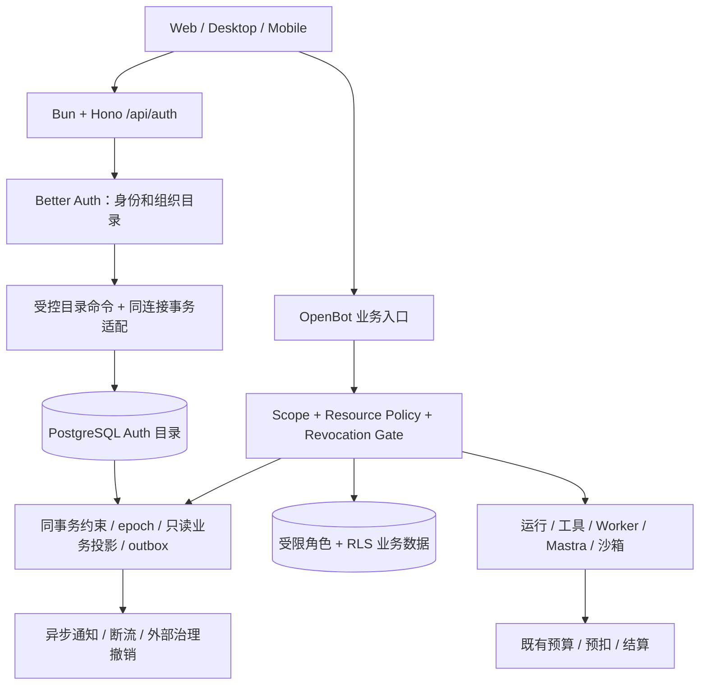

# OpenBot：Better Auth 全量接入与公司多租户体系设计

状态：**详细设计评审稿 v2，尚未批准实施**。日期：2026-10-22。

本文承接 ADR 0011 已确认的身份及目录选型。旧 ADR 0004 和旧多租户整改规格已作废；本稿重新列出独立候选需求与验收，不承接旧 Issue 的实施授权。新增物理模型、同步机制、角色、接口和上线步骤均为本稿建议；本次调整修复设计不等于批准实施、迁移或发布。当前代码事实是静态读取结果，不代表功能已通过部署或隔离验收。

## 1. 设计结论与事实源

采用 **Better Auth + Better Auth UI + PostgreSQL + OpenBot 既有业务授权**。Better Auth 统一管理身份、会话、公司目录、团队目录、成员与邀请；OpenBot 管理公司业务生命周期、可信 Scope、资源权限、运行审批、数据库隔离、公司/个人付款账户与审计。保留 Bun/Hono、React/Vite/TanStack Router、Mastra 执行适配及现有 Worker，不因参考文档示意而迁移到 Next.js 或重建 Go Platform Core。

本稿建议的首期候选范围是公司多租户完整交付，平台开通公司、公司管理员邀请员工；这是待重新批准的交付建议，不恢复旧整改排期。独立个人空间按 proposed ADR 0007 保留扩展位置；在产品决策改变前，不将缺少公司选择解释为完整个人业务空间。用户可自助创建公司的流程在 §8 给出可启用分支。这些默认值是可调整建议，不是已确认的实施需求。

### 1.1 依据和优先级

| 事实源 | 本稿处理 |
| --- | --- |
| [功能参考矩阵 F001–F094](2026-10-22-Better_Auth_Better_Auth_UI.md) | 作为能力目录；不作为当前代码已实现、组件兼容或版本锁定证明。 |
| [ADR 0011](../adr/0011-better-auth-identity-and-membership-authority.md) | 已接受的身份及目录选型、职责方向：BA 为目录唯一管理权威，OpenBot 保留业务治理，暂不引入 OpenFGA；不代表完整交付范围已批准。 |
| [ADR 0004（已作废）](../adr/0004-company-team-tenancy.md)、[旧公司多租户规格（已作废）](2026-10-14-company-team-multitenancy-design.md) | 仅作历史背景，不作为本轮需求、验收或排期依据。本稿候选范围须独立评审，原 Issue #6 及其子 Issue 不恢复。 |
| [ADR 0009](../adr/0009-remove-knowledge-base-domain.md) | KB 已决定下线；不因参考矩阵包含 Knowledge/RAG 而恢复 KB 服务或列入本次必建功能。 |
| [ADR 0006](../adr/0006-logical-private-bot-scoped-execution.md)、[ADR 0010](../adr/0010-mastra-execution-openbot-governance.md) | 保留逻辑私有 Bot、分范围执行环境，以及 OpenBot 的运行、审批和预算权威。 |
| [ADR 0007](../adr/0007-personal-space-business-scope-and-payer.md)、[个人/小企业规格](2026-10-16-enterprise-personal-agent-product-permissions-spec.md) | 区分已确认合同和 proposed 个人空间。个人模型消费不等于完整个人工作台。 |
| [CONTEXT.md 公司与团队、计费与积分](../../CONTEXT.md) | 用于现有词义：Tenant=公司，Workspace=公司内团队；术语存在不代表相应功能或交付范围已批准。 |

适用范围裁决：ADR 0011 的选型决定与旧整改作废可以同时成立。旧规格的批准状态、验收编号和任务树不向本稿传递；相邻 ADR 中引用旧多租户背景，也不构成旧整改重启依据。§1.3 是本稿重新提出的完整候选范围，§15 仅映射这些新需求。后续需先完成该范围的重新立项及 Spec 批准，再制定实施计划；此次文档修订不代替这些决定。

### 1.2 候选方案必须满足的业务不变量

1. 一个全局 User 对应一个全局 Principal，可以分别加入多家公司、每家公司多个平级团队。
2. 有效公司资格是团队业务前提；有效团队资格不授予其他成员的私有内容或凭据。
3. 公司管理权、团队管理权、业务内容权、公司财务权、平台运维权分别判定。
4. `activeOrganizationId`、`activeTeamId`、header、URL 都只是选择器。服务端核验成员、对象归属和动作后才能生成可信 Scope。
5. 成员撤销提交后，新业务事务和后续敏感动作的准入不能继续使用旧资格；下载的新请求、Range 重试和后续输出批次也属于新准入。撤权前已准入的在途动作按 §5.5 的明确边界处理，不承诺追回已输出字节或已完成的外部副作用；未知费用继续原账户结算。
6. 公司工作台消费公司统一余额，团队只统计用量；个人 Bifrost 授权消费个人余额，余额不足不互相兜底。
7. 身份/权限/存储不可用时相关入口关闭，不回退默认公司、首个团队、部署管理员或开发用户。
8. 每个成员关系只有一个写入权威；兼容资格投影可由 BA 当前目录、OpenBot 生命周期和独立持久撤权版本事实重建，不可独立管理。撤权版本事实不能随投影重建而丢弃。

### 1.3 本稿独立候选需求与验收映射

以下 BA-R01–BA-R12 全部为本稿待批准的候选需求，不复用旧规格编号。§12 的 P0、§14 的 Task 和 §13 的上线步骤均以这些需求获批为前提；批准范围有变时须同步重做映射。现有代码只作为复用对象，不作为需求批准或功能完成证据。

| 编号 | 候选需求及边界 | 设计位置 | 验收 |
| --- | --- | --- | --- |
| BA-R01 | 保留全局 User/Principal、外部账号关联及历史业务 ID；不复制身份或改变既有 payer。 | §2、§4、§13 | BA01、BA15 |
| BA-R02 | BA 唯一管理公司/团队/成员/邀请；全部写入口受控，同事务完成目录、资格投影、撤权版本与审计。 | §4–§5 | BA08、BA09、BA18 |
| BA-R03 | 公司开通、邀请、角色、退出/移除、暂停与 owner 保护有完整闭环，固定角色首发。 | §6、§8 | BA04、BA05、BA06 |
| BA-R04 | 公司管理、指定团队管理、财务与内容动作分别授权；私有资源和显式分享不因目录角色扩大权限。 | §6、§10 | BA03、BA04、BA17 |
| BA-R05 | 明确公司/团队选择；服务端可信 Scope 与客户端缓存、流、多标签和原生切换一致。 | §7 | BA02、BA13 |
| BA-R06 | 即时阻断撤权后的新准入；旧能力不随重新加入或投影重建复活，下载在途边界可验证。 | §4.4、§5.4–§5.5 | BA06、BA07、BA14、BA19 |
| BA-R07 | 保留已启用 SSO/SCIM；公司认证证据绑定实际会话及公司，SCIM 只影响所绑定公司。 | §9 | BA10、BA20 |
| BA-R08 | §10 所列实际业务、外部状态及启用客户端具备公司/团队/个人隔离，未知归属受控隔离；不恢复 KB。 | §10 | BA02、BA03、BA09、BA14、BA16 |
| BA-R09 | 执行、Worker、审批与费用保持固定发起范围和 payer；公司共同余额与个人模型余额分离。 | §5、§10–§11 | BA11、BA12 |
| BA-R10 | BA UI 复用登录、账户、公司和团队管理；保留当前技术栈和已启用客户端，无公司/团队有明确空态。 | §7、§12 | BA01、BA05、BA13、BA17 |
| BA-R11 | 平台管理、审计、容量和财务动作独立受控；审计与配额失败按相应合同关闭操作。 | §6、§11 | BA04、BA05、BA08、BA12 |
| BA-R12 | 稳定映射、停写回填、单权威切换、备份恢复及完整验证有明确门槛；无证据不开放。 | §4.4、§13–§15 | BA15、BA16、BA18、BA19 |

## 2. 当前系统基线与实际差距

读取基线：工作区 `/Users/wuyongjun/trea/OpenBot`，HEAD `e8ea2102a33956705d4f01c4893b2bd388db395e`，2026-10-22。本次读取包含已有未提交文件；以下定位用于设计，实施前必须重核工作区与版本。

| 当前事实及代码位置 | 复用方式 | 缺口 |
| --- | --- | --- |
| `server/src/auth/index.ts` 已创建 Better Auth，装配 SSO、条件 SCIM、Electron、条件 Expo、generic OAuth。 | 扩展现有工厂与适用插件。 | 本次查看的 plugins 数组未启用 Organization/Admin；依赖存在不等于接入完成。 |
| `server/src/db/schema/core.ts` 已有 users/accounts/sessions/verifications。 | 原 User ID、Account 关联与历史身份保留。 | Organization schema、session active 字段、Admin 扩展需迁移；不能另建一份用户目录。 |
| `server/src/db/schema/enterprise-tenancy.ts` 有 Tenant/Principal/公司成员/团队/团队成员/Resource/Grant；公司成员有 epoch。 | 保留业务 ID、FK、资源和付款归属。 | 目录权威目前在 Enterprise 表，需要切换写入与明确投影地位。 |
| `tenancy/store.ts`、`scope-gate.ts`、`revocation.ts` 已有可信 Scope、实时成员重验、共享锁和撤权检查点。 | 保留集中判定和锁语义。 | Better Auth 的所有变更入口必须进入同一串行化规则，不能仅迁 UI。 |
| `workspace-admin.ts`、`workspace-scope-routes.ts`、`company-admin-routes.ts` 提供旧目录和管理入口。 | 保留必要的兼容 Interface，底层改调新目录 Module。 | 旧 SQL 写入、CLI、SCIM、初始化和离职入口都须停用或改路由，防止双主。 |
| `tenancy/connections.ts` 验证 directory/data/operator 受限连接角色。 | 继续限制业务数据库权限。 | Auth 目录写角色、投影函数和运行期管理能力需单独设计，不扩大 data 权限。 |
| `app/src/lib/auth/client.ts` 目前只装配 ssoClient；前端已有 scope selection、stream-scope、scoped-cache。 | 加入 organizationClient；复用现有缓存代际与流断开规则。 | 接入 UI provider、组织/团队页面、邀请路径和管理面；避免两套切换状态各自生效。 |
| server 声明 Better Auth `^1.7.1`，app 声明 `^1.6.27`；本次两处本地安装包均为 `1.7.1`。 | 先统一明确兼容的依赖与锁文件。 | 当前声明不是精确版本锁定；UI registry 产物也需记录版本/来源。 |
| `auth/organization.ts` 是远程 OpenBot authority 的组织登录交接；`organization-store.ts` 会 materialize 本地用户。 | 单独纳入跨部署身份合同。 | 这里的 organization 不等于新 Organization 插件；按 email 合并的现有路径必须审核，不能据此跨公司自动授权。 |

已有大量 tenancy 适配和回填代码，部分处于当前未提交状态。本文不宣布这些入口全部已装配或验收，不将其移除，也不默认它们可直接满足新的成员目录合同。

## 3. 目标架构与职责



Better Auth 可直接挂载到 Hono 的 Request/Response 入口，无需为了接入它改技术栈。[官方 Hono 集成](https://better-auth.com/docs/integrations/hono)

### 3.1 Module 与 Interface

| Module | 对外 Interface 与不变量 | 内部 Implementation |
| --- | --- | --- |
| Identity | `authenticate(request)`：可信 actor/session；禁用或撤销拒绝。 | Better Auth 的现有认证与原生客户端适配。 |
| Organization Directory | `execute(command)`、`listEligibleScopes(actor)`：限定公司、幂等、授权与变更原子完成。 | Better Auth Organization、映射、事务 adapter、约束、投影、审计。 |
| Business Scope | `resolveCompany`、`resolveWorkspace`、`transaction(scope, operation)`。Scope 不可由 JSON 恢复。 | 现有 resolver/gate、成员版本、锁、RLS 本地上下文。 |
| Resource Authorization | `authorize(scope, action, resource)`：对象归属、动作、发布、Grant 和依赖共同判定。 | 保留现有资源策略；目录角色不能替代资源判定。 |
| Tenant Lifecycle | `provision/suspend/requestDeletion`：只有 active 公司允许正常业务；清理可恢复。 | 公司业务状态、开通幂等、任务取消、资产交接、保留策略。 |
| Billing / Execution | 使用已验证 Scope 及固定 PayerRef。 | 复用 Run/Attempt、审批、能力租约和积分台账。 |

Seam 放在上述 Interface；业务调用者无需知道 Better Auth 的表名、hook 顺序或 UI 选择方式。先对现有 Module 深化，避免在每个路由重复拼组织管理、撤权和权限逻辑。

## 4. 领域模型与数据所有权

### 4.1 概念映射

| OpenBot 概念 | Better Auth 对应 | 权威与约束 |
| --- | --- | --- |
| OpenBot User | user | 全局身份，沿用 users.id。邮箱是可变属性，不能作为跨系统身份合并的唯一依据。 |
| Principal | 无需替换 | 继续一对一绑定 user；业务授权引用稳定 principal_id。 |
| Tenant | organization + OpenBot 公司业务扩展 | name/logo/slug 等目录字段由 BA 管；运行状态、payer、政策等由 OpenBot 管，不能相互覆盖。 |
| Workspace | team | 每个团队固定属于一家 Organization；公司内平级。 |
| Company Membership | member | `(organizationId,userId)` 唯一；业务资格同时要求公司/用户/成员有效。 |
| Workspace Membership | teamMember | 必须先是该组织有效 member；公司移除使所有团队资格失效。 |
| Membership Invitation | invitation | pending 不授予权限；接受后才建立成员关系。 |
| Company Credit Account | 无对应钱包 | 原 Tenant→payer/customer 映射和账务事实保留。 |

以上沿用 CONTEXT.md 的已确认词义，不新增另一份词汇表。下文“投影”“命令”“版本”是实现概念，不写入共享领域词汇。独立个人空间仍保留 proposed 状态。

### 4.2 推荐物理模型

新表名为设计建议，最终以固定版本生成 schema 后的 Drizzle 定义为准。

| 数据 | 推荐存储 | 规则 |
| --- | --- | --- |
| 原身份 | users/accounts/sessions/verifications | 原 ID、外部账号 provider identity、历史引用保持；追加插件必需字段。 |
| BA 公司/团队目录 | `auth_organizations`、`auth_teams` | BA schema mapping 指向新目录表，不把既有业务表直接改成 BA 所有。 |
| BA 成员/邀请 | `auth_members`、`auth_team_members`、`auth_invitations` | BA 为唯一写入口；组织成员可增加服务器控制的 lifecycle 字段。 |
| 公司业务存根 | `enterprise_tenants` | 保留原 ID、业务 status、policyRevision 和所有历史外键；目录 name 是 BA 同事务投影，业务状态不是 BA profile。 |
| 团队业务存根与映射 | `enterprise_workspaces` + `auth_team_bindings` | 映射键 `(tenant_id,workspace_id)` 唯一，team_id 唯一；保留旧业务 ID。 |
| 公司/团队业务资格投影 | 原 `enterprise_memberships`、`enterprise_workspace_memberships` | 同事务派生、普通应用无直接 DML；保留历史 FK 和 epoch，不再提供独立成员管理。 |
| 资格代际 | 成员投影的 company/team eligibility generation，及授权签发时绑定值 | 撤销后重新加入不能恢复旧授权；代际只能由受控目录事实推进，不是独立资格授予。 |
| 事件与幂等 | 目录 command receipt / outbox，接入既有审计体系 | command_id、actor、目标、前后版本、结果、时间；唯一幂等键绑定 actor/company/command type/payload hash。 |

Tenant 主键已全局唯一，优先让 organization.id 沿用 tenant.id；Workspace 当前是复合主键，不得假定 workspace.id 跨公司唯一。因此新 team.id 使用独立全局 ID，由 binding 关联旧 `(tenant,workspace)`。同一个旧 workspace 名或 ID 在不同公司出现时不重写历史运行、文件、资源与费用。

BA 目录必须唯一约束 `(organization_id,user_id)` 和 `(team_id,user_id)`。团队写入需校验 team 所属 organization 及 member；不能只依赖 UUID。Binding 建立后不允许换公司，移动资源必须走独立导出/交付流程。投影行不得因为 BA 物理删除而级联删除业务资产。

### 4.3 删除、暂停与重新加入

- 公司暂停：OpenBot `tenant.status` 关闭业务和组织管理写操作，允许受控恢复与查询停用原因；成员目录仍保留。
- 公司成员暂停：BA member 扩展服务器字段表达 `suspended`，客户端不能自行输入。所有组织管理和业务入口都必须检查，不仅业务 Scope。恢复是显式管理命令。
- 团队暂停：本地 1.7.1 `schema.teamMember` 类型没有 additionalFields 配置，**不假设它原生支持 status/epoch**。推荐通过移除 teamMember 撤销资格，投影保留 suspended/tombstone 和历史版本；需要恢复时显式重新添加并重新核验。UI 用“移出团队/重新加入”，避免承诺原生暂停能力。
- 公司移除：BA member 删除，teamMember 清理；兼容公司投影转 suspended/tombstone 并递增 epoch，保留被 Run、Grant、审计引用的历史键。
- 重新加入：BA 可产生新 member.id，但业务 `(tenant,principal)` 的 epoch 必须继续增长，不能重置为 1。团队关系同理；旧 Scope/租约/分享/审批不因重新入职自动恢复。
- 删除组织/团队：首期禁止裸物理删除有业务资产的目录对象。先发起业务归档、资产交接、停止任务、财务与保留期检查，再最终清理。BA 表上的删除/级联不能直接删除账本或运行事实。
- 删除 User：先完成资产交接、历史主体保留或匿名化设计。当前 users→principals 有 cascade，不能直接开放通用 DeleteUser 组件。

## 5. 唯一写入、事务与撤权设计

### 5.1 方案取舍

| 方案 | 优点 | 问题 | 结论 |
| --- | --- | --- | --- |
| 直接把旧成员表映射为 BA 表 | 表少 | 复合键、principal/user、role/status、RLS、FK 与插件模型不一致；影响面大。 | 不推荐。 |
| BA 与旧成员表各自写，异步同步 | 接入快 | 双主冲突；撤权窗口；离职后旧目录仍可放行。 | 不接受。 |
| 所有业务直接改查 BA，立即删除旧表 | 长期模型简单 | 大量现有外键、gate、SQL 和历史审计都需同时改动。 | 可在后续独立演进，不作为首轮切换条件。 |
| **BA 唯一目录写入 + 同事务受控投影** | 保留业务合同，缩小迁移面，无异步资格窗口 | 需要固定事务 adapter、数据库函数与升级合同测试。 | **本稿推荐，必须先证明可行。** |

投影存在不等于第二套目录：旧表没有管理写权限、没有独立授权授予、没有异步 grant 同步入口；只能从 BA 已提交事实重建。恢复时发现不一致先隔离并核验，不静默双向修复。

### 5.2 目录写入协议

所有 member/teamMember/role/invitation 的增加、接受、删除、退出、角色更新，以及 SSO JIT、SCIM、后台管理调用，必须进入同一协议：

1. 认证 actor 或受限 provisioning identity；解析服务器可信 command envelope。envelope 含 operation/actor/target tenant/action/idempotency，不接受客户端伪造 actor。
2. 对目标公司获取现有 tenant advisory **排他事务锁**，再按现有顺序获取必要 principal/member/team 锁。首期牺牲少量目录写并发，换取与全部业务 gate 的 tenant 共享锁一致；批量命令按稳定排序，不在多个公司间无序持锁。
3. 锁内重新读取操作者资格、公司状态、目标与管理权限。禁止在锁外通过权限检查后直接写入。
4. 用请求局部、绑定同一个数据库连接与外层事务的 BA adapter 执行 BA 命令。插件内部 transaction 必须复用该上下文或 savepoint；不能暗中新开 pool 连接。
5. BA 表约束/受控触发函数更新存根和成员投影、epoch、审计与 outbox。任何一步失败，整个命令回滚；不在 after hook 中另开事务更新资格。
6. 提交后才返回成功和发送邮件/失效通知。通知失败由 outbox 重试，不改变已提交的资格判断。

这是应用集成设计，**不是 Better Auth 官方承诺的现成跨业务事务功能**。本地源码显示 remove-member 在 `adapter.deleteMember` 前后调用 hooks，deleteMember 内部另有 `runWithTransaction`，不足以证明外部 hook 与 BA 写入同事务。实施 T01 必须用实际 Drizzle adapter 验证连接绑定、嵌套事务、异常与所有写路径；失败则停止成员权威切换，修订 adapter 方案，不降级为异步成员投影。

同一端点内由插件执行的多个写入必须一起回滚，包括邀请状态更新、成员增加和团队加入；不能只保证每个 SQL 各自原子。邀请邮件及外部 webhook 回调改写成 outbox 意图，禁止插件在外层事务提交前实际发送。Profile/Invitation 之外的用户输入不得覆盖 status、epoch、eligibility generation 或 payer 等服务器字段。

### 5.3 强制覆盖所有路径

- `/api/auth/*` 可以挂载现有 handler，但 organization 写端点必须由集成层建立 envelope/事务上下文后才能调用；不提供绕过入口。
- `auth.api.*` 服务端调用、SCIM、SSO provisioning 和管理员操作同样受控，不能认为没有浏览器就可信。
- 目录写角色可写 BA 目录，不直接写业务投影；受控数据库函数可写明确列、固定 schema、固定 `search_path`，撤销 PUBLIC EXECUTE。若使用 SECURITY DEFINER，函数拥有者不得变成通用业务读写旁路。
- 投影写入必须检查可信命令上下文；缺少上下文、actor/action 或未知 BA 变更类型时失败。DB 结构约束覆盖成员归属；应用命令检查业务策略，双层各有职责。
- 旧 operator 成员管理 DML 权限需收回或限制到迁移角色；provision/startup/seed、旧 admin route、脚本、SCIM、离职任务逐个改为 Directory Interface。
- 后台任务不得直接拿普通 SQL 修改成员；迁移角色离线使用，切换时退出并记录。

### 5.4 并发语义与撤权完成定义

业务事务持 tenant 共享锁，目录变更持排他锁，因此先完成的事务定义顺序：业务事务先取得锁，可以完成该事务；撤权先提交，后续业务读实时投影和 epoch 必须失败。事务设短超时，不把外部模型流、浏览器调用或人工审批等待放在数据库事务锁内。

长运行在领取、恢复、工具执行、凭据获取、产物下载签发等检查点重验。Run 发起人离职默认阻止后续敏感执行；交接为单独审计命令，不能切到管理员或默认用户继续执行。队列 payload 只携带定位信息，Worker 从持久化 Run/Job 重新建立身份和 Scope。

公司成员、团队成员、角色、用户禁用、ACL/policy、能力租约都应携带适用版本。角色降级、停用、删除再加入都使旧版本失效。既有 gate 只检查当前 active 的路径需补查适用 epoch，防止移除再加回使旧能力复活。

Scope 合同需显式增加团队成员版本；既有 `memberEpoch` 继续表示公司成员版本。另以 company/team eligibility generation 区分“同一次资格内的更新”与“撤销后的新资格”：撤销推进对应代际，Resource Grant、审批、凭据/执行租约与受众分享保存签发时的适用代际，使用时比较；或者在同事务内将适用授权明确置 revoked。旧授权缺少代际时只能经归属核验迁移，不能按当前成员状态自动补成有效。重新加入后可获得当前发布的团队公共 Bot 使用权，但不会恢复旧私有资源 Grant、个人凭据和审批。这样不依赖异步批量删除就能关闭旧能力。

安全准入不依赖 outbox 通知。通知用于主动断开流、清缓存、吊销外部租约；**每次新的敏感动作仍查实时事实**。已经签发的对象存储 URL 无法仅靠成员表即时撤销；敏感文件应走校验代理或受控短期能力，并明确最长存续时间。无法达到撤销合同的下载路径不得算作通过。

身份全局禁用由受控身份命令更新 user/Principal 有效性并撤销会话，锁与业务 principal 锁一致；不要通过删除某个公司成员来全局停用用户。历史费用仍按原固定 Payer 结算。

## 6. 权限体系

Organization 插件提供组织成员、团队和组织管理权限，是目录基础；业务资源隔离由本稿和 OpenBot 授权 Module 实现。[官方 Organization 文档](https://better-auth.com/docs/plugins/organization)

### 6.1 角色与授权关系

| 身份/角色 | 可做什么 | 额外约束 |
| --- | --- | --- |
| 平台管理员 | 开通/暂停公司、管理全局用户和身份基础设施。 | 不因此读取客户私有内容；不把 tenant owner 迁为全局 admin。 |
| 公司 owner | 公司管理及所有权交接、删除申请。 | 最后一个有效 owner 不能退出/移除/降级；并发也要受锁与约束保护。 |
| 公司 admin | 邀请、成员及团队管理、公司配置。 | 不能提升为平台管理员；默认无财务和私有会话读取权限。 |
| 公司 member | 进入所加入团队，使用已发布的团队公共 Bot。 | 不可修改公共 Bot，也不可读取他人会话、凭据、来源受限记忆。 |
| 公司 auditor | 明确允许的公司审计元数据。 | 作为 BA 自定义固定角色；无成员管理、凭据正文和普通内容默认读取。 |
| 团队管理授权 | 管理指定团队的成员/发布操作。 | 不假设 BA teamMember 有原生业务角色；以 OpenBot 明确的范围动作授权表达。 |
| 公司财务授权 | 读取授权账务、发放/调整/退款等各自动作。 | 复用既有财务 Grant；owner/admin 不自动继承，不能通过邀请角色获得。 |
| Resource Grant / Publication | 指定对象的 read/run/write/share/manage 等动作。 | 每次检查公司、团队、成员、依赖与撤销，read 不等于 run。 |

旧 `tenant_admin` 映射 BA `admin`，普通成员映射 `member`，`auditor` 映射同名自定义固定角色；旧目录未区分 owner，因此迁移必须由有证据的公司负责人指定 owner，不能默认第一个成员、最早登录用户或平台管理员。存在多管理员不等于存在合法 owner。

兼容投影将 BA owner/admin 映射为旧 `tenant_admin`，member/auditor 保持原角色；所有权专属操作始终回到 BA 当前成员角色检查，旧三值 role 不作为 owner 证据。首期拒绝未知角色和任意多角色组合，不把逗号字符串或无法识别的角色默认为管理员。最后 owner 的退出、移除、降级和暂停均在锁内校验。

平台 `userRoles` 与 BA Admin role 也只能选择一个权威：接入 Admin 后由 BA 管全局角色，旧 role repository 仅保留受控兼容读取，并完成配置 bootstrap/seedRole/setRole 的单写迁移。首次管理员配置只能用于明确初始化或受控 break-glass，不在每次普通登录时反复覆盖既有禁用/降级。公司角色与全局角色的映射方向必须保持隔离。

### 6.2 业务授权公式

```text
允许业务动作 = 有效全局身份
             ∧ 公司业务状态允许
             ∧ 有效公司成员
             ∧ 有效目标团队成员（团队业务）
             ∧ 资源公司/团队与请求的可信范围一致
             ∧ 动作被资源策略、本人所有权或显式授权允许
             ∧ 依赖、审批、能力租约均有效
             ∧ 配额和预算准入通过（执行/计费动作）
```

公司设置/成员管理不要求管理员加入每个团队，不读取团队内容；使用独立 company admin context。公司 owner 想运行某团队 Bot，仍需团队和 Bot 使用资格。团队公共只覆盖明确发布且策略允许的资源；私有内容保持独立。跨公司内容分享首期不开放；同公司跨团队分享走已有显式受众和动作规则，不能通过临时切团队或 BA role 绕过。

动态角色 F043 首期关闭，采用固定角色和明确动作授权，避免引入任意权限字符串与旧策略不一致。将来开放时需固定可委派动作上限，禁止创建包含平台管理或财务提权的角色；角色删除、缓存和 epoch 一并设计。

### 6.3 平台管理员与模拟登录

Admin 插件是全局用户管理能力，必须与公司管理页面和权限隔离。[官方 Admin 文档](https://better-auth.com/docs/plugins/admin)

首期接入全局用户查询、禁用和会话撤销；模拟登录 F050 默认关闭。若后续启用，须二次验证、理由、时间限制、操作者/被模拟者双身份审计，禁止提取密钥、变更付款、接受授权、工具副作用及修改安全因素。不能只安装 StopImpersonating 按钮就允许访问客户业务内容。

## 7. Scope、接口和客户端切换

### 7.1 Interface 合同

保留兼容选择头 `x-openbot-tenant`、`x-openbot-workspace` 和 `GET /api/enterprise/workspace-scope`。组织 ID 与 team ID 由 binding 解析为业务 ID；新客户端不能把 BA team.id 直接当旧 workspace.id。

建议新增或扩展以下 Interface，具体路由注册前需与现有入口分类清单核对：

| Interface | 输入/输出 | 关键约束 |
| --- | --- | --- |
| `GET /api/enterprise/workspace-scope` | 当前 actor 有效公司、有效团队、业务 ID、BA ID、显示名称、管理能力。 | 不要求先选择团队；只返回自己的可选范围，不泄露他人目录。 |
| `POST /api/enterprise/workspace-scope/validate-selection` | `{tenantId, workspaceId}` → 已核验 ID 对、当前版本和 capabilities。 | 不返回可客户端伪造的可信 Scope；不以此取代下一请求实时核验。 |
| BA organization/team/member/invitation endpoints | 对应 BA client methods。 | 目录命令包装、完整事务、server-side permission；显式目标公司优先于 session 默认值。 |
| 公司暂停/删除申请/财务授权 | OpenBot 业务命令。 | 使用 company admin context 和专门动作；不混入组织 profile metadata。 |
| 旧团队/成员管理接口 | 保留时转译成 Directory command。 | 返回稳定业务 ID，不能再对旧成员表独立 SQL 写入；弃用期要有调用监控。 |

组织 selector 与公司 header 冲突时拒绝，不静默选一个。按对象 ID 操作先查可见对象归属，再验证允许的范围；批量动作要整批校验，不能部分跨公司执行。缺少选择需要 400，未登录 401，有效身份无管理动作 403，不可见业务对象统一 404，基础设施故障 503；公司列表不得依赖错误文本枚举隐藏对象。

### 7.2 唯一的业务选择流程

1. 公司切换先断开旧业务交互并标记切换中；从 Directory 查询并核验目标团队，不能默认获得任意团队。
2. 将 BA 当前 organization/team 作为偏好状态更新；需要的 server/client 配置配对。业务权威仍来自验证过的明确 ID 对。
3. 复用现有 selection generation：递增代际，取消 query/mutation 后续 UI 写入，清旧业务缓存，关闭 SSE/WebSocket、电脑流及临时凭据，避免旧响应污染新视图。
4. 成功后发布新的 selection；失败保持无业务范围或原已验证范围并显示原因，不能 UI 显示公司 B、实际请求仍带 A。
5. 多标签遵守现有共享切换合同：传播选择事件、全部递增代际和断流。若两个 BA active 更新发生乱序，业务请求的显式 ID 对仍被服务端验证；不得以 session active 隐式改写在途业务归属。
6. 登出、换账号、公司停用或被移除时同步清理所有身份/范围缓存。长任务保持发起范围，不随 UI 切换换公司或付款方。

无公司资格的用户看到“尚未加入公司/待接受邀请”；公司成员但没有团队时可管理个人账户和允许的公司设置，业务工作台显示“尚未分配团队”。首期关闭 OrganizationSwitcher 的个人业务入口；既有个人模型授权和余额入口保留，不能回退无 Scope 的公司 API。

### 7.3 UI 页面和复用范围

Better Auth UI 的 Organization 插件提供组织设置、人员、邀请、切换等组件和 hooks；服务端、client、UI plugin 必须配套注册。[官方 UI Organization 文档](https://better-auth-ui.com/docs/shadcn/plugins/organization)

| 入口 | 复用基础 | OpenBot 必须补充 |
| --- | --- | --- |
| 登录与账户安全 | Auth/Settings/UserButton 相关组件。 | 保留现有 SSO、可信回调、原生登录；仅展示后端启用的方法。 |
| 公司/团队选择 | OrganizationSwitcher/TeamSwitcher。 | 通过 §7.2 的选择流程接线，控制创建入口、无团队与停用状态。 |
| 公司资料 | OrganizationProfile。 | Logo 安全上传、slug 变更与旧链接处理，业务状态只读展示。 |
| 人员与邀请 | OrganizationMembers/Invitations/AcceptInvitation。 | 固定可委派角色、服务端分页/授权、公司暂停、过期/已接受/邮箱不符与并发结果。 |
| 团队管理 | 对应 Team 管理组件。 | 稳定业务 ID 映射、公司资格校验、团队资产检查、显式团队管理授权。 |
| 公司业务设置 | UI 扩展插槽或现有公司设置。 | 模型范围、工具能力、网络政策、预算及审批配置，后端 enforce。 |
| 公司账务 | 现有 OpenBot 账务页面；可适配 UI 展示。 | 接原账本/用量/订单和财务授权，不接第二套 Credits 权威。 |
| 平台管理 | Admin 组件。 | 独立路由与全局授权；禁用、会话、审计，不开放公司管理员进入。 |

首期沿用当前 app 的 React/Vite/TanStack Router 和 shadcn 样式体系，不扩展成全站 UI 框架迁移。建议保留现有账户与管理路由，只增加独立 organization 子路由及公开邀请落地页；实际路径由固定 UI 版本的 viewPaths 绑定，不能照搬 Next.js 文件路由。

邀请落地页允许未登录访问，登录后回到原 invitation；不能把 callbackURL 任意跳转。换成正确账号、邮箱验证、已取消/过期/重复接受都需明确文案。权限决定由后端返回；隐藏按钮仅帮助交互。

## 8. 公司、团队与成员生命周期

### 8.1 公司开通

推荐平台开通模式：平台管理员提交公司与指定 owner → 创建 BA organization 和 owner member → 同事务创建 Tenant 存根、稳定映射与幂等开通记录 → 建立默认 Team/Workspace 和 owner 团队资格 → 初始化公司政策及 payer 映射 → 所有必需本地条件具备后将公司设为 active。

若外部计费 Customer 或供应商设置不能在数据库事务内完成，公司保持 provisioning（需扩展当前 status 枚举），用 outbox 幂等重试；不得组织创建成功就立即放行收费运行。重复请求只产生一个公司、一个 payer 映射和一份初始权益。失败不通过删除并重建 ID 解决。

若选择自助开通：仅改变“谁可提交开通命令”，沿用同一后端流程；增加创建频控、每用户公司数量限制、滥用防护、套餐和容量决策。必须在后端限制 BA 原生 create organization；隐藏 CreateOrganizationDialog 不够。

### 8.2 邀请与接受

邀请绑定公司、目标邮箱、可委派固定角色及可选团队；邀请人不能授予自己不具备的动作。接受时锁内核验 invitation 状态/有效期、公司状态、当前用户的已验证邮箱、邀请角色是否仍可用、团队是否仍属该公司、席位容量与已有成员。

接受建立公司及指定团队成员、投影和审计；默认不加入其他团队。已经是公司成员的人不能利用较低角色邀请覆盖现有角色；更新资格需要明确命令。并发接受、同邮箱重复邀请与席位竞争由事务/唯一约束保证幂等；不能客户端先查数量再无锁创建。

邀请 ID 即使可见也不是资格。邮件只在提交后发送，重发不延长已取消邀请或复活旧权限；若生成新 invitation，要取消旧记录并保留审计。

### 8.3 离职、退出与资产

公司移除立即撤销该公司的所有团队资格和后续业务操作，其他公司、个人模型授权不受影响。停止用户发起任务的后续敏感动作，撤销本公司能力和凭据租约，阻止重新签发下载和新订阅。个人连接账号、浏览器状态和私有记忆不能转交给新 owner；可交接业务产物须明确授权并留下记录。

恢复/重新邀请只恢复明确指定成员资格；旧 Resource Grant、团队资格、工具审批、凭据租约是否恢复分别处理，默认不复活。部门树、嵌套团队与自动上下级继承不在首期范围。

## 9. SSO、SCIM、凭据与原生客户端

- 保留现有可用 SSO/SCIM，不以“后续增强”名义使已有企业失去登录或离职同步。新增客户自助 IdP 配置属于后续单独功能。
- SSO provider、SCIM connection 固定绑定公司；回调使用服务器保存的 state/intent，不能读取回调时 active organization 决定归属。
- SSO 成功证明身份，不默认赋予公司资格；JIT 仅在该公司明确开启、验证 issuer/domain/subject 并满足策略时创建最低角色。禁止根据任意相同邮箱自动合并外部主体或授予 admin。
- 当前全部署 `ssoRequired` 规则不能直接作为不同公司各自的策略。引入公司级“访问该公司需要的认证强度/IdP”检查；全局 session 可以存在，但访问要求更高的公司需追加相应认证。设置失败时拒绝该公司访问，保留明确受控的 break-glass 路径。
- SCIM externalId/subject/group 均带 connection/company 维度；deactivate 只影响绑定公司资格，不自动删除全局 User 或其他公司成员。组到团队/固定角色映射使用管理员批准的规则，普通目录组不产生 owner/admin。
- 本地 `@better-auth/scim` 为 1.7.1，现有研究引用的新版本 Beta 文档不能视为本地合同。实施先做固定版本协议与回归核验，尤其 provisioning 回调是否经过新目录命令。
- Web 保持同源 Cookie、安全属性、可信 origin 和 mutation 的 CSRF 防护；不为接 Go 或移动端默认开启一组新的 bearer/JWT/API Key 入口。
- Desktop/Expo/OpenMuse 保留各自已启用的登录与 authority 绑定；公司列表来自可信身份。跨部署用户映射必须验证 issuer+subject/服务器绑定，不把同邮箱当可任意 materialize 的授权依据。
- 原生客户端升级前，旧版本仍需服务端隔离；不能靠客户端版本检查放宽权限。必须兼容则保留受控映射，无法兼容时阻断相应旧入口并明确升级要求。

## 10. 业务数据、执行与外部状态隔离

### 10.1 数据归属与 RLS

沿用共享 PostgreSQL，所有业务查询必须具有适用的公司、团队和个人条件。根资源显式归属；子表通过复合 FK 证明父子同公司，需要团队一致性的关联也要约束。业务全局唯一 ID 不能代替授权。

事务本地 `app.tenant_id/principal_id/user_id/workspace_id` 继续使用，提交/回滚后不污染连接池。data/directory/operator/identity/目录 writer 各司其职；普通业务不得使用表拥有者、superuser 或 BYPASSRLS。PostgreSQL 的 RLS 不约束 superuser/BYPASSRLS，表拥有者默认也有绕过能力，因此角色校验本身是交付条件。[官方 RLS 规则](https://www.postgresql.org/docs/current/ddl-rowsecurity.html)

RLS 作为数据库兜底，应用仍执行动作和资源策略。不能在每张表简单加 `tenant_id` 后就声称已覆盖团队、私有资源、共享依赖和管理权限。

### 10.2 全功能覆盖清单

| 闭环 | 必须接入的点 | 最低反例 |
| --- | --- | --- |
| Bot/插件/技能/市场安装/配置 | 创建、发布、安装、升级、依赖、使用、编辑。 | 团队公共 Bot 使用他人私有连接；安装模板跨公司复用配置或密钥。 |
| 会话/消息/Memory/Hindsight | 列表、详情、流、导出、来源授权、银行/namespace。 | 仅以 user_id 聚合导致多公司记忆串用；退出团队仍能 recall 来源记忆。 |
| Craft/Workshop/OpenMuse/附件/分享 | 父子资源、下载、预览、快照、分享、迁移。 | 旧公开 URL 或签名 URL 绕过公司权限。 |
| 工具/MCP/连接/Host Access/审批 | 申请与执行都核验、服务器回调固定归属、一次性能力。 | 会话已移除但旧审批、凭据租约仍能执行。 |
| Run/Attempt/调度/责任/主动任务/Worker | 领取、重试、恢复、取消、敏感动作、产物与费用。 | 任务读队列里的任意 tenant；管理员接管后换 payer。 |
| 浏览器/电脑/沙箱/学习容器 | 分配、登录态、文件目录、流 token、回收和恢复。 | 物理池复用泄漏上一公司浏览器 Cookie/文件。 |
| 通知/渠道/Webhook/外部用户绑定 | 入站归属、正文授权、outbox、订阅与设备。 | 只用全局 channel/user 映射发到另一家公司。 |
| 账务/订单/支付/积分/网关 | 固定 payer、回调映射、预扣、用量、对账、财务读取。 | 前端 organizationId 改写付款方；个人 Key 打开公司内容。 |
| 设置/审计/观测/导出/管理面 | 平台与公司分类、敏感正文、脱敏和可见性。 | 平台 admin 或 auditor 默认读取全公司私有 prompt/凭据。 |
| 全局例外 | 健康、认证、静态目录、明确公共模板。 | 将业务配置、租户实例或安装状态误列全局。 |

不恢复已下线 KB。若未来新增向量检索/Knowledge，需在检索执行前强制租户与授权集合过滤，独立审批范围与实现。原有惰性 KB 历史数据不由本次目录迁移自动删除。

存储/缓存/事件/幂等键必须含实际公司/团队/用户/对象及适用版本；对象前缀用于寻址，读取仍需授权。外部回调从服务器已持久化关联确定范围，不能信任 body/header 的 tenant。观测导出同样检查范围，日志不写 token/credential 原文。

## 11. 计费、席位、配额与审计

### 11.1 保留既有付款事实

公司→原 Company Payer/Customer 映射保持不变，团队不建钱包。公司预扣竞争同一原子余额；用量记录 tenant/workspace/actor/bot/run/call。用户切换公司、离职、任务重试与目录 ID 改变均不能改变已记录 payer。外部个人模型授权保留原用户余额，不并入公司账单。

F085–F094 是可选 UI/支付能力，**本次不以 Stripe/Polar/OpenMeter/Flexprice 替换既有 Lago/积分/订单/支付与结算权威**。Billing UI 若复用只加读取/命令 adapter；不能双份发放、重复扣费或另算一套余额。余额不足不切另一账户，待结算不随离职自动释放。

### 11.2 席位和容量

推荐首期席位表示 active 公司 member，多个团队只计一次；pending invitation 单列，不计已使用席位，接受时必须原子核验容量。暂停不立即承诺减少付费席位，套餐结算以原计费合同为准。现阶段这是容量规则建议，不改变已购订单或供应商计费周期。

公司成员数、团队数、Bot 数、并发运行、存储和模型额度分别限制。组织插件 limits 仅覆盖适用目录操作；OpenBot 在实际业务操作处 enforce 其他配额。多人并发接受邀请或创建资源使用锁/计数事实，UI 展示余额或剩余席位不构成准入。

### 11.3 审计合同

目录变更与业务资格投影的审计和 outbox 同事务写入；审计失败则该管理变更失败。身份登录现有非致命审计行为不在本稿静默改写；另监控审计失败。审计字段至少含 event/command、actor user/principal、有效操作者、目标、tenant/team、变更前后版本、结果、时间和 trace。禁止包含密码、完整 Key、SCIM token、SSO secret。

平台事件与公司事件分域授权。公司审计员只见授权元数据，正文内容按独立资源授权。重要审计采用仅追加权限与独立保留/备份，若没有不可篡改存储，不宣称“不可篡改”。

## 12. F001–F094 范围映射

P0 表示本次多租户闭环需要；“后续”不意味着可以使当前已有同类功能退化。插件启用均以固定版本兼容、schema、许可证、部署依赖和适用验收为条件。

| 参考编号 | 本稿范围与取舍 | 设计位置 |
| --- | --- | --- |
| F001–F012 | P0 完成所启用登录方式的账户闭环；邮箱/密码/社交由部署政策开启，不默认全部启用。保留现有 SSO。 | §2、§7、§9 |
| F013 | 自助删除默认关闭，待资产、账务和历史引用的安全删除合同完成再开放。 | §4.3 |
| F014–F019 | P0 会话、回调、用户展示、受控字段和邮件/schema；不将邮件模板等同发送服务。 | §4、§7、§9 |
| F020–F022 | MFA/恢复码/Passkey 为后续安全增强；若部署强制则成为该部署发布门槛。 | §9、§15 |
| F023–F032 | 后续按产品需要启用；匿名合并、多账号和账号绑定不能跳过公司资格。 | §1、§9 |
| F033–F034 | P0 公司开通/选择，默认平台开通；自助为可启用分支。 | §7–§8 |
| F035 | 公司空间切换 P0；完整个人空间不因有 switcher 自动成立。 | §1、§7.2、§16 |
| F036–F042 | P0 公司资料、受控离开、成员邀请接受、角色、移除与固定 RBAC；物理删除受业务生命周期控制。 | §4–§8 |
| F043 | 后续动态角色，首期固定角色。 | §6 |
| F044–F046 | P0 平级团队、成员及目录容量；业务配置/配额由 OpenBot 补充。 | §4、§7–§8、§11 |
| F047–F049 | P0 受控全局用户管理、禁用；创建/编辑遵循已启用身份策略。 | §6.3、§9 |
| F050 | 模拟登录默认关闭；单独安全设计后再启用。 | §6.3 |
| F051 | P0 会话查看与撤销，确保全局禁用生效。 | §5、§6.3 |
| F052–F053 | 既有 SSO/SCIM P0 兼容并迁入新目录；客户自助配置、更多 IdP 后续。 | §9 |
| F054 | P0 资源级授权；跨公司分享不开放，不按矩阵名称默认引入 OpenFGA。 | §6 |
| F055–F056 | P0 数据/执行隔离、原有权益、配额和余额合同。 | §10–§11 |
| F057–F059 | 新 BA API Key 控制台后续；已有模型 Key/能力租约保留并验证撤销，不把两类 Key 混用。 | §5、§9、§11 |
| F060–F063 | 按现有客户端需要保留适配；新 JWT/Bearer/一次性 Token/OAuth proxy 不默认启用。 | §9 |
| F064–F070 | 新 OAuth Provider/设备码授权后续，非多租户上线前置；已有原生登录保持。 | §9 |
| F071–F074 | 现有 MCP/Agent 资源和工具权限 P0 隔离；实验 Agent Auth 不替代现有审批/执行权威。 | §3、§6、§10 |
| F075–F076 | 开启密码/公开注册时评估对应反滥用能力；不默认引入外部服务。 | §8、§9 |
| F077–F079 | P0 错误文案、必要接口合同与测试；开发插件不暴露生产。 | §7、§15 |
| F080 | 不纳入本次业务范围。 | §1 |
| F081–F082 | P0 适配现有主题、Provider/Query/Router；不做全站主题迁移。 | §7.3 |
| F083–F084 | P0 既有审计和必要企业策略；不依赖托管 Dash，自助总控台后续。 | §9、§11 |
| F085–F090 | 不新增支付提供方、不替换现有支付/账务权威。 | §11 |
| F091–F094 | P0 现有套餐、用量、余额、结算的多租户正确性；新 Billing UI adapter 可后续。 | §11 |

## 13. 迁移与回退

### 13.1 迁移前置清单

从实际路由注册、schema、FK、后台任务、脚本、客户端调用与外部存储生成覆盖清单。至少确认所有身份/目录写入者、活动成员数、重复/孤立关系、同名及重复 workspace ID、owner 指定、SSO/SCIM 绑定、payer 唯一映射和旧开发绕过。数据规模、停写窗口和恢复时间需要实测，不承诺零停机。

### 13.2 切换状态机

| 阶段 | 读/写权威 | 放行条件和动作 |
| --- | --- | --- |
| M0 固化基线 | 旧目录权威 | 保存 schema、版本与可恢复备份；保留现有业务隔离，不开放新多公司使用。 |
| M1 Expand | 旧目录权威 | 追加 BA schema、binding、command、receipt/outbox 与受控投影逻辑；BA 组织写端点仍关闭。生成 schema 经 Drizzle 迁移审核。 |
| M2 停写与回填 | 目录写暂停 | 暂停旧 UI/API/脚本/SCIM/JIT 等目录写入并受控处理重试；公司/团队/成员映射无歧义后回填。密码/account 不重建。 |
| M3 校验 | 目录写仍暂停 | 对集合、键、角色、状态、epoch、FK、payer、owner 及外部归属逐项对账；shadow 比较结果但不双主写。未知归属隔离并阻断相关交付。 |
| M4 原子切换 | BA 唯一写权威 | 在受控切换窗口收回旧写权限、启用 BA 事务投影、切换目录命令与读 gate；持久化 authority_version，防止新旧进程混跑。 |
| M5 内部验收 | BA 权威 | UI、所有客户端、后台和外部入口按同一版本验收；feature gate 仍禁止对外多租户开放。 |
| M6 统一开放 | BA 权威 | 全业务覆盖、复审和恢复演练满足后，一次开放多租户；保留运行监控和停用开关。 |
| M7 收缩 | BA 权威 | 观察兼容接口调用后移除旧写代码；投影与历史键可继续保留，不为清表损坏 FK。 |

采用停目录写迁移避免无证据的在线双写；业务写若会创建 Principal/成员或依赖迁移中的目录也需暂停。回填可在预演环境反复运行，必须幂等。切换期间新旧应用实例必须遵守相同 authority_version，不支持该版本的实例启动拒绝写入。

本地 Drizzle adapter 的 schema 由 ORM 迁移维护；不能照抄参考文档的 `auth migrate` 在生产对 ORM schema 自动迁移。[官方数据库迁移说明](https://better-auth.com/docs/concepts/database)

### 13.3 回退合同

M4 前可停新组件并继续旧目录，但必须确认没有 BA-only 的新成员变更。M4 后首选回到支持 BA 权威与新隔离合同的兼容应用版本；不能只将开关切回旧独立目录。若必须回退权威，需停止目录及业务写入，按完整命令事实验证映射或恢复一致备份后再开放，明确切换点后的数据处理和损失窗口。

存在多公司数据后，禁止回退到不理解 tenant/team 的旧应用。备份恢复演练必须验证身份、目录、业务、账务与外部存储同一恢复点；只恢复成员表不算恢复成功。邮件、支付或模型已经发生的外部事实不能因数据库回退重复执行。

## 14. 后续实施切片与依赖

以下是详细设计的工作拆分，**不是已经执行的 Issue DAG，也不假称已读取远端 Issue**。若后续要求实施，按项目规则转为 writing-plans/SDD/OCR 流程，任务与运行证据分别落入 docs/plans 与 .archive；没有实施授权前不启动。

| Task | 可验收切片与文件责任 | 依赖 | 产出与验收 / 失败处理 |
| --- | --- | --- | --- |
| T01 固定版本与事务可行性 | 后端：auth factory/Drizzle adapter/Organization 源码合同；前端：确认固定 UI 产物来源与兼容。 | 无 | 证明同连接事务、内部 transaction、所有组织写路径、失败回滚与 epoch 同步；任何原子性缺口阻断后续切换，修订设计。 |
| T02 目录模型与迁移预演 | 后端：core/enterprise schema、新 auth schema、Drizzle migration、离线映射。 | T01 | 身份/公司/团队稳定映射，支持暂停/tombstone；唯一约束/FK、碰撞 workspace、owner 和回填幂等可验。未知归属隔离。 |
| T03 开通公司并进入团队 | 后端：Directory command、provision/gate；前端：scope selection 与组织切换。 | T02 | 从平台开通到 owner 使用默认团队闭环；payer 初始化幂等，失败保持 provisioning，不放行业务。 |
| T04 邀请、成员变更与撤权 | 后端：member/invitation/旧 workspace-admin 转译；前端：成员/邀请/团队页。 | T03 | 多团队加入、接受、角色变更、移除/退出并立即影响 gate；并发与最后 owner 校验通过，所有旧写入口退出。 |
| T05 企业身份与全局管理 | 后端：SSO/SCIM、guard/role、global disable；前端：账户与平台管理。 | T04 | SCIM 单公司停用、SSO 公司策略、会话撤销和原生登录兼容；无凭据/真实 IdP 验证时不算通过。 |
| T06 全业务授权与执行回归 | 后端：既有 tenancy 各闭环、Worker、Mastra/外部适配；前端：缓存/流/各业务入口。 | T04、T05 | §10 清单逐项证明目录切换后正向功能与隔离，付款不漂移；每个入口建立实际验收归属，不按文件存在认定完成。 |
| T07 多客户端与容量账务 | 前端：Web/Desktop/Mobile；后端：BFF、财务/配额/审计。 | T06 | 切换/旧响应/长连接、公司余额并发、财务权限和原生回调闭环。需进入 OpenMuse 子模块时先读其局部上下文。 |
| T08 迁移、恢复与统一发布准备 | 后端/验证：迁移脚本、startup checks、外部状态核对；前端：受控入口。 | T07 | M0–M6 候选环境预演、全范围验证/独立审查/OCR、恢复演练；任一必需外部证据缺失保持 gate 关闭。 |

默认串行集成；前后端是任务内责任和验证分工，不为此另建水平业务 Ticket。任务拆分后需明确 owned_files、Consumes/Produces Interface、验收及提交/检查点策略，避免共享 auth/schema/selection 文件并发冲突。

## 15. 验收设计与发布门槛

测试身份：公司 A 的甲/乙、公司 B 的丙；包含仅甲、仅乙、甲乙双团队、A owner/B member 的同一用户、同团队另一人、公司 admin、auditor、平台管理员、无公司/无团队用户、受限 Worker。

| 编号 | 场景及预期 | 覆盖 |
| --- | --- | --- |
| BA01 | 原用户登录、历史会话/订单/Run 可按原身份访问，不产生重复 User/Principal/Payer。 | R1、旧功能回归 |
| BA02 | A/B 公司切换；伪造 BA ID/header、混合 A tenant+B team、猜对象 ID 均不能跨公司访问或改角色。 | A1、A6 |
| BA03 | 同公司多团队正常使用明确公共 Bot；非成员团队不可见；同团队私有内容和凭据仍拒绝。 | A2–A4 |
| BA04 | owner/admin/auditor/财务/平台身份按 §6 判定，A owner 无 B 管理权；管理员不默认看私有内容。 | A2–A3、管理分离 |
| BA05 | 邀请过期、取消、邮箱不符、未验证、重复/并发接受、角色失效和席位竞争；无 pending 访问权。 | 邀请与容量 |
| BA06 | 移除/停用/降级与业务并发，锁顺序有效；撤权提交后新事务、工具、下载签发、恢复、凭据访问均拒绝。 | A5、A8 |
| BA07 | 移除再加入、恢复或重发邀请不复活旧 Scope/租约/Grant/审批；epoch 单调增长。 | A5、A12 |
| BA08 | 在 BA 写入、投影、审计、outbox 各步骤注入异常，确认全部回滚；直接/服务端/SCIM/JIT/旧接口不可绕过命令。 | 唯一权威与原子性 |
| BA09 | 受限真实角色下 RLS、复合 FK、连接池复用、授权存储故障和 schema 不匹配均关闭相关操作。 | A6 |
| BA10 | SSO 回调和 SCIM 在用户切换公司后仍归属原绑定；停用 A 不删除 B，SSO 强度不足拒绝目标公司。 | A7 |
| BA11 | 队列重放、任务重试/恢复/离职/取消保持原范围与 payer；外部副作用及已产生费用不重复执行或错误释放。 | A8、A13 |
| BA12 | 多团队并发消费公司同一余额，账务与用量一致；个人 Key 不访问公司业务、个人消费不入公司账。 | A9、A13 |
| BA13 | Web/多标签/桌面/移动端切换时旧响应、乐观回滚、流与原生 deep link 不写入新范围；无团队有明确空态。 | A10 |
| BA14 | 文件/预览/分享/沙箱/浏览器/Memory/观测隔离，旧签名 URL 和外部 lease 的剩余能力符合撤销合同。 | A5、A8、A11 |
| BA15 | 回填数量/集合/哈希和映射一致；重复 workspace ID、孤立关系、未知 owner、payer 冲突阻断迁移；恢复与回退保持隔离。 | A12 |
| BA16 | 全部实际路由、后台入口、客户端及启用的外部集成都有正向和越权证据；无未分类例外。 | A11、R5 |

测试应从 Module 的真实 Interface 进入；原子性、RLS、锁和并发必须用真实 PostgreSQL 与实际 adapter，内存 mock 不能证明。静态检查按项目 testing 规范与测试 ADR 选用 runner，本文不预先运行实施测试或凭旧测试数断言完成。

发布门槛：选定范围的验收全部通过、旧写入口关闭、投影一致、没有未知归属、适用类型/Lint/构建/行为验证通过、独立 Spec/质量 Review 与完整 OCR 无有效 critical/high/medium、外部状态与恢复演练完成。凭据、邮件、IdP、沙箱或真实客户端不可用必须记录阻塞；跳过不能代替通过。

建议监控：目录变更失败/耗时、锁等待/死锁、投影一致性、outbox 积压、权限拒绝异常、未知 Scope、旧端点流量、租约撤销延迟、重复 payer/余额差异。出现隔离疑点先关闭受影响公司/能力，保留审计，不回退默认放行。

## 16. 决策、未决项与批准范围

### 16.1 已有决定，本稿不重新询问

Better Auth 统一目录、Better Auth UI 复用、公司 Tenant/团队 Workspace、多公司多团队、团队默认隔离、管理与内容权限分离、公司/个人付款分离、不引入 OpenFGA、不恢复 KB、保留 OpenBot 执行治理，均按已有事实源处理。

### 16.2 本稿推荐，待详细设计评审

| 决策 | 默认建议 | 改变影响 |
| --- | --- | --- |
| 本轮完整个人工作台 | 先公司多租户，个人模型功能保留；独立个人空间另批。 | 同期引入需补 scope kind、独立归属、存储、执行和付款迁移，不能只多一个切换项。 |
| 公司创建模式 | 平台开通；保留自助命令分支。 | 自助需公开注册/反滥用、组织数量和套餐规则，但目录事务合同相同。 |
| 目录同步 | BA 唯一写入 + 同事务受控投影。 | 改为直接读 BA 需要迁移全部 FK/SQL；异步资格同步不满足撤权合同。 |
| 首期角色 | owner/admin/member/auditor 固定；团队/财务用既有明确授权。 | 动态角色另加委派上限、版本与迁移。 |
| 高风险组件 | 模拟登录、裸组织/用户删除、实验 Agent Auth 默认关闭。 | 开放前补相应资产/审计/执行限制和验收。 |
| 首发功能集合 | §12 P0 + 当前已启用能力的完整回归。 | 不是把 94 项全部安装；新增插件逐项评审。 |

实施前仍需取得的部署事实：真实数据规模、生产/预发布拓扑、数据库版本与角色、既有 IdP/SCIM 配置、邮件/对象存储、原生客户端发布兼容范围、迁移窗口、公司 owner 指定和恢复目标。它们影响实施步骤与测量，不阻止本稿描述目标设计；未知项不得被实现者猜测为默认安全值。

本轮只新增方案文档；未修改业务代码、原有 ADR/术语/规格，未运行迁移、未创建 Issue、未提交、未发布。本文可作为后续评审依据；新增重大取舍在确认后再写入 accepted ADR，不能因文档存在就视为批准。

## 17. 外部资料与版本复核

资料读取日期：2026-10-22。外部文档描述可能比本地 1.7.1 新，实施以固定包及源码合同测试为准。

- [Better Auth Organization](https://better-auth.com/docs/plugins/organization)：用于核对组织、成员、团队和目录管理能力；本稿的业务投影、锁和 Scope 是 OpenBot 设计。
- [Better Auth UI Organization](https://better-auth-ui.com/docs/shadcn/plugins/organization)：用于核对现有组织组件和三端配套；不证明当前仓库已安装兼容 UI。
- [Better Auth Database](https://better-auth.com/docs/concepts/database)：用于核对 adapter 与 schema/migration 方式。
- [Better Auth Hono](https://better-auth.com/docs/integrations/hono)、[Admin](https://better-auth.com/docs/plugins/admin)：用于核对挂载方式与全局用户管理职责。
- [PostgreSQL RLS](https://www.postgresql.org/docs/current/ddl-rowsecurity.html)：用于核对受限角色、表拥有者和绕过行为。
- [已有官方能力研究](../plans/research/2026-10-22-auth-stack-official-capabilities.md)：背景资料，包含跨版本事实，不能直接代替本地兼容验收。

本地重点复核文件：`server/node_modules/better-auth/dist/plugins/organization/{types.d.mts,adapter.mjs,routes/crud-members.mjs}`。本地 node_modules 路径不作为团队共享事实源；实施时记录固定依赖版本、锁文件和相应包源码校验，新增 adapter 的合同测试才是升级约束。
