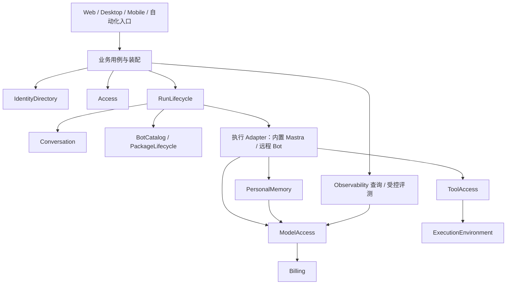

# OpenBot 模块化架构详细设计

日期：2026-10-23。文档版本：1。类型：架构设计。

**状态：用户已认可上一轮模块拆解方向，并要求细化和持久化；本文新增的 Interface、迁移步骤和验收为详细设计稿，尚未逐项批准或实施。** 本文可供 Code Agent 分析和规划；修改产品行为仍以相应已批准 Spec/ADR 和实际任务授权为依据。

## 1. 目标、范围与事实源

采用模块化单体：保持 Bun/Hono、React/Vite/TanStack、现有 PostgreSQL、Worker 与外部执行宿主，把业务知识集中在明确的 Module Interface 后面。Module 的划分依据是事实所有权、业务不变量与变化原因；目录、package 和进程是独立的组织选择。

目标：新增入口复用已有授权/运行/计费规则；更换 Adapter 不扩散到全部调用方；Code Agent 能按任务定位所有者、最小阅读集和验证面。优先改善 Depth 与 Locality，不以目录数量、文件行数或微服务数量作为完成标准。

范围包括十二个核心 Module、扩展 Module 的协作、内部依赖、事务与远端失败、前端与多宿主装配、渐进迁移及验收。不引入新执行框架、消息总线、数据库拆分、自动数据迁移或新的产品权限。

事实源按 [设计规范](../../.agents/rules/design.md)排序；领域词义使用根 [CONTEXT.md](../../CONTEXT.md)。本文不另建词汇表。重要约束：

- [ADR 0010](../adr/0010-mastra-execution-openbot-governance.md)：Mastra 执行循环，OpenBot 保留运行与治理权威。
- [ADR 0011](../adr/0011-better-auth-identity-and-membership-authority.md)：Better Auth 身份与目录方向；新完整接入详细范围仍待批准。
- [ADR 0006](../adr/0006-logical-private-bot-scoped-execution.md)：稳定逻辑 Bot 与范围隔离的执行环境分别表达。
- [ADR 0009](../adr/0009-remove-knowledge-base-domain.md)：KB 下线，架构整理不恢复 KB。
- [ADR 0004](../adr/0004-company-team-tenancy.md)已作废；旧 #6 子树不恢复。[ADR 0007](../adr/0007-personal-space-business-scope-and-payer.md)仍为 proposed，不据此实现完整 Personal Space。
- 现有 tenancy 代码是需要保全和评估的当前实现，存在代码不等于旧需求重新批准。现有保护措施保留；改变行为需独立依据。

初步分析见 [模块拆解建议](../plans/2026-10-23-module-decomposition-design.md)。该文是背景；详细方案引用以本文及下列分册为准。实际读取范围、代码版本与本轮文档验证见[本地证据](../../.archive/runs/2026-10-23-module-decomposition/architecture-detail-index.md)，归档不作为其他工作区必需输入。

## 2. 文档地图

| 要解决的问题 | 按需读取 |
| --- | --- |
| 修改落在哪个 Module、哪个事实由谁写 | [模块目录与所有权](../plans/modular-architecture/module-catalog.md) |
| 跨 Module 怎么调用、哪些信息不能外泄 | [Interface 合同](../plans/modular-architecture/interface-contracts.md) |
| 聊天/审批/后台/模型/预览等链路如何协作 | [运行链路与一致性](../plans/modular-architecture/runtime-flows.md) |
| 怎么逐步迁移、与 Issue 怎么衔接、怎样验收 | [迁移与验收方案](../plans/modular-architecture/migration-plan.md) |
| Code Agent 的阅读与改动流程 | [架构工作规则](../../.agents/rules/architecture.md) |

仅阅读任务所属分册章节及直接依赖；不默认加载所有实现文件或全部 Issue 正文。

## 3. 方案取舍

| 方案 | 收益 | 代价与选择 |
| --- | --- | --- |
| 仅给现有目录增加出口文件 | 小改动，可逐步实施 | 无法单独解决双写、双向引用和调用方拼规则；作为迁移手段。 |
| **业务 Module + 明确所有权 + 渐进封装** | 保留同库事务和现有宿主，按业务链路迁移；便于独立验收 | 需整理真实消费者与内部 Seam；采用此方向，用户已表示可行。 |
| 先拆为独立 package/进程 | 部署与依赖可独立管理 | 当前跨表事务、撤权和消息一致性会变为分布式问题；保留为有实际需求后的单独决策。 |

本稿具体目录、Interface 命名和迁移批次是本轮提出的设计，不归因于用户已逐项确认。

## 4. 架构视图

以下是责任流，箭头不是完整 import 清单；静态允许依赖见模块目录。



生产执行过程还会在敏感检查点调用 Access。图中省略这些重复连线。观测由执行 Module 发布受控观察或注入内部 observer，装配连接到 Observability；运行代码不依赖 Opik SDK。

十二个核心 Module：IdentityDirectory、Access、BotCatalog、Conversation、RunLifecycle、ModelAccess、Billing、ToolAccess、ExecutionEnvironment、PersonalMemory、Observability、PackageLifecycle。它们各有一份公开 Interface，内部可分子 Module 和多个 Adapter。

Craft、Workshop、OpenMuse 各业务、Automation、Learning、Voice/Dictation 保持独立扩展职责。一个 Module 可以跨 server 与 app 拥有相应代码，但客户端合同不携带服务端可信对象或秘密。

## 5. 架构决定

| ID | 本稿采用的决定 | 实施含义 |
| --- | --- | --- |
| A01 | 业务状态有唯一写入所有者 | 调用方通过所有者 Interface 改状态；共享数据库不等于共享写权限。 |
| A02 | 先原位建立公开出口 | 使用现有领域目录的 public.ts，必要内部合同留在 integration.ts；不做全仓搬目录。 |
| A03 | 装配是显式组合位置 | 新增 server/src/assembly/ 承接工厂、宿主生命周期和同事务用例组合；业务规则归原 Module。 |
| A04 | 业务 Interface 隐藏供应商协议 | Mastra、Bifrost、Hindsight、Opik 和连接供应商均在真实变化的 Seam 后接入 Adapter。 |
| A05 | 一次动作资格不作为永久授权 | 范围/对象/来源绑定，敏感检查点重验；恢复从持久事实重建。 |
| A06 | 原子写保持同连接事务 | 拆目录时保留账务、目录撤权和消息 intent 等事务不变量；跨远端动作使用持久状态和重试协议。 |
| A07 | 运行事实与资金事实分别拥有 | RunLifecycle 管运行上限和 Attempt；Billing 管积分预留/实际费用，不能将 token 确认当作资金结算。 |
| A08 | 完整消息协议归 Conversation | 单写者、顺序、附件、tool parts 与存储对账一起封装；引擎不另写历史。 |
| A09 | 工具决定与运行等待分别拥有 | ToolAccess 管审批决定/动作副作用；RunLifecycle 管等待/恢复驱动，只有一次有效消费。 |
| A10 | 可选能力显式隔离 | Learning、Hindsight、Opik 的禁用、故障与启用条件具名；强制安全审计独立遵守业务合同。 |
| A11 | 可执行兼容按行为验收 | 路由、DTO、AG-UI、数据库 ID 与配置语义逐消费者迁移；内部重构不默认升级 wire schema。 |
| A12 | 提取 package 由真实复用驱动 | 多个实际消费者、依赖可单向化、验证可独立才提取；不给每个 Module 预建 package。 |

每项决定的验证映射在迁移分册；本稿未签发新的执行 capability，也未新增产品动作权限。

## 6. 目标代码组织

```text
server/src/
  assembly/                  # 目标：宿主装配、受控事务用例组合、shutdown
  <现有领域目录>/
    public.ts                # 目标：对调用方的业务 Interface
    integration.ts           # 按需：仅装配/内部 Adapter 可见的合同
    <现有实现与测试辅助>       # 原位深化，逐步收拢
  db/schema/                 # 暂留原位；表的写入归属独立记录
  mastra/                    # 执行/消息存储等具名 Adapter，逐用途迁移
app/src/
  routes/                    # 页面和路由组合
  lib/<现有领域>/            # 查询、mutation、状态和 DTO 转译
shared/                      # 真实跨宿主 wire 合同；不导出服务端授权能力
toolkit/                     # 真实复用与具名协议 Adapter
```

这是目标示意，所列新文件不表示已经存在。Module 不强制一目录对应一 package；core.ts 等混合 schema 先按表区分所有者。

`public.ts` 不做整目录 export。普通消费者只依赖公开用例；仅装配层可接内部 integration 合同。编译期类型与运行期签发/校验配合，TypeScript 类型断言不能制造可信 Scope 或有效租约。

## 7. 适用与演进

新增功能先定位所属 Module，再消费其 Interface；遇到现有跨 Module 深层引用，标记为具名迁移项，只在相应任务范围内调整。仓库已有功能不因本稿发布而获得“已完成模块化”的状态。

Detailed Interface 和迁移任务获批后，按仓库 writing-plans/SDD/验证/Review/OCR 流程建立实际任务与检查点。本轮只交付文档及 Agent 阅读入口，没有代码重构、提交、发布或 GitHub 写入授权。
