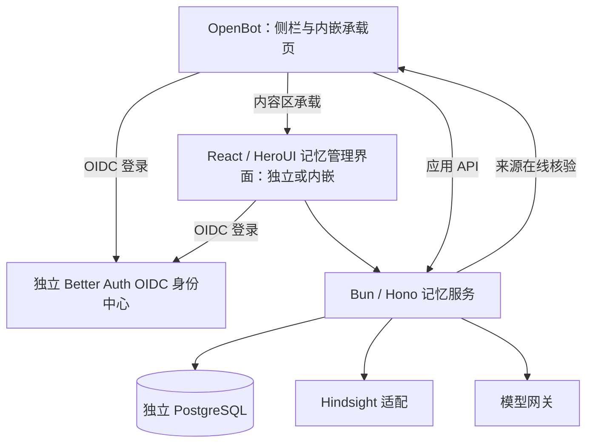

# 通用个人长期记忆服务

## 1. 状态与依据

用户已在 Q26 批准 v3 作为跨仓库实施计划依据；批准指向的内容指纹和原文见上方元数据。本批准覆盖设计及其中标注的实现起点，不自动授权建仓、产品实施、身份迁移、数据删除或部署。逐题方向见[访谈 D01–D26](../plans/2026-10-30-independent-memory-service-design.md)及 [ADR 0012](../adr/0012-independent-personal-memory-authority.md)。第 3 版确定 React/HeroUI 管理界面独立访问及 OpenBot 保留侧栏内嵌、独立 Better Auth OIDC 身份中心，并补齐相应验收。

领域词义使用根 [CONTEXT.md](../../CONTEXT.md) 的“个人记忆”。[ADR 0005](../adr/0005-self-hosted-hindsight-for-personal-memory.md)作为已有业务约束的来源；权威归属由 ADR 0012 局部替代，不因删除旧实现而取消审核、来源、敏感内容、暂停与遗忘要求。当前代码仍是 OpenBot 持有记忆权威，本设计是目标架构。

## 2. 目标与范围

建立可供 OpenBot、其他自有应用和外部 Bot 使用的个人长期记忆服务。服务独立仓库、独立部署、独立业务数据库，统一拥有原文、候选、审核、更正、来源、版本、共享、暂停及遗忘状态。OpenBot 是接入方，不是服务的运行前提。

首版包含：统一身份接入与应用登记；本人采集/读取委托；异步候选提取、重复和冲突识别；本人审核、更正、遗忘；按当前权限召回；逐条内容版本共享；React/HeroUI 统一管理界面；预算、清理和恢复状态。管理界面可独立访问，也可从 OpenBot 菜单进入、保留 OpenBot 侧栏并在内容区内嵌。共同前置能力包括独立 Better Auth OIDC 身份中心与两应用的客户端接入。

首版不包含：聊天历史存储、当前会话管理、团队共享知识、OpenMuse 精确 ID 私有记忆迁移、旧记忆导入、分类持续共享、未来记忆自动共享、接入应用收费系统。独立服务不引入另一套公司/团队成员权威。

失败标准包括：凭统一身份读到其他应用记忆；候选未经确认进入召回；来源撤销后继续作为当前可用记忆返回；旧实现与新服务同时写入；把异步接收显示为已记住；声称撤销已经收回全部外发内容。

## 3. 已选择的方案与取舍

| 方案 | 收益与代价 | 结论 |
| --- | --- | --- |
| 仅将 Hindsight 检索包装成通用 API | 改动少，但各应用仍自行实现审核、权限与遗忘 | 不满足 Q3 的完整权威目标 |
| OpenBot 内部模块对外提供 API | 可复用现有装配与数据库，但应用发布、故障及数据结构仍耦合 | Q18 已选择独立交付 |
| 独立记忆业务服务，Hindsight 为内部适配 | 统一生命周期规则，可独立发布；需维护身份、来源核验及接入合同 | 用户已选择 |

统一管理界面取代各应用分别实现审核体验；本人在线授权与逐版本共享优先于静默关联和自动共享；来源在线核验优先于复制各应用业务权限；后台处理费用由运营方承担，暂不引入收费产品。

## 4. 职责与数据所有权

| 所有者 | 拥有 | 对外合同 |
| --- | --- | --- |
| 统一 Better Auth 身份中心 | 用户身份与登录事实；公司/团队目录遵守其已批准范围 | 可验证当前身份、账号关联事实 |
| 记忆服务 | 记忆全生命周期、应用委托、共享授权、任务和清理状态、记忆处理预算与用量 | 管理 UI、应用 API、状态与清理通知 |
| 来源应用 | 原始业务内容、连接凭据、当前来源权限 | 提交经授权片段；核验指定访问上下文的当前来源资格 |
| 接收应用 | 自身会话与运行状态、受控缓存及外发副本记录 | 按用户委托调用；执行清理并报告范围和结果 |
| Hindsight | 可重建的索引、排序、检索与推理任务 | 记忆服务内部适配；不直接向接入应用开放 |
| 模型网关 | 受管模型调用及相应网关侧事实 | 接受记忆服务身份调用；不依赖 OpenBot 业务 API |

应用不得直接写服务的业务表。记忆服务不直接读 OpenBot 的用户、团队、来源授权或记忆表。身份中心与模型网关可共用基础设施，但以明确接口接入。服务数据库不得复制出可独立修改的身份或团队目录。

图中的登录箭头表示客户端通过统一身份中心建立身份，不表示父窗口向内嵌页转交自己的 cookie 或访问权限。

## 5. 身份、委托与隔离

自有应用与服务共用同一 Better Auth 身份中心；外部应用账号经本人证明控制权后关联，不按邮箱或名字自动合并。关联不授予读取权。

首版管理界面采用 Better Auth 统一登录跳转。统一身份中心独立部署并作为 OIDC（OpenID Connect）提供方；OpenBot 与记忆管理应用分别作为客户端。同一人通过受信身份主体关联，不能凭相同邮箱合并。各应用可拥有各自会话，统一身份不意味着跨站复制 session cookie，也不等于记忆委托或共享授权。

官方能力依据：[Better Auth OAuth Provider](https://better-auth.com/docs/plugins/oauth-provider)说明 Better Auth 可作为授权服务器并提供 OIDC 身份能力；[Generic OAuth](https://better-auth.com/docs/plugins/generic-oauth)说明应用侧可接入 OIDC 提供方。两种角色不能混为一谈。实施前需核实身份中心已装配的提供方能力及兼容版本；当前 OpenBot 使用 Better Auth 不自动证明它已是供其他应用登录的 OIDC 提供方。该协议方向及具体登录流程随本稿评审，未运行集成验证。

当前代码核对：`server/src/auth/index.ts` 的 genericOAuth/SSO 装配消费外部身份提供方，定向检索未发现 OAuth/OIDC 提供方装配。独立身份中心的新增提供方能力、客户端登记及会话建立须纳入建设与验证，不视为已有功能；提供方可用性不依赖 OpenBot 业务进程。

不迁移旧记忆不等于放弃现有用户、公司目录和资源归属。身份接入计划必须保持现有稳定主体与 OpenBot 历史业务引用连续，不以重新注册或邮箱匹配替代；身份目录具体切换按 ADR 0011 的单一权威要求另列步骤、回滚与验收。此设计只确定身份中心目标职责，不授权执行身份数据迁移。

每次业务请求须同时满足：已登记且有效的应用身份、可验证的本人身份或委托、相应操作权限、匹配的记忆归属与当前来源权限。应用仅传 userId 不构成本人委托，服务密钥不代替用户授权。

本人分别授予或撤销采集和读取。采集委托允许提交内容形成候选，不允许应用自行把观察标为本人确认；读取委托只覆盖本应用范围内符合条件的记忆。跨应用还须具有当前有效的逐版本共享授权。本人在统一管理界面管理其记忆时，不受某个应用读取委托的替代，但仍受公司和来源约束。

实现建议：将原始应用、本人及来源隔离范围保存在服务端权威记录中；同内容来自不同应用或不同来源时，去重仅提示关联，不合并所有权或授权。跨应用共享保留原始归属，不能通过复制为接收应用自有记忆绕过撤销。

来源核验必须包括本人、原始归属、实际接收应用、操作、内容版本和来源引用等必要上下文。来源应用能否允许该内容向接收应用提供，不能由“本人仍是该项目成员”单独代替。未知接收应用、未知来源或无法核验时不返回受限内容。个人共享不能跨越公司和来源限制。

## 6. 接口职责

以下是逻辑能力，不固定 URL、SDK 名称或供应商协议。接口设计时必须覆盖这些合同。

| 能力 | 调用者与前提 | 结果与限制 |
| --- | --- | --- |
| 应用登记与停用 | 运营管理入口 | 独立服务身份、回调及能力配置；登记不产生本人委托 |
| 本人委托管理 | 本人受信交互 | 采集与读取分别管理，撤销立即影响后续准入 |
| 提交片段 | 应用身份 + 本人采集委托 + 来源资格 | 持久接收后的任务回执；记录最迟处理期限，重复提交幂等 |
| 查询处理状态 | 本人或任务所属应用的适当委托 | 已接收、处理中、待处理原因、待审核、失败或过期；不泄露其他应用任务 |
| 提交/审核候选 | 应用仅可提交候选，本人可审核 | 确认、编辑、拒绝；拒绝和重复处理不产生新有效版本 |
| 明确记住 | 可核验的本人显式请求 | 普通事实可直接确认；应用或模型声称“本人已要求”不构成证据 |
| 召回 | 本人读取委托 + 归属/共享 + 当前来源资格 | 已确认的有效原文或已确认派生判断、依据与有效时间 |
| 更正/遗忘/暂停 | 本人受信操作 | 权威状态先更新；阻断召回先于远端物理清理 |
| 来源绑定与撤销 | 本人受信操作及登记来源应用的适当合同 | 明确撤销持久生效，阻断相关原始信息及派生；创建索引、依据和副本清理任务 |
| 共享管理 | 本人选择具体内容版本及接收应用 | 只读、可撤销；更正或派生不继承旧共享 |
| 来源核验 | 服务与来源应用的已登记通道 | 限定当前请求的准入判定；超时或失败不放行 |
| 清理通知与回执 | 服务及已登记接收应用 | 幂等通知、重试、应用控制范围及逐项结果，不把通知成功当清理完成 |

外部文本、模型输出、索引结果均不直接成为可信身份、来源范围、审核证据或共享授权。具体票据格式、身份中心验证方式和回调协议留给实施设计，但必须证明签发者、目标应用、本人、操作、范围、有效性与撤销处理。

## 7. 内容形成、审核与保留

来源应用获得采集委托后提交必要片段及来源信息；服务在准入后可靠接收，返回可查询回执。后台开始处理与提交候选时重新核验委托、来源资格、暂停和过期状态，撤销后的旧排队任务不能恢复形成资格。

后台提取候选、识别重复或冲突。候选不进入任何跨会话召回，包括产生它的应用。重复、冲突不自动覆盖已确认事实；本人审核后生成确定版本。派生判断只使用已确认且当前可用的依据，判断本身须本人确认，并继承全部依据限制。首版保留 ADR 0005 的同一来源或通用个人记忆内部综合约束。

普通事实的本人明确“请记住”可走直接确认；密码、令牌不保存，其他敏感内容遵守 ADR 0005 的明确要求与额外本人审核规则。不得以删除旧实现为由放宽。

| 材料 | 保留与使用 |
| --- | --- |
| 完整提交片段 | 临时材料；处理结束一天内从活跃存储清除；排队最长 30 天，超时过期 |
| 最小依据 | 仅保存支撑候选或已确认记忆所必需内容，遵守同一来源约束；不能借此复制完整片段 |
| 未审核候选 | 沿用 30 天过期规则；过期不继续后台处理或进入召回 |
| 已确认记忆及更正历史 | 保留至本人遗忘或适用保留政策到期；当前问题取当前版本，历史问题也须当前有权访问 |
| Hindsight 已结束任务载荷 | 沿用一天保留窗口，关闭含内容的模型调用追踪 |
| 受控备份 | 沿用不超过 30 天窗口；恢复后先重放遗忘和撤销记录，再开放召回 |

队列、索引、任务回执、缓存、观测和备份都纳入清理范围。任务状态与必要的无内容审计可按运维策略保留；具体最小依据形状和清理任务机制属于实现设计，必须证明没有变相无限保留原始片段。

## 8. 召回、版本共享与撤销

召回顺序：验证调用身份和本人委托 → 限定本应用及明确共享的版本 → 检索候选 ID → 回读服务权威记录 → 核对审核、有效版本、暂停、遗忘、共享及来源资格 → 返回受控正文和依据。Hindsight 的原文、reflect 回答或新提取事实不能直接作为正式结果返回。

索引为空与来源无法核验必须在内部状态和适当的调用结果中可区分，调用方不能把“无法核验”显示为用户没有记忆。返回数据不包含未经授权的其他应用候选数量、内容摘要或匹配提示。

共享指定内容版本；更正后旧版本不再向接收应用返回，新版本和新派生需本人重新授权。实现建议：共享默认持续到本人撤销、版本失效或底层资格丢失；不把调用凭据到期与本人授权撤销混为一谈。具体授权期限允许后续实施配置，不放宽当前范围。

撤销、更正或遗忘提交后，新发起读取必须被最新权威状态拦截；已开始但尚未交付的读取在结果交付前再核验服务内授权状态和来源资格。实现不得用长事务跨远端请求造成永久阻塞。来源核验与并发撤权的线性化时点、版本/租约方案由实施设计证明；已交付响应归外发副本清理，不能承诺追回网络上已经交付的字节。

服务立即停止后续提供相应内容，并可靠创建清理通知。接收应用报告它控制的缓存、会话/模型上下文及下游副本处理范围与结果；部分失败、无法控制及未回执均可见。只有有证据的相应范围可显示清理完成，不能将回调 200、超时或未回执等价为完成。记忆遗忘同时覆盖索引及派生依赖的阻断和后续清理。

来源暂时无法核验或本人当前不具备来源资格时，阻断相应访问，不仅凭超时或一次拒绝即物理删除。本人明确撤销记忆来源绑定时则不同：服务先持久记录撤销，立即阻断该来源的原始信息及相关派生判断，取消相关未完成提取，再跟踪 Hindsight 活跃文档、观察、相关依据及外发副本的清理。恢复来源连接或成员资格不复活已经撤销的旧记忆；重新采集必须经过新的有效授权及正常审核。

来源撤销的持久状态、清理意图和依赖传播须能在故障后重试，恢复备份时先重放，再开放读取；不能只在内存过滤或删除一条连接配置。来源应用的最终撤销事件、临时资格拒绝和网络故障须能区分，具体通知/轮询协议由实施设计选择。本人明确撤销的语义沿用 ADR 0005，不需要新需求批准。

## 9. 统一管理界面

本人可查看应用委托、处理任务、候选、已确认记忆、来源、版本历史、共享和清理状态；执行审核、编辑、拒绝、更正、遗忘、来源撤销及分别暂停学习/使用。暂停使用立即阻断召回，暂停学习阻断新形成与未完成处理。

审核展示待保存内容、必要依据、来源和时间；共享展示具体内容版本及接收应用；更正后明确共享失效。界面区分可靠接收、待处理原因、待审核、已确认、已停止共享、应用侧清理和受控副本清理结果。

管理界面使用 React 与 HeroUI，独立访问时通过 Better Auth 统一登录跳转。OpenBot 的记忆菜单进入内部承载路由，保留 OpenBot 侧栏，内容区展示记忆管理界面；独立访问仍可用，两种入口操作同一服务及本人记忆。接入不改变记忆服务的独立仓库、部署及数据所有权。现有 `app/src/components/app-sidebar/app-sidebar.tsx` 以静态内部链接组织菜单，`app/src/routes/_authed/_app.tsx` 通过内容区 Outlet 保留侧栏，需要实施相应菜单及承载页。菜单具体位置与名称由实施设计选择。

内嵌须约定宿主/子应用路由、允许的宿主 Origin、尺寸、导航、会话建立和退出；身份登录跳转与登录后的页面展示分开处理。需要登录时在浏览器顶层进入统一身份中心，完成后回到已校验的 OpenBot 承载路由并恢复内嵌；不能把登录页留在 iframe 中等待用户完成。独立站以同一身份中心建立自身客户端会话，不能因入口不同新建另一个人。

不得为内嵌直接复用父窗口 cookie、允许任意站点嵌入或把长期凭据放入 URL。若使用窗口消息，校验发送方窗口、精确 Origin 和请求关联；不能凭消息中的 userId/tenantId 或父页面声称的权限扩大访问。登出和会话失效时清除相应内嵌页内的当前状态，重新认证不得复活已撤销的记忆委托。

实现建议：首版优先评估受控 iframe 与适当的同站部署拓扑；浏览器存储限制、跨站部署、回跳及退出必须在选定方案和支持环境中实际验证，不能假定第三方 cookie 总可用。若该方案无法满足验收，实施设计可选择其他受控承载技术，仍须满足保留侧栏、独立访问及服务独立性，不能仅退化为外链并声称完成内嵌。

管理界面直接调用服务，由本人操作，应用身份不能伪造审核动作。运营人员只查看健康、积压及预算，不因管理身份获得个人正文读取权。

## 10. 模型费用与故障

服务直接使用可配置模型网关及自身服务身份。运营方承担后台处理费用，按应用和个人记账并执行预算上限；调用前原子预留预算，按实际用量确定结果，结果未知时不盲目释放或重复调用。暂不建设订阅、收款或面向接入应用的积分扣费系统。具体预算单位、价格依据和持久协议在实施设计中明确，不复刻 OpenBot 支付与积分产品。

服务整体不可用：应用普通对话继续但明确未使用记忆；依赖记忆的任务暂停；没有可靠接收回执则不能显示已接收，重试需沿用幂等身份。不得恢复 OpenBot 旧本地记忆、旧引擎记忆或不经授权核验的持久缓存。

仅 Hindsight 不可用：服务可从自身已确认权威数据进行同权限降级召回；确认先持久化，索引稍后补同步。来源应用不可用：相应来源受限内容不返回；无关且已授权的个人记忆仍可使用。预算不足：任务待处理但受 30 天片段上限约束，超时明确过期。

## 11. 交付与实现建议

用户已确定 Bun/Hono、PostgreSQL、React 与 HeroUI，管理界面首版使用 Better Auth 统一登录跳转。以下为其余实现起点，随本稿评审：

- 独立仓库包含 Bun/Hono API、后台处理和 React/HeroUI 管理界面，部署可独立升级；PostgreSQL 访问可沿用团队熟悉的 Drizzle，ORM 选择仍属实现建议。
- 先用同一业务数据库内的持久任务与通知记录保持权威状态和发送意图一致，不预先引入消息总线或拆分多个记忆微服务。
- 对身份中心、来源核验、Hindsight、模型网关和应用通知定义具名适配接口；发布版本化应用 API 与最小客户端。
- 新服务独占自己的业务数据库和迁移；Better Auth 身份中心拥有其目录。具体身份中心部署、正式服务名、仓库名、语言库版本、表名和路由由实施阶段选择并记录。
- 无需将应用的模型上下文格式固定在服务内部；服务返回受控结构化记忆与依据，应用适配器负责注入自己的运行协议。

OpenBot 接入属于单独实施范围：各聊天及无人值守入口改用同一客户端；保留来源在线核验接口；删除旧本地记忆、旧引擎记忆及回退的实际消费者，不能仅停一个 UI 入口。若其他业务仍依赖旧 memory defaults，按其非记忆职责处理，不能误删任务或 Bot 生命周期功能。

身份中心建设、记忆服务建设与 OpenBot 接入须分列可验收交付，统一集成验证。身份中心先提供稳定身份与 OIDC 合同，记忆服务及 OpenBot 分别验证客户端接入；菜单承载在独立站、身份及授权链路可用后集成。独立身份中心的仓库和部署配置另行明确，不将其实现混入记忆业务数据库或 OpenBot 业务进程。

首版从新服务空数据开始，不导入旧记忆，不恢复旧 Intelligence 私有记忆，不混入 OpenMuse 独立边界。旧数据本次不删、不迁移、不参与新召回；删除旧路径不能以级联迁移顺便删除旧表或记录。旧文档保留历史并标明生效范围和替代关系，不能将历史决定从仓库抹除。

## 12. 验收场景

| ID | 场景与预期 |
| --- | --- |
| A01 | 本人相同、两个应用：B 不能读取 A 的记忆；邮箱同名、伪造 userId、服务密钥均不产生本人委托 |
| A02 | 有效应用登记但无采集委托：提交被拒绝；只有读取委托时也不能提交；撤销采集不自动撤销读取 |
| A03 | 候选、拒绝、过期或暂停的内容在产生应用、跨应用、索引与降级路径均不可召回 |
| A04 | 共享指定已确认版本后仅指定应用可读；接收应用不得修改/删除；新增、派生和更正版本不自动共享 |
| A05 | 来源撤销、跨公司/团队、未知接收应用及来源故障均拒绝相关返回；远端检索过程中变化须在交付前按明确的竞态合同核验 |
| A06 | 更正、撤销、遗忘后新请求拒绝旧版本；并发在途结果满足交付检查合同；已交付副本按范围跟踪清理 |
| A07 | 清理通知失败可重试且幂等；部分失败/未回执不显示完成；索引、派生及恢复后的删除重放均有证据 |
| A08 | 显式本人普通事实可按受信协议直接确认；模型/应用自行声称本人要求不能确认；敏感内容走适用审核 |
| A09 | 同一提交重复请求或处理重启只形成一份相应结果；只有持久接收后返回已接收；预算/来源/委托变化在后台重新准入 |
| A10 | 原始片段结束后一天内清理、排队 30 天过期、候选 30 天过期；最小依据不变成完整片段替身；备份与任务载荷满足保留及恢复规则 |
| A11 | 并发任务不能突破应用和个人预算；未知模型费用不错误释放；额度不足可见，任务过期后不再执行 |
| A12 | OpenBot 应用停机时，服务及其他接入应用仍可工作；统一身份和模型网关的故障按明确合同处理 |
| A13 | 服务整体故障时普通对话继续且提示未用记忆，依赖记忆任务暂停；仅 Hindsight 故障仍执行同权限本地降级 |
| A14 | 统一管理界面使用本人身份；应用不能伪造审核和共享；运营身份不能读取个人正文 |
| A15 | OpenBot 浏览器、频道、定时与其他实际记忆消费者均统一接入；旧链路无运行入口或回退；旧数据无导入或删除，其他业务行为不被误删 |
| A16 | 临时来源核验失败只阻断访问；本人明确撤销来源则持久停止相关原始信息及派生的使用、取消待处理并跟踪索引/依据/副本清理；重启、重新连接及恢复成员资格不复活已撤销内容，备份恢复先重放撤销 |
| A17 | React/HeroUI 管理界面独立访问可用；从 OpenBot 菜单进入后保留原侧栏，内容区内嵌同一管理能力，两入口指向同一主体和权威记忆，授权语义一致 |
| A18 | 内嵌需要登录时顶层完成 OIDC 并回到受验证的承载路由；深链接/刷新/会话过期/退出行为可验证；未允许的宿主或窗口消息不能建立身份或扩大权限，浏览器存储受限时满足已声明的支持合同 |
| A19 | 独立 Better Auth 身份中心具备提供方能力，两应用作为客户端接入；OpenBot 业务进程停机不停止身份中心或其他无关应用登录，现有主体与历史资源引用保持连续，目录无双主写入 |

## 13. 设计批准与实施门槛

第 1 版已完成独立设计审阅并补齐来源撤销合同，第 3 版身份中心及内嵌增量已完成独立复审；用户在 Q26 明确批准 v3。批准针对上方指纹所指内容；此处只更新批准记录，不增加新产品范围。实现建议是可审查的实施起点，具体协议与文件结构由实施计划细化，不得放宽本文验收。

跨仓库实施计划见[计划入口](../plans/2026-10-30-independent-memory-service/README.md)，明确身份中心、服务仓库与 OpenBot 各自文件所有权、外部合同、验证环境和集成顺序。此阶段不建仓、不提交、不推送、不启动数据清理，不因文档存在而声称服务已实现或完成接入。
