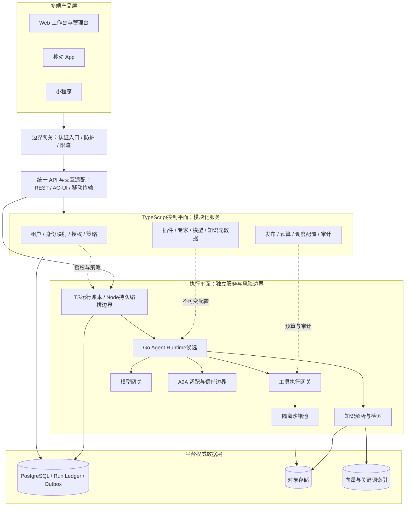
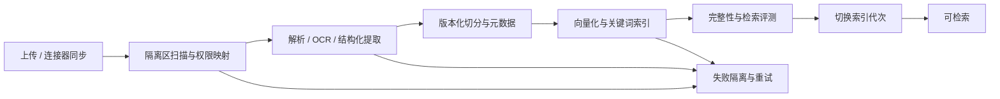
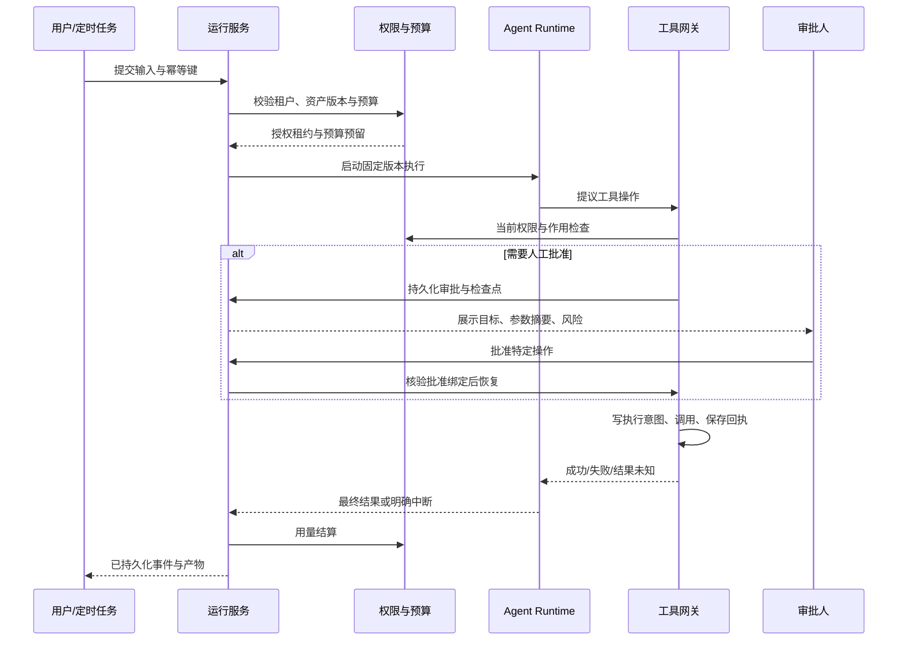
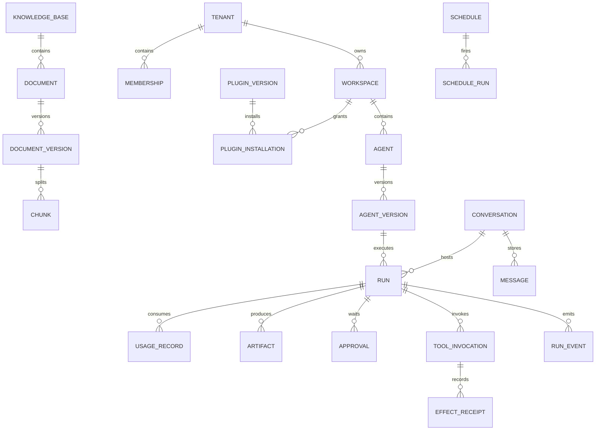
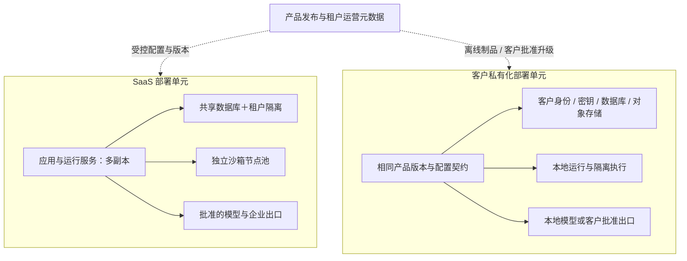

# 企业级 AI 公共平台建设方案

> 版本：修订稿 v0.2／`enterprise-mvp-v0.2` ｜ 修订日期：2026-10-09
>
> 建设方式：目标架构＋OpenBot 现状映射。兼容私有化与 SaaS，先开展小范围生产试点。
>
> 文档基线已统一：保留 TypeScript/Hono/Bun 控制平面；Go 仅为独立 Agent 执行候选；复用现有认证；当前整个 MVP 不引入 OpenFGA/OPA。用户授权按评审建议修订四份文档，不代表批准编码、安装、部署或数据迁移。
> 规范性决策索引见 [总计划 §1](docs/superpowers/plans/2026-10-09-enterprise-ai-00-master.md)，共同契约见其 §4，门禁唯一注册见其 §6。03–06 分册待编写；本稿并不代表整体实施就绪。
>
> 本文是总体建设与分期评审文件，不是逐文件编码计划。规模、性能、人员和周期均为建议目标或规划假设，不是当前项目实测结果、采购报价或交付承诺。线上协议文档查询日期为 2026-10-09；滚动文档不等于当前仓库依赖版本已经支持其中所有能力。

## 0. 决策摘要

建议把平台定位为“企业 AI 应用与 Agent 的公共能力底座”，而不是模型聊天界面、插件列表或单一 Agent 框架的封装。

采用以下核心决策：

1. **产品与治理统一、执行隔离**：统一工作台、租户、身份、权限、资产、发布和计量；Agent、插件、解析和浏览器执行处于独立信任边界。
2. **保留体验、治理域渐进演进**：复用 React Web、移动端基础、AG-UI 接入与认证经验；在 TypeScript/Hono/Bun 内划分企业治理域并提供独立入口。Go 只验证独立 Agent 执行服务，不迁移控制平面；普通资源 read 使用本地 TS Authz，工具动作使用本地 TS ActionPolicy，当前整个 MVP 不引入 OpenFGA/OPA。
3. **同一产品，两类部署**：共享产品代码与交付物，通过部署配置支持 SaaS 和客户独立部署；客户差异放在配置、插件和版本化策略，不形成客户代码分支。
4. **模块化优先，按边界拆服务**：MVP 不建设几十个微服务。控制平面先做模块化服务，执行平面因安全与伸缩需求独立。
5. **AG-UI、MCP、A2A 分工明确**：分别承载用户交互、工具接入和 Agent 间任务协作；协议接入不自动提供权限、安全隔离或业务可靠性。
6. **运行必须可追溯、可中断、可核账**：每次执行锁定专家版本、插件版本、模型路由和知识索引，关联审批、工具回执、成本和事件记录。
7. **MVP 即具备安全基线**：身份验证、租户隔离、危险操作审批、沙箱、审计、预算上限和恢复演练不能推迟到“企业版”。后续增强规模、自动化和保障等级。
8. **核心持久化归平台掌握**：新运行的会话、任务和业务回执进入平台权威存储；现有外部线程依赖通过适配器渐进迁移，不制造双主状态。

## 1. 业务定位与产品边界

### 1.1 服务对象

- 普通员工：知识问答、文档分析、专业助理、业务办理和个人自动化。
- 业务专家：配置角色、提示词、知识范围、工具、流程、评测集并发布专家。
- 开发者：开发插件、连接器、Agent 服务、受控交互组件。
- 管理员：组织与租户管理、授权、成本与配额、资产发布、运营。
- 安全与审计人员：策略、审批、访问审计、事件调查、供应链管理。
- 运维与客户交付：监控、部署、升级、备份、恢复和专属环境交付。

### 1.2 产品形态

| 产品面 | 核心功能 | 不应承担的职责 |
|---|---|---|
| 用户工作台 | 对话、专家目录、知识引用、文件、审批、任务结果 | 不保管模型密钥，不直接执行敏感工具 |
| 专家工作室 | 专家草稿、编排、知识绑定、评测、发布、运营 | 不绕过发布审批或运行策略 |
| 开发者中心 | 插件清单、SDK、调试、版本、提交审核、运行诊断 | 不向开发者暴露平台管理员权限 |
| 租户控制台 | 成员、空间、授权、预算、连接账号、审计 | 不查看其他租户数据 |
| 平台运营台 | 租户开通、套餐权益、基础容量、市场治理、故障管理 | 平台管理员身份不自动授予租户业务内容访问权 |

“专家系统”在本方案中指**版本化的领域 Agent 应用**：角色、提示词、技能、知识与工具共同构成。对于财务规则、审批规则和安全决策，使用确定性规则或工作流，不让模型自由决定；不把所有专家都设计成传统推理规则引擎。

### 1.3 优先业务闭环与价值度量

首期优先选择企业知识问答、文档处理、带审批的业务操作三类闭环，而不是同时铺开所有行业场景。

衡量指标：有证据支撑的任务成功率、用户采纳率、引用正确性、人工接管率、单个成功任务成本、业务处理周期和安全拒绝准确性。不能仅用调用量或 Token 消耗证明价值。

| 需求ID | 场景及输入/输出 | 权限和失败边界 | 验收集/阈值责任 | 对应任务 |
|---|---|---|---|---|
| BIZ-01 | 已授权问题＋知识范围→带定位引用的答案或证据不足 | 召回进入重排/模型前ACL，撤权后拒绝；无依据不得生成内部事实 | 业务/知识负责人提交领域问答、无答案、撤权集及质量/成本阈值，当前待确认 | T、E、K1–K4、D1/D5 |
| BIZ-02 | 授权文件＋目标Schema→抽取结果、异常与来源 | 非可信解析隔离、大小/时限、产物权限；格式损坏给明确失败 | 业务/数据负责人提交真实授权样本与异常集、准确率/耗时上限，当前待确认 | T、E4、K1、P4、D5 |
| BIZ-03 | 授权业务请求→审批预览→执行回执/待核对 | 目标或参数改变重批；未知回执不重试；拒绝不获批动作 | 业务/工具负责人提供目标系统测试环境与验收操作，安全复核风险，当前待确认 | E1–E3、P2–P4、D2/D5 |

每项验收保存样本版本、输入输出Schema、成功/拒绝/失败定义、数据等级、阈值与签署人。未确认项阻断对应业务闭环/G2，不阻断隔离协议试验；不得用fake样本或建议数字补成已批准结果。

### 1.4 首期排除项

不自研基础模型训练平台，不建设开放互联网任意代码执行市场，不自动赋予 Agent 支付或发布权限，不做跨地域数据库双写，不承诺前端组件全端原样复用，不把自主学习直接写回生产提示词或知识库。

## 2. 规划假设与成功标准

以下数字仅作为压测与预算建模的**起始假设**，项目启动后用真实业务数据替换。

| 维度 | MVP 生产试点 | 二期运营化 | 企业级完整版本 |
|---|---|---|---|
| 租户规模 | 1–5 家试点企业 | 10–50 家企业 | 按部署单元持续横向扩容，不承诺无限共享集群 |
| 注册用户 | 总计 500–2,000 | 总计 5,000–20,000 | 按客户合同和单元容量规划 |
| 活跃流式连接 | 总计 100 | 总计 1,000 | 分单元压测与配额管理 |
| 同时运行的 Agent 任务 | 总计 20–50 | 总计 200–500 | 按模型额度、工具额度和沙箱池独立伸缩 |
| 首轮知识规模 | 总计 10 万份文档以内 | 总计 100 万份文档量级 | 按 Chunk 数、ACL 复杂度和更新频率分片 |
| 部署范围 | 单地域，生产基础组件冗余 | 多可用区与专属租户单元 | 多地域灾备、离线私有化交付、分级隔离 |
| 核心平台可用性目标 | 99.5% | 99.9% | 经成本与演练验证后提供 99.95% 等分级目标 |

容量统计以 SaaS 单个初始部署单元的总量为口径；私有化按客户实际规模单独计算。流连接数、运行任务数和模型并发数不是同一指标。

生产试点成功必须同时满足：用户闭环可用、跨租户访问被拒绝、危险写操作有有效审批、任务重复投递不产生重复外部操作、恢复流程经过演练、成本能够逐笔解释。

## 3. 架构路径比较与推荐

| 路径 | 适用条件 | 优势 | 代价与风险 |
|---|---|---|---|
| A：渐进式混合架构，推荐 | 保留 OpenBot 体验，长期建设企业公共底座 | 复用前端与适配；新治理域边界清晰；Go 运行服务可独立发展 | 过渡期维护两种语言及接口；必须明确数据域唯一写入方 |
| B：TypeScript 主栈持续演进 | 团队以 TypeScript 为主，强调首期速度 | 改造面小、人才与工具链集中；并不妨碍企业级可靠性 | 需要主动拆解现有服务职责并建立相同安全边界 |
| C：整体重建微服务 | 已有成熟平台团队、明确容量与客户约束 | 自由设计边界，减少历史兼容负担 | 重写及运维成本高，容易在没有真实负载时过度设计 |

现行采用 A 的收敛版本：治理域仍为 TypeScript/Hono/Bun，Go 只作为独立可替换运行时候选。选择两种语言是为了执行进程与依赖隔离，不是控制平面语言统一或未经实测的性能优势。早期“Go 控制平面＋外部授权引擎”的组合已被取代；未来迁移需独立 ADR、收益/运维证据与单写切换方案。B 是运行时候选不通过时可另行评估的路径，不自动切换真实业务。

## 4. 推荐技术选型及引入时机

这些是拟采用的工程选型，除现状明确列出的组件外，不表示当前仓库已经安装或集成。生产版本应通过兼容性测试后冻结，不追随滚动文档直接使用 latest。

| 层次 | 推荐选择 | 引入时机与边界 |
|---|---|---|
| Web | 保留 React、TypeScript、Vite、现有路由/查询体系 | MVP；不因后端迁移更换前端框架 |
| 移动 App | 保留 Expo / React Native 工程基础 | 二期完成流式与同步能力；首期移动浏览器基本可用 |
| 小程序 | Taro + React，独立渲染层 | 二期；复用协议、类型、状态机、业务规则，不承诺 DOM 组件复用 [S10] |
| 客户端共享包 | API SDK、AG-UI 事件归约器、权限类型、设计 Token | MVP；不把浏览器对象、存储或认证 SDK 写进纯业务包 |
| 遗留入口 | 现有 Hono / Bun | 仅原部署与旧线程；与共享租户入口隔离，不为企业 API 作安全后备 |
| 控制平面 | TypeScript/Hono/Bun 模块化企业服务 | 身份、租户、资源、资产、Run 账本、预算与审计；HTTP 为主，不泄露 ORM/框架状态 |
| Agent 运行时候选 | tRPC-Agent-Go | G1a 验证协议，G1b 验证持久安全，G2 才批准试点；不直写业务库或持有长期供应商密钥 [S3] |
| 持久编排 | Temporal＋独立 Node Worker | 等待、调度与恢复；TS 运行域仍唯一写 Run；冻结 Node/SDK/镜像架构并测试，不在 Bun 中运行 Native Worker [S4] |
| API / 模型入口 | Higress，分离公网入口与模型出口 | 路由、流控、熔断在网关，资产、预算与评测在 TS；能力不满足时加受控代理而非开放 Go 直连 [S5] |
| 身份适配 | 现有 Better Auth＋受控企业 OIDC/SAML 身份源 | 稳定 principal 映射、会话撤销与人工租户授权；不强制身份源迁移，不自动开放各租户 IdP 注册 |
| 资源授权 | PostgreSQL ACL＋本地 TypeScript Authz | 只读授权在短事务内检查成员/ACL/版本；不引入 OpenFGA，不建外部适配占位 |
| 动作策略 | 本地 TypeScript ActionPolicy | 工具网关执行危险参数、网络、数据、审批、预算交集；不引入 OPA；旧 CEL 不作为企业默认许可 |
| 秘密管理 | OpenBao 或客户已批准的企业密钥服务 | MVP；平台库只持有 secret_ref，不回显长期凭证 [S8] |
| 主数据库 | PostgreSQL，初期沿用现有 pg17 系列兼容基线 | 业务、运行账本、审计索引、Outbox；升级另做兼容验证 |
| 向量检索 | pgvector | MVP 独立索引数据域；规模达瓶颈后再评估专用向量引擎 |
| 关键词检索 | MVP PostgreSQL 索引＋经过验证的中文分词链路；二期 OpenSearch 候选 | 不把默认全文配置当作已经满足中文检索；以领域评测决定引入 |
| 对象存储 | S3 兼容接口，云端托管存储或客户既有对象存储 | MVP 原文、产物、快照、审计归档；本地开发适配器不代表生产选型 |
| 缓存 / 短期配额 | Valkey | MVP 可选；二期统一使用。不是账单或任务状态唯一来源 |
| 业务事件 | MVP PostgreSQL Outbox＋消费者去重；二期引入 NATS JetStream 候选 | 仅在扇出、隔离和吞吐需要时增加消息系统；不复制 Temporal 职责 |
| 部署 | Kubernetes + Helm，GitOps 发布 | SaaS 与标准私有化共用交付物；Compose 仅开发与明确限定的演示用途 |
| 沙箱 | gVisor RuntimeClass，独立节点池与网络出口 | MVP 必选的非可信代码边界；更高风险客户另评估 microVM [S11] |
| 可观测 | OpenTelemetry + Prometheus / Grafana + 日志与 Trace 后端 | MVP 贯通请求、运行、工具和模型；后端可接入客户已有平台 |
| CI / CD | 保留现有 CI，增加契约、安全、评测与迁移门禁 | 不一次替换全部工具链；生产制品必须不可变和可追溯 |

**避免重复基础设施**：Kubernetes 部署中优先使用原生服务发现；只有明确需要跨集群注册、非 K8s 服务或统一动态配置时再引入 Nacos。不上来同时部署多个身份源、多个授权引擎去判断同一个规则，也不让多个模型网关互相重试。

## 5. 总体技术架构

### 5.1 逻辑视图

图中是逻辑模块，不是一框一微服务。Control和Runs中的账本/交互属于同一TS治理服务；Execution中只有Go计算、Node编排、解析及工具沙箱独立运行。Runs→PG是TS运行域写入，不是Go或Node直写。BFF是同一TS服务的接入模块，不另设新Go治理进程。模型方、企业系统和外部Agent仅经批准出口；Sandbox→OBJ表示控制器扫描登记后的受限上传，不赋予沙箱任意桶访问。

### 5.2 最小生产部署粒度

物理部署按信任/故障/伸缩边界拆分，不是一框一微服务：

| 部署项 | MVP属性 | 所有者与边界 |
|---|---|---|
| Web 静态制品＋TS 企业 API | 必需 | 前端/后端；IAM、Authz、资产、Run账本、预算先同一模块化服务，公开与内部 listener 隔离 |
| 遗留 Hono 入口 | 仅保留旧部署时需要 | 后端；不接共享租户新流量，无企业后备路由 |
| Go Runtime | 候选通过门禁后启用 | 运行团队；模型/工具受控出口，无业务库权限 |
| Node Temporal Worker＋Temporal服务 | 持久任务必需 | 运行/SRE；Worker为独立制品；业务账本仍由TS写，服务可复用客户批准实例 |
| 解析 Worker、工具执行/沙箱控制器、浏览器池 | 对应闭环必需且隔离 | 数据/工具/SRE；权限判定属TS治理，危险执行独立；无隔离验收则禁用该类任务 |
| PostgreSQL、对象存储、批准的模型网关、身份/秘密服务 | 必需能力，可复用客户已有服务 | 数据/SRE/安全；记录连接方向、角色、备份与密钥归属，不重复安装等价系统 |
| Valkey、专用搜索/消息系统、Nacos | 可选或后续 | 必须先有瓶颈或跨部署需求证据；不成为权限或账本唯一来源 |

不部署 Go 控制平面或 OpenFGA/OPA 服务。D4 冻结每项版本/制品摘要、CPU/系统要求、存储卷、连接数、健康条件、升级/备份责任；未验证的兼容项保持阻断，不补默认版本。

| 故障依赖 | 允许的行为 | 必须停止的行为 |
|---|---|---|
| TS治理/身份/业务DB | 已授权纯计算可在有界时间内完成本地提案；已持久化事件仅在能复核订阅权限时补发 | 新Run、授权刷新、工具/模型新能力、结果提交；无法确认权限则拒绝，不保证运行无条件继续 |
| Go进程 | TS资产管理可继续；由E2/D2核对检查点和租约后决定恢复 | 旧attempt提交、新副作用盲目重试；内存会话不能证明持久恢复 |
| Temporal/Worker | 独立CRUD按自身依赖可用；持久触发留在Outbox等待 | 无记录的同步补跑；不能启动第二套调度器 |
| 沙箱/模型/外部工具 | 仅影响对应隔舱；批准的模型后备须遵守预算和已输出边界 | 切换未授权出口，或将未知工具回执当失败重试 |

### 5.3 模块拥有权

| 模块 | 拥有的数据 | 提供的能力 | 不拥有 |
|---|---|---|---|
| 租户与身份域 | tenant、membership、identity binding | 开通、成员、身份映射、隔离级别 | 模型供应商密钥 |
| 资产与发布域 | plugin version、agent version、model endpoint 元数据 | 注册、审核、版本、发布 | 运行中的瞬态状态 |
| 运行域 | run、step、checkpoint、approval、event cursor | 启动、暂停、恢复、取消、回执 | 插件市场审核规则 |
| 工具域 | invocation、effect receipt | 授权后执行、幂等、审计 | 用户会话主存储 |
| 知识域 | document、version、chunk、index generation、ACL projection | 导入、更新、检索、引用 | 组织身份权威源 |
| 计量域 | reservation、usage、ledger、price version | 预算预留、结算、对账、成本分摊 | 模型文本内容 |
| 部署运营域 | deployment cell、release、health projection | 单元分配、升级、容量和故障管理 | 默认读取租户业务内容 |

## 6. 用户、租户与权限体系

### 6.1 资源层级

MVP采用 `平台 → Tenant → Workspace → Resource（专家/知识/插件安装/个人会话/运行/产物）`。资源通过tenant＋workspace复合约束定位，授权为明确单资源grant；不建悬空Project表，不隐式继承空间角色。Project、空间成员/角色继承、共享会话与跨租户共享为二期专项；后续实体表必须复用资源标识和权限检查，不各自发明继承规则。

一个自然人可属于多个租户，但每次请求、运行和凭证绑定必须确定唯一租户。部署单元 Cell 是物理与运行故障域，不是用户租户：一个 Cell 可以承载少量共享租户，也可独占给一个客户。

### 6.2 角色矩阵

| 角色 | 默认权限 | 必须限制 |
|---|---|---|
| 平台运营 | 租户开通、平台版本、容量与账务汇总 | 无权默认读取会话、文档、密钥 |
| 租户管理员 | 租户内成员、空间、连接器授权、配额 | 无权跨租户；敏感内容访问仍受策略约束 |
| 工作空间管理员 | 空间资源、成员、专家可见性 | 不修改租户安全基线 |
| 专家开发者 | 创建草稿、绑定授权资产、测试、申请发布 | 高风险发布不得自行审批 |
| 插件开发者 | 提交插件与新版本、查看自身诊断 | 不获得安装租户的凭证与业务数据 |
| 普通成员 | 使用已授权专家与知识库、查看自己的运行 | 不任意扩展工具权限 |
| 审计员 | 查看脱敏审计与导出证据 | 默认不能编辑策略或执行工具 |
| 服务账号 | 被授予的 API 或定时任务权限 | 不允许成为长期全局管理员 |

上表是目标产品职责，不等于MVP已实现所有角色。02仅定义tenant_admin/member/auditor及显式资源read；三种角色都不默认获得内容，空间管理员/开发者专门角色/独立服务业务账号后续定义。MVP租户管理走受控离线CLI，不能把部署admin映射为租户内容权限。初期个人会话＋人类主体的短期计划委托；机器服务认证和业务principal分开，禁止伪造用户承载Worker。

采用职责分离：插件提交者与审核者分离；敏感授权与业务执行分离；全局principal绑定/暂停与租户成员/ACL操作使用不同离线能力及审计。应急管理员通过限时授权、工单和审计访问。

### 6.3 授权模型

- 现有认证适配＋受控企业 IdP：回答“是谁”；MFA/账号链接按实际配置验收，组织成员以平台显式授权为准，邮箱域不自动赋权。
- PostgreSQL成员/ACL＋本地TypeScript Authz：回答“能否读取资源”，在同一短READ COMMITTED事务内验证Scope、当前成员状态、resource共享锁、显式grant与支持的规则版本；不依靠事务外允许缓存。
- 本地TypeScript ActionPolicy：回答“此时是否允许此动作”，在工具执行入口验证数据等级、安装/专家版本授权、委托、参数和目标、网络、审批、预算；输出allow/deny/requires_approval和稳定原因/规则版本。缺规则或状态不明默认拒绝。
- 执行网关：强制落实策略，不把read权限当执行许可，不让模型或调用方自行决定受众/endpoint/权限。

当前整个MVP不引入OpenFGA/OPA或外部策略包；未来采用需独立ADR，不是04分册默认补装任务。规则随应用制品发布，数据库保存期望policy_revision；初始仅实现tenancy-v1。升级先发布同时实现旧/新规则的确定性映射，再切租户版本，确认旧副本退出后移除旧规则。未知版本失败关闭，不能只添加版本标签而复用未定义语义。

有效能力是多重约束的交集：**用户或服务主体权限 ∩ 租户策略 ∩ 专家版本授予 ∩ 插件声明与安装授权 ∩ 运行委托范围 ∩ 当前资源 ACL ∩ 审批约束**。不存在“模型说需要”就扩大权限的路径。

### 6.4 SaaS 隔离基线

1. 网关从经过验证的会话和成员关系选择租户，不信任客户端自行提交的 tenant_id。
2. 所有租户域表包含 tenant_id；外键采用包含 tenant_id 的复合约束，禁止跨租户引用。平台公共目录使用单独 schema 与只读角色。
3. PostgreSQL 使用 RLS 作为纵深防御；应用连接不能是超级用户、BYPASSRLS 角色或具有绕过能力的所有者。按需启用 FORCE RLS。[S12]
4. 连接池中租户上下文在事务内设置、事务结束清除；无 tenant context 默认拒绝；后台任务同样遵守。
5. 缓存、对象路径、索引、事件、队列、日志查询都携带租户边界，不能只给数据库加字段。
6. 搜索、下载、审批和流式订阅均鉴权；资源不可见时统一错误行为，减少标识符和计数泄露。
7. 对高敏租户提供独立数据库、对象桶、密钥、节点池或独立 Cell。namespace 和普通容器本身不是强租户隔离承诺。

### 6.5 身份与委托

Web 优先服务端会话＋安全 Cookie，处理 CSRF、重定向白名单和会话撤销。App 使用适配客户端的授权码与 PKCE 流程、设备安全存储与刷新令牌轮换。小程序登录码由后端兑换并映射到企业成员；平台身份不自动等于企业权限。

运行绑定 `actor_id`、`principal_id`、`initiator_kind`、`tenant_id`、`run_id`、授权版本和有效期。Agent 转交只允许收窄委托；不向远端透传用户完整访问令牌。账号离职或授权撤销后，使后续敏感动作和新工具凭证失效，不仅阻止再次登录。

## 7. 前后端架构与多端复用

### 7.1 前端模块

建议边界：用户工作台、专家工作室、知识中心、插件中心、自动化中心、管理台、运行详情与审计中心。

共享包负责：API 类型与错误码、消息与任务状态机、AG-UI reducer、重连游标、上传协议、权限能力描述、国际化文案键、设计 Token、纯业务校验。不同端负责导航、表单、渲染组件、文件选择、通知与安全存储。

**复用对象是协议和逻辑，不是所有页面**：Web 承担复杂编排与运营；App 和小程序优先对话、任务跟踪、通知、审批、轻量知识检索。不要把完整管理台强行移植到手机。

### 7.2 多端能力矩阵

| 能力 | Web | App | 小程序 |
|---|---|---|---|
| 对话与事件 | AG-UI HTTP 流 | 原生网络适配＋同一 reducer | 经过验证的分块接收或 WebSocket 适配 |
| 弱网恢复 | 事件游标＋快照 | 游标、本地待发送队列、前后台恢复 | 游标＋快照；不依赖后台持续连接 |
| 富交互 | 平台组件注册表 | 原生组件映射 | 小程序安全组件映射 |
| 文件 | 分片上传与断点续传 | 系统文件选择与后台限制适配 | 平台文件接口与大小限制适配 |
| 审批 | 完整操作预览 | 通知深链＋二次认证 | 通知/入口回到应用完成鉴权 |
| 专家编排 | 完整 | 查看和简单调整 | 首期不提供复杂编排 |

传输可不同，事件语义相同；不能假设 Web 的 EventSource、DOM、Cookie 或组件包可以直接运行在所有小程序环境。每个目标端必须做真机协议、网络与鉴权验证。

### 7.3 后端工程边界

TypeScript控制平面在server/src/enterprise按租户、资产、发布、知识元数据、预算、运行入口划分模块，域之间不能直接改对方表。普通读API、授权和业务事务在TS，计算在Go，持久编排在Node Worker；共享DB集群不等于共享写入权限。

外部优先 REST＋OpenAPI；内部高频调用按需要使用 RPC。UI 不绑定 ORM 或运行时内部类型；字段变更先维护契约兼容。旧 Hono API 通过适配器调用新域，并在路由层明确新旧拥有者。

### 7.4 客户端安全

模型输出一律按不可信内容处理：Markdown、链接、代码块、附件和 UI 描述需校验。只渲染注册且版本兼容的组件；禁止把模型返回的脚本放进主应用执行。前端工具只处理受限 UI 行为，业务写操作回到服务端授权与审计。

## 8. 插件管理与市场机制

### 8.1 插件类型与边界

| 类型 | 内容 | 执行方式 |
|---|---|---|
| 连接器插件 | 企业 API、数据库受控查询、文件源、MCP Server | 工具网关＋受限连接器 Worker；外部系统不等于本地沙箱 |
| 可执行插件 | 数据转换、代码处理、专业工具 | 独立沙箱任务，不能载入控制平面进程 |
| 专家能力包 | 提示词、技能、编排片段和依赖声明 | 作为版本化配置载入，不能因为是文本而获得执行权限 |
| UI 扩展 | 受控组件描述与静态资源 | 组件注册与审核；Web 隔离域/受限容器，移动端使用白名单组件 |

插件是可安装和治理的资产，Skill 是行为说明或流程资源，Tool 是实际可执行操作，MCP 是其中一种连接协议。四者不能混为同一个权限对象。

### 8.2 Manifest 最小字段

`plugin_id、publisher_id、version、artifact_digest、signature_ref、runtime_kind、entrypoint、platform_api_range、tools_schema、permissions、network_allowlist、resource_profile、secret_requirements、dependencies、license、data_categories、supported_clients、migration_policy`。

工具声明包含输入/输出 Schema、作用类别 `read/write/destructive`、是否支持幂等键、是否允许无人值守、超时和返回数据等级。未知作用类别按高风险处理。安装不能自动执行任意生命周期脚本。

### 8.3 生命周期

`草稿 → 提交 → 自动扫描 → 人工/策略审核 → 已批准版本 → 上架 → 安装 → 启用 → 升级/禁用 → 撤回/卸载`。

- 版本制品不可变，以 digest 为实际运行依据，不以可变标签定位。
- 依赖解析生成锁文件与完整依赖图；检查循环依赖、许可证与运行 API 兼容。
- 依赖新增权限视为顶层插件权限变更，需要重新同意。
- 安装绑定租户、工作空间、版本、配置与授权；“已安装”不等于“所有专家可调用”。
- 审核包含来源校验、恶意代码与漏洞扫描、SBOM、许可证、秘密泄漏检查、网络与数据行为测试。
- 升级先在隔离环境做兼容与契约测试，灰度到受控安装；旧运行锁定旧版本，新运行使用新版本。
- 紧急撤回先阻断新调用、撤销短期凭证并通知管理员；是否终止已有执行由风险策略决定。
- 卸载先禁用、排空执行、确认依赖，再处理数据导出与保留，不直接删除全部历史审计。

### 8.4 市场机制

MVP 建设企业私有目录：审核、安装、授权、版本和运行质量。二期提供供应商入驻、分类检索、适配标识、文档与验证记录。完整版本再引入商业分成、购买权益、退款和结算，不用业务调用账本直接替代财务账本。

评价基于真实安装与执行记录，区分功能质量、失败率、权限范围和维护状态。市场首页不能将高下载量等同于可信度。建立投诉、下架、撤回、漏洞通知与维护者责任机制。

## 9. 沙箱与工具安全

### 9.1 风险分层

| 工作负载 | 默认边界 | 额外要求 |
|---|---|---|
| 平台自有可信业务逻辑 | 受控应用容器 | 常规最小权限与代码发布门禁 |
| 文档解析、OCR、压缩包处理 | 非可信输入 Worker / 沙箱 | 防压缩炸弹、路径穿越、文件伪装与资源耗尽 |
| 用户代码与第三方插件 | gVisor 沙箱，独立节点池 | 无宿主挂载、禁止特权、默认无网络 |
| 浏览器自动化 | 隔离浏览器会话与独立登录态 | 按租户＋实际凭证主体隔离；不能让共享专家共用所有用户账号 |
| 高敏或高对抗运行 | 专属节点或经验证的 microVM 方案 | 兼容性、启动延迟与成本测试后引入 |

gVisor 增加系统调用隔离，但不能替代安全网络、正确挂载和资源控制。[S11]

### 9.2 控制要求

- CPU、内存、PID、临时盘、文件数、输出大小、执行时长与租户并发配额全部设置上限。
- 非 root、只读根文件系统、去掉 capabilities，禁止 privileged、hostNetwork、hostPID、宿主路径和容器管理 socket。
- 不挂载 Kubernetes ServiceAccount token；沙箱无权申请自己的配额或修改策略。
- CNI 网络策略落实默认拒绝；只放行 DNS 与受控出口。仅设置 HTTP_PROXY 环境变量不是网络隔离。
- 网络出口代理校验域名与解析后 IP，阻断云元数据、回环、内网及重定向绕过；私网工具由单独批准的连接器访问。
- 凭证通过短时、单用途引用或代理注入；不将全租户密钥置于环境变量、提示词或日志。
- 执行包预构建并签名；运行时安装依赖只访问审核仓库，不能默认任意联网下载。
- 文件产物经过扫描和权限登记后进入对象存储；不直接把沙箱文件系统暴露为公共下载目录。

### 9.3 沙箱生命周期

`申请 → 策略与预算校验 → 配额预留 → 分配隔离环境 → 注入最小输入 → 执行 → 收集回执与产物 → 撤销凭证 → 清理/回收`。

控制器维护 lease 与 fencing token，过期实例不能继续提交有效结果。超时触发终止并核验进程退出；取消请求被接收不等于外部操作已经撤销。预热池只复用干净镜像或已经验证清理的环境，不复用用户数据与登录态。

### 9.4 工具调用可靠性

工具网关先解析参数、校验权限和审批，再记录执行意图。高风险动作必须在可持久化审计写入成功后才能执行。

外部操作状态至少区分 `未提交、已提交、成功、失败、结果未知`。网络断开时不能推断“失败”然后重试；支持幂等键的系统复用同一业务键，不支持的系统先查询回执或转人工核对。审计链只能证明平台记录，不能凭空保证外部系统 exactly-once。

## 10. 模型管理与统一模型网关

### 10.1 模型资产层次

分开管理：提供方 Provider、实际端点 Endpoint、模型发布版本 Revision、业务别名 Alias、路由策略 Route、凭证引用、能力标签、数据分类、计费价目版本和评测结果。

用户选择业务别名，例如“通用问答”或“文档抽取”，运行记录解析后的真实端点与版本。若供应商不提供可冻结版本，明确记录“上游可变”，保留请求参数与结果，不承诺完全可复现。

### 10.2 路由过程

1. 确定租户、专家版本、数据等级、能力要求、预算与延迟目标。
2. 过滤不满足区域、数据使用条款、上下文长度、工具调用或输出格式要求的端点。
3. 在合规候选中按健康状态、额度、负载与成本策略选择。
4. 预留本次最高允许费用与并发配额，调用网关。
5. 记录每个尝试的用量、延迟、错误与实际端点；结算后释放预留。

先满足授权和数据边界，再优化价格。禁止故障时把数据降级到未批准的外部端点。

### 10.3 网关与控制平面分工

Higress承载入口、协议转换、负载均衡、流控与可观测入口；具体能力须锁版本验证。[S5] TS解析批准路由并预留预算，向Go签发绑定run/attempt/路由/期限/额度的窄能力；网关若不能原生验证则经平台受控代理落实。Go不得自由改端点或持长期共享供应商key，网络禁止旁路。模型每次尝试单独标识，用量去重与业务预算对账，不能用日志汇总代替准入上限。

控制平面承载模型目录、权限、预算、价目、评测、审批、业务别名和灰度。账本不能依赖网关日志最终汇总才控制上限；网关也不成为知识权限的实现位置。

### 10.4 失败与重试

- 建立端到端总超时和总重试预算，只让明确的一层承担某一类重试。
- 已输出文本或触发工具后，不静默重跑整个请求并拼接新结果。
- 可恢复网络错误与不可恢复权限/参数错误分开处理。
- 供应商缺少实际 Token 回执时记录估算状态，之后对账；不能将估算当作确定账单。
- 模型切换需验证工具 Schema 和结构化输出兼容，不能仅看是否支持聊天接口。

### 10.5 评测与版本治理

固定评测集覆盖中文企业问答、结构化抽取、工具选择、拒答、提示注入防御、引用和任务完成。将质量、失败率、延迟、单位成功任务成本共同作为发布门禁。

业务方标注测试集并抽样人工复核；自动评分不能取代全部人工判断。模型、提示词、检索和工具版本分别变更并可回滚，避免同时升级后无法定位质量退化。

## 11. 知识库与 RAG

### 11.1 文档索引流程

原文、解析结果、Chunk 和索引分别版本化。记录内容 hash、解析器版本、切分策略、Embedding 版本、维度、数据源定位和 ACL 版本。

### 11.2 检索链路

`确认身份与查询范围 → 查询规范化 → 权限过滤后的关键词/向量召回 → 合并去重 → 重排 → 上下文预算控制 → 生成 → 引用校验 → 输出`。

- 进入重排器、模型或共享缓存之前，候选必须已经通过数据权限检查。
- 索引阶段同步 ACL 投影，检索阶段再次检查可访问范围；撤销权限后旧索引和缓存不能继续提供内容。
- 需要调用外部重排服务时，重排本身也属于数据出域操作。
- 引用指向 document_version、chunk_id、页码或结构定位；用户点开时重新鉴权。
- 未检索到足够证据时说明缺口，不用常识补写成企业制度或内部事实。

### 11.3 更新与删除

连接器采用增量游标、幂等导入、内容去重和周期性全量对账。权限变更优先写入拒绝集合并使查询缓存失效，再异步更新索引；不能等待下一轮向量化才能撤权。

删除先 tombstone 并停止检索，后清理原文、Chunk、索引、缓存和派生产物，保留依法与合同要求的必要审计。恢复旧备份时重新应用删除与撤权账本，避免已删除数据复活。

重建新索引代次，达到数量、维度、ACL 和评测门禁后切换；失败时继续使用可用旧代次，但旧代次同样受最新撤权规则约束。

### 11.4 权限一致性选择

主数据库维护成员、ACL版本与拒绝标记，本地TS规则读取权威事实，索引/缓存仅为受控投影；当前无独立关系权限系统。新增授权可等待投影确认后生效；撤权事务提交后，新读取/召回必须拒绝。已在保护锁内完成的读取可能正发送字节，不承诺收回已发送内容；进入外部重排/模型前及引用下载时仍需复核，不持DB锁等待网络。版本落差无法确认安全则拒绝，不回退公开内容。

### 11.5 检索策略与评测

MVP 使用结构化切分、向量＋关键词混合召回、来源引用和基础重排，不默认引入知识图谱、复杂 Graph RAG 或自治更新。

评测覆盖检索 Recall@K、排序质量、引用正确性、答案依据充分性、无答案识别、权限泄露测试、更新新鲜度及单位索引成本。阈值按业务测试集设定，不能套用供应商通用基准。

中文关键词检索需单独验证分词、专有名词、编号、缩写与表格。扩容决策基于 Chunk 数、每份文档平均更新量和 ACL 过滤后的真实查询性能，不仅看文件总数。

## 12. 专家系统与 Agent 运行时

### 12.1 专家定义

专家版本包含：身份与角色、系统提示词、输入/输出 Schema、模型路由、工具安装版本、技能版本、知识范围、流程定义、预算与轮次上限、审批策略、展示组件和评测基线。

生命周期：`草稿 → 测试 → 评测通过 → 审核 → 发布 → 灰度 → 稳定 → 废弃/撤回`。修改草稿不会改变运行中版本；发布时间不是唯一版本标识。

专家运营指标：用户活跃与采纳、业务成功、工具错误、引用反馈、人工接管、延迟、成本、版本对比。自主学习只产生候选草稿，由评测与发布流程决定是否生效。

### 12.2 运行时边界

tRPC-Agent-Go 是待门禁验证的执行候选，可复用Runner、工具调用、图编排及协议适配；不是已批准默认生产运行时。TS拥有租户/授权、预算、审计、版本、Run与回执，Go只上报执行事件和检查点提案，无业务数据库或长期供应商密钥。[S3] 真正启动接线、SDK互操作、工具未知状态和依赖风险必须实测；G1a不等于G1b/G2。

- 简单任务用单 Agent＋受控工具；复杂确定性业务用显式图；只有可分工且能定义聚合规则时才用多 Agent。
- 禁止无预算、无深度、无截止时间的开放式递归协作。
- 外部运行时经协议适配器接入，按“受管”或“外部黑盒”分类。
- 受管运行时强制经过平台模型网关与工具网关；外部黑盒无法证明内部模型和工具合规时，只授予相应数据等级，不声称全链路治理。

### 12.3 运行主流程

审批绑定 `operation_id、参数hash、目标、作用、有效期、审批主体、权限版本`。参数或目标变更必须重新批准。审批通过并不绕过执行瞬间的撤权、预算和网络检查。

### 12.4 状态与恢复

平台 Run 使用 `queued、running、waiting_input、waiting_approval、suspended、succeeded、failed、cancel_requested、cancelled、expired`；外部副作用未知记录在 ToolInvocation / reconciliation 上，不伪装为成功。

检查点包括schema/专家/运行时兼容版本、消息引用、图位置、已完成操作回执、待审批操作、授权/预算/产物引用和摘要；余额以预算账本复核，不信任Go自报。Go提案由TS在当前fencing下接受并持久化。最低状态转换与标识映射以总计划§4.3为准，恢复不重放已确认写操作；未知效果进入suspended核对，不由模型猜成功。

会话记忆、个人长期记忆、企业知识库分别管理权限、保留和更正。用户撤回一段对话不等于自动清理所有派生记忆，需要显式来源追踪与删除传播。

## 13. 定时任务与持久编排

### 13.1 职责分工

Temporal 管理持久工作流、定时触发、等待、重试和恢复；Agent 图负责单次智能任务的业务步骤。业务事件总线用于跨域事件分发，不替代工作流历史。[S4]

工作流代码保持确定性；模型调用、网络请求、插件执行、文件解析等放在 Activity。不要把任意 Agent 内部对象直接序列化进工作流历史；存储紧凑状态和内容引用。

### 13.2 任务配置

MVP触发器限一次性时间、周期日历、间隔和手工触发；Webhook/业务事件为二期。配置包含时区、窗口、错过/重叠策略、有限重试、并发、预算、人类运行主体、可撤销委托、固定专家版本与通知；不因运行在服务进程内自动获得业务权限。

生产默认采用明确时区与“不补跑过期敏感任务”；需要补跑时显式操作并记录审批。重叠默认跳过或最多缓冲一次，高成本任务不默认无限积压。暂停调度只影响未来触发，取消已有运行是不同操作。

### 13.3 幂等、重试与公平性

- 触发唯一键由租户、计划、计划触发时间组成。
- Activity 按可重试错误、永久错误、结果未知错误分类；外部副作用不自动重试未知状态。
- 全局、租户、专家、插件及外部系统额度分别控制；对租户采用公平排队，避免单租户占满资源。
- 限制最大重试次数、总时限和花费；指数退避带抖动，失败进入人工处理队列。
- 执行人离职、授权撤销、目标专家撤回时暂停计划，不能继续借用旧会话令牌。
- 告警包括调度延迟、心跳缺失、连续失败、预算耗尽和通知失败；业务执行与通知投递分别记账。

### 13.4 OpenBot 调度迁移

保留现有 work_items 处理未迁移的维护任务。业务自动化逐计划迁移到 Temporal，设置 `scheduler_owner` 与切换点；迁移时停旧触发、对账已有运行、写入新计划，再启新触发。同一计划不得同时被旧轮询和新调度器执行。

## 14. AG-UI 集成

### 14.1 协议定位与兼容

AG-UI 承载运行生命周期、文本增量、工具参数/结果、状态快照与增量，以及受控自定义事件。[S1][S2]

关键区别：`ToolCallEnd` 表示参数阶段结束，不代表工具业务成功；断开 SSE 连接不代表 Run 已取消；`RunFinished` 是否表示等待输入需按锁定协议版本和 outcome 处理。当前官方文档同时出现稳定与草案扩展，不能直接假设仓库 SDK 支持所有新字段。

MVP 冻结最小事件子集并建立前后端协议契约测试。审批、自定义组件与子任务进度使用命名空间化扩展或经验证的标准能力；降级到旧客户端时保留安全语义，不把“等待批准”渲染成“已完成”。

### 14.2 平台实现

1. Client SDK 发起 Run，获得平台 run_id、thread_id 和订阅权限。
2. Runtime Adapter 将内部事件转换为 AG-UI；过滤内部秘密、敏感原始内容和非必要调试信息。
3. 事件进入 Run Ledger，分配单调递增 seq；面向用户的事件持久化后再发布。
4. Stream Service 提供 HTTP 流；移动与小程序适配器可用其他传输，但不改变事件模型。
5. 客户端按 run_id / event_id / seq 去重和重建状态；重连从游标补发，超出保留窗口返回快照＋后续增量。

`seq、resume cursor、transport ticket` 是平台传输可靠性约定，不应宣称为 AG-UI 原生字段。账本存储包封，输出时仍遵守所选择的 AG-UI Schema。

### 14.3 安全与流控

订阅时鉴权、撤权后终止或收窄流；日志与 URL 不携带长期令牌。共享状态只包含允许前端读取的字段，不把整个 Agent 内存序列化出去。`StateDelta` 只能更新白名单状态路径，版本不连续则重新取快照。

设置心跳、空闲超时、每用户订阅数和慢消费者队列上限；代理关闭不必要缓冲。对 Token 做有界合并减轻写入成本，但终态、审批与回执不可丢弃。只展示步骤、工具过程与可公开解释，不以暴露模型内部推理作为可观测性要求。

## 15. A2A 通信与协作

### 15.1 定位与版本

A2A 用于独立 Agent 服务之间发现能力、发送消息、处理有生命周期的任务并交换产物，不要求共享对方内部记忆与工具。[S13]

截至本次读取，官方最新发布规范标为 **1.0.0**。方案以此为评估目标；落地必须验证所选 tRPC-Agent-Go A2A 适配器与对端具体版本、绑定和能力，不能将“框架支持 A2A”理解为“已兼容所有 1.0 能力”。不兼容时使用单独边界适配器或明确旧版端点，禁止伪装兼容。

### 15.2 接入结构

- Agent Registry：保存 Agent Card、提供方、信任域、协议版本、技能、端点、认证要求、数据等级和审核结果。
- A2A Gateway / Adapter：处理协议绑定、Schema 校验、认证、限流、超时、任务映射、事件与产物转换。
- Task Bridge：映射本地 run_id 与远端 task_id / context_id，持久化状态和结果。
- Trust Policy：限制可调用的远端、能分享的上下文、允许的能力、预算、深度和跨租户行为。

MVP 只对受控测试对端提供能力发现、消息/任务提交、状态查询、产物与取消的最小互操作集合；完整推送、外部市场发现和跨组织自动协作放到后续阶段。

### 15.3 委派流程与安全

`能力匹配 → 审核 Agent Card 与端点 → 计算最小上下文 → 用户/策略授权 → 签发窄化委托 → 提交任务 → 追踪/恢复 → 验证产物 → 汇总及结算`。

Agent Card 只是能力描述，不是可信证明或授权凭证。端点注册和产物下载都做 SSRF 防护、文件扫描及大小限制。远端可声明认证要求，但实际身份必须通过受信的认证链验证。

同一信任域使用服务身份和窄权限令牌；跨组织结合双边配置的认证方式和受众约束，不转发平台用户全量令牌。网络重试不能假定对端支持幂等，提交结果未知时先查状态。

### 15.4 任务状态映射

远端工作中映射本地运行中；等待输入/授权映射平台等待；完成、失败、拒绝、取消分别保留语义。消息型响应不强行创建不存在的远端任务。

远端接受取消不代表已经撤销外部业务写入。子任务失败采用预先定义的失败终止、部分结果或人工接管策略；父任务取消需向子任务传播并追踪回执。限制递归深度、委派数量、总时限和总成本，防止 Agent 协作循环。

AG-UI 面向用户展示 A2A 任务进度，A2A 不直接驱动浏览器执行不受信 UI；产物变成平台受控资源后再供用户访问。

## 16. 数据模型与一致性

### 16.1 核心实体

以下是目标实体目录而非02迁移清单。租户实体必须含tenant_id与复合关系；资源采用revision/acl_epoch，成员采用epoch，纯关系表可用复合主键，不强制每个关系表重复id/updated_at/revision。Project、服务业务账号及共享会话二期；02只建立最小租户域。公共目录、全局principal与身份审计单独划域，不以空tenant_id代表公共数据。

| 数据域 | 实体 | 关键字段与约束 |
|---|---|---|
| 身份 | tenant、workspace、project、principal、membership | isolation_tier、cell_id、外部 issuer＋subject、状态、组织角色 |
| 授权 | resource_grant、policy_version、delegation | 资源关系、动作、条件、期限、授权版本、撤销状态 |
| 插件目录 | plugin、plugin_version、review、dependency_lock | 发布者、版本、digest、签名、审核结果、依赖锁 |
| 插件安装 | plugin_installation、installation_grant | workspace、固定版本、配置引用、凭证引用、权限集合 |
| 模型 | provider、model_endpoint、model_revision、model_route | 能力、地区、凭证引用、路由配置、价目版本、评测状态 |
| 知识 | knowledge_base、document、document_version、chunk | 来源、hash、页码/定位、分类、ACL 版本、处理状态 |
| 索引 | index_generation、embedding_ref、acl_projection | Embedding 版本、维度、切分策略、代次、权限版本 |
| 专家 | agent、agent_version、agent_release、skill_version | 不可变配置、评测集引用、工具依赖、知识绑定、发布通道 |
| 会话 | conversation、message、attachment | 参与成员、消息角色、内容引用、客户端消息键 |
| 执行 | run、run_step、checkpoint、run_event | 专家版本、状态、父子关系、授权版本、fencing、事件 seq |
| 工具与审批 | tool_invocation、effect_receipt、approval | operation_id、参数 hash、目标、审批期限、外部回执、未知状态 |
| 调度 | schedule、trigger、schedule_run | 时区、触发规则、重叠策略、owner、预定触发时间、scheduler_owner |
| 协作 | remote_agent、delegated_task | Card、协议版本、信任域、本地 run 与远端 task 映射 |
| 产物 | artifact、artifact_version、artifact_access | 对象引用、hash、类型、扫描状态、数据分类、权限 |
| 计量 | budget、reservation、usage_record、cost_ledger | 额度、已预留、已结算、价格版本、估算标记、币种 |
| 审计事件 | audit_event、outbox、consumer_inbox | 操作者、因果链、事件类型、投递状态、消费者去重键 |

### 16.2 关系图

### 16.3 不变量

- `run_event` 唯一键为 `(tenant_id, run_id, seq)`；`message` 以客户端消息键防重复提交。
- 插件版本和专家版本发布后不可变；运行引用具体版本，不能在执行中解析 latest。
- 业务触发、预算预留、工具操作与外部尝试各有不同标识；重试一个尝试不能重复增加业务账单。
- 金额采用明确精度的整数最小单位或 decimal，不使用浮点数计算账单；跨币种换算单独记录汇率及时间。
- Outbox 与业务变更同事务提交；消费者 Inbox 防重复；数据库提交成功不意味着外部通知已送达。
- 成员/ACL是PostgreSQL权威事实，本地规则不存第二份关系；向量/搜索索引与缓存是带源版本/水位的投影，最终一致不允许撤权泄露。
- 产物、原文和大日志存对象存储；数据库保存引用、权限与 hash。对象存储访问不能只靠猜不到的路径。

### 16.4 存储权威与迁移

新Run：TS运行域唯一修改PostgreSQL业务状态/事件/检查点；对象存储保存正文与产物；Node Temporal Worker拥有编排历史并通过受认证内部命令推进业务，Go无业务库权限。查询以平台Run为准，不能直接覆盖为Temporal/Go状态。

共同wire合同以总计划§4为准。业务run_id、execution attempt、AG-UI turn_id和Temporal标识分别记录；审批恢复保留业务run并创建新turn，SDK RunFinished仅结束一轮协议，不自动标记业务成功。启动Run/预算/Outbox同事务，以稳定workflow_id对账重发；Go事件提案按source_event_id去重，平台分配seq并持久化后ACK/发布。ACK丢失可重发同事件，不重执行工具。

Go丢失/租约过期使Run进入suspended待对账；恢复只使用已确认checkpoint/receipt，新attempt提高fencing，旧事件/工具/结果拒绝。Activity明确heartbeat/deadline/取消和重试分类，不能把含未知副作用的整个Agent Run直接自动重跑。检查点含schema/专家/运行时兼容版本和内容摘要；升级不支持时暂停而非猜测反序列化。E2/D2必须在启动、回执、检查点、事件ACK和取消各故障点证明上述语义。

旧 Run：仍按既有 Intelligence 线程拥有者处理。会话有明确 `storage_backend`，新旧消息不得同时由两个主系统改写。迁移先只读导出与校验、再短暂冻结写入、最后切换拥有者；完成前保留历史只读访问，不直接删除旧线程。

## 17. API 与事件机制

以下是**拟设计接口**，不是现有仓库可直接调用的端点。所有请求均受租户、资源、动作权限及限流约束。

| API 域 | 建议接口 | 要点 |
|---|---|---|
| 专家 | `POST /api/enterprise/v1/agents`、`POST /api/enterprise/v1/agents/{id}/versions` | 草稿与不可变版本分离 |
| 发布 | `POST /api/enterprise/v1/agent-versions/{id}/release-requests` | 评测、审批与灰度配置 |
| 插件 | `POST /api/enterprise/v1/plugin-installations` | 固定版本、授权摘要、依赖锁 |
| 知识 | `POST /api/enterprise/v1/knowledge-bases/{id}/imports` | 返回 import_id 与状态，不同步等待解析 |
| 检索 | `POST /api/enterprise/v1/knowledge-bases/{id}/search` | 服务端确定权限范围 |
| 运行 | `POST /api/enterprise/v1/runs`、`GET /api/enterprise/v1/runs/{id}` | Idempotency-Key、输入 Schema、预算 |
| 事件 | `GET /api/enterprise/v1/runs/{id}/events` | 游标与快照协议；AG-UI 数据适配 |
| 控制 | `POST /api/enterprise/v1/runs/{id}/cancel`、`POST /api/enterprise/v1/runs/{id}/resume` | 幂等，检查当前状态及恢复权限 |
| 审批 | `POST /api/enterprise/v1/approvals/{id}/decisions` | 绑定参数 hash、主体、期限与版本 |
| 调度 | `POST /api/enterprise/v1/schedules`、`POST /api/enterprise/v1/schedules/{id}/pause` | 明确时区、运行主体与错过策略 |
| 模型 | `GET /api/enterprise/v1/model-routes`、`POST /api/enterprise/v1/model-evaluations` | 不返回秘密；评测异步 |
| 计量 | `GET /api/enterprise/v1/usage`、`GET /api/enterprise/v1/budgets` | 原始账本与汇总可核对 |

A2A原生端点按选定版本binding暴露，不将内部REST路径冒充标准。企业公开API基址统一 `/api/enterprise/v1`；独立内部listener使用 `/internal/enterprise/v1`，runtime/validate、tool-invocations/prepare、tool-invocations/{operation_id}/execute由服务身份＋短期能力＋Run权威映射保护，字段见总计划§4。公开企业app不挂内部listener、旧 `/api/agent-tools/call`、旧管理入口或全部认证插件；网络实际不可达须D4验证。

### 17.1 通用契约

分页采用游标；时间使用明确时区的时间戳；更新使用 revision/ETag 防丢失更新；错误包含稳定 code、request_id、是否可重试与安全摘要，不回传内部堆栈。长任务返回接受状态和查询入口，不占用一个同步 HTTP 请求等待全部业务结束。

文件上传先申请受限凭证，上传后服务端检查归属、hash、大小与扫描结果。下载授权短时有效并限定资源；不能将用户提交的外链直接作为可信内部文件。

### 17.2 事件契约

事件信封字段：`event_id、event_type、schema_version、tenant_id、aggregate_type、aggregate_id、aggregate_revision、occurred_at、actor_id、trace_id、correlation_id、causation_id、payload_ref`。

业务事件包括：插件版本批准/撤回、专家发布、文档可检索/删除、权限撤销、运行完成/等待审批、工具回执待核对、预算阈值、调度失败。

交付语义采用至少一次＋消费者幂等，只保证单聚合顺序，不宣称全局有序或端到端 exactly-once。重放仅重建投影，不自动重新执行外部副作用。错误消费者进入隔离队列，可按事件范围人工重放。

Webhook 需签名、时间窗口、防重放标识、投递尝试记录、退避、死信和目标 SSRF 检查。对方返回接受不等于业务完成；状态反馈另有契约。

## 18. 部署架构：SaaS 与私有化

### 18.1 一套内核，部署单元分级

MVP私有化是受控联网部署：不依赖SaaS在线控制平面，但可以使用客户批准的身份、模型、存储等服务。完全air-gapped交付、离线许可、镜像/插件目录和离线升级包为后续独立范围，不能把本地启动等同于离线交付完成。遥测默认不出客户环境，诊断须明确授权并脱敏。

### 18.2 网络与故障域

划分入口区、控制区、数据区、运行区、沙箱区和外部连接区。沙箱默认不能访问控制区、数据库、节点元数据或 Kubernetes 管理面。工具网关分别连接运行服务与批准的企业系统，不做任意内网代理。

生产应用跨节点或可用区分布，配置副本、PodDisruptionBudget、反亲和和限时排空：先ready=false停止接单，正常排空，超过批准期限才强停，最后关闭连接。数据库、身份、秘密、Temporal、对象和模型网关各自需要HA；本地Authz/ActionPolicy随TS副本部署，无独立外部授权服务。API副本数不代表系统整体可用。

### 18.3 数据高可用与灾备

MVP 使用具备故障转移与恢复能力的 PostgreSQL 服务，独立对象存储版本与备份；支持恢复演练。二期采用多可用区部署、自动故障转移与异地备份。完整版本按客户目标提供跨地域温备；默认不做跨地域活跃双写。

密钥、成员/ACL、工作流、对象、数据库和制品均纳入恢复依赖。不能仅恢复旧业务库后从同一旧库推断后来发生的撤权/删除。

**恢复安全水位合同：** 维护独立权限与删除事件归档、完整性校验和确认水位，归档不随业务数据库一起回滚；事件与业务变更同事务后由Outbox归档。业务副本提交与异步归档存在滞后：必须另保存归档确认位置/备份WAL等可对账事实，能够证明恢复后的安全水位覆盖已提交撤权；无法证明时保持隔离并人工核对，不能仅用最大已归档seq认定没有缺口。具体保留期限、存储锁与故障域由安全/SRE在D4批准，G2前必须演练。

恢复顺序：密钥与身份→数据库/对象→以独立事实重放撤权/删除并达到可信水位→重建/核对索引与工作流/操作回执→验证账号/授权/幂等→开放业务。达到水位前禁止内容读取、检索、新模型/工具调用及调度；旧fencing失效。记录RecoveryWatermark（备份时点、归档/恢复水位、对象/索引代次、工作流对账状态）。备份成功不代表可恢复，更不代表撤权已安全恢复。

### 18.4 私有化兼容矩阵

发布包声明 CPU 架构、操作系统、Kubernetes、数据库、对象接口、浏览器及沙箱运行时支持范围。客户替换身份源、对象存储或模型服务时执行兼容测试。不能承诺在任意离线国产环境无需改造直接运行；特殊硬件与数据库属于单独验证与交付工作。

## 19. DevOps、测试与发布

### 19.1 CI 门禁

沿用项目构建、格式、lint、类型检查与测试入口，再增加Go、隔离数据库迁移、协议与安全门禁。企业类型检查须在实际CI调用并覆盖全部enterprise测试/运行时测试；只新增package脚本不等于CI接线。本轮仅修订文档与静态核对，未执行构建或业务测试。

- 单元测试：预算、授权交集、状态迁移、依赖解析、事件去重。
- 集成测试：SSO/成员撤销、数据库 RLS、对象访问、索引 ACL、Temporal 恢复、网关路由。
- 协议测试：AG-UI 事件顺序、快照与增量、旧客户端；A2A 版本与任务生命周期。
- 安全测试：跨租户 ID 枚举、缓存污染、SSRF、提示注入、非可信文件、凭证泄漏、沙箱出网与逃逸面检查。
- 故障测试：重复投递、客户端断线、Worker 崩溃、外部回执未知、数据库切换、通知丢失。
- 业务评测：固定评测集＋人工抽查＋版本对比，不允许只跑单元测试就发布专家。

### 19.2 制品与发布

所有应用镜像、插件制品、专家版本、本地规则代码、迁移脚本和评测集有不可变版本与摘要；当前不生产独立策略包。制品生成SBOM，扫描依赖与秘密，部署验证签名和批准状态；依赖风险修订形成新候选/依赖图并重跑受影响合同，不用“已锁定”拒绝补丁。

数据库采用 expand/contract 迁移：先扩展兼容字段、回填校验、切换读写，再移除旧结构。应用回滚不能假设数据库也能无损回滚；破坏性迁移必须有独立审批和恢复方案。

灰度按内部租户、试点租户、指定比例逐步放量；自动门禁观察错误、延迟、拒绝率、质量和成本。只读影子验证可以使用脱敏样本，真实副作用不能影子执行两次。

### 19.3 环境与配置

开发、测试、预生产、生产分离数据和密钥。线上用户数据不默认复制到测试环境。配置与秘密分离，运行参数可追溯；所有生产变更通过发布或受控运维入口，不在容器内手工长期修补。

## 20. 监控、告警与运营可观测性

统一关联 `request_id → run_id → step_id → tool_invocation_id / model_attempt_id → artifact_id`，并记录 tenant、专家版本与策略版本。Trace 不默认包含原始提示词、秘密、文档正文或私人信息。

| 监控面 | 指标 | 告警与责任 |
|---|---|---|
| 用户入口 | 可用性、鉴权失败、流建立耗时、重连率 | 平台 / 前端，排查网关与客户端兼容 |
| Agent 执行 | 排队、完成率、等待审批、取消滞后、检查点失败 | 运行团队，按专家版本分析 |
| 工具与插件 | 超时、错误、未知回执、版本退化、拒绝率 | 插件维护者＋平台，必要时自动禁用 |
| 模型 | 首 Token、吞吐、Token、错误、fallback、成本 | 模型运营，区分平台与供应商故障 |
| 知识 | 导入失败、新鲜度、召回、引用、ACL 投影滞后 | 知识团队，撤权滞后优先安全处置 |
| 自动化 | 调度延迟、积压、连续失败、补跑、通知失败 | 运行 / SRE，检查调度与额度 |
| 基础设施 | CPU、内存、连接池、存储、数据库复制、队列 | SRE，容量与故障转移 |
| 安全 | 拒绝、越权、异常出口、凭证读取、供应链风险 | 安全团队，隔离、撤权与事件调查 |
| 财务 | 预算预留、实际消耗、估算差异、异常增长 | 租户管理员 / FinOps |

使用 SLO 错误预算与持续燃烧率告警，而不是每次失败都发通知。告警包含影响租户范围、trace、最近版本变更和处置手册。租户 ID 等高基数字段不无节制放入指标标签；细粒度查询放在日志与分析存储。

健康检查分为进程存活、依赖就绪和业务探针；核心依赖不可用时不应仍返回“所有业务可用”。避免把所有外部模型故障都变成应用 liveness 失败而引发重启风暴。

## 21. 性能、高可用与容量验收

### 21.1 建议验收目标

以下是建议设定的测试目标，需要在指定数据集、硬件、并发、ACL 复杂度和模型配额下证明。

| 指标 | MVP 建议目标 | 二期 / 完整版方向 |
|---|---|---|
| 普通管理 API | p95 ≤ 300ms，不含外部依赖 | 按核心接口与租户负载持续管理 |
| Run 接受 | p95 ≤ 500ms，不包含任务完成 | 扩展排队提示与租户公平性 |
| 平台事件转发 | 持久化后可见延迟 p95 ≤ 300ms | 按 Cell 水平扩展与背压 |
| 知识检索 | p95 ≤ 1.5s，排除生成时间 | 基于真实过滤条件优化索引 |
| 模型首 Token | 单独观测，按端点配置 SLO | 不将供应商延迟包装成平台保证 |
| 灾难恢复 | RPO ≤ 1h、RTO ≤ 4h 的试点目标 | 二期 RPO ≤ 15min、RTO ≤ 1h；更高等级另评估成本 |

本地提交保护、异地数据丢失窗口、恢复时长是不同指标，必须分别测量；可用性SLO的统计窗口/纳入接口与灾难RTO分别定义，不能互相证明。以上仍是待批准试点目标，不是框架能力。

D5验收前冻结：硬件/CPU架构/副本、DB与各池总连接数、身份/模型配额、Run/连接/模型并发、负载持续与峰值、文档/Chunk/消息大小、ACL复杂度、热冷缓存、事件保留/队列上限、依赖故障范围。各副本连接上限总和＋Worker/运维预留不得超过DB预算。运行/SRE制定RSS、首事件、取消滞后等阈值，业务制定质量/成本阈值；未批准阈值只记测量，不填写通过。

### 21.2 容量模型

按排队模型估算：`执行并发 ≈ 每秒新任务数 × 平均执行秒数`；模型 API 额度由任务中模型调用次数、Token 输入/输出与平均持续时长决定，不能用登录用户数估算 GPU。

`向量存储下限 ≈ Chunk 数 × 维度 × 每元素字节数`，还需叠加索引、元数据、副本和备份开销。`事件存储量 ≈ Run 数 × 每 Run 事件数 × 平均事件大小 × 保留周期`。

压测至少包含：小与大文档、复杂 ACL、长流式连接、慢模型、重复提交、沙箱冷启动、租户热点和恢复风暴。达到单元容量阈值后开新 Cell，不在同一共享单元无限叠加。

### 21.3 韧性设计

- 无状态服务水平伸缩，依据排队、运行数和流连接数，而不只看 CPU。
- 数据库连接池上限与扩容联动；避免应用扩容压垮数据库。
- 配额准入、背压、熔断、隔舱和租户公平调度先于无限重试。
- 租约与 fencing 防止旧 Worker 恢复后重复提交；新执行必须验证当前租约。
- 查询缓存按租户、ACL 版本、模型/提示版本与知识代次隔离；敏感结果默认不跨用户复用。
- 本地Authz/ActionPolicy无法加载或其权威数据库不可用时危险动作fail closed；未知规则不回退，不能用长期allow缓存掩盖故障。

## 22. 安全合规与数据治理

### 22.1 安全基线

覆盖入口身份、资源授权、Agent 委托、工具执行、模型出域、知识权限、产物下载、供应链和运行隔离。关键威胁包括提示注入、混淆代理、工具描述投毒、跨租户资源引用、SSRF、恶意文件、数据外泄、预算耗尽和执行回执伪造。

提示词不是安全边界。检索内容和插件输出作为不可信输入，不允许其中指令改变权限、审批规则、网络范围或秘密读取。对高风险动作进行独立参数验证与人类确认。

### 22.2 数据生命周期

建立公开、内部、敏感、严格受限等企业可配置等级，映射存储、索引、模型路由、日志、共享与导出策略。传输加密，存储加密，密钥轮换和最小访问；高敏客户支持专属密钥与撤销机制。

分别配置会话、文件、向量、运行事件、审计、账单和备份的保留策略，不硬编码一个期限覆盖全部数据。法律保全、用户删除、合同保留及备份删除存在冲突时，由治理流程裁决并记录。

审计采用追加记录、受限访问、独立归档与完整性校验；需要不可篡改存储时验证实际对象存储能力及保留锁行为，不把普通数据库表称为不可篡改账本。

### 22.3 合规交付清单

按客户行业、数据种类、部署地域和对公众开放情况，由法务与安全团队确认个人信息、数据出境、内容治理、供应商条款、等保或行业要求的适用范围。本文不指定法律保留期限，也不代表已经获得任何认证。

交付数据流图、处理活动清单、供应商与子处理方清单、权限矩阵、审计字段、删除证明流程、备份恢复证据和事故响应流程。私有化合同明确哪些诊断数据可以回传，默认不回传客户正文与密钥。

## 23. 成本控制与计量

### 23.1 成本拆解

`总成本 = 模型推理 + 向量化/重排 + 文档解析/OCR + 沙箱/浏览器资源 + 存储/备份 + 网络 + 基础平台 + 人员与运维`。

单任务成本按真实调用次数与用量计算；`成功任务单位成本 = 总可归属成本 / 已验收成功任务数`，不能只优化每千 Token 单价却增加失败和重试。

### 23.2 预算机制

租户→空间→专家→Run 多级上限，预留在并发安全事务中完成。每次模型或工具操作消耗或追加预留，达到上限拒绝新步骤并返回可恢复状态。结束后结算实际用量、释放余额；崩溃由对账任务回收过期预留。

供应商重试、模型 fallback、A2A 子任务、沙箱预热和失败任务同样计入内部成本。用户账单和内部成本可使用不同口径，但规则与价格版本必须明确，不能暗中重复计费。

### 23.3 优化顺序

先关闭无价值循环与过量并发，再压缩上下文、优化检索、缓存稳定提示词、按任务选择已批准路由、合并 Embedding 更新、设置浏览器空闲回收、分层归档和对长流做事件合并。自托管 GPU 需先有利用率和运维能力证据，不能默认比按量 API 更便宜。

### 23.4 投入估算方法

本方案不提供未经询价的金额。采购预算应以批准的峰值/平均负载、真实提供方价格、云或机房报价、备份等级、值守范围和人月单价计算，并分别列出固定基础成本、随用量增长成本和客户私有化交付成本。

## 24. OpenBot 现状映射与迁移建议

### 24.1 证据范围

基于当前本地仓库文档、入口、部分 Schema、路由和 Helm 模板的只读检查；不是全量代码审计，也未做生产验证。检查基线的最近提交为 `4773ef6`。以下“未见”仅指本次检索范围，不证明整个工程绝对没有相关代码。

根 README 将项目定义为可定制 Alpha 模板，而不是已完成企业运营的产品。现有工程并非空壳，身份、工具授权、审计、AG-UI 与持久队列有实际基础。

### 24.2 保留、改造、替换、新增矩阵

路径相对仓库根目录；行号用于定位本次阅读证据，后续代码变化会使其漂移。

| 领域 | 本次证据与边界 | 处置 | 目标 |
|---|---|---|---|
| Web | `app/package.json:16-57`：React、Vite、现有查询与路由依赖 | 保留＋改造 | 引入共享 SDK，分离领域 UI 与协议适配 |
| 服务端 | `server/src/index.ts:332-390`、`:2810-2860`：集中装配多个业务域 | 渐进改造 | TS/Hono/Bun保留治理域，新企业独立入口；Go只执行候选，不写治理数据 |
| 认证 | `server/src/auth/index.ts:195-275`、`server/src/auth/scim.ts:58-120` | 保留流程、替换权威源按需 | 对接统一 IdP，稳定内部 principal 映射，保留撤销链路 |
| 租户 | `server/src/db/schema/core.ts:261-282`：租户包；本次未见全面租户外键与 RLS | 新增核心隔离 | TenantContext、复合约束、缓存与对象隔离、跨租户测试 |
| 组权限 | `docs/architecture.md:159-163`：allowed_groups 不等于已生效访问控制 | 改造 | 身份组同步＋资源关系授权，逐路由验收 |
| 插件 | `server/src/db/schema/plugins.ts:45-149`、`:561-629`：MCP 配置、技能与 grants | 保留治理、新增生命周期 | Manifest、不可变版本、依赖、审核、撤回、市场 |
| 工具执行 | `server/src/app.ts:1631-1790`、`docs/architecture.md:39-73` | 保留模式、逐域迁移 | 统一参数解析、授权、审批、意图、回执和成本 |
| 沙箱 | `docs/architecture.md:75-87`；`charts/openbot/README.md:400-427` | 改造与强化 | 隔离真实凭证主体、强制网络策略、资源与生命周期治理 |
| 网络 | `charts/openbot/README.md:461-477`：策略需开启与 CNI enforcement | 必须改造 | 上线默认拒绝并验证实际连通性，不能只检查 YAML |
| 模型 | `server/src/db/schema/admin.ts:133-160`：使用身份记录；远端可 unknown | 新增治理、保留可用基础 | 统一网关、预算、Token、版本、评测与外部黑盒风险分级 |
| 知识库 | `server/src/tenant-package.ts:220-227`：knowledge 配置校验但当前无消费者 | 新增完整 RAG | 导入、解析、Chunk、ACL、索引、引用、更新删除 |
| 专家 | `server/src/agents/routes.ts:481-585`：生命周期与复制 | 改造 | 版本化配置、评测、发布、灰度、回滚 |
| 调度 | `server/src/db/schema/work.ts:16-99`：租约、attempt、幂等工作项 | 保留旧队列、迁移业务编排 | Temporal 负责新业务任务，按计划唯一调度器切换 |
| AG-UI | `server/src/copilot.ts:66-77`、`:1101-1159`：远程接入与持久线程依赖 | 保留协议、替换持久化边界 | 新 Run 账本与恢复；旧线程适配读取与迁移 |
| A2A | `docs/architecture.md:197-257`：自有 Bot handoff；本次未见标准 Card/任务端点 | 新增标准边界 | 独立适配、发现、委托、状态、产物与协议验收 |
| App | `mobile/app/conversation.tsx:49-73`：REST 历史＋发送后刷新 | 保留工程、补齐体验 | 流式、游标、离线队列、弱网、推送与设备撤销 |
| 小程序 | 本次未见独立小程序工程证据 | 新增 | Taro 薄客户端＋共享协议与业务逻辑 |
| HA | `charts/openbot/values.yaml:21-55`：副本等基础；`server/src/app.ts:439-443`：简单 health | 保留模板、改造验收 | 依赖 readiness、业务探针、数据 HA、按运行负载伸缩 |
| 可观测 | `server/src/telemetry/otel.ts:1-13`、`:130-165`：主要为 OTLP Logs | 保留＋新增 | 完整 metrics、traces、成本、排队、检索与质量观测 |

### 24.3 迁移原则与顺序

**原则一：一个数据域一个写入方。** 旧域与TS新企业域不能并行接受同一对象写入，Go不建业务主库。旧部署的兼容API若代理新域也必须经过企业授权，不能开放旧工具链；数据同步通过Outbox/投影，不靠长期应用双写。

**原则二：先建立边界，后迁移功能。** 先统一身份映射、TenantContext、资源标识、权限与审计，再迁移 Run、模型、知识、插件版本和调度。

**原则三：先解决生产阻断，再扩大能力。** 已有真实认证与审计值得复用；单用户模式、默认开放策略、共享登录态、网络策略未生效、缺少调度 Worker 等问题应列为上线检查，不作为“以后优化”。

建议顺序：

1. 冻结现状契约与证据，建立回归测试；确认第三方依赖许可、自托管与数据导出条件。
2. 建立统一租户与 principal，旧部署包映射为显式租户；租户不明确的历史对象进入隔离待归属区，禁止默认公共化。
3. 在现有TS栈建设企业模块、独立入口、本地权限门与Run账本；保留隔离旧会话通道，企业试点经门禁使用新Run后端，不新建Go控制平面。
4. 接入模型网关、预算、RAG 与专家版本，形成只读知识闭环。
5. 接入受控工具、沙箱与审批，形成可核账的业务操作闭环。
6. 迁移业务定时任务并增加最小 A2A 互操作；旧 maintenance queue 保持职责清晰。
7. 通过容量、越权、恢复与升级测试后切换试点流量，再开展移动端、小程序和更大规模运营。

历史凭证映射到新的秘密引用，不在日志或迁移报告中输出明文；身份迁移使用 issuer＋subject 和经过验证的内部映射，不只根据邮箱字符串合并用户。回滚须考虑新库已产生的写入，不能简单把流量切回旧库丢弃新结果。

### 24.4 必须单独验证的现状疑点

- SCIM 组同步与实际路由授权是否贯通。
- 远端 Agent 使用 unknown 或不允许模型时，究竟拒绝还是仅记录。
- 当前部署的 NetworkPolicy 是否由 CNI 真正执行。
- Intelligence 不可用、线程写入滞后、断线与重复 Run 时的真实行为。
- 单容器、Helm 和本地脚本三种部署模式中 Worker 与 Computer 的差异。

在这些验证完成之前，不把其标注为已满足企业级要求。

## 25. MVP、二期与企业级完整版本

### 25.1 功能分期矩阵

| 能力 | MVP：安全可用闭环 | 二期：多端与运营化 | 企业级完整版本：规模与生态 |
|---|---|---|---|
| 租户 / 权限 | 显式 Tenant、成员、资源授权、RLS、防串租户、SSO | 自动开通、配额套餐、企业组织同步、专属单元 | 分级隔离、跨组织协作、应急访问、细粒度治理 |
| 插件 | 私有目录、Manifest、版本锁、人工审核、签名校验、授权、监控 | 依赖体验、自动扫描流程、灰度、维护者与市场检索 | 外部开发者生态、商业权益、分成结算、撤回治理 |
| 沙箱 | 非可信代码隔离、默认禁网、资源/时间上限、审计 | 预热、弹性池、细分网络、运行诊断 | 专属节点、microVM 可选、强化隔离与多地域容量 |
| 模型 | 统一网关、目录、能力/权限、路由、预算/用量、固定业务评测门禁 | 持续质量运营、灰度、精细成本、路由优化 | 自托管容量治理、租户 BYOK、等级化供应商治理 |
| 知识 | 上传、解析、切分、混合召回、基础重排、ACL、引用、更新删除、发布评测 | 企业连接器、增量同步、重排优化、评测运营 | 大规模分片、复杂结构化知识、分级数据治理 |
| 专家 | 草稿、版本、知识/工具绑定、测试、人工审核发布 | 可视编排、灰度、运营指标、受控多 Agent | 领域资产市场、企业模板、多组织复用和质量体系 |
| 定时任务 | 持久调度、时区、有限重试/并发、审批暂停恢复与参数绑定、告警 | 事件触发、受控补跑、可视/复杂审批编排、公平调度运营 | 复杂跨系统编排、跨单元恢复与运营治理 |
| AG-UI | 流式文本、工具/状态、审批映射、事件持久化与重连 | 多端共享 reducer、复杂组件、子任务展示 | 兼容性治理、规模化长连接、扩展组件生态 |
| A2A | 受控对端的发现、消息/任务、查询、产物和取消 | 多对端适配、流式/通知、信任策略、故障恢复 | 跨组织互操作认证、治理市场与可计量协作 |
| 多端 | Web完成批准的用户闭环，管理操作可用受控CLI；移动浏览器基础流程 | 管理界面、App流式/推送/弱网、小程序核心任务 | 多端能力治理、无障碍与企业设备管理 |
| 部署与 HA | 同一交付物的 SaaS 试点和私有化验证、数据备份 | 多可用区、自动升级、容量与恢复自动化 | 离线交付、异地灾备、客户分级 SLO |

MVP 的简化是减少场景、对端、连接器和运营自动化，不是省略权限、审计、预算或安全隔离。所有八类核心能力均有最小可验收范围，但 A2A 和市场在 MVP 只提供受控集合。

### 25.2 MVP 内部分段

| 分段 | 交付 | 必须通过的退出条件 |
|---|---|---|
| M0：基线与风险验证 | 身份/租户契约、协议候选、依赖与威胁模型 | G0-R/G0-T，G1a候选证据；不允许真实租户 |
| M1：只读价值闭环 | Web→专家→模型→知识→引用，Run账本/成本 | BIZ-01/02测试集与阈值已批准；撤权/断线/已确认事件测试；预生产验证不等于发布 |
| M2：受控执行闭环 | 插件、工具网关、沙箱、审批、产物 | BIZ-03隔离业务测试；参数变更重批、重复不重写、unknown核对；持久/隔离完成后申请G1b |
| M3：生产试点 | 定时任务、受控A2A、SaaS/联网私有化、运维恢复 | G1b＋D5/G2，恢复到安全水位、SLO/升级排空、业务共同签署 |

M0–M3是交付分段，不另建一套准入规则；门禁始终以00 §6为准。

MVP 总体验收应由产品、业务负责人、平台负责人、安全和运维共同签署，而不是只由研发认定“服务已启动”。

## 26. 团队配置与实施路线图

### 26.1 团队建议

以下为能力覆盖与投入规划，不代表现有团队人数。

| 职责 | MVP 建议投入 | 负责结果 |
|---|---|---|
| 产品与业务负责人 | 1 人 | 场景选择、验收集、价值与分期 |
| 架构 / 技术负责人 | 1 人 | 模块边界、协议、迁移与技术决策 |
| 后端 / 平台工程 | 3 人 | 租户、版本、权限、账本、网关与工具 |
| Agent / RAG 工程 | 2 人 | 运行时、知识链路、评测、协议适配 |
| Web 前端 | 2 人 | 工作台、管理台、共享 SDK、交互 |
| SRE / DevOps | 1 人 | 基础设施、发布、监控、备份恢复 |
| 测试 / 自动化 | 1 人 | 契约、端到端、故障、回归验收 |
| 安全与 UX | 按阶段共享投入 | 威胁建模、供应链、授权体验 |

基线约 11 名核心成员的职责覆盖。若团队更小，应缩小连接器、业务场景和界面范围或延长周期，不削弱安全基线。二期增加移动/小程序、测试与客户交付能力；完整版本建立平台、运行与知识、客户端、安全/SRE、生态运营的持续团队。轮值和值守不能长期依赖单个 SRE。

### 26.2 相对时间计划

与总计划统一以获准实施且对应G0输入齐备为起点；下面MVP总窗口已含风险验证，不重复相加。分册未完成、门禁等待或业务输入缺失均须重新排期，数字不是承诺日期。

| 阶段 | 建议时长 | 重点与依赖 |
|---|---|---|
| MVP总窗口（含验证） | 第1–16周 | 按总计划§7组织，G1b与G2不得为赶工跳过 |
| 其中：架构与风险验证 | 第1–3周 | 技术基线、协议候选、数据归属、依赖风险、首批评测集 |
| 其中：闭环与试点 | 第4–16周 | 按M1→M2→M3，基础平台与客户端可并行但完成依赖明确 |
| 二期运营与多端 | 10–14 周 | 以试点数据为依据扩展客户端、连接器、运营和容量 |
| 企业级完整版本 | 再投入 4–6 个月迭代 | 高等级隔离、灾备、离线交付、生态与合同化保障 |

关键路径为：租户/身份 → 权限与数据边界 → Run/版本 → 模型/知识 → 工具/沙箱/审批 → 调度/A2A → 全链路生产验收。界面与非安全关键的目录功能可以并行，但不能在后端授权尚未建立时开放企业业务操作。

### 26.3 建设子项目

总体方案应分解成有独立验收边界的专项规格：

1. 租户、身份、授权与数据隔离。
2. Run Ledger、交互协议、审批与恢复。
3. 插件供应链、工具网关与沙箱。
4. 模型网关、资产治理、预算计量与评测。
5. 知识导入、ACL、检索、更新删除与评测。
6. 专家版本、编排、调度与 A2A。
7. 多端共享 SDK、客户端体验与能力兼容。
8. 部署单元、私有化交付、观测、灾备与运营。

每个专项经过设计确认后再形成实施计划，避免把这份总体蓝图直接当作单个编码任务。

## 27. 主要风险与规避方案

| 风险 | 影响 | 规避与验收 |
|---|---|---|
| 把租户包当多租户 | 跨企业数据泄漏 | TenantContext、复合外键、RLS、对象/缓存/索引隔离与攻击式测试 |
| 非可信运行与控制服务同进程 | 插件漏洞变为平台权限 | 独立执行服务与沙箱，禁止共享密钥和管理 socket |
| 代理配置不等于网络封锁 | 数据外泄、内网访问 | CNI / 节点策略强制执行，实际 raw socket 与重定向测试 |
| A2A / AG-UI 文档与 SDK 漂移 | 互操作失败或审批语义丢失 | 锁版本、能力矩阵、契约测试、适配器，不宣传未验证功能 |
| 外部 Agent 黑盒 | 无法核实内部模型、工具和数据处理 | 信任分级、数据限制、合同与技术审查；不授予高敏范围 |
| 新旧系统双写、双调度 | 数据冲突、重复业务操作 | 唯一写入方与 scheduler_owner、切换对账、fencing |
| 供应商回执未知被当失败 | 重复消息、重复订单或重复扣费 | 独立未知状态、查单、人工核对、幂等键 |
| 知识权限投影滞后 | 已撤权内容继续召回 | 立即拒绝集合、ACL 版本、缓存失效、检索前后二次校验 |
| 插件升级扩大权限 | 隐式越权和供应链风险 | 权限 diff、依赖锁、重新批准、签名和撤回 |
| 多 Agent 循环与重试叠加 | Token、费用与资源失控 | 深度、步数、并发、时限与预算的总上限 |
| 过早铺设全部基础设施 | 试点被运维拖慢 | 控制平面模块化、复用客户已有服务、按证据引入消息/检索扩展 |
| 单一外部线程服务依赖 | 离线交付与恢复受限 | 权威存储明确、导出与迁移测试、逐会话切换，不急切删除旧系统 |
| App / 小程序直接复用 Web | 认证、流式与组件不兼容 | 共享协议逻辑、分端传输与组件、真机弱网验证 |
| 只备份数据库 | 灾后密钥、对象或工作流缺失 | 跨组件恢复清单、完整演练、删除账本重新应用 |
| 不受控自学习写回生产 | 提示污染、质量不可追溯 | 只产生候选版本，人工/评测门禁后发布 |
| 以供应商性能宣传替代实测 | SLO 和预算失真 | 明确负载条件与平台/上游边界，以验收测试决定合同目标 |

## 28. 架构图与评审材料应表达什么

本文已给出逻辑架构、RAG 流程、执行时序、核心关系和双部署视图。后续专项规格应补齐以下图，而不是只画“前端→后端→数据库”。

| 图 | 必须表达的内容 | 用于回答的问题 |
|---|---|---|
| 系统上下文图 | 用户、租户、企业系统、模型方、外部 Agent、数据出域 | 谁参与，信任边界在哪里 |
| 控制/执行平面图 | 模块职责、依赖方向、同步与异步、配置与流量路径 | 组件故障影响哪些能力 |
| 信任边界与网络图 | 入口、密钥、数据库、工具代理、沙箱节点、允许出口 | 非可信代码实际能访问什么 |
| Run 时序与状态图 | 版本锁、授权、预算、事件、审批、回执、取消与恢复 | 一次任务何时真的成功 |
| 插件生命周期图 | 制品、扫描、审核、依赖、授权、安装、升级和撤回 | 谁批准什么，如何回滚 |
| 知识数据流图 | 原文、ACL、Chunk、索引代次、引用与删除传播 | 如何证明答案没有越权 |
| AG-UI / A2A 协议图 | 用户流、Agent 委派、任务映射、断线恢复、版本适配 | 协议在哪里终止和转换 |
| 数据 ER 与拥有权图 | 租户归属、复合键、版本引用、账本与投影 | 哪个系统是唯一写入方 |
| 部署与灾备图 | Cell、多可用区、数据复制、备份、密钥与恢复顺序 | 扩容和灾难恢复如何实现 |
| 迁移图 | 旧域、新域、代理、单写切换、历史只读与回滚 | 如何避免大爆炸重写 |

图中标注“现有”“拟新增”“改造中”“外部依赖”，并区分逻辑模块与物理服务。不同版本的架构图应关联到同一份决策记录与部署清单。

## 29. 评审结论与下一步门禁

**建议批准的总体方向**：以治理与运行边界为核心，保留 OpenBot 产品体验和有价值的授权审计模式；以版本化资产、统一 Run 模型、隔离执行和协议适配形成公共内核；同一交付物支持 SaaS 与私有化。

**现行技术基线**：TS控制平面＋Go执行候选＋本地TS授权/动作策略，当前不引入OpenFGA/OPA；已同步00/01/02。Go是否获准承载试点仍以G1a/G1b/G2真实证据决定，不等于控制平面迁移待批准。

**启动前需要业务/技术负责人提供的输入**：首批真实场景与评测样本、已有 IdP 与基础设施、数据等级与出域限制、目标客户部署环境、团队实际能力与预算范围。当前用规划假设完成总体设计；这些输入用于专项规格与容量采购，不阻塞本评审稿的阅读。

**本次交付边界**：依据评审修改四份文档，未修改代码、依赖或Git配置，未运行编译/业务测试、迁移或部署。03–06待编写；业务样本/阈值、受限身份配置、依赖风险修复、真实恢复与部署兼容仍是明确待验收项，不因文档修订记为完成。

**修订追踪**：D-01→§1.3；D-02→§4–5；D-03→§18.3；D-04→§25；X-01/02→§0/3/4/6/24；X-03/06→§6/17及总计划§4；X-04→总计划§6；X-05/07→§10/12/16；X-08→§5/18/21/26。评审报告保留为原始问题快照，修订后使用章节定位，不复用旧行号作为新证据。

## 30. 资料与证据

### 30.1 官方资料

下列为原方案/评审记录在2026-10-09使用的资料，本轮文档修订未再次请求外部页面。滚动资料只支持能力/语义判断，不证明当前锁定依赖的兼容或性能。S6/S7/S9仅保留为已取代方案的历史参考，非当前MVP选型或安装要求。

- [S1：AG-UI 协议定位与协议分工](https://docs.ag-ui.com/introduction)
- [S2：AG-UI 事件、状态、工具与生命周期](https://docs.ag-ui.com/concepts/events)
- [S3：tRPC-Agent-Go 官方仓库与功能说明](https://github.com/trpc-group/trpc-agent-go)
- [S4：Temporal Schedule、重叠策略与补跑](https://docs.temporal.io/schedule)
- [S5：Higress 官方简介与 AI 网关能力](https://higress.ai/docs/latest/overview/what-is-higress/)
- [S6：OpenFGA 官方文档](https://openfga.dev/docs)
- [S7：OPA 官方文档](https://www.openpolicyagent.org/docs)
- [S8：OpenBao 官方文档](https://openbao.org/docs/)
- [S9：Casdoor 官方能力与身份协议说明](https://casdoor.ai/docs/overview/)
- [S10：Taro 官方跨端说明](https://docs.taro.zone/docs/)
- [S11：gVisor 安全模型与限制](https://gvisor.dev/docs/architecture_guide/security/)
- [S12：PostgreSQL RLS 与绕过条件](https://www.postgresql.org/docs/current/ddl-rowsecurity.html)
- [S13：A2A 官方规范与已发布版本](https://a2a-protocol.org/latest/specification/)

### 30.2 本地工程证据

- `/Users/wuyongjun/trea/OpenBot/README.md`：项目定位与当前能力。
- `/Users/wuyongjun/trea/OpenBot/package.json`、`app/package.json`、`server/package.json`、`mobile/package.json`：现有技术栈与检查入口。
- `/Users/wuyongjun/trea/OpenBot/docs/architecture.md`：协议、工具治理、Computer、身份、插件和队列边界。
- `/Users/wuyongjun/trea/OpenBot/docs/deployment.md`：部署形态与运行依赖。
- `/Users/wuyongjun/trea/OpenBot/charts/openbot/README.md`：Kubernetes 部署与隔离条件。
- 第 24 章列出的源文件与行号：领域实现证据及检索范围内的缺口。
