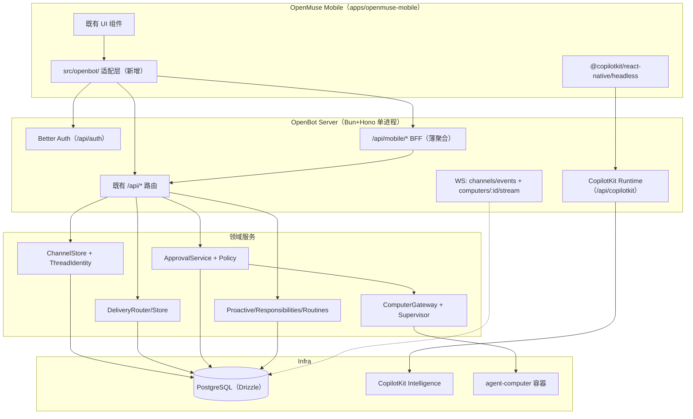
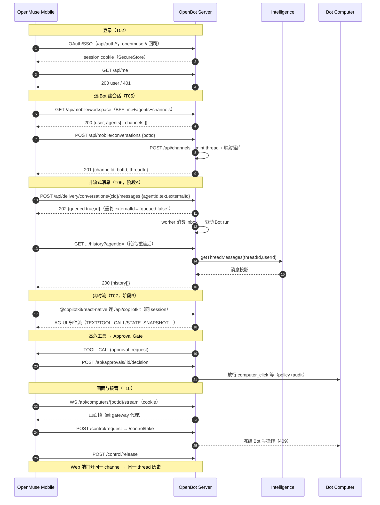

# OpenBot 后端架构设计（面向 OpenMuse Mobile）

> 历史方案：完整能力迁移、OpenBot 独占后端和 Git submodule 布局以 [2026-10-12 设计](2026-10-12-openmuse-frontend-openbot-backend-design.md) 为准。本文保留作迁移参考。

> 版本：v1.0
> 编写日期：2026-10-11
> 输入：`docs/superpowers/specs/OpenMuse-Mobile-OpenBot-Backend.md`（下称"集成方案"）
> 代码基线：OpenBot `main` @ `ab46dd1`（2026-10-11）；OpenMuse Mobile 迁移落位 `apps/openmuse-mobile` @ `8dda8a0`
> 状态：设计定稿，作为后端实现（任务 #4）与上线方案（任务 #5）的依据

---

## A. 功能范围拆解与假设清单

### A.1 集成方案 §1.1 七条能力 → 代码证据映射

| # | 能力 | OpenBot 现状 | 代码证据 |
| --- | --- | --- | --- |
| 1 | 登录/退出/会话恢复 | **已具备**。Better Auth（Google/Entra/Okta/Casdoor/SSO/SCIM），Expo 插件在 `EXPO_PROJECT_ID` 设置时启用 | `server/src/auth/index.ts:277`（`nativeApp ? [expo()]`）、`auth/guards.ts:55`（`createRequireUser`） |
| 2 | 查看并选择有权限的 Bot | **已具备**。`GET /api/agents` 按角色过滤（admin 全量 / user 仅自己参与的） | `agents/routes.ts`（`routes.get("/")`，store 内 `canAccessAgent`） |
| 3 | Channel / Thread 创建、切换、恢复 | **已具备**。`/api/channels` CRUD + `/api/threads/mint` + `intelligence_channel_mappings` 表 | `channels/routes.ts:1096`、`channels/thread-routes.ts:16`、`db/schema/core.ts:490` |
| 4 | 实时对话（流式/工具/富卡片/失败态） | **已具备**。CopilotKit Runtime 挂载在 `/api/copilotkit`（挂载在根、handler 自带 basePath）；Delivery API 为非流式通道 | `app.ts:1394`（`app.route("/", copilotHandler)` + 双前缀注释）、`delivery/routes.ts:250` |
| 5 | Computer 实时画面/接管 | **已具备**。`/api/computers/:botId/*` 全套 + WS 画面流经 index.ts 手工鉴权代理 | `computer/routes.ts`（35+ 端点）、`index.ts:3456-3519`（stream WS：session→computerAccessCheck→gateway.locate→upgrade） |
| 6 | 审批/插件/Skills/Routines/Memory | **已具备** | `approvals/routes.ts`（8 端点）、`plugins/routes.ts`、`routines/routes.ts`、`memory/routes.ts` |
| 7 | Ideas/Goals/PDF 等进阶 | **部分具备**。Ideas=proactive suggestions 已有；Goals 无等价模型（集成方案 §10.3 已明确）；PDF 未接 | `proactive/routes.ts`（settings/suggestions/start/dismiss） |

**结论：OpenBot 后端对 M1/M2 闭环的接口已基本齐备。后端工作的重心不是"补 API"，而是（a）验证既有接口在 Native 客户端场景下的鉴权与 CORS/cookie 语义，（b）为移动端聚合补充轻量 BFF，（c）补齐集成方案要求的测试与上线工程。**

### A.2 假设清单（文档缺失/含糊处）

| # | 假设 | 依据 | 影响面 | 假设失败的返工范围 |
| --- | --- | --- | --- | --- |
| H1 | 移动端第一阶段覆盖 iOS/Android（Expo dev build），Web 端由 `pnpm web` 顺带可用，但验收以真机为准 | 集成方案 §3.3、§12 | Expo 插件、scheme 回跳、SecureStore | 登录链（T02）重测 |
| H2 | 推送（Expo Push）为 M3 可选项；`EXPO_PROJECT_ID` 未配置时仅禁用推送与 native scheme 信任，不影响登录主链 | `auth/index.ts:276-279`（nativeApp 由 EXPO_PROJECT_ID 决定） | **注意：不设 EXPO_PROJECT_ID 时 expo 插件不注册，cookie 回跳会失败**——部署必须设置 | 鉴权配置 |
| H3 | `externalId` 幂等已由 `delivery_inbox` 唯一索引 `(source, realm, external_id)` + `onConflictDoNothing` 落实，客户端重试同 ID 返回 `{queued:false}` 不重复投递 | `delivery/store.ts:330-349`、`db/schema/delivery.ts:96-100` | 消息重试语义 | 无需返工，直接验证 |
| H4 | Group Channel 的 botId→threadId 映射已有 `group_bot_threads` 表（PK: owner+channel+agent，threadId 唯一），不需要新建 | `db/schema/group.ts:14-35` | 会话建模 | 无需返工 |
| H5 | Computer WS 鉴权走 HTTP 升级时的 Better Auth session cookie（`resolveRequestActor`）+ `computerAccessCheck`，**不支持 header token**；移动端必须让 WS 请求携带 cookie | `index.ts:3464-3472` | 移动端 WS 客户端实现 | 若 RN WebSocket 无法带 cookie，需在 BFF 加 ticket 换取机制（新增面） |
| H6 | 审批 Gate 现有端点：`GET /api/approvals`、`POST /:id/decision`、`POST /computer/:botId`、`POST /rules`、`POST /questions/:id/respond`；移动端直接复用，不另建 | `approvals/routes.ts` | 工具/审批 UI | 无 |
| H7 | `/api/delivery/conversations/:id/messages` 返回 202 + `{queued:true/false, id}`；最终结果通过 `GET .../history`（Intelligence `getThreadMessages`）或实时 Runtime 获取 | `delivery/routes.ts:250-266`、`index.ts:3354-3358` | 消息闭环状态机 | 无 |
| H8 | 集成方案建议的独立 `server/src/openmuse/` BFF 目录落地为 `server/src/mobile-bff/`（避免与上游 OpenMuse 品牌混淆，且该目录只做聚合不做业务） | 集成方案 §4 | 目录结构 | 仅改名 |
| H9 | 单用户模式（`OPENBOT_SINGLE_USER=true`）**禁止**用于本次交付的多用户验收 | 集成方案 §5.3 | 部署配置 | 无 |
| H10 | 数据权威在 OpenBot PostgreSQL（`DATABASE_URL`），移动端不落任何业务数据（SecureStore 仅存 session） | 集成方案 §2.1 | 架构不变式 | 无 |

### A.3 文档 vs 代码差异清单（以代码为准）

| # | 集成方案的说法 | 代码实际 | 处理 |
| --- | --- | --- | --- |
| D1 | §9.2 列出 `GET /api/computers/:botId/status` 等 11 个端点 | 实际 35+ 端点（另有 `/fleet`、`/policy`、`/computers/stop|reset|update`、`/human/*`、`/files/write|download`、`/page-frame/:toolCallId` 等） | 以代码为准，BFF 只聚合移动端需要的子集 |
| D2 | §7.1 暗示 `/api/copilotkit` 可直接作为 Provider URL | 该 handler 挂载在根路径且自带 `/api/copilotkit` basePath，**重复挂载会 404**（app.ts:1390 注释） | 客户端直接用 `runtimeUrl = {SERVER}/api/copilotkit`，无 BFF 中转 |
| D3 | §5.2 提及 `mobile/src/auth.ts` 参考实现 | 存在且与 server 端 expo 插件配套（scheme `openbotmobile://`，服务端 trustedOrigins 增补 `NATIVE_APP_ORIGIN` 仅在 EXPO_PROJECT_ID 设置时） | OpenMuse 适配层照此实现，scheme 改 `openmuse://` 时需同步服务端信任配置 |
| D4 | §3.2 说"packages/backends/src/openbot.ts 可复用" | 属于上游 OpenMuse 仓库，本次迁移范围（apps/mobile）未包含；且其契约基线落后 | 仅作参考阅读，不作为依赖 |
| D5 | §6.2 "从 OpenBot 授权响应取得 channelId、agentIds、threadId" | `POST /api/channels` 响应 `{channel:{...}}`（201）；threadId 需另调 `POST /api/threads/mint`（threadIdentity）或从 `intelligence_channel_mappings` 读 | BFF 聚合：`createConversation(botId)` 一次返回三标识 |

---

## B. 接口契约清单（从代码提取，覆盖移动端 M1/M2 所需）

鉴权约定：除标注外全部走 Better Auth session（cookie）；未登录 401 `{"error":"Authentication required."}`；无角色 403 `{"error":"Authorization required."}`。错误体统一 `{"error": string}`，无机器可读错误码——BFF 层补充 `code` 字段（见 C.4）。

### B.1 身份与会话

| 方法+路径 | 鉴权 | 请求 | 响应 | 状态码 | 代码位置 |
| --- | --- | --- | --- | --- | --- |
| `GET /api/me` | session | – | `{user:{id,email,name,image,role,onboarding}, singleUser}` | 200 | app.ts:764 |
| `GET /api/auth/*` | Better Auth 自管 | – | – | – | auth/index.ts（betterAuth handler） |
| `POST /api/me/onboarding` | session | `{completed:true}` 或 `{step}` | `{}` | 200/503 | app.ts:785 |

### B.2 Bot（Agents）

| 方法+路径 | 鉴权 | 请求 | 响应 | 状态码 | 代码位置 |
| --- | --- | --- | --- | --- | --- |
| `GET /api/agents` | session | – | `{agents:[{id,name,…}]}`（按角色过滤） | 200 | agents/routes.ts |
| `GET /api/agents/:id` | session | – | agent DTO | 200/404 | agents/routes.ts |
| `POST /api/agents` | session | agent 输入 | 201 | 201/400 | agents/routes.ts |
| （管理类：patch/duplicate/hide/pin/callback-token 等） | session | – | – | – | agents/routes.ts（M1/M2 不依赖） |

### B.3 Channel / Thread

| 方法+路径 | 鉴权 | 请求 | 响应 | 状态码 | 代码位置 |
| --- | --- | --- | --- | --- | --- |
| `GET /api/channels` | session | `?cursor=&limit=` | `{channels:[channelDto], nextCursor}` | 200 | channels/routes.ts |
| `POST /api/channels` | session | `{agentIds:[...]}`（zod parseChannelInput） | `{channel:channelDto}` | 201/400 | channels/routes.ts:1096 |
| `GET /api/channels/:id` | session | – | channelDto | 200/404 | channels/routes.ts |
| `DELETE /api/channels/:id` | session | – | 204（软删） | 204/404 | channels/routes.ts |
| `PUT /api/channels/:id/read` | session | – | – | 200 | channels/routes.ts |
| `PUT /api/channels/:id/pin` | session | – | – | 200 | channels/routes.ts |
| `GET /api/channels/events` | session+WS upgrade | – | channel activity 推送 | 101 | channels/routes.ts:1077（upgrade 时解析 actor，Postgres NOTIFY 分发） |
| `POST /api/threads/mint` | session | channel 上下文 | `{threadId}` | 200 | channels/thread-routes.ts:16 |
| `GET /api/threads/:threadId` | session | – | Intelligence 线程投影 | 200 | channels/thread-routes.ts（挂载 app.ts:1967） |

### B.4 消息投递（Delivery，非流式闭环）

| 方法+路径 | 鉴权 | 请求 | 响应 | 状态码 | 代码位置 |
| --- | --- | --- | --- | --- | --- |
| `GET /api/delivery/conversations` | session | `?cursor=` | `{channels:[…], nextCursor}` | 200 | delivery/routes.ts:220（listConversations→channelStore.list） |
| `GET /api/delivery/conversations/:id/history` | session | `?agentId=`（必填） | `{history:[…]}`（Intelligence getThreadMessages） | 200/400/404 | delivery/routes.ts:243 |
| `POST /api/delivery/conversations/:id/messages` | session | `{agentId, text(1..16000), externalId?uuid}`（缺省服务端生成） | `{queued:true, id}` 或 `{queued:false}`（幂等重试） | **202**/400/404 | delivery/routes.ts:250 |
| `GET /api/delivery` | session | – | bindings/devices/deliveries/available | 200 | delivery/routes.ts:95 |
| `POST /api/delivery/devices` | session | Expo push token 注册 | 201 | 201/400 | delivery/routes.ts:191 |

ownership 校验：`ownedScope` 要求 scope.ownerUserId===actor.id 且 channel/agent 匹配，否则 400 `Choose an accessible Bot...`（delivery/routes.ts:26-44）。

### B.5 CopilotKit Runtime（实时闭环）

| 路径 | 说明 |
| --- | --- |
| `{SERVER}/api/copilotkit` | `@copilotkit/react-native` 直接连接；session 同源 cookie；**不可**经 BFF 重写路径（双前缀 404 陷阱，app.ts:1390） |

### B.6 Computer（35+ 端点中的移动端子集）

| 方法+路径 | 鉴权 | 状态码 | 代码位置 |
| --- | --- | --- | --- |
| `GET /api/computers/:botId/status` | session+computerAccessCheck | 200/404/503 | computer/routes.ts |
| `GET /api/computers/:botId/screenshot` | 同上 | 200(image)/404 | computer/routes.ts |
| `POST /api/computers/:botId/navigate` | 同上+policy | 200/403(拒绝)/409(接管中) | computer/routes.ts |
| `POST /api/computers/:botId/snapshot` | 同上 | 200/404 | computer/routes.ts |
| `POST /api/computers/:botId/click` / `type` / `key` / `scroll` | 同上+policy+审批 Gate | 200/403/409 | computer/routes.ts |
| `POST /api/computers/:botId/files/list` / `files/read` / `files/write` | 同上 | 200/403 | computer/routes.ts |
| `POST /api/computers/:botId/exec` | 同上（高危，审批） | 200/403 | computer/routes.ts |
| `GET /api/computers/:botId/control` | 同上 | 控制权状态 | computer/routes.ts |
| `POST /api/computers/:botId/control/request` / `take` / `release` / `cancel` | 同上 | 200/409 | computer/routes.ts |
| `WS /api/computers/:botId/stream` | 升级时 session+computerAccessCheck，经 gateway.locate 代理到 computer 上游 | 101/401/404/503 | index.ts:3456-3519、computer/stream-path.ts |

### B.7 审批与平台能力（M1 只读，M2 交互）

| 方法+路径 | 鉴权 | 代码位置 |
| --- | --- | --- |
| `GET /api/approvals` | session | approvals/routes.ts |
| `POST /api/approvals/:id/decision` | session | approvals/routes.ts |
| `POST /api/approvals/computer/:botId` | session | approvals/routes.ts |
| `GET/POST /api/routines`（+run） | session | routines/routes.ts |
| `GET /api/plugins` | session+canUseBot | plugins/routes.ts |
| `GET /api/memory` | session | memory/routes.ts |
| `GET /api/proactive/suggestions`、`POST .../start`、`POST .../dismiss` | session | proactive/routes.ts |
| `GET /api/responsibilities` | session | responsibilities/routes.ts |

---

## C. 架构设计

### C.1 分层与模块划分

沿用 OpenBot 现有 `createXxxRoutes(deps)` 工厂 + 装配在 `index.ts` 的模式，**不引入新框架**。新增仅一个目录：

```text
server/src/
├── mobile-bff/                 # 【新增】移动端聚合层（只聚合、不持有业务规则）
│   ├── routes.ts               # createMobileBffRoutes(...)：/api/mobile/* 挂载
│   ├── workspace.ts            # 会话工作区聚合（bot+channel+thread 三标识一次取齐）
│   └── activity.ts             # Activity 聚合（routines/responsibilities/approvals 摘要）
└── （其余全部复用现有模块）
```

**为什么落在 `server/src/mobile-bff/` 而非集成方案建议的 `server/src/openmuse/`**：该层服务的是"移动端客户端形态"而非 OpenMuse 品牌；上游更名或第二客户端（桌面 Lite）接入时不必搬家。功能与集成方案 §4 的 `openmuse/{routes,workspace,activity}` 一一对应。

**BFF 端点（全部薄聚合，透传鉴权与错误）**：

| 端点 | 聚合来源 | 移动端收益 |
| --- | --- | --- |
| `GET /api/mobile/workspace` | `/api/me` + `/api/agents` + `/api/channels`（首页一次拉齐） | 冷启动 3 个串行请求 → 1 个 |
| `POST /api/mobile/conversations` | `POST /api/channels` + `POST /api/threads/mint` + `intelligence_channel_mappings` 读写 | 选 Bot 后一次拿到 `{channelId, botId, threadId}`（集成方案 §6.2 的 OpenBotSession） |
| `GET /api/mobile/activity` | routines + responsibilities + approvals 计数与最近项 | Activity 页 ViewModel（集成方案 §10.1 P1） |

非聚合需求（发消息、历史、Computer、审批交互）**直接用现有端点**，不包一层——每多一层包装，上游契约变更时就多一处要同步。

### C.2 服务调用关系



依赖方向（不变式）：BFF → 既有路由模块 → 领域服务 → DB/Intelligence。BFF **不得**绕过路由直接摸 store 以外的私有实现；Computer 一律经 `computerAccessCheck` + gateway（`index.ts:1415` 的"ungoverned computer must not exist"原则）。

### C.3 数据库与缓存

**选型：全量沿用 PostgreSQL + Drizzle（零新增表）。**

移动端所需数据模型已在现有 schema 内：

| 需求 | 表 | 证据 |
| --- | --- | --- |
| Channel 主体/软删/置顶/已读 | `channels` + `channel_memberships`（per-member pinnedAt/lastReadAt） | core.ts:284/370 |
| user×channel→thread 映射 | `intelligence_channel_mappings`（PK user+channel，threadId 唯一） | core.ts:490 |
| Group channel 的 bot→thread | `group_bot_threads`（PK owner+channel+agent） | group.ts:14 |
| 消息幂等 | `delivery_inbox` 唯一索引 `(source, realm, external_id)` | delivery.ts:81 |
| 审批 | approvals 表族 | approvals.ts schema |
| Bot 档案与权限 | `agents` + profile-policy | core.ts / agents/profile-store.ts |

**新增索引：无**（查询路径均有现成索引；`delivery_inbox_owner_idx`、`group_messages_channel_idx` 等已覆盖移动端排序）。

**缓存：不引入 Redis**。理由：(a) 现有部署无 Redis 依赖，channel 活动分发已用 Postgres NOTIFY（events.ts 注释：多实例下 NOTIFY 保证投递）；(b) 移动端首屏数据（me/agents/channels）总量小且强一致要求高，缓存得不偿失；(c) BFF 聚合响应走 `Cache-Control: no-store`，配合客户端 SWR 策略。横向扩容瓶颈与对策见 C.7。

**迁移策略：无 schema 变更，无需 drizzle 迁移文件。**（任务 #3 数据库评审的预期结论已在此给出依据，宋砚秋复核。）

### C.4 鉴权方案

```text
Native 登录链（复用 mobile/src/auth.ts 模式，scheme 换 openmuse://）：
  OpenMuse App
    → better-auth/react + @better-auth/expo/client（SecureStore 存 cookie）
    → OAuth/SSO（Google/Entra/Okta/Casdoor，经 /api/auth/*）
    → 回跳 openmuse://（服务端 trustedOrigins 必须包含该 scheme——部署配置项）
    → GET /api/me 验证 → 后续所有请求带 session cookie
```

关键事实（代码已验证）：
1. 服务端 expo 插件**仅在 `EXPO_PROJECT_ID` 非空时注册**（auth/index.ts:276），`trustedOrigins` 同时增补 `openbotmobile://` 常量。**为 OpenMuse 启用需将 scheme 纳入配置**——这是一个已识别的部署配置缺口（见 E.差异点 R3）。
2. 所有 `/api/*`（除 webhooks/billing callbacks）经 `createRequireUser`：Better Auth `getSession`（禁 cookie 缓存）→ 角色解析 → 401/403 语义固定。
3. WS 两条：`/api/channels/events` 在 Hono upgrade 中解析 actor（routes.ts:1080）；`computers/:id/stream` 在 index.ts 手工执行同一守卫（3464）。Native WS 客户端（H5）必须随请求带 cookie。
4. 密钥边界：Intelligence Key、Computer Token、Agent Token 均不出服务端（app.ts:1809 起的 agent-tools 双凭证设计同源精神）；移动端只持有自己的 session cookie。

### C.5 第三方依赖清单

**服务端零新增依赖**（复用 server/package.json 既有：hono/better-auth/drizzle/postgres/pino/otel/@copilotkit/runtime 等）。

**移动端新增（apps/openmuse-mobile，独立 pnpm 域，不进 bun workspace——迁移决策）**：`better-auth`、`@better-auth/expo`、`@better-auth/sso`、`@copilotkit/react-native@1.70.1`（上游已带）。版本对齐 server 端 better-auth 1.7.x。

### C.6 核心业务流程端到端时序（M1 消息闭环 → M2 实时与接管）



失败分支：401→重登录（不静默降级为管理员）；403→提示无权限；404→channel/bot 不存在或不可见；409→接管冲突；202 后超时→以 externalId 幂等重试；网络中断→WS 重连+history 全量对账（events.ts 的"refetch on reconnect"契约）。

### C.7 非功能性要求

**性能**
- 首屏（workspace BFF）P95 < 400ms（3 个内存级查询聚合）；消息 202 入队 P95 < 150ms。
- 实时链路不在 BFF 中转，避免多一跳；history 分页 `limit=100`（index.ts:3353 现值）。
- 移动端耗电/流量：Computer 画面降级策略——WS 帧率受限时切 `screenshot` 轮询（≥2s 间隔），进后台即断 WS（客户端责任，BFF 响应头 `Cache-Control: no-store` 防中间层缓存）。

**安全（对齐集成方案 §12 测试矩阵）**
- 越权：A 用户猜 B 的 channelId → `ownedScope` 400/404；猜 botId → `computerAccessCheck` 404；WS 升级同守卫。
- 幂等：同 externalId 重试 → `{queued:false}`，无重复副作用（唯一索引兜底）。
- 会话过期：所有端点 401；`OPENBOT_SINGLE_USER` 模式不得用于多用户交付（部署检查项）。
- 密钥：全部留服务端；移动端包内无任何 Intelligence/Computer/Agent token。
- 审计：审批决策、computer 写操作、computer 接管均落 audit store（现有机制，BFF 不绕过）。

**可扩展性**
- 多 Bot Group：`group_bot_threads` 已按 (owner,channel,agent) 建模，BFF `conversations` 聚合时对 group channel 返回 `threads: {botId→threadId}` 映射而非单一 threadId（集成方案 §6.1 红线的落实）。
- 横向扩容：server 无状态（session 在 PG、活动分发在 PG NOTIFY），可直接多副本；瓶颈是 Computer 网关的有状态代理——扩容时 stream 代理粘性由 ingress 层解决（上线方案任务 #5 展开）。

---

## D. 技术选型理由与差异点汇总

| # | 差异点 | 原因 | 影响 | 缓解 |
| --- | --- | --- | --- | --- |
| R1 | BFF 目录 `server/src/mobile-bff/` 而非方案建议的 `server/src/openmuse/` | 命名按客户端形态而非上游品牌；避免第二客户端时搬家 | 无功能影响 | 目录 README 注明对应关系 |
| R2 | 双仓库结构被收敛为单仓（OpenMuse Mobile 已 subtree 进 OpenBot） | 用户明确要求迁入当前项目；subtree 保留上游历史 | 跟进上游改用 subtree pull（MIGRATION.md 已写明流程）；方案 §4 的 workspace 布局不再适用 | apps/openmuse-mobile 独立 pnpm 域隔离依赖 |
| R3 | 服务端 `NATIVE_APP_ORIGIN` 常量为 `openbotmobile://`，OpenMuse scheme `openmuse://` 需要配置化 | 现有代码写死单一 scheme | 不改则 OpenMuse OAuth 回跳被 trustedOrigins 拒绝 | **任务 #4 落地项**：`EXPO_PROJECT_ID` + 新环境变量 `EXPO_APP_SCHEME` 注入 trustedOrigins（约 10 行改动） |
| R4 | 方案 §10.1 Goals 列 P2"独立扩展" | OpenBot 无 Goal/Milestone 模型，移动端 Goals 页第一阶段显示"未接入" | 页面空态 | 与方案一致，不建假持久化 |
| R5 | 零新增 DB 表/索引、零新增服务端依赖 | 数据模型与端点已齐备（B 节证据） | 实现工作量集中在 BFF 三个端点 + scheme 配置化 + 测试 | — |
| R6 | 实时链路直连 `/api/copilotkit`，不经 BFF | 双前缀 404 陷阱（app.ts:1390）；SDK 自带协议处理 | BFF 不持有 Runtime 契约 | 客户端 `runtimeUrl` 直接指向服务器根 |

**测试基线**：`bun test`（root）已覆盖 331 个 server 测试文件；本设计新增用例进 `server/tests/`（mobile-bff 聚合、scheme 信任、delivery 幂等重试、WS 越权）。

---

## E. 交付边界（给实现任务的输入）

1. **必做**：`mobile-bff/`（workspace/conversations/activity 三端点 + 测试）；`EXPO_APP_SCHEME` 配置化；`.env.example` 增补移动端部署段（EXPO_PROJECT_ID、scheme、TRUSTED_ORIGINS 说明）；`docs/` 上线方案。
2. **不做**：任何 DB schema 变更；Redis；重写既有路由；OpenMuse UI 改造（属前端任务，另行排期）。
3. **验证**：`bun run typecheck` + `bun test`（server 全量）+ BFF 新增用例；移动端闭环联调依赖部署环境（CloudBase/CloudStudio，见上线方案）。
