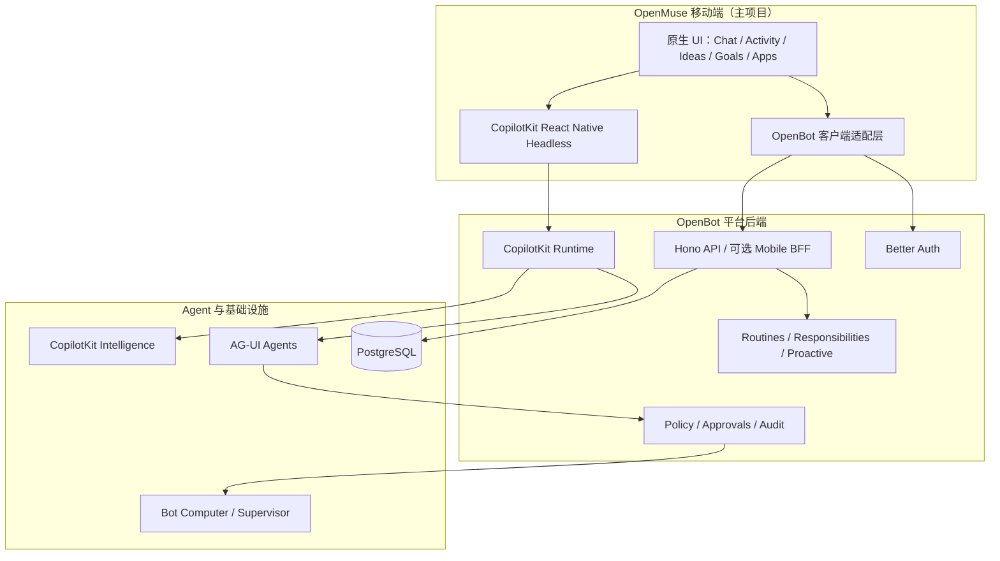

# OpenMuse Mobile × OpenBot Backend 集成改造方案

> 历史方案：完整能力迁移、OpenBot 独占后端和 Git submodule 布局以 [2026-10-12 设计](2026-10-12-openmuse-frontend-openbot-backend-design.md) 为准。本文保留作迁移参考。

> 版本：v1.0  
> 编写日期：2026-10-09  
> 方案定位：**以 OpenMuse 为移动端主项目，保持既有 React Native UI 与交互；以 OpenBot 为统一后端和 Agent 平台。**  
> 状态：设计方案，尚未实施联调。参考仓库以实际实施时固定的 Commit 为准。

## 1. 目标与原则

### 1.1 项目目标

采用 [CopilotKit/openmuse](https://github.com/CopilotKit/openmuse) 的移动端，连接 [CopilotKit/OpenBot](https://github.com/CopilotKit/OpenBot) 的后端服务，构建功能完整的个人/企业 AI Agent 移动工作台。

最终用户在 OpenMuse 移动端应能够：

1. 使用 OpenBot 用户体系登录、退出、恢复会话。
2. 查看并选择自己有权限使用的多个 Bot。
3. 创建、浏览、切换和恢复 OpenBot Channel 与 Intelligence Thread。
4. 与 Bot 实时对话，显示流式文字、工具执行、富内容卡片和失败状态。
5. 查看 Bot Computer 的实时画面、浏览器状态与工作文件；必要时人工接管。
6. 查看和处理审批、插件、Skills、Routines、Memory 等平台能力。
7. 逐步接入 OpenMuse 的 Ideas、Goals、PDF、个人任务等进阶体验，而不重复建设后端执行平台。

### 1.2 明确不采用的路线

- **不以 OpenBot/mobile 为移动端主项目。** 它可作为认证、API 和 Computer 通信逻辑的参考实现。
- **不将 OpenMuse 的全部服务端直接并入 OpenBot。** 优先替换客户端数据提供者，确需补齐的业务能力才新增后端模块。
- **不同时维护两套 Agent Runtime、Computer 沙箱、会话归属和权限体系。**
- **不采用仅替换 API URL 的方式。** 两个项目的身份、Channel/Thread、状态模型、工具协议并不完全一致。

### 1.3 架构原则

| 原则 | 实施约束 |
| --- | --- |
| OpenMuse 是客户端主项目 | 最大程度保留 `apps/mobile` 原有页面、导航、视觉和交互 |
| OpenBot 是服务端事实来源 | Bot、Channel、权限、审计、Computer、Routines、Plugins 由 OpenBot 管理 |
| UI 与服务端解耦 | 通过 `OpenBotApiClient`、`OpenBotWorkspaceAdapter`、`OpenBotRuntimeAdapter` 分层 |
| 不绕过执行网关 | 工具调用通过 OpenBot 授权、策略和审计路径 |
| 渐进式迁移 | 先完成登录-选 Bot-聊天-查看电脑的闭环，再扩展其他功能 |
| 保持可跟进上游 | 尽量在新增的 `src/openbot/` 中承载适配逻辑，减少对 OpenMuse 核心 UI 文件的侵入 |

## 2. 总体架构



### 2.1 技术选型

| 层级 | 选择 | 备注 |
| --- | --- | --- |
| Mobile 主项目 | OpenMuse `apps/mobile` | iOS / Android / React Native |
| UI / 交互 | OpenMuse 原有组件 | 保留 Chat、Activity、Ideas、Goals、Apps 等入口 |
| 移动框架 | 优先沿用 OpenMuse 当前 Expo 54 | 先联通，验证 Expo Auth 兼容后再升级；不要直接混装 Expo 55 依赖 |
| 身份 | OpenBot Better Auth + Expo 适配 | OpenBot `mobile/src/auth.ts` 可参考 |
| Agent 客户端 | `@copilotkit/react-native/headless` | 与 OpenBot Runtime 版本契约联调 |
| Agent 交互 | CopilotKit Runtime / AG-UI | `/api/copilotkit` 并非可直接按普通 SSE 使用的原始 Bot 地址 |
| API | OpenBot Hono | 需要时增加 Mobile BFF 仅作聚合 |
| 平台数据 | OpenBot PostgreSQL | 不依赖 OpenMuse PGlite 作为权威数据源 |
| 会话与记忆 | OpenBot + CopilotKit Intelligence | 使用 OpenBot 授权的 Channel/Thread 关系 |
| 浏览器和沙箱 | OpenBot Computer | 不再使用 OpenMuse 独立 Computer 作为同一 Bot 的执行环境 |
| 后台任务 | OpenBot Worker / Routines | Goals / Tasks 需判定语义再建模 |

## 3. 源码现状与边界

### 3.1 OpenMuse 当前依赖

从 OpenMuse 源码可见：

- `apps/mobile/App.tsx` 通过 `createSession()` 调用自身 `/api/session`，拿到 OpenMuse Bearer Token。
- 同文件 `CopilotKitProvider` 使用 `Authorization: Bearer ...`，Runtime URL 指向 OpenMuse `/api/copilotkit`。
- `src/chat.tsx` 使用 `useAgent`，目前 `runtimeAgentId: "default"`，与 OpenBot 多 Bot 不匹配。
- `src/threads.tsx` 通过 `/api/main-thread` 管理主会话，并使用 `useThreads({agentId:"default"})`。
- `src/workspace.tsx` / `App.tsx` 依赖 `/api/workspace` 的 OpenMuse 特有模型。
- `src/agent-workspace.tsx` 依赖 `/api/agent` 的任务、目标、通知等数据模型。
- `src/screens.tsx` 中 Mail、Calendar、Files、Browser 等页面调用 OpenMuse 自身 API。

**结论：优先保持 View 组件，替换它们依赖的数据源、Provider、事件及操作层。**

### 3.2 OpenBot 已有能力

OpenBot 后端已经提供：

- `/api/me`、Better Auth OAuth / SSO 等用户会话能力；
- `/api/agents`、`/api/channels` 的 Bot 与业务会话接口；
- `/api/copilotkit` 的 CopilotKit Runtime；
- `/api/delivery/conversations`、历史及消息投递接口；
- `/api/computers/:botId` 的沙箱操作、画面、接管；
- `/api/approvals`、`/api/routines`、`/api/plugins`、`/api/memory`；
- `/api/proactive/suggestions`、`/api/responsibilities` 等主动任务与长期职责能力。

**现成适配基础：** OpenMuse 的 `packages/backends/src/openbot.ts` 已有 `OpenBotAdapter`，覆盖探测、创建 Channel、电脑状态、快照、导航、人机控制等一部分接口。但它的文档明确说明尚未完成真实用户会话和运行时联调，其契约基线可能落后于当前 OpenBot。该文件适合复用 DTO/错误处理设计和测试，不应直接视作已完成集成。

### 3.3 需要关注的版本差异

- OpenMuse Mobile：源码检查时为 **Expo SDK 54 / React Native 0.81.5**。
- OpenBot Mobile：源码检查时为 **Expo SDK 55 / React Native 0.83.10**。
- 迁移 OpenBot 的 Better Auth Expo 登录逻辑时应验证其依赖能否在 OpenMuse 当前 Expo 版本工作；若不兼容，**单独建立 Expo 升级任务**，不要在业务适配过程中混杂全量升级。
- 对 `@copilotkit/react-native` 与 OpenBot Runtime 的版本、连接协议、工具能力和历史恢复做真实端到端测试。

## 4. 推荐的目录组织

建议保留两个独立仓库：

```text
workspace/
├── openmuse/                         # 移动端主项目
│   ├── apps/
│   │   └── mobile/
│   │       ├── App.tsx                # 替换认证与 Runtime 注入
│   │       └── src/
│   │           ├── chat.tsx          # UI 保留，运行/会话接入 OpenBot
│   │           ├── threads.tsx       # 重做 Channel/Thread 映射
│   │           ├── workspace.tsx     # 保留 Context 契约，替换数据源
│   │           ├── agent-workspace.tsx
│   │           ├── agent-ui.tsx      # 原有页面与卡片大体保留
│   │           ├── screens.tsx       # 按模块更换数据提供者
│   │           └── openbot/          # 【新增】所有 OpenBot 集成逻辑
│   │               ├── auth/
│   │               │   ├── auth-client.ts
│   │               │   └── auth-provider.tsx
│   │               ├── api/
│   │               │   ├── client.ts
│   │               │   └── errors.ts
│   │               ├── runtime/
│   │               │   ├── runtime-provider.tsx
│   │               │   └── events.ts
│   │               ├── agents/
│   │               │   ├── agent-client.ts
│   │               │   └── agent-types.ts
│   │               ├── channels/
│   │               │   ├── channel-client.ts
│   │               │   ├── channel-provider.tsx
│   │               │   └── thread-mapping.ts
│   │               ├── tools/
│   │               │   ├── computer-tools.tsx
│   │               │   ├── approval-tools.tsx
│   │               │   ├── skill-tools.tsx
│   │               │   └── tool-registry.tsx
│   │               ├── computer/
│   │               │   ├── computer-client.ts
│   │               │   └── computer-stream.ts
│   │               └── adapters/
│   │                   ├── workspace-adapter.ts
│   │                   ├── activity-adapter.ts
│   │                   └── proactive-adapter.ts
│   └── packages/
│       └── backends/src/openbot.ts   # 既有契约的参考与必要复用
│
└── openbot/                           # 独立平台后端
    ├── server/
    │   └── src/
    │       └── openmuse/             # 【可选新增】Mobile BFF
    │           ├── routes.ts
    │           ├── workspace.ts
    │           └── activity.ts
    ├── agent-computer/
    ├── supervisor/
    ├── worker/
    └── shared/
```

以上 `openbot/` 与 `openmuse/` 下标记为“新增”的路径为目标设计，不是上游现有目录。

## 5. 核心改造一：统一登录认证

### 5.1 改造点

**移除 OpenMuse Live 登录链：**

```ts
const session = await createSession(accessKey);
```

现有 OpenMuse `App.tsx` 中类似下面的 Provider 需要替换：

```tsx
<CopilotKitProvider
  runtimeUrl={`${API_URL}/api/copilotkit`}
  headers={{ Authorization: `Bearer ${token}` }}
>
  <WorkspaceApp token={token} />
</CopilotKitProvider>
```

### 5.2 新登录链

```text
OpenMuse App
  → OpenBotAuthProvider
  → OpenBot Better Auth OAuth / SSO
  → 安全存储用户 Session
  → 校验 /api/me
  → OpenBotApiClient
  → CopilotKit Runtime 会话接入
  → WorkspaceApp
```

建议从 OpenBot 的 `mobile/src/auth.ts` 提取：

- `better-auth/react` / `@better-auth/expo/client` 的实际用法；
- OAuth / SSO 登录与原生回跳逻辑；
- SecureStore Session 存储；
- 原生平台与服务端 URL 的安全校验。

### 5.3 验收约束

- 不能以 `OPENBOT_SINGLE_USER=true` 的共享管理员模式交付多人环境；
- Native HTTP、Runtime、WebSocket 必须使用**当前登录用户**的身份；
- Intelligence Key、Agent Token、Computer Token 均保留服务端；
- 退出后清理用户级缓存；不同用户不能读取彼此的数据；
- Cookie、OAuth 返回 Scheme 和 SDK 连接协议须真实验证。`credentials: include` 不是 Native 所有传输通道都自动认证成功的保证。

## 6. 核心改造二：Bot / Channel / Thread 统一

### 6.1 标识定义

OpenMuse 原来以单个 `default` Runtime Agent 和自有 Thread 为主，OpenBot 以 Bot、Channel、Intelligence Thread 管理聊天。

新增明确的数据模型：

```ts
export interface OpenBotSession {
  userId: string;
  channelId: string;
  botId: string;
  threadId: string;
  mode: "single" | "group";
}
```

注意：此接口可作为**单个 Bot 对应的会话视图**；Group Channel 需另外维护 `botId → threadId` 的映射，不能用一个 Thread ID 表示整个多 Bot 群组。

### 6.2 获取会话

1. 调用 OpenBot `GET /api/agents` 获取用户有权限的 Bot。
2. 选择 Bot 后调用 `POST /api/channels` 创建会话，或从已存在 Channel 恢复。
3. 从 OpenBot 授权响应取得 `channelId`、`agentIds`、`threadId`。
4. 将会话标识提供给 OpenMuse `ThreadsProvider` 和 `ChatScreen`。
5. 使用 OpenBot 的会话列表进行导航；如果启用 CopilotKit Threads，须限定用户、Bot 与 Channel 的一致性。

### 6.3 动态 useAgent 示例

```tsx
import { useAgent } from "@copilotkit/react-native/headless";

function OpenBotChat({ session }: { session: OpenBotSession }) {
  const { agent, isReady } = useAgent({
    agentId: `mobile-${session.botId}-${session.threadId}`,
    runtimeAgentId: session.botId,
    threadId: session.threadId,
  });

  // 将 agent/isReady 交给 OpenMuse 现有消息界面。
  return null;
}
```

这是结构示例，仍需与 OpenMuse `chat.tsx` 现有的运行锁、消息队列、历史回放和线程切换机制联合测试。

**严禁：**在客户端随机生成 Thread ID 后把它当作 OpenBot Channel；任意传入用户 ID；把 Group Channel ID 当作所有 Bot 的 Thread ID。

## 7. 核心改造三：CopilotKit Runtime 与 AG-UI

### 7.1 正确区分两种通信

| 路径 | 角色 | 推荐使用方式 |
| --- | --- | --- |
| `/api/copilotkit` | OpenBot CopilotKit Intelligence Runtime | 使用兼容 CopilotKit 客户端完成 Run / Connect / Stop / 实时事件 |
| `/api/delivery/conversations/:id/messages` | OpenBot Native Delivery 消息投递 | 可用作非流式第一阶段；返回 HTTP 202 仅表示已接受 |
| Bot 自身的原始 AG-UI Endpoint | Agent 服务端调用接口 | 由 OpenBot Runtime 进行路由和治理，不由 Mobile 直接调用 |

### 7.2 推荐渐进式联调

**阶段 A：稳定消息闭环**

- 通过 Delivery API 发送消息；
- 从授权 History API 读取结果；
- 验证 Bot、Channel、Thread 关系正确；
- 暂不要求逐 token 流式展示。

**阶段 B：实时 CopilotKit 闭环**

- 为 OpenMuse Provider 指向 OpenBot `/api/copilotkit`；
- 处理 Run / Connect / Stop 与 Intelligence 连接；
- 处理流式文字、工具调用、状态快照、错误和历史重连；
- 同一条消息只通过一种运行路径发起，防止重复执行。

### 7.3 要处理的事件类别

- `RUN_STARTED` / `RUN_FINISHED` / `RUN_ERROR`：运行生命周期；
- `TEXT_MESSAGE_START` / `TEXT_MESSAGE_CONTENT` / `TEXT_MESSAGE_END`：回答消息；
- `TOOL_CALL_START` / `TOOL_CALL_ARGS` / `TOOL_CALL_END` / `TOOL_CALL_RESULT`：工具调用；
- `STATE_SNAPSHOT` / `STATE_DELTA`：UI 共享状态；
- 取消、重连、网络错误、已有历史回放等 SDK 行为。

### 7.4 实际调用示例（Delivery 方案）

```ts
async function sendMessage(session: OpenBotSession, text: string) {
  const externalId = crypto.randomUUID();
  return openbotApi(
    `/api/delivery/conversations/${encodeURIComponent(session.channelId)}/messages`,
    {
      method: "POST",
      body: {
        agentId: session.botId,
        text,
        externalId,
      },
    },
  );
}

async function loadHistory(session: OpenBotSession) {
  return openbotApi(
    `/api/delivery/conversations/${encodeURIComponent(session.channelId)}/history` +
      `?agentId=${encodeURIComponent(session.botId)}`,
  );
}
```

`openbotApi` 表示项目中新封装的、携带 OpenBot 当前用户 Session 的请求函数；不是上游现成全局 API。`externalId` 应与重试操作保持一致，以便服务端判重；若请求结果不明，不应直接生成新 ID 并重复提交同一次业务操作。

## 8. 核心改造四：Frontend Tools 与审批

OpenMuse `WorkspaceTools` 当前主要用 `useRenderTool` 显示 Mail、Web Search、Browser 等工具的结果。OpenBot Web 的电脑工具则大量通过 `useFrontendTool` 注册**真实工具定义和处理器**。

**不能只搬运 UI 卡片：**如果只有渲染组件，没有匹配的前端工具执行机制，Bot 可能无法使用相应工具；如果把调用直接改为 Computer 私有端口，又会破坏 OpenBot 的安全边界。

推荐在 `src/openbot/tools/` 中分离三类能力：

1. **UI Renderer**：只展示 AG-UI Tool Call 的参数、进度、结果；
2. **Frontend Tool Handler**：仅在实际需要 Native 端处理时注册；调用必须经 OpenBot 授权 API；
3. **Server/Headless Tool**：适合脱离移动端运行的能力，交由 OpenBot 服务端的 Headless Tools 路径处理。

重要约束：

- 保留 OpenBot 现有 `Policy → Approval → Audit → Computer` 机制；
- 高风险写操作经既有审批 Gate，不在前端直接提交并绕过审批；
- 前端不能伪造 `botId`、`actor`、签名运行上下文以跨越授权边界；
- 对 `computer_click`、`computer_type`、`computer_run_command`、`computer_write_file` 等操作应覆盖拒绝、待审批、失败、恢复等完整状态。

参考代码：

- [OpenBot Web computer-tools.tsx](https://github.com/CopilotKit/OpenBot/blob/main/app/src/lib/copilot/computer-tools.tsx)
- [OpenBot Web approval-tools.tsx](https://github.com/CopilotKit/OpenBot/blob/main/app/src/lib/copilot/approval-tools.tsx)
- [OpenBot Server headless-tools.ts](https://github.com/CopilotKit/OpenBot/blob/main/server/src/computer/headless-tools.ts)

## 9. 核心改造五：Computer / Browser

### 9.1 基本原则

**保留 OpenMuse 浏览器/电脑画面 UI；实际执行全部对接 OpenBot Computer。**

```text
OpenMuse Browser / Computer UI
    → OpenBot Computer Client
    → OpenBot /api/computers/:botId/*
    → Policy / Audit / Approval Gateway
    → 对应 Bot 的 Computer
```

### 9.2 基础 API

| 能力 | OpenBot 接口 |
| --- | --- |
| 电脑状态 | `GET /api/computers/:botId/status` |
| 实时屏幕 | `WS /api/computers/:botId/stream` |
| 截图 | `GET /api/computers/:botId/screenshot` |
| 打开页面 | `POST /api/computers/:botId/navigate` |
| DOM 快照 | `POST /api/computers/:botId/snapshot` |
| 点击 / 输入 | `POST /api/computers/:botId/click`、`/type` |
| 文件目录和读取 | `POST /api/computers/:botId/files/list`、`/files/read` |
| 命令执行 | `POST /api/computers/:botId/exec` |
| 请求接管 | `POST /api/computers/:botId/control/request` |
| 人工接管和归还 | `POST /api/computers/:botId/control/take`、`/release` |

### 9.3 关键细节

- `Computer` 归属于 Bot，不等于每个 Chat Thread 都新建一台电脑；
- DOM 元素 `ref` 必须绑定原 `snapshotId`，过期后重新抓取；
- 人工接管应携带服务端所要求的 `requestId`，维护控制权状态；
- `WebSocket` 连接必须携带当前用户的已验证 Session；
- 用截图兜底实时画面，但注意轮询频率和移动端耗电、流量；
- 一旦用户接管，Bot 电脑写动作应由后端拒绝或进入符合平台规范的等待状态；
- 不直接从手机调用 agent-computer、supervisor 私有端口。

## 10. Workspace / Activity / Ideas / Goals / Apps 数据适配

### 10.1 页面映射

| OpenMuse 既有页面 | OpenBot 数据来源 | 实施建议 |
| --- | --- | --- |
| Chat | `GET /api/agents`、Channel、Runtime | P0：完整替换数据接入 |
| Threads | `/api/channels`、Intelligence Thread | P0：改写会话管理 |
| Activity | Routines、Responsibilities、Approvals、执行记录 | P1：聚合为 `ActivityViewModel` |
| Ideas | `/api/proactive/suggestions` | P1：DTO 和行为差异适配 |
| Goals | OpenBot 目前不具有完全等价的 Goal/Milestone 模型 | P2：独立扩展 |
| Apps / Connections | `/api/plugins`、连接器接口 | P1/P2：替换原有 Google 专用逻辑 |
| Memory | `/api/memory`、Intelligence | P1：使用 OpenBot 权威数据 |
| Files | OpenBot Computer Workspace | P1：路径 / 下载映射 |
| Mail / Calendar | OpenBot 已授权的 Plugin / Connector | P2：不假设 OpenMuse 原始 API 在 OpenBot 存在 |
| PDF | OpenMuse 的独立 PDF 工作流 | P2：单独设计迁移 |

### 10.2 Workspace Adapter 示例

```ts
export interface OpenBotWorkspaceClient {
  listBots(): Promise<Bot[]>;
  createConversation(botId: string): Promise<OpenBotSession>;
  getHistory(session: OpenBotSession): Promise<ChatMessage[]>;
  getApprovals(): Promise<ApprovalItem[]>;
  getRoutines(): Promise<Routine[]>;
  getComputerStatus(botId: string): Promise<ComputerStatus>;
  getSuggestions(): Promise<Suggestion[]>;
}
```

上面的 DTO 是项目自己的应用层类型，需根据实际 API JSON 响应定义并验证。不要以 TypeScript 类型断言取代运行时响应校验。

### 10.3 Goals、Tasks 与 Routines 的边界

- **Goal**：长期目标，包含多个里程碑，可能跨月；
- **Task**：具体任务实例，有状态、执行计划、结果、审批；
- **Routine**：按时间或规则定期触发任务的配置。

它们不是同一个业务模型。第一阶段不应把 OpenMuse Goal/Milestone 直接转为 OpenBot Routine；可先保留 Goals 页面入口但明确显示当前未接入的数据能力，避免产生“保存成功”却无服务端持久化的假象。

## 11. 分阶段实施计划

### M1：登录、选 Bot、会话和消息闭环

| Ticket | 任务 | 依赖 | 验收标准 |
| --- | --- | --- | --- |
| T01 | 固定两个仓库 Commit、核对 SDK/API 契约 | 无 | 版本记录、接口清单、冒烟环境可重复 |
| T02 | OpenMuse 接入 Better Auth Expo | T01 | 登录、退出、重启恢复、过期处理正确 |
| T03 | 新增 OpenBotApiClient / 错误处理 | T01、T02 | 授权 GET/POST、401/403/网络超时处理正常 |
| T04 | 改造 `App.tsx` 注入 OpenBot Runtime | T02 | Native Runtime 可正常探测及建立连接 |
| T05 | 迁移 Bot 列表和 Channel/Thread 映射 | T03 | 能选 Bot、创建、切换、恢复会话 |
| T06 | 接入 Delivery API / 历史读取 | T05 | 正确发送消息；202 与最终结果区分 |

**M1 验收：**OpenMuse 真机客户端使用 OpenBot 账号登录，选择已授权 Bot，发送消息并看到最终结果；数据在 Web 与移动端对应同一个 Channel。

### M2：实时体验、工具与 Computer

| Ticket | 任务 | 依赖 | 验收标准 |
| --- | --- | --- | --- |
| T07 | CopilotKit React Native 实时运行 | T04、T05 | 流式文本、Stop、Reconnect、重放无重复 |
| T08 | 替换 OpenMuse 工具卡片绑定 | T07 | 工具事件、进度和结果正确 |
| T09 | 对接 OpenBot Frontend Tools / Approval Gate | T07 | 工具正常执行，拒绝/审批/错误可展示 |
| T10 | 对接 Computer Screen / Handover | T03、T09 | 可看屏幕、请求接管、归还控制权 |

**M2 验收：**用户发送“打开指定网站并提取信息”，能够实时看见 Bot 工作、工具调用和网页画面，必要时由手机接管浏览器，且所有动作遵循 OpenBot 策略与审计。

### M3：完整工作台功能

| Ticket | 任务 | 依赖 | 验收标准 |
| --- | --- | --- | --- |
| T11 | Activity、Routines、Responsibilities 聚合 | M1 | 状态与 OpenBot 服务端一致 |
| T12 | Ideas 对接 Proactive Suggestions | M1 | 可查看、开始、忽略建议 |
| T13 | Apps / Plugins / Memory 对接 | M1 | 资源列表和权限一致 |
| T14 | Goals / Milestones 业务模型扩展 | T11 | 真实持久化、与 Task/Routine 关系清晰 |
| T15 | PDF、Mail、Calendar 按需迁移 | T13 | 附件、安全审核和回执流程可用 |
| T16 | 全端 E2E / 性能 / 升级兼容 | M2、M3 | iOS、Android、Web 回归通过 |

### 并行建议

- T02 与基础 UI 整理可并行，但 T03 的认证注入必须依赖 T02；
- T05 在 T03 完成后推进，T06 依赖会话模型稳定；
- T08、T09、Computer UI 样式可分别开发，最终在 T07 真实运行时联调；
- M3 的 Goals/PDF 设计可以提前进行，但不阻碍 M1/M2 主路径交付。

## 12. 重点测试矩阵

| 场景 | 预期结果 |
| --- | --- |
| A 用户读 B 用户 Channel / Computer | 服务端 403/404，不泄漏资源 |
| 未登录访问 Runtime | 不允许运行 Agent |
| Native Session 过期 | 正确提示重新登录，不静默以管理员身份运行 |
| OAuth 登录回跳 | iOS / Android 都能成功返回 OpenMuse |
| 网络中断后恢复 | 能恢复受权历史，避免重复新建消息或执行任务 |
| 相同 `externalId` 重试 | 服务端判重逻辑正确；不产生重复业务副作用 |
| 并发运行同一 Thread | 按 OpenBot Runtime 线程锁 / 并发策略处理 |
| 移动端和 Web 同时查看 | 消息、权限和状态一致 |
| AG-UI 工具调用失败 | 明确展示拒绝、取消或错误，不伪装成功 |
| Computer 人工接管中 | Bot 不得绕过服务端控制权直接操作 |
| 多 Bot Group Channel | 各 Bot 对应正确 Thread，群消息归属不混淆 |
| Server 重启 / Worker 恢复 | 任务与记录保留，无重复外部写操作 |
| Expo 版本升级 | Native PDF、WebView、Session、WebSocket 回归通过 |

## 13. 主要风险和规避方式

1. **身份通道不一致：**OpenMuse Bearer 与 OpenBot Cookie 不能直接互换。复用 Better Auth Expo，同时验证 CopilotKit Native 网络层。
2. **CopilotKit Runtime 被当作原始 SSE：**应使用兼容客户端完成 Intelligence Runtime 协议处理，不直接按普通 `fetch('/api/copilotkit')` 的 SSE 解析。
3. **工具仅有展示、缺少执行定义：**复用 OpenBot Web Frontend Tool/Headless Tool 契约，并通过服务器审批网关。
4. **Channel、Thread、Bot 混用：**统一建模，Group Channel 维护单独映射。
5. **OpenMuse `/api/workspace`、`/api/agent` 不存在于 OpenBot：**创建 Adapter 或必要的服务端 BFF，不在 UI 中直接拼凑模拟状态。
6. **版本升级破坏 Native 依赖：**Expo 54 先跑通，确有需要时单独升级并针对 PDF/Auth 等关键依赖验证。
7. **接管接口契约变动：**OpenMuse 既有 `OpenBotAdapter` 钉住的旧 OpenBot Commit 并不保证今日 API 兼容；按实际固定版本重新运行契约测试。
8. **许可证和部署前提：**OpenMuse、OpenBot 仓库为 MIT，CopilotKit Intelligence 的服务和自托管许可证应独立确认；不要认为仓库 MIT 即等于所有云服务功能免费可商用。

## 14. 最小可交付验收路线

```text
启动 OpenBot 后端
    ↓
启动 OpenMuse Mobile
    ↓
Better Auth 登录 OpenBot 用户
    ↓
读取并展示有权限的 Bot
    ↓
选择 Bot 创建 Channel
    ↓
绑定对应 Intelligence Thread
    ↓
发送用户消息并获取回复
    ↓
接入实时 Run / Stop / Reconnect
    ↓
展示 Tool Call 与审批状态
    ↓
打开 OpenBot Computer 画面
    ↓
人工接管并归还
    ↓
返回 OpenBot Web 恢复同一会话
```

**第一阶段的优先级：认证 → Bot/Channel/Thread → 消息 → CopilotKit 实时事件 → Frontend Tools → Computer。**

## 15. 最终结论

**OpenMuse 是主移动 App，OpenBot 是统一后端。**

尽量保留 OpenMuse 当前的原生页面和用户体验，在 `apps/mobile/src/openbot/` 增加独立适配层，逐步替换 OpenMuse 自有服务依赖。以 OpenBot 负责登录、Agent、Channel、Intelligence、权限、插件、沙箱和任务执行。先实现完整聊天闭环，再整合 Ideas、Goals、PDF 等高级能力。

这样既避免从 OpenBot 目前较简单的移动端重新开发 UI，也避免形成两个互相冲突的 Agent 后端。

## 16. 参考源码与文档

- [OpenMuse 仓库](https://github.com/CopilotKit/openmuse)
- [OpenBot 仓库](https://github.com/CopilotKit/OpenBot)
- [OpenMuse Mobile](https://github.com/CopilotKit/openmuse/tree/main/apps/mobile)
- [OpenMuse App.tsx](https://github.com/CopilotKit/openmuse/blob/main/apps/mobile/App.tsx)
- [OpenMuse chat.tsx](https://github.com/CopilotKit/openmuse/blob/main/apps/mobile/src/chat.tsx)
- [OpenMuse threads.tsx](https://github.com/CopilotKit/openmuse/blob/main/apps/mobile/src/threads.tsx)
- [OpenMuse OpenBot 集成说明](https://github.com/CopilotKit/openmuse/blob/main/docs/OPENBOT-INTEGRATION.md)
- [OpenMuse OpenBotAdapter](https://github.com/CopilotKit/openmuse/blob/main/packages/backends/src/openbot.ts)
- [OpenBot Better Auth Expo 示例](https://github.com/CopilotKit/OpenBot/blob/main/mobile/src/auth.ts)
- [OpenBot Mobile API 示例](https://github.com/CopilotKit/OpenBot/blob/main/mobile/src/api.ts)
- [OpenBot Computer Routes](https://github.com/CopilotKit/OpenBot/blob/main/server/src/computer/routes.ts)
- [OpenBot Frontend Computer Tools](https://github.com/CopilotKit/OpenBot/blob/main/app/src/lib/copilot/computer-tools.tsx)
- [OpenBot Frontend Approval Tools](https://github.com/CopilotKit/OpenBot/blob/main/app/src/lib/copilot/approval-tools.tsx)
- [OpenBot 服务端架构文档](https://github.com/CopilotKit/OpenBot/blob/main/docs/architecture.md)
